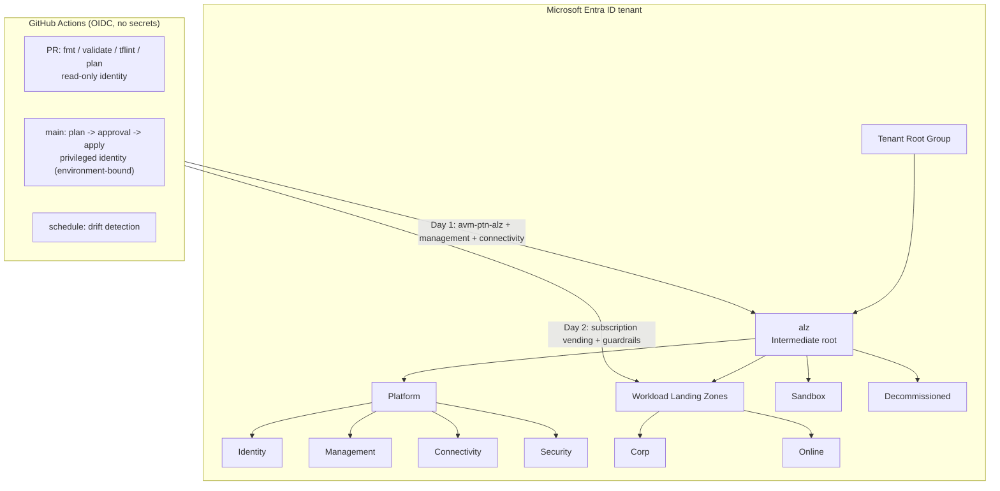

# Azure Landing Zones 2026 Masterclass

> **Note**: This architectural reference framework and repository content were fully generated using **Claude Opus 5.5**.

> **Disclaimer**: This repository serves purely as an advanced theoretical and architectural reference framework incorporating the latest 2026 Microsoft Azure Landing Zone best practices. The code, Terraform manifests, and pipeline configurations provided herein **have not been physically deployed, executed, or tested in a live production environment**. Users should thoroughly validate, plan, and test all code in a sandbox environment prior to enterprise implementation.

<table>
  <tr><th align="left">Project</th><td><a href="https://www.anthropic.com/claude"></a>
    <a href="#static-checks-performed-at-generation-time"></a>
    <a href="#static-checks-performed-at-generation-time"></a>
    <a href="https://github.com/nubenetes/azure-landing-zones-2026-masterclass/blob/main/LICENSE"></a>
    <a href="https://github.com/nubenetes/azure-landing-zones-2026-masterclass/commits/main"></a>
    <a href="https://github.com/nubenetes/azure-landing-zones-2026-masterclass/stargazers"></a></td></tr>
  <tr><th align="left">IaC stack</th><td><a href="https://developer.hashicorp.com/terraform"></a>
    <a href="https://opentofu.org"></a>
    <a href="https://registry.terraform.io/providers/hashicorp/azurerm/latest"></a>
    <a href="https://registry.terraform.io/providers/Azure/azapi/latest"></a>
    <a href="https://registry.terraform.io/providers/Azure/alz/latest"></a>
    <a href="https://registry.terraform.io/providers/hashicorp/azuread/latest"></a>
    <a href="https://github.com/Azure/Azure-Landing-Zones-Library/tree/platform/alz/2026.10.0"></a>
    <a href="https://aka.ms/avm"></a></td></tr>
  <tr><th align="left">Architecture</th><td><a href="docs/01-architecture-conceptual.md"></a>
    <a href="docs/03-networking-hubspoke-vs-vwan.md"></a>
    <a href="docs/04-security-private-vs-service.md"></a>
    <a href="docs/06-waf-simplicity-vs-security.md"></a>
    <a href="code/day-2-workload-vending-operations/README.md"></a>
    <a href="docs/06-waf-simplicity-vs-security.md"></a></td></tr>
  <tr><th align="left">Pipeline security</th><td><a href="docs/05-cicd-oidc-security.md"></a>
    <a href="docs/05-cicd-oidc-security.md"></a>
    <a href="docs/05-cicd-oidc-security.md#31-the-abac-condition-on-the-apply-identity"></a>
    <a href=".github/workflows"></a>
    <a href=".github/dependabot.yml"></a></td></tr>
</table>

A complete, opinionated reference for deploying an **Azure Landing Zone** the way Microsoft's Cloud Adoption Framework (CAF) recommends it in late 2026: composed from **Azure Verified Modules (AVM)**, governed by the **ALZ Library** through the `alz` provider, delivered by **zero-secret GitHub Actions pipelines** (Workload Identity Federation / OIDC), and operated with **subscription vending** and a phased **Policy-as-Code** lifecycle.

---

## Table of contents

- [Executive summary - the 2026 state of Azure Landing Zones](#executive-summary---the-2026-state-of-azure-landing-zones)
- [Reference architecture at a glance](#reference-architecture-at-a-glance)
- [Repository map](#repository-map)
- [Documentation index](#documentation-index)
- [🎥 Video Guides, Technical Shorts & Multimedia Sessions (YouTube)](#-video-guides-technical-shorts--multimedia-sessions-youtube)
- [Quickstart: Day 0, Day 1, Day 2](#quickstart-day-0-day-1-day-2)
- [Key design decisions](#key-design-decisions)
- [Version matrix](#version-matrix)
- [Static checks performed at generation time](#static-checks-performed-at-generation-time)
- [What this repository is not](#what-this-repository-is-not)
- [References](#references)

---

## Executive summary - the 2026 state of Azure Landing Zones

| Shift | What changed | What it means for you |
|---|---|---|
| **Monolith retired** | The legacy `terraform-azurerm-caf-enterprise-scale` module reached the end of extended support and was **archived on 1 August 2026**. | New deployments compose the AVM pattern modules (`avm-ptn-alz`, `avm-ptn-alz-management`, `avm-ptn-alz-connectivity-*`). Existing estates migrate by state import, not rebuild. |
| **Bicep classic retired** | The ALZ-Bicep *classic* starter was **removed from the accelerator on 16 February 2026**; the `Azure/ALZ-Bicep` repository is **archived on 16 February 2027** (fixes only until then). | Bicep users move to the AVM Bicep accelerator. Both IaC languages now share the same ALZ Library. |
| **Blueprints retiring** | Azure Blueprints retires on **31 January 2027** with phased restrictions: no new definitions since 31 July 2026, **no new assignments or definition edits from 31 October 2026**, no assignment edits from 31 December 2026. | Replace with **Deployment Stacks** (lifecycle + deny settings), **template specs** and **Policy-as-Code**. Export anything you still need *now*. |
| **AVM is the standard** | AVM modules are owned by Microsoft engineering, follow strict interface specifications (Private Endpoints, diagnostics, RBAC, managed identities, locks, telemetry) and are Well-Architected aligned. | Prefer AVM resource/pattern modules over hand-rolled resources; pin exact versions. |
| **Library decoupled from code** | Policy, archetype and architecture definitions live in the versioned **ALZ Library** (`platform/alz` tag `2026.10.0` at the time of writing) and are processed by the `Azure/alz` provider. | Policy updates are a reviewed library-ref bump; module upgrades are independent. |
| **AzAPI first** | AVM pattern modules are implemented primarily with `azapi` (ARM REST, day-zero API versions, plan-time schema validation, retries). AzureRM **v5 exists but is not supported** by the ALZ modules - stay on `~> 4.x`. | Always configure `azapi` alongside `azurerm`; do not float AzureRM to v5. |
| **New Security MG** | The ALZ reference hierarchy now contains a **Security** management group under Platform. | This repository includes it (optional subscription placement). |
| **Private subnets by default** | New VNets created with API versions released after 31 March 2026 default to **private subnets** (`defaultOutboundAccess = false`). | Explicit egress (Azure Firewall / NAT Gateway) is mandatory - which ALZ already assumes. |
| **Terminology** | CAF frames a landing zone as one **platform landing zone** plus many **application (workload) landing zones**. | This repository uses **Workload Landing Zones** to cover apps, AI/ML, data platforms and containers alike (see [docs/01](docs/01-architecture-conceptual.md#terminology)). |

> [!IMPORTANT]
> Today is within the Blueprints phase-out window. If any subscription still relies on Blueprint assignments or Blueprint locks, plan the migration to Deployment Stacks before the **31 October 2026** and **31 December 2026** restrictions.

---

## Reference architecture at a glance



Detailed diagrams: [`architecture/diagrams/`](architecture/diagrams/README.md).

---

## Repository map

```text
azure-landing-zones-2026-masterclass/
├── README.md                                   # This portal
├── docs/                                       # Architecture guides & decision matrices
├── architecture/
│   ├── diagrams/                               # Mermaid + ASCII diagrams
│   └── decision-matrices/                      # ADR-style weighted decision records
├── code/
│   ├── backend.hcl.example                     # Shared partial backend config (local runs)
│   ├── day-0-bootstrap-oidc/                   # State storage (CMK), Entra apps, OIDC, RBAC
│   ├── day-1-platform-landing-zone/            # AVM ALZ: MGs, policy, management, hub/vWAN
│   │   └── lib/                                # Custom ALZ library (architecture, archetypes, assignments)
│   └── day-2-workload-vending-operations/      # Subscription vending, DINE/Deny guardrails, DNS links
│       └── policies/                           # Custom policy definitions (JSON)
├── .github/
│   ├── workflows/                              # plan / apply / drift + reusable stack workflow
│   ├── CODEOWNERS                              # Separation of duties
│   └── dependabot.yml                          # SHA-pinned actions & Terraform updates
└── .tflint.hcl                                 # Lint rules (terraform + azurerm rulesets)
```

---

## Documentation index

| # | Guide | Answers |
|---|---|---|
| 01 | [Conceptual architecture & MG hierarchy](docs/01-architecture-conceptual.md) | What is a landing zone in 2026? Which MGs, why, and who owns what? |
| 02 | [IaC provider matrix](docs/02-iac-provider-matrix.md) | When do I use AVM, `azurerm`, `azapi`, `azuread`, `alz`? |
| 03 | [Hub-and-spoke vs Virtual WAN + IPAM](docs/03-networking-hubspoke-vs-vwan.md) | Which topology, where is the tipping point, how do I plan IP space? |
| 04 | [Private Endpoints vs Service Endpoints](docs/04-security-private-vs-service.md) | Why Private Endpoints are the default and when Service Endpoints are acceptable. |
| 05 | [CI/CD, OIDC & pipeline security](docs/05-cicd-oidc-security.md) | GitHub Actions vs Azure DevOps, Workload Identity Federation, least privilege. |
| 06 | [WAF: simplicity vs security & policy rollout](docs/06-waf-simplicity-vs-security.md) | Audit -> Remediate -> Enforce, trade-offs per WAF pillar. |

| Decision record | Topic |
|---|---|
| [ADR-001](architecture/decision-matrices/ADR-001-iac-tooling.md) | IaC tooling & providers |
| [ADR-002](architecture/decision-matrices/ADR-002-network-topology.md) | Network topology |
| [ADR-003](architecture/decision-matrices/ADR-003-paas-network-access.md) | PaaS network access |
| [ADR-004](architecture/decision-matrices/ADR-004-cicd-platform.md) | CI/CD platform & identity |
| [ADR-005](architecture/decision-matrices/ADR-005-policy-rollout.md) | Policy rollout strategy |

---

## 🎥 Video Guides, Technical Shorts & Multimedia Sessions (YouTube)

The architectural patterns, provider matrices, network topologies, and zero-secret pipeline configurations of this masterclass are accompanied by a dedicated series of technical video guides and rapid architecture shorts synthesized with **Gemini NotebookLM**.

All sessions are hosted on the official YouTube channel [**@nubenetes**](https://youtube.com/@nubenetes).

> [!NOTE]
> **Multilingual Technical Content 🌐**:
> The architectural masterclasses and shorts feature native **English** technical narration with auto-generated subtitles (CC) in over **20 languages** to assist cloud platform teams, enterprise architects, and site reliability engineers worldwide.

### 📊 Technical Multimedia Catalog (10 Sessions)

#### 📽️ Deep-Dive Architectural Video Guides (6 Episodes)

| Format | Title / Episode | Focus / Core Engineering Domain | Language | Duration | Direct YouTube Link |
| :---: | :--- | :--- | :---: | :---: | :--- |
| 📽️ **Video Guide** | [**The Cloud Metropolis: Azure Landing Zones Architecture Blueprint**](https://www.youtube.com/watch?v=u9rLpmpUf2Y) | **Conceptual Architecture & City Metaphor**: City planning analogy for enterprise cloud scale, multi-subscription isolation, zoning laws, and platform vs. workload separation | 🇬🇧 English *(CC 20+)* | `8:30` | [▶️ Watch Video](https://www.youtube.com/watch?v=u9rLpmpUf2Y) |
| 📽️ **Video Guide** | [**Azure Landing Zones 2026: Next-Gen Enterprise Architecture Masterclass**](https://www.youtube.com/watch?v=LE568gOjCkY) | **Microsoft CAF 2026 Blueprint**: Next-gen Cloud Adoption Framework, enterprise-scale landing zone hierarchy, subscription democratization, and governance baseline | 🇬🇧 English *(CC 20+)* | `8:03` | [▶️ Watch Video](https://www.youtube.com/watch?v=LE568gOjCkY) |
| 📽️ **Video Guide** | [**Azure Management Groups & Governance: Core Engine Architecture**](https://www.youtube.com/watch?v=xh84QXkuYm8) | **Core Engine & Hierarchy**: Management group archetypes (Platform: Identity, Management, Connectivity, Security vs Workloads: Corp, Online), Policy-as-Code, and WAF guardrails | 🇬🇧 English *(CC 20+)* | `8:41` | [▶️ Watch Video](https://www.youtube.com/watch?v=xh84QXkuYm8) |
| 📽️ **Video Guide** | [**Retiring the CAF Monolith: Azure Verified Modules (AVM) & ALZ Library**](https://www.youtube.com/watch?v=BNEGxzQgDB8) | **Modern IaC Stack**: Archiving legacy monolithic CAF modules, composable Azure Verified Modules (AVM), decoupled ALZ Library, and AzAPI-first provider architecture | 🇬🇧 English *(CC 20+)* | `7:59` | [▶️ Watch Video](https://www.youtube.com/watch?v=BNEGxzQgDB8) |
| 📽️ **Video Guide** | [**Azure Hub-and-Spoke vs Virtual WAN: 2026 Enterprise Network Architecture**](https://www.youtube.com/watch?v=mUmga-Nz6cc) | **Network Topology & Sizing**: Traditional Hub-and-Spoke vs. Virtual WAN (vWAN), routing intents, virtual network peering, NVA inspection, and hierarchical IPAM addressing | 🇬🇧 English *(CC 20+)* | `8:11` | [▶️ Watch Video](https://www.youtube.com/watch?v=mUmga-Nz6cc) |
| 📽️ **Video Guide** | [**Azure Private Endpoints vs Service Endpoints: PaaS Network Security Blueprint**](https://www.youtube.com/watch?v=ppqHvYNkII4) | **PaaS Network Security**: Private Endpoints default standard vs Service Endpoints exception, centralized Private DNS Zones, egress filtering, and data exfiltration mitigation | 🇬🇧 English *(CC 20+)* | `8:30` | [▶️ Watch Video](https://www.youtube.com/watch?v=ppqHvYNkII4) |

#### ⚡ Technical Shorts & Architecture Takeaways (4 Episodes)

| Format | Title / Episode | Focus / Core Engineering Domain | Language | Duration | Direct YouTube Link |
| :---: | :--- | :--- | :---: | :---: | :--- |
| ⚡ **Short** | [**Why Azure is Killing the Landing Zone Monolith**](https://www.youtube.com/shorts/7S6HDnZXQhI) | **AVM Shift**: Why Microsoft archived CAF monoliths on August 1, 2026 in favor of modular Azure Verified Modules (AVM) | 🇬🇧 English *(CC 20+)* | `1:09` | [▶️ Watch Short](https://www.youtube.com/shorts/7S6HDnZXQhI) |
| ⚡ **Short** | [**How Workload Identity Federation Replaces Stored Secrets**](https://www.youtube.com/shorts/0mdEib04nTw) | **CI/CD Security**: Eliminating static client secrets in GitHub Actions pipelines using OpenID Connect (OIDC) and Entra ID | 🇬🇧 English *(CC 20+)* | `1:16` | [▶️ Watch Short](https://www.youtube.com/shorts/0mdEib04nTw) |
| ⚡ **Short** | [**Why Azure Landing Zones Split Corp and Online**](https://www.youtube.com/shorts/Uab5Y1nnt08) | **Hierarchy Design**: Why management groups split Corp vs Online rather than dev/stage/prod environments | 🇬🇧 English *(CC 20+)* | `1:24` | [▶️ Watch Short](https://www.youtube.com/shorts/Uab5Y1nnt08) |
| ⚡ **Short** | [**Choosing Between Azure Private and Service Endpoints**](https://www.youtube.com/shorts/E1rnKNKWWUg) | **PaaS Decision Rules**: Key decision criteria between Private Endpoints and Service Endpoints for enterprise data boundary defense | 🇬🇧 English *(CC 20+)* | `1:20` | [▶️ Watch Short](https://www.youtube.com/shorts/E1rnKNKWWUg) |

<details>
<summary>📂 <strong>Detailed Agendas, Transcripts & Engineering Takeaways</strong></summary>

<br/>

### Section A: Deep-Dive Architectural Video Guides (6 Sessions)

#### 1. The Cloud Metropolis: Azure Landing Zones Architecture Blueprint (8:30)
- 🔗 **Direct URL**: [https://www.youtube.com/watch?v=u9rLpmpUf2Y](https://www.youtube.com/watch?v=u9rLpmpUf2Y)
- ⏱️ **Duration**: 8:30 | 🌐 **Language**: 🇬🇧 English *(CC 20+)*
- 🏷️ **Domain**: Conceptual Architecture, City Metaphor, Multi-Subscription Governance, Zoning Laws
- 📝 **Technical Overview**:
> Conceptual architecture masterclass establishing the city planning metaphor for enterprise Azure environments. Compares cloud infrastructure to an organized metropolis with zoning laws, shared utilities (water, electricity, transit), and residential/commercial districts. Explains why single-subscription designs fail under enterprise scale and how Microsoft CAF management group hierarchies provide clean boundaries between platform utilities and application workloads.

#### 2. Azure Landing Zones 2026: Next-Gen Enterprise Architecture Masterclass (8:03)
- 🔗 **Direct URL**: [https://www.youtube.com/watch?v=LE568gOjCkY](https://www.youtube.com/watch?v=LE568gOjCkY)
- ⏱️ **Duration**: 8:03 | 🌐 **Language**: 🇬🇧 English *(CC 20+)*
- 🏷️ **Domain**: Microsoft CAF 2026 Framework, Enterprise Scale, Subscription Democratization
- 📝 **Technical Overview**:
> Exhaustive overview of Microsoft's late-2026 Cloud Adoption Framework (CAF) reference architecture. Breaks down the multi-subscription model, subscription vending mechanisms, and the shift from central IT gatekeeping to self-service application teams constrained by automated guardrails. Details how the platform provides security baselines, centralized connectivity, and compliance without slowing down feature delivery.

#### 3. Azure Management Groups & Governance: Core Engine Architecture (8:41)
- 🔗 **Direct URL**: [https://www.youtube.com/watch?v=xh84QXkuYm8](https://www.youtube.com/watch?v=xh84QXkuYm8)
- ⏱️ **Duration**: 8:41 | 🌐 **Language**: 🇬🇧 English *(CC 20+)*
- 🏷️ **Domain**: Management Group Archetypes, Platform vs Workloads, Policy-as-Code Lifecycle
- 📝 **Technical Overview**:
> Deep dive into the core engine of Azure Landing Zones: the management group hierarchy and Policy-as-Code governance engine. Examines the structural separation of Platform management groups (Identity, Management, Connectivity, and the new Security archetype) from Workload Landing Zones (Corp and Online). Details the phased policy rollout strategy (Audit -> Remediate -> Enforce) aligned with the Well-Architected Framework.

#### 4. Retiring the CAF Monolith: Azure Verified Modules (AVM) & ALZ Library (7:59)
- 🔗 **Direct URL**: [https://www.youtube.com/watch?v=BNEGxzQgDB8](https://www.youtube.com/watch?v=BNEGxzQgDB8)
- ⏱️ **Duration**: 7:59 | 🌐 **Language**: 🇬🇧 English *(CC 20+)*
- 🏷️ **Domain**: Infrastructure as Code (IaC), AVM Pattern Modules, ALZ Library, AzAPI Provider
- 📝 **Technical Overview**:
> Technical guide on the monumental 2026 shift in Azure Infrastructure as Code: the retirement of the monolithic `terraform-azurerm-caf-enterprise-scale` module (archived August 1, 2026) and the adoption of Microsoft-maintained Azure Verified Modules (AVM). Analyzes how decoupling policy definitions into the versioned ALZ Library processed by the `Azure/alz` provider and leveraging the AzAPI-first provider architecture guarantees day-zero API support and zero-regression upgrades.

#### 5. Azure Hub-and-Spoke vs Virtual WAN: 2026 Enterprise Network Architecture (8:11)
- 🔗 **Direct URL**: [https://www.youtube.com/watch?v=mUmga-Nz6cc](https://www.youtube.com/watch?v=mUmga-Nz6cc)
- ⏱️ **Duration**: 8:11 | 🌐 **Language**: 🇬🇧 English *(CC 20+)*
- 🏷️ **Domain**: Network Topology, Hub-and-Spoke, Virtual WAN, Routing Intent, IPAM
- 📝 **Technical Overview**:
> In-depth architectural trade-off analysis between customer-managed Hub-and-Spoke virtual networks and Microsoft-managed Azure Virtual WAN (vWAN). Evaluates regional scale tipping points, routing intent policies, NVA firewall clustering, and cross-region transit costs. Details hierarchical IP Address Management (IPAM) allocation rules (/8 enterprise root down to /24 workload subnets) and private DNS zone resolution architecture.

#### 6. Azure Private Endpoints vs Service Endpoints: PaaS Network Security Blueprint (8:30)
- 🔗 **Direct URL**: [https://www.youtube.com/watch?v=ppqHvYNkII4](https://www.youtube.com/watch?v=ppqHvYNkII4)
- ⏱️ **Duration**: 8:30 | 🌐 **Language**: 🇬🇧 English *(CC 20+)*
- 🏷️ **Domain**: PaaS Security, Private Endpoints, Service Endpoints, Private DNS, Data Exfiltration
- 📝 **Technical Overview**:
> Masterclass on enterprise PaaS network isolation in Azure. Demonstrates why Private Endpoints are the non-negotiable default for enterprise production environments and examines why Service Endpoints are restricted to audited exceptions. Covers centralized Private DNS Zones in the Connectivity subscription, virtual network link automation, split-horizon DNS, and defending against data exfiltration attacks while complying with Azure's 2026 default outbound access deprecation.

---

### Section B: Technical Shorts & Architecture Takeaways (4 Sessions)

#### 7. Why Azure is Killing the Landing Zone Monolith (1:09)
- 🔗 **Direct URL**: [https://www.youtube.com/shorts/7S6HDnZXQhI](https://www.youtube.com/shorts/7S6HDnZXQhI)
- ⏱️ **Duration**: 1:09 | 🌐 **Language**: 🇬🇧 English *(CC 20+)*
- 🏷️ **Domain**: Azure Verified Modules (AVM), Modular IaC, ALZ Library
- 📝 **Technical Overview**:
> Rapid architectural short breaking down why Microsoft archived legacy monolithic landing zone modules on August 1, 2026. Explains the transition to composable Azure Verified Modules (AVM pattern modules) and the versioned ALZ Library, allowing teams to deploy only what they need without deploying an all-or-nothing monolith.

#### 8. How Workload Identity Federation Replaces Stored Secrets (1:16)
- 🔗 **Direct URL**: [https://www.youtube.com/shorts/0mdEib04nTw](https://www.youtube.com/shorts/0mdEib04nTw)
- ⏱️ **Duration**: 1:16 | 🌐 **Language**: 🇬🇧 English *(CC 20+)*
- 🏷️ **Domain**: CI/CD Security, GitHub Actions, Workload Identity Federation (OIDC), Zero Secrets
- 📝 **Technical Overview**:
> Essential security takeaway showing how Workload Identity Federation (OIDC) eradicates long-lived static client secrets and certificates from GitHub Actions pipelines. Explains the short-lived token exchange with Microsoft Entra ID and least-privilege role assignment architectures.

#### 9. Why Azure Landing Zones Split Corp and Online (1:24)
- 🔗 **Direct URL**: [https://www.youtube.com/shorts/Uab5Y1nnt08](https://www.youtube.com/shorts/Uab5Y1nnt08)
- ⏱️ **Duration**: 1:24 | 🌐 **Language**: 🇬🇧 English *(CC 20+)*
- 🏷️ **Domain**: Management Group Archetypes, Corp vs Online, Network Routing Boundaries
- 📝 **Technical Overview**:
> Core architectural principle explaining why management group hierarchies must never be divided by environment (dev, stage, prod). Details how splitting workloads by connectivity archetype (Corp with private corporate network transit vs. Online with public egress/inbound endpoints) prevents redundant policy sprawl and secures hybrid perimeters.

#### 10. Choosing Between Azure Private and Service Endpoints (1:20)
- 🔗 **Direct URL**: [https://www.youtube.com/shorts/E1rnKNKWWUg](https://www.youtube.com/shorts/E1rnKNKWWUg)
- ⏱️ **Duration**: 1:20 | 🌐 **Language**: 🇬🇧 English *(CC 20+)*
- 🏷️ **Domain**: PaaS Access Decision Rules, Private Endpoints, Service Endpoints, Data Perimeter
- 📝 **Technical Overview**:
> Concise engineering decision framework for selecting between Azure Private Endpoints and Service Endpoints. Explains private IP assignment, bidirectional routing control, data exfiltration protection, and why Private Endpoints are the enterprise production baseline in 2026.

</details>

## Quickstart: Day 0, Day 1, Day 2

> [!WARNING]
> Run everything first in a **sandbox tenant**. Day 1 creates management groups and policy assignments at tenant scope and moves subscriptions; Day 2 creates billable subscriptions.

### Prerequisites

| Item | Requirement |
|---|---|
| Tools | Terraform `~> 1.12` (CI pins 1.16.6), Azure CLI, GitHub CLI `gh`, TFLint 0.64+ |
| Entra ID | Permission to create app registrations (Application Developer or higher) |
| Azure RBAC | Owner (or User Access Administrator + Contributor) at the Tenant Root Group for the Day 0 operator - elevate via PIM, drop afterwards |
| Subscriptions | Management, Connectivity, Identity (and optionally Security) subscriptions already exist |
| Billing (Day 2) | EA *Enrollment account subscription creator* or MCA *Azure subscription creator* role for the apply identity |
| GitHub | Repository in `github.com/nubenetes/`, an environment named `production` with required reviewers |

### Day 0 - Bootstrap trust (local, once)

```bash
cd code/day-0-bootstrap-oidc
cp terraform.tfvars.example terraform.tfvars    # edit values
az login --tenant <tenant-id>
terraform init
terraform apply

# Configure GitHub variables + environment (identifiers only, no secrets):
terraform output -raw github_configuration_commands | bash

# Migrate this stack's own state into the new account (see code/day-0-bootstrap-oidc/README.md)
```

Outputs: state storage account (Entra-only, CMK), `plan` and `apply` app registrations with federated credentials, least-privilege RBAC.

### Day 1 - Platform landing zone (CI/CD)

```bash
cd code/day-1-platform-landing-zone
cp terraform.tfvars.example terraform.tfvars    # edit, then COMMIT (identifiers only)
git checkout -b feat/platform-landing-zone && git add . && git commit -m "feat: platform landing zone"
git push -u origin HEAD                          # open a PR -> plan is posted as a comment
```

Merge the PR, approve the `production` environment deployment, and the pipeline applies: management resources -> connectivity (hub-and-spoke **or** vWAN) -> management groups, policies and subscription placement.

### Day 2 - Workload landing zones & operations (CI/CD)

1. A workload team opens a PR adding one entry to `code/day-2-workload-vending-operations/terraform.tfvars` (the *order form*).
2. CODEOWNERS routes it to platform + FinOps; the PR plan shows the subscription, spoke CIDR, peering, RBAC and budget.
3. After merge and approval, the subscription is vended into `corp` / `online` / `sandbox` with networking, DNS, RBAC, budget and an optional OIDC identity for the workload's own pipeline.
4. Governance is promoted through `policy_enforcement_phase`: `audit` -> `remediate` -> `enforce` (one PR per promotion).
5. `terraform-drift-detection.yml` runs every weekday and opens an issue if Azure diverges from `main`.

---

## Key design decisions

| Decision | Choice | Rationale | Details |
|---|---|---|---|
| IaC composition | AVM pattern modules + `alz` provider + custom library | Microsoft-maintained, versioned policy library, no monolith | [docs/02](docs/02-iac-provider-matrix.md) |
| Topology | Hub-and-spoke by default, vWAN toggle (`connectivity_type`) | 1-2 regions & < ~50 spokes favour hub-and-spoke; 3+ regions / 50+ spokes favour vWAN | [docs/03](docs/03-networking-hubspoke-vs-vwan.md) |
| IPAM | `/8` org -> `/12` region -> `/16` archetype+env -> `/24` workload | Deterministic, collision-free, computed in code | [docs/03](docs/03-networking-hubspoke-vs-vwan.md#ip-address-management-ipam) |
| PaaS access | Private Endpoints by default; Service Endpoints denied unless approved | Removes public exposure, closes the shadow-IT path | [docs/04](docs/04-security-private-vs-service.md) |
| CI/CD identity | Two Entra apps, OIDC only; apply bound to a protected environment; ABAC-conditioned Owner | No secrets, no standing path from a PR to production | [docs/05](docs/05-cicd-oidc-security.md) |
| Policy rollout | Phased: audit -> remediate -> enforce | Brownfield-safe, measurable, reversible | [docs/06](docs/06-waf-simplicity-vs-security.md) |

---

## Version matrix

| Component | Version / constraint used | Notes |
|---|---|---|
| Terraform | `~> 1.12` (CI: 1.16.6) | Provider-defined functions (`provider::azapi::*`) require >= 1.8 |
| `hashicorp/azurerm` | `~> 4.35` (Day 1), `~> 4.81` (Day 0/2) | **v5 not supported** by ALZ AVM modules |
| `Azure/azapi` | `~> 2.12` | Required by every AVM pattern module |
| `hashicorp/azuread` | `~> 3.10` | Day 0 only |
| `Azure/alz` | `~> 0.21` | Library processing |
| ALZ Library | `platform/alz` `2026.10.0` | Pinned in `code/day-1-platform-landing-zone/lib/alz_library_metadata.json` |
| `Azure/avm-ptn-alz/azurerm` | `0.22.0` | Management groups, policy, RBAC, placement |
| `Azure/avm-ptn-alz-management/azurerm` | `0.9.0` | Log Analytics, AMA identity + DCRs, Sentinel |
| `Azure/avm-ptn-alz-connectivity-hub-and-spoke-vnet/azurerm` | `0.17.7` | Customer-managed hubs |
| `Azure/avm-ptn-alz-connectivity-virtual-wan/azurerm` | `0.18.0` | Microsoft-managed hubs |
| `Azure/avm-ptn-alz-sub-vending/azure` | `0.3.4` | Subscription vending (AzAPI-based successor of `lz-vending`) |
| GitHub Actions | `checkout@v7`, `azure/login@v3`, `setup-terraform@v4`, `setup-tflint@v6` | Pinned by commit SHA |

> [!NOTE]
> Versions were current when this repository was generated (October 2026). The original brief asked for `azure/login@v2` and ALZ Library ref `2025.02.0`; newer releases (`v3`, `2026.10.0`) are used instead. Re-check every version before use.

---

## Static checks performed at generation time

No Azure tenant was ever touched. The following **offline, static** checks were run when the repository was generated (October 2026):

| Check | Tool | Result |
|---|---|---|
| HCL formatting | `tofu fmt -check -recursive` | Pass |
| Configuration validity (all three stacks, real provider schemas, AVM modules resolved at the pinned versions) | `tofu validate` with AzureRM 4.81.0, AzureAD 3.10.0, AzAPI 2.13.0, ALZ 0.22.0 | Pass |
| Lint | TFLint 0.64 (terraform + azurerm rulesets) | Pass |
| Day 1 locals (IPAM, policy defaults, rollout phase) evaluated with `terraform.tfvars.example` | `tofu console` | Expected values |
| Workflows | `actionlint`, `yamllint` | Pass |
| Mermaid diagrams (21) | `mermaid.parse` | Pass |
| Policy definitions / library files | JSON / YAML parsers | Pass |

> [!WARNING]
> Static validity is **not** deployment validity. `plan`/`apply` behaviour (Azure API responses, RBAC propagation, policy aliases, ALZ Library resolution, billing permissions) has **not** been exercised.

---

## What this repository is not

- **Not tested in Azure.** Nothing here has been deployed. Expect to fix details during your first `terraform plan` against a sandbox tenant.
- **Not a replacement for the official ALZ IaC Accelerator.** For a supported, generated starting point, use the [Azure Landing Zones accelerator](https://azure.github.io/Azure-Landing-Zones/accelerator/); use this repository to understand *why* each decision is made and as a composition reference.
- **Not workload architecture.** Workload-specific design (AKS, AI Foundry, data platforms) belongs to the Azure Architecture Center and the Well-Architected Framework.

---

## References

- Azure Landing Zones documentation (accelerator, Terraform, Bicep, policy): <https://azure.github.io/Azure-Landing-Zones/>
- ALZ Terraform module index and provider constraints: <https://azure.github.io/Azure-Landing-Zones/accelerator/starter-terraform/module-index/>
- ALZ-Bicep classic migration and retirement dates: <https://azure.github.io/Azure-Landing-Zones/bicep/migration/>
- Azure Blueprints retirement timeline: <https://learn.microsoft.com/azure/governance/blueprints/blueprint-retirement-faq>
- Default outbound access changes: <https://learn.microsoft.com/azure/virtual-network/ip-services/default-outbound-access>
- Cloud Adoption Framework - Ready: <https://learn.microsoft.com/azure/cloud-adoption-framework/ready>
- Azure Verified Modules: <https://aka.ms/avm>
- ALZ Library: <https://github.com/Azure/Azure-Landing-Zones-Library>

---

<sub>Generated with Claude Opus 5.5 for the Nubenetes community. MIT licensed. Untested architectural reference - use at your own risk.</sub>
