# Azure Landing Zones 2026 Masterclass

> **Note**: This architectural reference framework and repository content were fully generated using **Claude Opus 5.5**.

> **Disclaimer**: This repository serves purely as an advanced theoretical and architectural reference framework incorporating the latest 2026 Microsoft Azure Landing Zone best practices. The code, Terraform manifests, and pipeline configurations provided herein **have not been physically deployed, executed, or tested in a live production environment**. Users should thoroughly validate, plan, and test all code in a sandbox environment prior to enterprise implementation.

<table>
  <tr><th align="left">Project</th><td><a href="https://www.anthropic.com/claude"></a>
    <a href="#static-checks-performed-at-generation-time"></a>
    <a href="#static-checks-performed-at-generation-time"></a>
    <a href="https://github.com/nubenetes/azure-landing-zones-2026-masterclass/blob/main/LICENSE"></a>
    <a href="https://github.com/nubenetes/azure-landing-zones-2026-masterclass/commits/main"></a>
    <a href="https://github.com/nubenetes/azure-landing-zones-2026-masterclass/stargazers"></a></td></tr>
  <tr><th align="left">IaC stack</th><td><a href="https://developer.hashicorp.com/terraform"></a>
    <a href="https://opentofu.org"></a>
    <a href="https://registry.terraform.io/providers/hashicorp/azurerm/latest"></a>
    <a href="https://registry.terraform.io/providers/Azure/azapi/latest"></a>
    <a href="https://registry.terraform.io/providers/Azure/alz/latest"></a>
    <a href="https://registry.terraform.io/providers/hashicorp/azuread/latest"></a>
    <a href="https://github.com/Azure/Azure-Landing-Zones-Library/tree/platform/alz/2026.10.0"></a>
    <a href="https://aka.ms/avm"></a></td></tr>
  <tr><th align="left">Architecture</th><td><a href="docs/01-architecture-conceptual.md"></a>
    <a href="docs/03-networking-hubspoke-vs-vwan.md"></a>
    <a href="docs/04-security-private-vs-service.md"></a>
    <a href="docs/06-waf-simplicity-vs-security.md"></a>
    <a href="code/day-2-workload-vending-operations/README.md"></a>
    <a href="docs/06-waf-simplicity-vs-security.md"></a></td></tr>
  <tr><th align="left">Delivery &amp; security</th><td><a href="docs/05-cicd-oidc-security.md"></a>
    <a href="pipelines/azure-devops/README.md"></a>
    <a href="code/day-0-cicd-hcp-terraform/README.md"></a>
    <a href="code/hcp-terraform-stacks/alz/README.md"></a>
    <a href="docs/05-cicd-oidc-security.md"></a>
    <a href="docs/05-cicd-oidc-security.md#31-the-abac-condition-on-the-apply-identity"></a>
    <a href=".github/workflows"></a>
    <a href=".github/dependabot.yml"></a></td></tr>
</table>

A complete, opinionated reference for deploying an **Azure Landing Zone** the way Microsoft's Cloud Adoption Framework (CAF) recommends it in late 2026: composed from **Azure Verified Modules (AVM)**, governed by the **ALZ Library** through the `alz` provider, delivered without secrets through **GitHub Actions, Azure DevOps, HCP Terraform, Terraform Enterprise or Terraform Stacks** (Workload Identity Federation / OIDC), and operated with **subscription vending** and a phased **Policy-as-Code** lifecycle.

---

## Table of contents

- [1. Executive summary - the 2026 state of Azure Landing Zones](#1-executive-summary---the-2026-state-of-azure-landing-zones)
- [2. Reference architecture at a glance](#2-reference-architecture-at-a-glance)
  - [2.1 End-to-end overview](#21-end-to-end-overview)
  - [2.2 Management group hierarchy, archetypes and subscription placement](#22-management-group-hierarchy-archetypes-and-subscription-placement)
  - [2.3 Platform landing zone (Day 1): what is deployed in each platform subscription](#23-platform-landing-zone-day-1-what-is-deployed-in-each-platform-subscription)
  - [2.4 Network topology A: customer-managed hub-and-spoke (default)](#24-network-topology-a-customer-managed-hub-and-spoke-default)
  - [2.5 Network topology B: Azure Virtual WAN (toggle)](#25-network-topology-b-azure-virtual-wan-toggle)
  - [2.6 IP address management (IPAM)](#26-ip-address-management-ipam)
  - [2.7 Traffic flows and DNS resolution](#27-traffic-flows-and-dns-resolution)
  - [2.8 Identity, OIDC trust and Terraform state](#28-identity-oidc-trust-and-terraform-state)
  - [2.9 Delivery: the lifecycle of a change](#29-delivery-the-lifecycle-of-a-change)
  - [2.10 Deployment stages and the platform contract](#210-deployment-stages-and-the-platform-contract)
  - [2.11 Subscription vending: what one entry creates](#211-subscription-vending-what-one-entry-creates)
  - [2.12 Policy-as-Code lifecycle](#212-policy-as-code-lifecycle)
  - [2.13 Management, monitoring and security operations](#213-management-monitoring-and-security-operations)
  - [2.14 Non-production: sandboxes, canary and corp-nonprod](#214-non-production-sandboxes-canary-and-corp-nonprod)
- [3. Repository map](#3-repository-map)
- [4. Documentation index](#4-documentation-index)
- [5. 🎥 Video Guides, Technical Shorts & Multimedia Sessions (YouTube)](#5--video-guides-technical-shorts--multimedia-sessions-youtube)
  - [5.1 📊 Technical Multimedia Catalog (10 Sessions)](#51--technical-multimedia-catalog-10-sessions)
  - [5.2 Section A: Deep-Dive Architectural Video Guides (6 Sessions)](#52-section-a-deep-dive-architectural-video-guides-6-sessions)
  - [5.3 Section B: Technical Shorts & Architecture Takeaways (4 Sessions)](#53-section-b-technical-shorts--architecture-takeaways-4-sessions)
- [6. Quickstart: Day 0, Day 1, Day 2](#6-quickstart-day-0-day-1-day-2)
  - [6.1 Prerequisites](#61-prerequisites)
  - [6.2 Day 0 - Bootstrap trust (local, once)](#62-day-0---bootstrap-trust-local-once)
  - [6.3 Day 1 - Platform landing zone (through the platform)](#63-day-1---platform-landing-zone-through-the-platform)
  - [6.4 Day 2 - Workload landing zones & operations (through the platform)](#64-day-2---workload-landing-zones--operations-through-the-platform)
- [7. Key design decisions](#7-key-design-decisions)
- [8. Version matrix](#8-version-matrix)
- [9. Static checks performed at generation time](#9-static-checks-performed-at-generation-time)
- [10. What this repository is not](#10-what-this-repository-is-not)
- [11. References](#11-references)

---

## 1. Executive summary - the 2026 state of Azure Landing Zones

| Shift | What changed | What it means for you |
|---|---|---|
| **Monolith retired** | The legacy `terraform-azurerm-caf-enterprise-scale` module reached the end of extended support and was **archived on 1 August 2026**. | New deployments compose the AVM pattern modules (`avm-ptn-alz`, `avm-ptn-alz-management`, `avm-ptn-alz-connectivity-*`). Existing estates migrate by state import, not rebuild. |
| **Bicep classic retired** | The ALZ-Bicep *classic* starter was **removed from the accelerator on 16 February 2026**; the `Azure/ALZ-Bicep` repository is **archived on 16 February 2027** (fixes only until then). | Bicep users move to the AVM Bicep accelerator. Both IaC languages now share the same ALZ Library. |
| **Blueprints retiring** | Azure Blueprints retires on **31 January 2027** with phased restrictions: no new definitions since 31 July 2026, **no new assignments or definition edits from 31 October 2026**, no assignment edits from 31 December 2026. | Replace with **Deployment Stacks** (lifecycle + deny settings), **template specs** and **Policy-as-Code**. Export anything you still need *now*. |
| **AVM is the standard** | AVM modules are owned by Microsoft engineering, follow strict interface specifications (Private Endpoints, diagnostics, RBAC, managed identities, locks, telemetry) and are Well-Architected aligned. | Prefer AVM resource/pattern modules over hand-rolled resources; pin exact versions. |
| **Library decoupled from code** | Policy, archetype and architecture definitions live in the versioned **ALZ Library** (`platform/alz` tag `2026.10.0` at the time of writing) and are processed by the `Azure/alz` provider. | Policy updates are a reviewed library-ref bump; module upgrades are independent. |
| **AzAPI first** | AVM pattern modules are implemented primarily with `azapi` (ARM REST, day-zero API versions, plan-time schema validation, retries). AzureRM **v5 exists but is not supported** by the ALZ modules - stay on `~> 4.x`. | Always configure `azapi` alongside `azurerm`; do not float AzureRM to v5. |
| **New Security MG** | The ALZ reference hierarchy now contains a **Security** management group under Platform. | This repository includes it (optional subscription placement). |
| **Private subnets by default** | New VNets created with API versions released after 31 March 2026 default to **private subnets** (`defaultOutboundAccess = false`). | Explicit egress (Azure Firewall / NAT Gateway) is mandatory - which ALZ already assumes. |
| **Terminology** | CAF frames a landing zone as one **platform landing zone** plus many **application (workload) landing zones**. | This repository uses **Workload Landing Zones** to cover apps, AI/ML, data platforms and containers alike (see [docs/01](docs/01-architecture-conceptual.md#terminology)). |

> [!IMPORTANT]
> Today is within the Blueprints phase-out window. If any subscription still relies on Blueprint assignments or Blueprint locks, plan the migration to Deployment Stacks before the **31 October 2026** and **31 December 2026** restrictions.

---

## 2. Reference architecture at a glance

The architecture is described from the outside in: first the end-to-end picture, then the governance hierarchy, the platform resources, the two network topologies and their address plan, the trust model, how changes are delivered, how workloads are vended, how policy is rolled out, how the estate is observed, and finally where non-production work lives. Every diagram uses the values of the example `*.tfvars` files (two regions `westeurope` / `northeurope`, hub-and-spoke, `10.0.0.0/8`), so names and addresses match what a plan would show.

### 2.1 End-to-end overview

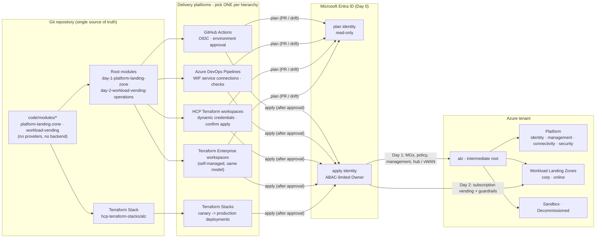

**How to read this diagram:**

- **Left - one codebase:** all logic lives in two provider-less modules. Two thin root modules (backend + authentication) and one Terraform Stack consume them, so no logic is duplicated per platform.
- **Centre - five interchangeable delivery platforms:** GitHub Actions, Azure DevOps, HCP Terraform workspaces and Terraform Enterprise workspaces run the root modules; Terraform Stacks runs the Stack. Only **one** platform may own a given management group hierarchy.
- **Entra ID - the same two identities everywhere:** created once in Day 0. Plans (pull requests, drift detection) use the read-only identity; applies use the privileged identity, reachable only after a human approval (or a Stacks auto-approve rule for the canary). Stacks use the apply identity for plan and apply of each deployment.
- **Right - what gets deployed:** Day 1 builds the management group hierarchy, policy, management resources and connectivity (hub-and-spoke or Virtual WAN); Day 2 vends subscriptions into the Workload Landing Zones and assigns the workload guardrails.
- **No secrets anywhere:** every arrow into Entra ID is a workload identity federation (OIDC) token exchange.

### 2.2 Management group hierarchy, archetypes and subscription placement

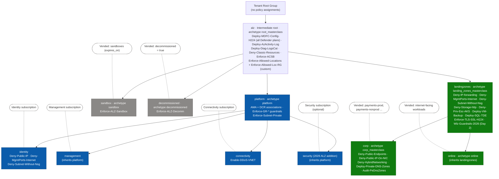

**How to read this diagram:**

- **Boxes are management groups, rounded dashed boxes are subscriptions.** Blue = platform landing zone (platform team), green = Workload Landing Zones, grey = special-purpose groups. The tree is defined in [`alz_2026_masterclass.alz_architecture_definition.yaml`](code/modules/platform-landing-zone/lib/architecture_definitions/alz_2026_masterclass.alz_architecture_definition.yaml); each box names its **archetype** and representative **policy assignments** from the ALZ Library `2026.10.0` plus this repository's overrides.
- **Inheritance flows downwards:** a subscription in `corp` is governed by `alz` + `landingzones` + `corp`. That is why the organisation-wide baseline (Defender for Cloud, activity log and diagnostics to the central workspace, classic resources denied, Microsoft cloud security benchmark, data residency) sits at `alz` and nowhere else.
- **The Tenant Root Group is not used for policy:** `alz` is an intermediate root, so tenant-wide guardrails can be tested, replaced or duplicated (canary) without touching the root.
- **Platform subscriptions are placed by Day 1** (`subscription_placement`); **workload subscriptions are placed by Day 2** vending, which picks `corp`, `online` or `sandbox` from the entry's `archetype`, or `decommissioned` when `decommissioned = true`.
- **`corp` vs `online` is an exposure model, not an org chart:** `corp` workloads are private and hub-connected (public endpoints and public IPs on NICs are denied); `online` workloads may be internet-facing behind WAF / Front Door. Environments (`prod` / `nonprod`) are separate **subscriptions** in the same MG, never separate MGs.
- **Phased assignments:** the `Deny-*` and `Deploy-*` assignments listed for `landingzones`, `corp` and `identity` change enforcement with `policy_enforcement_phase` (section [2.12](#212-policy-as-code-lifecycle)).
- **The security MG** is the 2026 ALZ addition for SOC tooling (Sentinel workspace, Defender exports, threat intelligence); its subscription is optional.

### 2.3 Platform landing zone (Day 1): what is deployed in each platform subscription

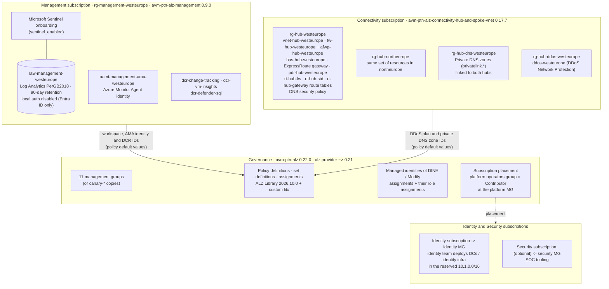

**How to read this diagram:**

- **Four AVM modules, one root module:** `avm-ptn-alz` (governance), `avm-ptn-alz-management` (logging), one connectivity pattern module (hub-and-spoke shown; `avm-ptn-alz-connectivity-virtual-wan 0.18.0` when `connectivity_type = "virtual_wan"`) and `avm-res-resources-resourcegroup 0.4.0` for the connectivity resource groups.
- **Management:** one central Log Analytics workspace (Entra ID-only ingestion and query), the user-assigned identity used by the Azure Monitor Agent, three data collection rules and optional Microsoft Sentinel. Azure Automation is **not** deployed - Update Manager and AMA replace it in ALZ 2026.
- **Connectivity, per region:** a hub VNet with zone-redundant Azure Firewall (SKU per region, `Premium` in the example) and its policy (DNS proxy on), Azure Bastion, the gateways you enable (ExpressRoute in the example, VPN off), a DNS Private Resolver inbound endpoint and the route tables the module manages. **Shared, once:** the private DNS zones and one DDoS Network Protection plan for all regions.
- **Policy is wired to the resources:** IDs of the workspace, AMA identity, DCRs, DDoS plan and DNS zones are composed at plan time and passed as ALZ *policy default values*, so `DeployIfNotExists` policies point at the right resources from the first apply. Policy assignments (and their role assignments) explicitly wait for the management and connectivity modules.
- **Identity and Security subscriptions** are only *placed* by Day 1; their content belongs to the identity and SOC teams. The identity `/16` is reserved in the address plan so identity VNets never overlap.
- **Feature toggles** (`connectivity_features`) switch every optional component on or off - the canary deployment turns off DDoS, Bastion and gateways to stay cheap.

### 2.4 Network topology A: customer-managed hub-and-spoke (default)

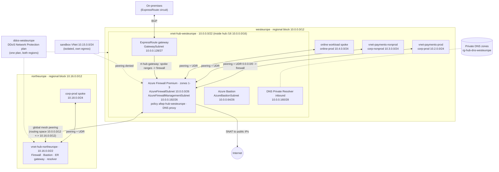

**How to read this diagram:**

- **One hub per region, one `/12` per region:** the hub VNet is a `/22` at the start of the region's hub `/16`; spokes take `/24`s from the archetype + environment `/16` (corp-prod `10.2.0.0/16`, corp-nonprod `10.3.0.0/16`, online-prod `10.4.0.0/16` ...). Subnet addresses come straight from `hub_vnet_layout` in [`locals.tf`](code/modules/platform-landing-zone/locals.tf).
- **Everything is inspected:** each spoke has a route table with `0.0.0.0/0 -> firewall private IP` and BGP propagation disabled, so internet, spoke-to-spoke and on-premises traffic all traverse the regional Azure Firewall. Traffic inside a spoke VNet (for example to its own Private Endpoints) stays local.
- **Multi-region:** the hubs are connected with global mesh peering and each hub advertises its whole regional `/12` as routing space, so a spoke in one region reaches a spoke in the other through both firewalls.
- **Hybrid:** the ExpressRoute gateway in `GatewaySubnet` exchanges routes with on-premises over BGP; the module's gateway route table sends traffic arriving from on-premises to the firewall, and spokes use the hub gateway through `use_remote_gateways` when `hub_gateways_present = true`.
- **DNS:** spokes use the firewall (DNS proxy) as their DNS server; the firewall forwards to the DNS Private Resolver inbound endpoint, which resolves the `privatelink.*` zones linked to the hub (section [2.7](#27-traffic-flows-and-dns-resolution)).
- **Protection:** one DDoS Network Protection plan in the primary region protects VNets in both regions (`Enable-DDoS-VNET` policy keeps them associated).
- **Sandboxes** are never peered (crossed line): they have their own explicit egress and still use a unique range from `10.15.0.0/16`.

### 2.5 Network topology B: Azure Virtual WAN (toggle)

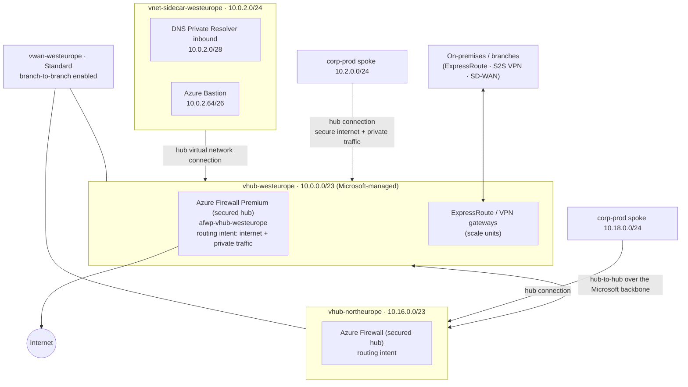

**How to read this diagram:**

- **Same address plan, different hub:** with `connectivity_type = "virtual_wan"` each region's hub `/16` holds a `/23` virtual hub and a `/24` **sidecar VNet** (`vwan_layout` in `locals.tf`). Spoke `/24`s are identical to hub-and-spoke, so switching topology does not re-address workloads.
- **Sidecar VNet:** a virtual hub cannot host the DNS Private Resolver or Azure Bastion, so they live in a small VNet connected to the hub like any spoke.
- **Routing intent replaces UDRs:** spokes are connected with `secure_internet_traffic` and `secure_private_traffic` enabled, so the hub firewall inspects internet and private traffic without route tables in the spokes (vending skips the route table in Virtual WAN).
- **Microsoft-managed transit:** hub-to-hub, branch-to-branch and branch-to-spoke routing are provided by the service; this is what makes Virtual WAN attractive at 3+ regions, 50+ spokes or many branches (decision matrix in [docs/03](docs/03-networking-hubspoke-vs-vwan.md#2-decision-matrix-12-criteria)).
- **Gateways are hub features:** ExpressRoute and VPN gateways are deployed inside the virtual hub in scale units rather than in a `GatewaySubnet`.

### 2.6 IP address management (IPAM)

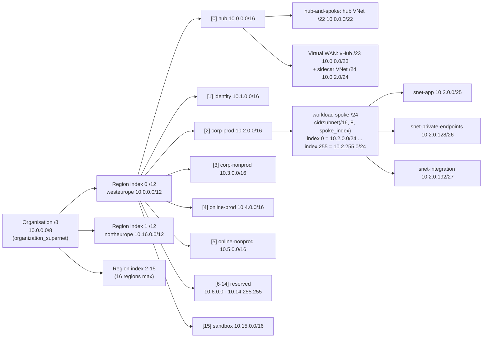

**How to read this diagram:**

- **Four levels, all computed:** `/8` organisation -> `/12` per region (`cidrsubnet(/8, 4, region.index)`) -> `/16` per archetype + environment (`cidrsubnet(/12, 4, block_index)`) -> `/24` per workload (`cidrsubnet(/16, 8, spoke_index)`). Day 1 publishes the result as the `ipam_plan` output; Day 2 only adds a `spoke_index`.
- **Block indexes are fixed across regions:** corp-prod is block `2` everywhere (`10.2.0.0/16` in westeurope, `10.18.0.0/16` in northeurope), so a range tells you region and archetype at a glance and firewall rules can be written per block.
- **Capacity:** 256 spokes per archetype + environment per region, 9 reserved `/16`s per region for new archetypes, AI / data platforms or AKS pod ranges.
- **Fixed subnet layout per spoke:** an application `/25`, a Private Endpoint `/26` (network policies enabled so NSGs and UDRs apply to Private Endpoints) and an integration `/27` for delegated subnets. All are private subnets (`default_outbound_access_enabled = false`).
- **Collision-free by construction:** a Day 2 validation rejects two entries with the same `(region, archetype, environment, spoke_index)`; Azure Virtual Network Manager IPAM pools can be used instead with the same hierarchy (docs/03 section 3).

### 2.7 Traffic flows and DNS resolution

| Flow (hub-and-spoke) | Path | Inspected by |
|---|---|---|
| Spoke -> internet | spoke UDR `0.0.0.0/0` -> regional firewall -> SNAT to firewall public IP | Azure Firewall (application + network rules, TLS inspection / IDPS with Premium) |
| Spoke -> spoke (same region) | spoke UDR -> firewall -> peered spoke | Azure Firewall |
| Spoke -> spoke (other region) | firewall (region A) -> global hub peering -> firewall (region B) | Both firewalls |
| Spoke <-> on-premises | spoke UDR -> firewall -> ExpressRoute gateway; return via the gateway route table -> firewall | Azure Firewall (BGP propagation disabled on spoke route tables) |
| Spoke -> its own Private Endpoint | stays inside the spoke VNet (more specific system route) | NSG on `snet-private-endpoints` |
| Admin -> VM | Azure Bastion in the hub -> VM private IP over peering | Bastion + NSG (management ports from the internet are denied by policy) |
| Sandbox -> internet | sandbox's own NAT Gateway or public IP | Nothing central - isolated by policy |

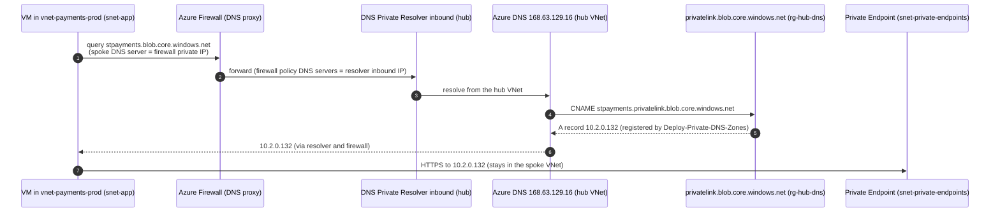

**How to read this diagram:**

- **Steps 1-2 - one DNS entry point per region:** every vended spoke gets the regional firewall IP as its DNS server (`dns_server_ip_addresses` output), and the firewall's DNS proxy forwards to the resolver inbound endpoint. The firewall therefore sees every name lookup, which FQDN-based network rules need.
- **Steps 3-5 - zones live once, in the hub:** the `privatelink.*` zones are created once in `rg-hub-dns-westeurope` and linked to the hub VNets, not to spokes. The `Deploy-Private-DNS-Zones` policy (corp) creates the A record automatically when a Private Endpoint is created, so workload teams never manage DNS.
- **Step 7 - data path:** the connection to the Private Endpoint stays inside the spoke VNet; nothing traverses the public endpoint, which `Deny-Public-Endpoints` keeps disabled in `corp`.
- **On-premises** resolves the same names by forwarding the public zones (`blob.core.windows.net`, ...) to the resolver inbound endpoint over ExpressRoute.
- **Virtual WAN difference:** the resolver lives in the sidecar VNet and spokes use the hub firewall DNS proxy or the resolver IP; the flow is otherwise identical.
- **Exception path:** `private_dns_zone_links = true` on a vending entry links zones to that spoke directly (documented exception in [`dns.tf`](code/modules/workload-vending/dns.tf)).

### 2.8 Identity, OIDC trust and Terraform state

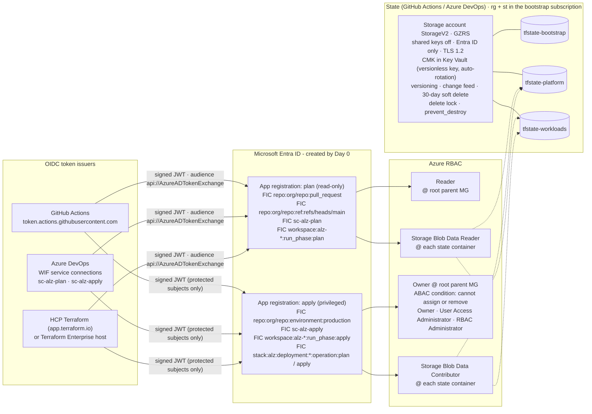

**How to read this diagram:**

- **Two identities, many issuers:** Day 0 creates exactly one *plan* and one *apply* app registration. Each delivery platform you enable adds **federated identity credentials (FICs)** - an `(issuer, subject)` pair - to them; Azure DevOps FICs are added by `day-0-cicd-azure-devops` because the service-connection subject is only known once the connection exists.
- **The subject is the security boundary:** pull requests and the default branch can only obtain the read-only identity; only jobs bound to the protected `production` environment (GitHub), the `sc-alz-apply` connection behind branch control and approvals (Azure DevOps), or the `apply` run phase (HCP Terraform / TFE) can obtain the privileged one. Terraform Stacks use one client ID per deployment, so both Stack subjects trust the apply identity and HCP Terraform approvals gate the apply.
- **Least privilege:** the plan identity is `Reader` on the hierarchy and can only read state (PR plans run with `-lock=false`). The apply identity needs `Owner` at the root parent management group because ALZ creates role assignments for policy managed identities - the ABAC condition stops it from minting new Owners, User Access Administrators or RBAC Administrators.
- **State is a crown jewel:** one container per lifecycle stage limits blast radius; the account accepts Entra ID authentication only, is encrypted with a customer-managed key and keeps versions and soft-deleted blobs for 30 days. HCP Terraform, TFE and Stacks keep state in the platform instead.
- **No secrets anywhere:** there is no client secret or certificate on either app registration; tokens are short-lived and minted per job.

### 2.9 Delivery: the lifecycle of a change

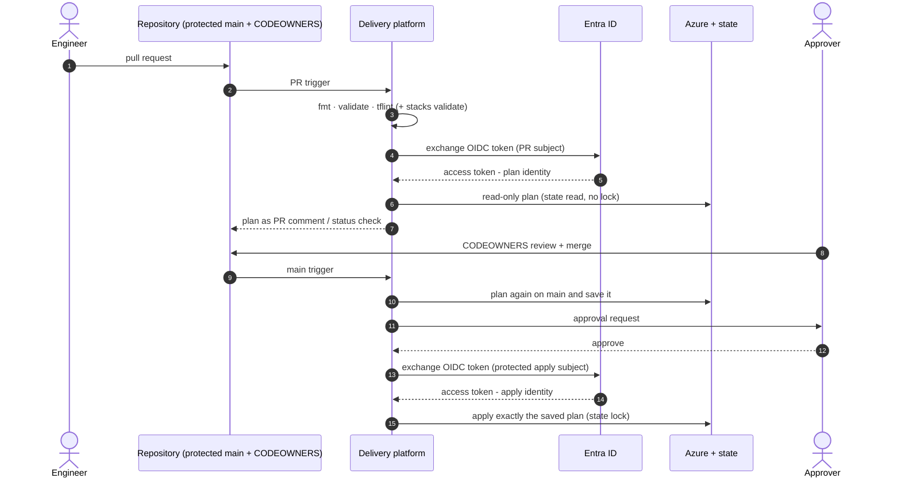

| Step | GitHub Actions | Azure DevOps Pipelines | HCP Terraform / TFE workspaces | Terraform Stacks |
|---|---|---|---|---|
| 3 - static checks | `terraform-plan.yml` (reusable stack workflow) | `alz-pr-validation.yml` | VCS speculative plan | `terraform stacks validate` in CI |
| 4-6 - read-only plan | `pull_request` subject -> plan identity | `sc-alz-plan` | `run_phase:plan` -> `TFC_AZURE_PLAN_CLIENT_ID` | deployment `operation:plan` (apply identity) |
| 10 - plan on `main` | `terraform-apply.yml`, plan job | `Plan_platform` / `Plan_workloads` stages | run queued in `alz-platform` | new configuration version, plan per deployment |
| 11-12 - approval | environment `production`, required reviewers | environment `alz-production`: approval, exclusive lock, branch control | *Confirm & apply* (`auto_apply = false`) | manual for `production`; auto-approve rule for `canary` (Premium) |
| 13-15 - apply | `environment:production` subject -> apply identity | `sc-alz-apply` (branch control: `main` only) | `run_phase:apply` -> `TFC_AZURE_APPLY_CLIENT_ID` | deployment `operation:apply` |
| Day 2 ordering | `workloads` job `needs: platform` | `Apply_workloads` after `Apply_platform` | run trigger `alz-platform` -> `alz-workloads` | component dependency `platform` -> `workloads` |
| Drift | `terraform-drift-detection.yml` -> GitHub issues | `alz-drift-detection.yml` | health assessments | per deployment |

**How to read this diagram and table:**

- **The same 15 steps on every platform:** only *where* each step is implemented changes. The table maps every numbered step to the concrete workflow, stage, setting or feature that implements it.
- **Two plans:** the PR plan (step 6) is informational and runs with read-only rights; the plan that is applied (step 10) is produced on `main` after the merge and applied verbatim, so nothing un-reviewed reaches Azure.
- **Gates live outside the YAML:** GitHub environments, Azure DevOps checks, HCP Terraform confirmation and Stacks deployment groups are configured by Day 0 bootstrap code, so a pull request cannot remove its own gate.
- **Full flows per platform:** [`architecture/diagrams/delivery-platforms.md`](architecture/diagrams/delivery-platforms.md); comparison and decision guide: [docs/07](docs/07-delivery-platforms.md) and [ADR-006](architecture/decision-matrices/ADR-006-delivery-platform.md).

### 2.10 Deployment stages and the platform contract

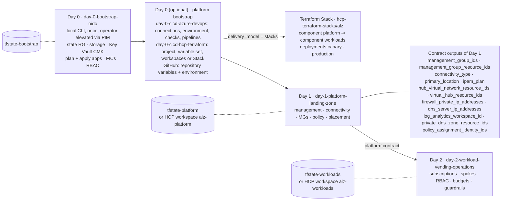

**How to read this diagram:**

- **Day 0 is the only CLI step:** it creates the trust anchor (state + identities) with an operator's elevated, temporary rights; everything after it runs through the chosen delivery platform with the Day 0 identities.
- **Optional platform bootstrap:** Azure DevOps and HCP Terraform / TFE configuration (service connections, checks, workspaces, variable sets, the Stack) is itself Terraform, so the gates are reviewed code too. GitHub needs only repository variables and the `production` environment, printed by a Day 0 output.
- **Day 1 -> Day 2 through a versioned contract:** Day 2 never reads Day 1 resources directly; it reads the outputs listed in the box through `terraform_remote_state` (Azure Storage or HCP Terraform remote state, shared only with `alz-workloads`). In the Stack the same values flow from the `platform` component to the `workloads` component.
- **Separate state per stage:** a broken workload change cannot corrupt platform state, and the platform team can restrict who may write `tfstate-platform`.
- **Stacks replace the two root modules, not the modules:** the Stack wires the same two modules as components and adds the `canary` deployment.

### 2.11 Subscription vending: what one entry creates

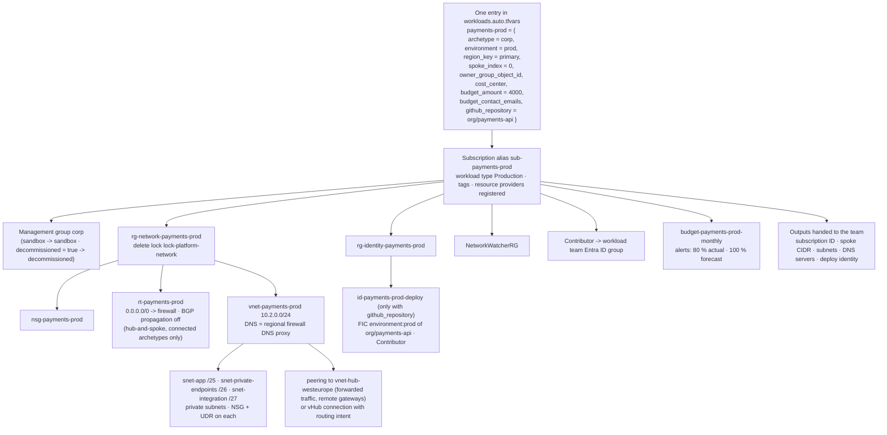

**How to read this diagram:**

- **One map entry is the whole request:** `avm-ptn-alz-sub-vending 0.3.4` turns it into a subscription and everything around it in a single plan; the only number the team chooses is `spoke_index`.
- **Platform-owned vs team-owned:** the network resource group carries a delete lock and the route table and peering are platform-managed, so the team's `Contributor` role cannot break connectivity; the team deploys workloads in its own resource groups.
- **Connected vs isolated:** `corp` and `online` entries get the route table, hub peering (or vHub connection) and hub DNS; `sandbox` entries get none of them, must set `expires_on` and use the `10.15.0.0/16` block.
- **Workload pipelines stay secret-less too:** with `github_repository`, a user-assigned identity with a federated credential for that repository's environment is created, scoped to the new subscription only.
- **Guardrails from minute one:** the subscription lands in a management group that already carries the ALZ policies and the `Wlz-Guardrails-2026` initiative (section [2.12](#212-policy-as-code-lifecycle)). The sequence of the request itself (PR, review, approval) is in [`subscription-vending-flow.md`](architecture/diagrams/subscription-vending-flow.md).

### 2.12 Policy-as-Code lifecycle

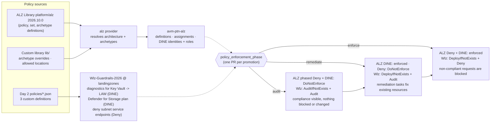

| Phase-controlled ALZ assignments | Deny (enforced only in `enforce`) | DeployIfNotExists (enforced from `remediate`) |
|---|---|---|
| `landingzones` | `Deny-IP-forwarding`, `Deny-MgmtPorts-Internet`, `Deny-Subnet-Without-Nsg`, `Deny-Storage-http`, `Deny-Priv-Esc-AKS`, `Deny-Privileged-AKS` | `Deploy-VM-Backup`, `Deploy-SQL-TDE`, `Deploy-SQL-Threat`, `Deploy-AzSqlDb-Auditing` |
| `corp` | `Deny-Public-Endpoints`, `Deny-Public-IP-On-NIC`, `Deny-HybridNetworking` | `Deploy-Private-DNS-Zones` |
| `identity` | `Deny-MgmtPorts-Internet`, `Deny-Public-IP`, `Deny-Subnet-Without-Nsg` | - |

**How to read this diagram and table:**

- **Two sources, one lifecycle:** the ALZ Library (through the `alz` provider and `avm-ptn-alz`) supplies the reference policy set; Day 2 adds a small custom initiative for gaps. Both read the same `policy_enforcement_phase` variable.
- **Audit -> remediate -> enforce:** ALZ assignments are switched with `enforcementMode` (`DoNotEnforce` keeps evaluation, so compliance is still reported); the custom initiative switches **effects** (`AuditIfNotExists`/`Audit` -> `DeployIfNotExists` -> `Deny`). In `remediate` and `enforce`, Day 2 also creates remediation tasks for existing resources (stopping if more than 10 % fail).
- **Always-on baseline:** assignments not in the table (Defender for Cloud, activity log, diagnostics, classic resources, data residency, the sandbox and decommissioned initiatives) are enforced from the first apply.
- **Reviewed overrides only:** parameters, enforcement and `creation_enabled` changes are explicit HCL in `locals.tf` (for example all Defender plans set to `DeployIfNotExists`, `Enable-DDoS-VNET` disabled when there is no DDoS plan); nothing is edited in the portal.
- Runbook and trade-offs per WAF pillar: [docs/06](docs/06-waf-simplicity-vs-security.md); timeline diagram: [`policy-lifecycle.md`](architecture/diagrams/policy-lifecycle.md).

### 2.13 Management, monitoring and security operations

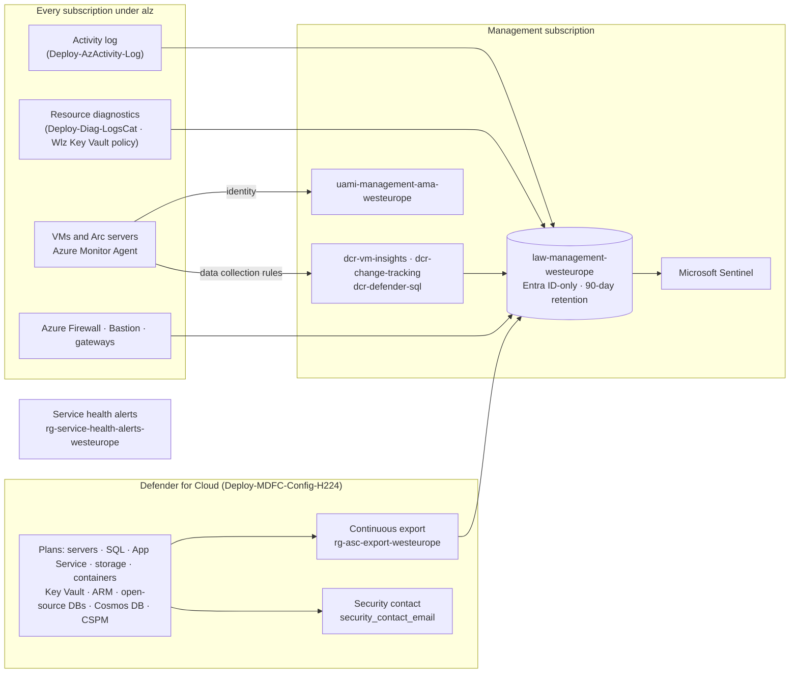

**How to read this diagram:**

- **One workspace for the platform:** activity logs and resource diagnostics of every subscription under `alz` are sent to the central workspace by policy, so new subscriptions are covered without any pipeline change.
- **Agent-based telemetry without Automation:** the Azure Monitor Agent authenticates with the shared user-assigned identity, and three data collection rules (VM insights, change tracking, Defender for SQL) are associated by ALZ policies using the IDs passed as policy default values.
- **Security operations:** every Defender for Cloud plan in the ALZ initiative is set to `DeployIfNotExists`; alerts and recommendations are exported to the workspace, where Microsoft Sentinel (optional) correlates them. The security contact receives Defender notifications.
- **Hardening of the workspace:** local (shared-key) authentication is disabled; public ingestion and query stay enabled until an Azure Monitor Private Link Scope is deployed (documented toggle in the management module call).
- **Service health:** ALZ policies deploy service health alert rules into a dedicated resource group, so platform and workload owners are notified of Azure incidents affecting their subscriptions.

### 2.14 Non-production: sandboxes, canary and corp-nonprod

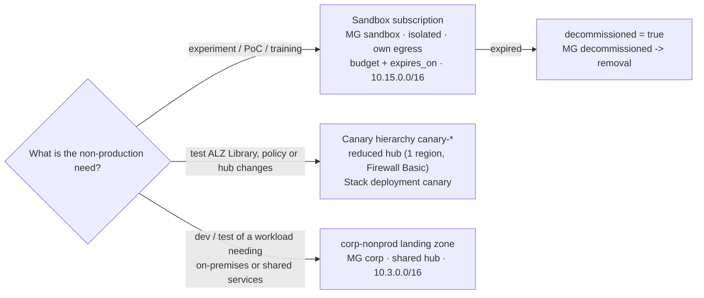

**How to read this diagram:**

- **Three different needs, three different answers:** sandboxes are for free experimentation and are never connected to the hub; the canary proves platform changes with real policy inheritance before production; non-production workloads that need connectivity are ordinary `corp` (or `online`) subscriptions with `environment = "nonprod"` behind the shared hub.
- **There is no "sandbox hub":** replicating the production hub per sandbox costs thousands of USD per month per sandbox and is partly impossible (gateways are denied by `Enforce-ALZ-Sandbox`).
- **Lifecycle is enforced:** sandboxes must declare `expires_on`; a weekly workflow reports expired ones, and decommissioning is two reviewed PRs (`decommissioned = true`, then removal).
- Full analysis with isolation controls, costs, the canary topology and the decision guide: [docs/03 section 5](docs/03-networking-hubspoke-vs-vwan.md#5-sandboxes-canary-and-non-production-environments-in-hub-and-spoke).

Detailed diagrams with ASCII fallbacks: [`architecture/diagrams/`](architecture/diagrams/README.md).

---

## 3. Repository map

```text
azure-landing-zones-2026-masterclass/
├── README.md                                   # This portal
├── docs/                                       # Architecture guides & decision matrices (01-07)
├── architecture/
│   ├── diagrams/                               # Mermaid + ASCII diagrams
│   └── decision-matrices/                      # ADR-style weighted decision records
├── code/
│   ├── backend.hcl.example                     # Shared partial backend config (local runs)
│   ├── day-0-bootstrap-oidc/                   # State storage (CMK), Entra apps, OIDC for every platform, RBAC
│   ├── day-0-cicd-azure-devops/                # (optional) WIF service connections, environment, checks, pipelines
│   ├── day-0-cicd-hcp-terraform/               # (optional) HCP Terraform / TFE project, workspaces or Stack
│   ├── modules/
│   │   ├── platform-landing-zone/              # AVM ALZ composition (no providers/backend)
│   │   │   └── lib/                            # Custom ALZ library (production + canary architectures)
│   │   └── workload-vending/                   # Subscription vending + guardrails (no providers/backend)
│   │       └── policies/                       # Custom policy definitions (JSON)
│   ├── day-1-platform-landing-zone/            # Root module: backend + auth -> modules/platform-landing-zone
│   ├── day-2-workload-vending-operations/      # Root module: backend + auth -> modules/workload-vending
│   └── hcp-terraform-stacks/alz/               # Terraform Stack: components + canary/production deployments
├── pipelines/
│   └── azure-devops/                           # Azure DevOps YAML: PR validation, apply, drift + templates
├── .github/
│   ├── workflows/                              # GitHub Actions: plan / apply / drift + reusable stack workflow
│   ├── CODEOWNERS                              # Separation of duties
│   └── dependabot.yml                          # SHA-pinned actions & Terraform updates
└── .tflint.hcl                                 # Lint rules (terraform + azurerm rulesets)
```

---

## 4. Documentation index

| # | Guide | Answers |
|---|---|---|
| 01 | [Conceptual architecture & MG hierarchy](docs/01-architecture-conceptual.md) | What is a landing zone in 2026? Which MGs, why, and who owns what? |
| 02 | [IaC provider matrix](docs/02-iac-provider-matrix.md) | When do I use AVM, `azurerm`, `azapi`, `azuread`, `alz`? |
| 03 | [Hub-and-spoke vs Virtual WAN + IPAM](docs/03-networking-hubspoke-vs-vwan.md) | Which topology, where is the tipping point, how do I plan IP space? Where do sandboxes, the canary and non-production workloads live, and what does each option cost? |
| 04 | [Private Endpoints vs Service Endpoints](docs/04-security-private-vs-service.md) | Why Private Endpoints are the default and when Service Endpoints are acceptable. |
| 05 | [CI/CD, OIDC & pipeline security](docs/05-cicd-oidc-security.md) | GitHub Actions vs Azure DevOps, Workload Identity Federation, least privilege. |
| 06 | [WAF: simplicity vs security & policy rollout](docs/06-waf-simplicity-vs-security.md) | Audit -> Remediate -> Enforce, trade-offs per WAF pillar. |
| 07 | [Delivery platforms](docs/07-delivery-platforms.md) | GitHub Actions vs Azure DevOps vs HCP Terraform vs Terraform Enterprise vs Terraform Stacks - and how one codebase serves them all. |

| Decision record | Topic |
|---|---|
| [ADR-001](architecture/decision-matrices/ADR-001-iac-tooling.md) | IaC tooling & providers |
| [ADR-002](architecture/decision-matrices/ADR-002-network-topology.md) | Network topology |
| [ADR-003](architecture/decision-matrices/ADR-003-paas-network-access.md) | PaaS network access |
| [ADR-004](architecture/decision-matrices/ADR-004-cicd-platform.md) | CI/CD platform & identity |
| [ADR-005](architecture/decision-matrices/ADR-005-policy-rollout.md) | Policy rollout strategy |
| [ADR-006](architecture/decision-matrices/ADR-006-delivery-platform.md) | Delivery platform (CI/CD vs HCP Terraform / TFE vs Stacks) |

---

## 5. 🎥 Video Guides, Technical Shorts & Multimedia Sessions (YouTube)

The architectural patterns, provider matrices, network topologies, and zero-secret pipeline configurations of this masterclass are accompanied by a dedicated series of technical video guides and rapid architecture shorts synthesized with **Gemini NotebookLM**.

All sessions are hosted on the official YouTube channel [**@nubenetes**](https://youtube.com/@nubenetes).

> [!NOTE]
> **Multilingual Technical Content 🌐**:
> The architectural masterclasses and shorts feature native **English** technical narration with auto-generated subtitles (CC) in over **20 languages** to assist cloud platform teams, enterprise architects, and site reliability engineers worldwide.

### 5.1 📊 Technical Multimedia Catalog (10 Sessions)

#### 5.1.1 📽️ Deep-Dive Architectural Video Guides (6 Episodes)

| Format | Title / Episode | Focus / Core Engineering Domain | Language | Duration | Direct YouTube Link |
| :---: | :--- | :--- | :---: | :---: | :--- |
| 📽️ **Video Guide** | [**The Cloud Metropolis: Azure Landing Zones Architecture Blueprint**](https://www.youtube.com/watch?v=u9rLpmpUf2Y) | **Conceptual Architecture & City Metaphor**: City planning analogy for enterprise cloud scale, multi-subscription isolation, zoning laws, and platform vs. workload separation | 🇬🇧 English *(CC 20+)* | `8:30` | [▶️ Watch Video](https://www.youtube.com/watch?v=u9rLpmpUf2Y) |
| 📽️ **Video Guide** | [**Azure Landing Zones 2026: Next-Gen Enterprise Architecture Masterclass**](https://www.youtube.com/watch?v=LE568gOjCkY) | **Microsoft CAF 2026 Blueprint**: Next-gen Cloud Adoption Framework, enterprise-scale landing zone hierarchy, subscription democratization, and governance baseline | 🇬🇧 English *(CC 20+)* | `8:03` | [▶️ Watch Video](https://www.youtube.com/watch?v=LE568gOjCkY) |
| 📽️ **Video Guide** | [**Azure Management Groups & Governance: Core Engine Architecture**](https://www.youtube.com/watch?v=xh84QXkuYm8) | **Core Engine & Hierarchy**: Management group archetypes (Platform: Identity, Management, Connectivity, Security vs Workloads: Corp, Online), Policy-as-Code, and WAF guardrails | 🇬🇧 English *(CC 20+)* | `8:41` | [▶️ Watch Video](https://www.youtube.com/watch?v=xh84QXkuYm8) |
| 📽️ **Video Guide** | [**Retiring the CAF Monolith: Azure Verified Modules (AVM) & ALZ Library**](https://www.youtube.com/watch?v=BNEGxzQgDB8) | **Modern IaC Stack**: Archiving legacy monolithic CAF modules, composable Azure Verified Modules (AVM), decoupled ALZ Library, and AzAPI-first provider architecture | 🇬🇧 English *(CC 20+)* | `7:59` | [▶️ Watch Video](https://www.youtube.com/watch?v=BNEGxzQgDB8) |
| 📽️ **Video Guide** | [**Azure Hub-and-Spoke vs Virtual WAN: 2026 Enterprise Network Architecture**](https://www.youtube.com/watch?v=mUmga-Nz6cc) | **Network Topology & Sizing**: Traditional Hub-and-Spoke vs. Virtual WAN (vWAN), routing intents, virtual network peering, NVA inspection, and hierarchical IPAM addressing | 🇬🇧 English *(CC 20+)* | `8:11` | [▶️ Watch Video](https://www.youtube.com/watch?v=mUmga-Nz6cc) |
| 📽️ **Video Guide** | [**Azure Private Endpoints vs Service Endpoints: PaaS Network Security Blueprint**](https://www.youtube.com/watch?v=ppqHvYNkII4) | **PaaS Network Security**: Private Endpoints default standard vs Service Endpoints exception, centralized Private DNS Zones, egress filtering, and data exfiltration mitigation | 🇬🇧 English *(CC 20+)* | `8:30` | [▶️ Watch Video](https://www.youtube.com/watch?v=ppqHvYNkII4) |

#### 5.1.2 ⚡ Technical Shorts & Architecture Takeaways (4 Episodes)

| Format | Title / Episode | Focus / Core Engineering Domain | Language | Duration | Direct YouTube Link |
| :---: | :--- | :--- | :---: | :---: | :--- |
| ⚡ **Short** | [**Why Azure is Killing the Landing Zone Monolith**](https://www.youtube.com/shorts/7S6HDnZXQhI) | **AVM Shift**: Why Microsoft archived CAF monoliths on August 1, 2026 in favor of modular Azure Verified Modules (AVM) | 🇬🇧 English *(CC 20+)* | `1:09` | [▶️ Watch Short](https://www.youtube.com/shorts/7S6HDnZXQhI) |
| ⚡ **Short** | [**How Workload Identity Federation Replaces Stored Secrets**](https://www.youtube.com/shorts/0mdEib04nTw) | **CI/CD Security**: Eliminating static client secrets in GitHub Actions pipelines using OpenID Connect (OIDC) and Entra ID | 🇬🇧 English *(CC 20+)* | `1:16` | [▶️ Watch Short](https://www.youtube.com/shorts/0mdEib04nTw) |
| ⚡ **Short** | [**Why Azure Landing Zones Split Corp and Online**](https://www.youtube.com/shorts/Uab5Y1nnt08) | **Hierarchy Design**: Why management groups split Corp vs Online rather than dev/stage/prod environments | 🇬🇧 English *(CC 20+)* | `1:24` | [▶️ Watch Short](https://www.youtube.com/shorts/Uab5Y1nnt08) |
| ⚡ **Short** | [**Choosing Between Azure Private and Service Endpoints**](https://www.youtube.com/shorts/E1rnKNKWWUg) | **PaaS Decision Rules**: Key decision criteria between Private Endpoints and Service Endpoints for enterprise data boundary defense | 🇬🇧 English *(CC 20+)* | `1:20` | [▶️ Watch Short](https://www.youtube.com/shorts/E1rnKNKWWUg) |

<details>
<summary>📂 <strong>Detailed Agendas, Transcripts & Engineering Takeaways</strong></summary>

<br/>

### 5.2 Section A: Deep-Dive Architectural Video Guides (6 Sessions)

#### 5.2.1 The Cloud Metropolis: Azure Landing Zones Architecture Blueprint (8:30)
- 🔗 **Direct URL**: [https://www.youtube.com/watch?v=u9rLpmpUf2Y](https://www.youtube.com/watch?v=u9rLpmpUf2Y)
- ⏱️ **Duration**: 8:30 | 🌐 **Language**: 🇬🇧 English *(CC 20+)*
- 🏷️ **Domain**: Conceptual Architecture, City Metaphor, Multi-Subscription Governance, Zoning Laws
- 📝 **Technical Overview**:
> Conceptual architecture masterclass establishing the city planning metaphor for enterprise Azure environments. Compares cloud infrastructure to an organized metropolis with zoning laws, shared utilities (water, electricity, transit), and residential/commercial districts. Explains why single-subscription designs fail under enterprise scale and how Microsoft CAF management group hierarchies provide clean boundaries between platform utilities and application workloads.

#### 5.2.2 Azure Landing Zones 2026: Next-Gen Enterprise Architecture Masterclass (8:03)
- 🔗 **Direct URL**: [https://www.youtube.com/watch?v=LE568gOjCkY](https://www.youtube.com/watch?v=LE568gOjCkY)
- ⏱️ **Duration**: 8:03 | 🌐 **Language**: 🇬🇧 English *(CC 20+)*
- 🏷️ **Domain**: Microsoft CAF 2026 Framework, Enterprise Scale, Subscription Democratization
- 📝 **Technical Overview**:
> Exhaustive overview of Microsoft's late-2026 Cloud Adoption Framework (CAF) reference architecture. Breaks down the multi-subscription model, subscription vending mechanisms, and the shift from central IT gatekeeping to self-service application teams constrained by automated guardrails. Details how the platform provides security baselines, centralized connectivity, and compliance without slowing down feature delivery.

#### 5.2.3 Azure Management Groups & Governance: Core Engine Architecture (8:41)
- 🔗 **Direct URL**: [https://www.youtube.com/watch?v=xh84QXkuYm8](https://www.youtube.com/watch?v=xh84QXkuYm8)
- ⏱️ **Duration**: 8:41 | 🌐 **Language**: 🇬🇧 English *(CC 20+)*
- 🏷️ **Domain**: Management Group Archetypes, Platform vs Workloads, Policy-as-Code Lifecycle
- 📝 **Technical Overview**:
> Deep dive into the core engine of Azure Landing Zones: the management group hierarchy and Policy-as-Code governance engine. Examines the structural separation of Platform management groups (Identity, Management, Connectivity, and the new Security archetype) from Workload Landing Zones (Corp and Online). Details the phased policy rollout strategy (Audit -> Remediate -> Enforce) aligned with the Well-Architected Framework.

#### 5.2.4 Retiring the CAF Monolith: Azure Verified Modules (AVM) & ALZ Library (7:59)
- 🔗 **Direct URL**: [https://www.youtube.com/watch?v=BNEGxzQgDB8](https://www.youtube.com/watch?v=BNEGxzQgDB8)
- ⏱️ **Duration**: 7:59 | 🌐 **Language**: 🇬🇧 English *(CC 20+)*
- 🏷️ **Domain**: Infrastructure as Code (IaC), AVM Pattern Modules, ALZ Library, AzAPI Provider
- 📝 **Technical Overview**:
> Technical guide on the monumental 2026 shift in Azure Infrastructure as Code: the retirement of the monolithic `terraform-azurerm-caf-enterprise-scale` module (archived August 1, 2026) and the adoption of Microsoft-maintained Azure Verified Modules (AVM). Analyzes how decoupling policy definitions into the versioned ALZ Library processed by the `Azure/alz` provider and leveraging the AzAPI-first provider architecture guarantees day-zero API support and zero-regression upgrades.

#### 5.2.5 Azure Hub-and-Spoke vs Virtual WAN: 2026 Enterprise Network Architecture (8:11)
- 🔗 **Direct URL**: [https://www.youtube.com/watch?v=mUmga-Nz6cc](https://www.youtube.com/watch?v=mUmga-Nz6cc)
- ⏱️ **Duration**: 8:11 | 🌐 **Language**: 🇬🇧 English *(CC 20+)*
- 🏷️ **Domain**: Network Topology, Hub-and-Spoke, Virtual WAN, Routing Intent, IPAM
- 📝 **Technical Overview**:
> In-depth architectural trade-off analysis between customer-managed Hub-and-Spoke virtual networks and Microsoft-managed Azure Virtual WAN (vWAN). Evaluates regional scale tipping points, routing intent policies, NVA firewall clustering, and cross-region transit costs. Details hierarchical IP Address Management (IPAM) allocation rules (/8 enterprise root down to /24 workload subnets) and private DNS zone resolution architecture.

#### 5.2.6 Azure Private Endpoints vs Service Endpoints: PaaS Network Security Blueprint (8:30)
- 🔗 **Direct URL**: [https://www.youtube.com/watch?v=ppqHvYNkII4](https://www.youtube.com/watch?v=ppqHvYNkII4)
- ⏱️ **Duration**: 8:30 | 🌐 **Language**: 🇬🇧 English *(CC 20+)*
- 🏷️ **Domain**: PaaS Security, Private Endpoints, Service Endpoints, Private DNS, Data Exfiltration
- 📝 **Technical Overview**:
> Masterclass on enterprise PaaS network isolation in Azure. Demonstrates why Private Endpoints are the non-negotiable default for enterprise production environments and examines why Service Endpoints are restricted to audited exceptions. Covers centralized Private DNS Zones in the Connectivity subscription, virtual network link automation, split-horizon DNS, and defending against data exfiltration attacks while complying with Azure's 2026 default outbound access deprecation.

---

### 5.3 Section B: Technical Shorts & Architecture Takeaways (4 Sessions)

#### 5.3.1 Why Azure is Killing the Landing Zone Monolith (1:09)
- 🔗 **Direct URL**: [https://www.youtube.com/shorts/7S6HDnZXQhI](https://www.youtube.com/shorts/7S6HDnZXQhI)
- ⏱️ **Duration**: 1:09 | 🌐 **Language**: 🇬🇧 English *(CC 20+)*
- 🏷️ **Domain**: Azure Verified Modules (AVM), Modular IaC, ALZ Library
- 📝 **Technical Overview**:
> Rapid architectural short breaking down why Microsoft archived legacy monolithic landing zone modules on August 1, 2026. Explains the transition to composable Azure Verified Modules (AVM pattern modules) and the versioned ALZ Library, allowing teams to deploy only what they need without deploying an all-or-nothing monolith.

#### 5.3.2 How Workload Identity Federation Replaces Stored Secrets (1:16)
- 🔗 **Direct URL**: [https://www.youtube.com/shorts/0mdEib04nTw](https://www.youtube.com/shorts/0mdEib04nTw)
- ⏱️ **Duration**: 1:16 | 🌐 **Language**: 🇬🇧 English *(CC 20+)*
- 🏷️ **Domain**: CI/CD Security, GitHub Actions, Workload Identity Federation (OIDC), Zero Secrets
- 📝 **Technical Overview**:
> Essential security takeaway showing how Workload Identity Federation (OIDC) eradicates long-lived static client secrets and certificates from GitHub Actions pipelines. Explains the short-lived token exchange with Microsoft Entra ID and least-privilege role assignment architectures.

#### 5.3.3 Why Azure Landing Zones Split Corp and Online (1:24)
- 🔗 **Direct URL**: [https://www.youtube.com/shorts/Uab5Y1nnt08](https://www.youtube.com/shorts/Uab5Y1nnt08)
- ⏱️ **Duration**: 1:24 | 🌐 **Language**: 🇬🇧 English *(CC 20+)*
- 🏷️ **Domain**: Management Group Archetypes, Corp vs Online, Network Routing Boundaries
- 📝 **Technical Overview**:
> Core architectural principle explaining why management group hierarchies must never be divided by environment (dev, stage, prod). Details how splitting workloads by connectivity archetype (Corp with private corporate network transit vs. Online with public egress/inbound endpoints) prevents redundant policy sprawl and secures hybrid perimeters.

#### 5.3.4 Choosing Between Azure Private and Service Endpoints (1:20)
- 🔗 **Direct URL**: [https://www.youtube.com/shorts/E1rnKNKWWUg](https://www.youtube.com/shorts/E1rnKNKWWUg)
- ⏱️ **Duration**: 1:20 | 🌐 **Language**: 🇬🇧 English *(CC 20+)*
- 🏷️ **Domain**: PaaS Access Decision Rules, Private Endpoints, Service Endpoints, Data Perimeter
- 📝 **Technical Overview**:
> Concise engineering decision framework for selecting between Azure Private Endpoints and Service Endpoints. Explains private IP assignment, bidirectional routing control, data exfiltration protection, and why Private Endpoints are the enterprise production baseline in 2026.

</details>

## 6. Quickstart: Day 0, Day 1, Day 2

> [!WARNING]
> Run everything first in a **sandbox tenant**. Day 1 creates management groups and policy assignments at tenant scope and moves subscriptions; Day 2 creates billable subscriptions.

The Terraform CLI is used **only** for the one-off Day 0 bootstrap (and break-glass). Every Day 1 and Day 2 change reaches Azure through a delivery platform - pick one:

| Delivery platform | Day 1 / Day 2 runs from | Bootstrap after Day 0 | Approvals | Drift detection |
|---|---|---|---|---|
| **GitHub Actions** | [`.github/workflows`](.github/workflows) | `terraform output -raw github_configuration_commands \| bash` | Environment `production` (required reviewers) | Scheduled workflow -> GitHub issues |
| **Azure DevOps Pipelines** | [`pipelines/azure-devops`](pipelines/azure-devops) | [`code/day-0-cicd-azure-devops`](code/day-0-cicd-azure-devops) | Environment `alz-production` checks + branch control on `sc-alz-apply` | Scheduled pipeline |
| **HCP Terraform workspaces** | VCS-driven workspaces `alz-platform` -> `alz-workloads` | [`code/day-0-cicd-hcp-terraform`](code/day-0-cicd-hcp-terraform) (`delivery_model = "workspaces"`) | Confirm apply (no auto-apply) | Health assessments |
| **Terraform Enterprise** (self-managed) | Same as HCP Terraform, on your TFE host | Same, with `hostname = "tfe.example.com"` | Same | Same |
| **Terraform Stacks** (HCP Terraform; TFE 2.0+) | [`code/hcp-terraform-stacks/alz`](code/hcp-terraform-stacks/alz) | Same, with `delivery_model = "stacks"` | Production manual; canary auto-approve rules (Premium) | Per deployment |

All five run the **same modules** (`code/modules/*`) - see [docs/07](docs/07-delivery-platforms.md).

### 6.1 Prerequisites

| Item | Requirement |
|---|---|
| Tools (Day 0 only) | Terraform `~> 1.12` (CI pins 1.16.6), Azure CLI; plus `gh` (GitHub), `AZDO_ORG_SERVICE_URL` (Azure DevOps) or `TFE_TOKEN` (HCP Terraform / TFE) |
| Entra ID | Permission to create app registrations (Application Developer or higher) |
| Azure RBAC | Owner (or User Access Administrator + Contributor) at the Tenant Root Group for the Day 0 operator - elevate via PIM, drop afterwards |
| Subscriptions | Management, Connectivity, Identity (and optionally Security) subscriptions already exist |
| Billing (Day 2) | EA *Enrollment account subscription creator* or MCA *Azure subscription creator* role for the apply identity |

### 6.2 Day 0 - Bootstrap trust (local, once)

```bash
cd code/day-0-bootstrap-oidc
cp terraform.tfvars.example terraform.tfvars    # enable github_enabled and/or hcp_terraform
az login --tenant <tenant-id>
terraform init && terraform apply
terraform output federated_credentials          # every OIDC subject Entra ID now trusts
```

Outputs: state storage account (Entra-only, CMK), **one** `plan` and **one** `apply` app registration with federated credentials for each enabled platform, least-privilege RBAC. Then run the bootstrap of your platform from the table above.

### 6.3 Day 1 - Platform landing zone (through the platform)

1. Copy `code/day-1-platform-landing-zone/terraform.tfvars.example` to **`platform.auto.tfvars`**, edit it and open a PR (identifiers only - no secrets).
2. The platform posts a read-only plan (PR comment, pipeline summary or HCP speculative plan).
3. Merge; approve the gated apply. Order: management resources -> connectivity (hub-and-spoke **or** vWAN) -> management groups, policies and subscription placement.

### 6.4 Day 2 - Workload landing zones & operations (through the platform)

1. A workload team opens a PR adding one entry to `code/day-2-workload-vending-operations/workloads.auto.tfvars` (the *order form*).
2. CODEOWNERS routes it to platform + FinOps; the plan shows subscription, spoke CIDR, peering, RBAC and budget.
3. After merge and approval, the subscription is vended into `corp` / `online` / `sandbox` with networking, DNS, RBAC, budget and an optional OIDC identity for the workload's own pipeline.
4. Governance is promoted through `policy_enforcement_phase`: `audit` -> `remediate` -> `enforce` (one PR per promotion).
5. Drift is detected by the platform (scheduled workflow / pipeline or HCP health assessments).

---

## 7. Key design decisions

| Decision | Choice | Rationale | Details |
|---|---|---|---|
| IaC composition | AVM pattern modules + `alz` provider + custom library | Microsoft-maintained, versioned policy library, no monolith | [docs/02](docs/02-iac-provider-matrix.md) |
| Topology | Hub-and-spoke by default, vWAN toggle (`connectivity_type`) | 1-2 regions & < ~50 spokes favour hub-and-spoke; 3+ regions / 50+ spokes favour vWAN | [docs/03](docs/03-networking-hubspoke-vs-vwan.md) |
| IPAM | `/8` org -> `/12` region -> `/16` archetype+env -> `/24` workload | Deterministic, collision-free, computed in code | [docs/03](docs/03-networking-hubspoke-vs-vwan.md#3-ip-address-management-ipam) |
| PaaS access | Private Endpoints by default; Service Endpoints denied unless approved | Removes public exposure, closes the shadow-IT path | [docs/04](docs/04-security-private-vs-service.md) |
| CI/CD identity | Two Entra apps, OIDC only; apply bound to a protected environment; ABAC-conditioned Owner | No secrets, no standing path from a PR to production | [docs/05](docs/05-cicd-oidc-security.md) |
| Delivery platform | Platform-neutral modules; GitHub Actions, Azure DevOps, HCP Terraform / TFE workspaces or Terraform Stacks | Organisations differ; the code should not | [docs/07](docs/07-delivery-platforms.md) |
| Policy rollout | Phased: audit -> remediate -> enforce | Brownfield-safe, measurable, reversible | [docs/06](docs/06-waf-simplicity-vs-security.md) |

---

## 8. Version matrix

| Component | Version / constraint used | Notes |
|---|---|---|
| Terraform | `~> 1.12` (CI: 1.16.6) | Provider-defined functions (`provider::azapi::*`) require >= 1.8 |
| `hashicorp/azurerm` | `~> 4.35` (Day 1), `~> 4.81` (Day 0/2) | **v5 not supported** by ALZ AVM modules |
| `Azure/azapi` | `~> 2.12` | Required by every AVM pattern module |
| `hashicorp/azuread` | `~> 3.10` | Day 0 and Azure DevOps bootstrap |
| `Azure/alz` | `~> 0.21` | Library processing |
| ALZ Library | `platform/alz` `2026.10.0` | Pinned in `code/modules/platform-landing-zone/lib/alz_library_metadata.json` |
| `Azure/avm-ptn-alz/azurerm` | `0.22.0` | Management groups, policy, RBAC, placement |
| `Azure/avm-ptn-alz-management/azurerm` | `0.9.0` | Log Analytics, AMA identity + DCRs, Sentinel |
| `Azure/avm-ptn-alz-connectivity-hub-and-spoke-vnet/azurerm` | `0.17.7` | Customer-managed hubs |
| `Azure/avm-ptn-alz-connectivity-virtual-wan/azurerm` | `0.18.0` | Microsoft-managed hubs |
| `Azure/avm-ptn-alz-sub-vending/azure` | `0.3.4` | Subscription vending (AzAPI-based successor of `lz-vending`) |
| `Azure/avm-res-resources-resourcegroup/azurerm` | `0.4.0` | AzAPI-based - pass `azapi`, not `azurerm` |
| `microsoft/azuredevops` | `~> 1.16` | Azure DevOps bootstrap |
| `hashicorp/tfe` | `~> 0.82` | HCP Terraform / TFE bootstrap (workspaces, Stack) |
| Terraform Stacks | CLI 1.13+ (`.terraform-version` 1.16.6) | GA on HCP Terraform; Terraform Enterprise 2.0+ |
| GitHub Actions | `checkout@v7`, `azure/login@v3`, `setup-terraform@v4`, `setup-tflint@v6` | Pinned by commit SHA |
| Azure DevOps | `AzureCLI@2`, Terraform installed with SHA256 check | No Marketplace extension required |

> [!NOTE]
> Versions were current when this repository was generated (October 2026). The original brief asked for `azure/login@v2` and ALZ Library ref `2025.02.0`; newer releases (`v3`, `2026.10.0`) are used instead. Re-check every version before use.

---

## 9. Static checks performed at generation time

No Azure tenant was ever touched. The following **offline, static** checks were run when the repository was generated (October 2026):

| Check | Tool | Result |
|---|---|---|
| HCL formatting | `tofu fmt -check -recursive` | Pass |
| Validity of all root modules and modules (real provider schemas, AVM modules resolved at the pinned versions): Day 0, Day 1, Day 2, Azure DevOps bootstrap, both modules | `tofu validate` with AzureRM 4.81.0, AzureAD 3.10.0, AzAPI 2.13.0, ALZ 0.22.0, AzureDevOps 1.16.0 | Pass |
| HCP Terraform / TFE bootstrap | `terraform validate` in CI with the real `hashicorp/tfe` provider | Pass |
| Terraform Stack configuration | `terraform stacks fmt` / `init` / `validate` in CI (Terraform 1.16.6) | Pass |
| Lint | TFLint 0.64 (terraform + azurerm rulesets) | Pass |
| Day 1 / Day 0 locals (IPAM, policy defaults, rollout phase, OIDC subjects) evaluated with the example values | `tofu console` | Expected values |
| GitHub workflows | `actionlint`, `yamllint` | Pass |
| Azure DevOps pipelines | `yamllint` (no offline ADO schema validator) | Pass |
| Mermaid diagrams | `mermaid.parse` | Pass |
| Policy definitions / library files | JSON / YAML parsers | Pass |

> [!WARNING]
> Static validity is **not** deployment validity. `plan`/`apply` behaviour (Azure API responses, RBAC propagation, policy aliases, ALZ Library resolution, billing permissions) has **not** been exercised.

---

## 10. What this repository is not

- **Not tested in Azure.** Nothing here has been deployed. Expect to fix details during your first `terraform plan` against a sandbox tenant.
- **Not a replacement for the official ALZ IaC Accelerator.** For a supported, generated starting point, use the [Azure Landing Zones accelerator](https://azure.github.io/Azure-Landing-Zones/accelerator/); use this repository to understand *why* each decision is made and as a composition reference.
- **Not workload architecture.** Workload-specific design (AKS, AI Foundry, data platforms) belongs to the Azure Architecture Center and the Well-Architected Framework.

---

## 11. References

- Azure Landing Zones documentation (accelerator, Terraform, Bicep, policy): <https://azure.github.io/Azure-Landing-Zones/>
- ALZ Terraform module index and provider constraints: <https://azure.github.io/Azure-Landing-Zones/accelerator/starter-terraform/module-index/>
- ALZ-Bicep classic migration and retirement dates: <https://azure.github.io/Azure-Landing-Zones/bicep/migration/>
- Azure Blueprints retirement timeline: <https://learn.microsoft.com/azure/governance/blueprints/blueprint-retirement-faq>
- Default outbound access changes: <https://learn.microsoft.com/azure/virtual-network/ip-services/default-outbound-access>
- Terraform Stacks (GA) and HCP Terraform features: <https://www.hashicorp.com/blog/scale-infrastructure-with-new-terraform-and-packer-features-at-hashiconf-2025>
- Terraform Enterprise 2.0.x release notes: <https://developer.hashicorp.com/terraform/enterprise/releases/2.0.x>
- HCP Terraform dynamic provider credentials (Azure): <https://developer.hashicorp.com/terraform/cloud-docs/dynamic-provider-credentials/azure-configuration>
- Cloud Adoption Framework - Ready: <https://learn.microsoft.com/azure/cloud-adoption-framework/ready>
- Azure Verified Modules: <https://aka.ms/avm>
- ALZ Library: <https://github.com/Azure/Azure-Landing-Zones-Library>

---

<sub>Generated with Claude Opus 5.5 for the Nubenetes community. MIT licensed. Untested architectural reference - use at your own risk.</sub>
