# Azure Landing Zones 2026 Masterclass

> **Note**: This architectural reference framework and repository content were fully generated using **Claude Opus 5.5**.

> **Disclaimer**: This repository serves purely as an advanced theoretical and architectural reference framework incorporating the latest 2026 Microsoft Azure Landing Zone best practices. The code, Terraform manifests, and pipeline configurations provided herein **have not been physically deployed, executed, or tested in a live production environment**. Users should thoroughly validate, plan, and test all code in a sandbox environment prior to enterprise implementation.

<table>
  <tr><th align="left">Project</th><td><a href="https://www.anthropic.com/claude"></a>
    <a href="#static-checks-performed-at-generation-time"></a>
    <a href="#static-checks-performed-at-generation-time"></a>
    <a href="https://github.com/nubenetes/azure-landing-zones-2026-masterclass/blob/main/LICENSE"></a>
    <a href="https://github.com/nubenetes/azure-landing-zones-2026-masterclass/commits/main"></a>
    <a href="https://github.com/nubenetes/azure-landing-zones-2026-masterclass/stargazers"></a></td></tr>
  <tr><th align="left">IaC stack</th><td><a href="https://developer.hashicorp.com/terraform"></a>
    <a href="https://opentofu.org"></a>
    <a href="https://registry.terraform.io/providers/hashicorp/azurerm/latest"></a>
    <a href="https://registry.terraform.io/providers/Azure/azapi/latest"></a>
    <a href="https://registry.terraform.io/providers/Azure/alz/latest"></a>
    <a href="https://registry.terraform.io/providers/hashicorp/azuread/latest"></a>
    <a href="https://github.com/Azure/Azure-Landing-Zones-Library/tree/platform/alz/2026.10.0"></a>
    <a href="https://aka.ms/avm"></a></td></tr>
  <tr><th align="left">Architecture</th><td><a href="docs/01-architecture-conceptual.md"></a>
    <a href="docs/03-networking-hubspoke-vs-vwan.md"></a>
    <a href="docs/04-security-private-vs-service.md"></a>
    <a href="docs/06-waf-simplicity-vs-security.md"></a>
    <a href="code/day-2-workload-vending-operations/README.md"></a>
    <a href="docs/06-waf-simplicity-vs-security.md"></a></td></tr>
  <tr><th align="left">Delivery &amp; security</th><td><a href="docs/05-cicd-oidc-security.md"></a>
    <a href="pipelines/azure-devops/README.md"></a>
    <a href="code/day-0-cicd-hcp-terraform/README.md"></a>
    <a href="code/hcp-terraform-stacks/alz/README.md"></a>
    <a href="docs/05-cicd-oidc-security.md"></a>
    <a href="docs/05-cicd-oidc-security.md#31-the-abac-condition-on-the-apply-identity"></a>
    <a href=".github/workflows"></a>
    <a href=".github/dependabot.yml"></a></td></tr>
</table>

A complete, opinionated reference for deploying an **Azure Landing Zone** the way Microsoft's Cloud Adoption Framework (CAF) recommends it in late 2026: composed from **Azure Verified Modules (AVM)**, governed by the **ALZ Library** through the `alz` provider, delivered without secrets through **GitHub Actions, Azure DevOps, HCP Terraform, Terraform Enterprise or Terraform Stacks** (Workload Identity Federation / OIDC), and operated with **subscription vending** and a phased **Policy-as-Code** lifecycle.

---

## Table of contents

- [1. Executive summary - the 2026 state of Azure Landing Zones](#1-executive-summary---the-2026-state-of-azure-landing-zones)
- [2. Reference architecture at a glance](#2-reference-architecture-at-a-glance)
  - [2.1 End-to-end overview](#21-end-to-end-overview)
  - [2.2 Management group hierarchy, archetypes and subscription placement](#22-management-group-hierarchy-archetypes-and-subscription-placement)
  - [2.3 Platform landing zone (Day 1): what is deployed in each platform subscription](#23-platform-landing-zone-day-1-what-is-deployed-in-each-platform-subscription)
  - [2.4 Network topology A: customer-managed hub-and-spoke (default)](#24-network-topology-a-customer-managed-hub-and-spoke-default)
  - [2.5 Network topology B: Azure Virtual WAN (toggle)](#25-network-topology-b-azure-virtual-wan-toggle)
  - [2.6 IP address management (IPAM)](#26-ip-address-management-ipam)
  - [2.7 Traffic flows and DNS resolution](#27-traffic-flows-and-dns-resolution)
  - [2.8 Identity, OIDC trust and Terraform state](#28-identity-oidc-trust-and-terraform-state)
  - [2.9 Delivery: the lifecycle of a change](#29-delivery-the-lifecycle-of-a-change)
  - [2.10 Deployment stages and the platform contract](#210-deployment-stages-and-the-platform-contract)
  - [2.11 Subscription vending: what one entry creates](#211-subscription-vending-what-one-entry-creates)
  - [2.12 Policy-as-Code lifecycle](#212-policy-as-code-lifecycle)
  - [2.13 Management, monitoring and security operations](#213-management-monitoring-and-security-operations)
  - [2.14 Non-production: sandboxes, canary and corp-nonprod](#214-non-production-sandboxes-canary-and-corp-nonprod)
- [3. Repository map](#3-repository-map)
- [4. Documentation index](#4-documentation-index)
- [5. 🎥 Video Guides, Technical Shorts & Multimedia Sessions (YouTube)](#5--video-guides-technical-shorts--multimedia-sessions-youtube)
  - [5.1 📊 Technical Multimedia Catalog (37 Sessions)](#51--technical-multimedia-catalog-37-sessions)
    - [5.1.1 🎙️ Architectural Podcasts & Long-Form Masterclasses (2 Episodes)](#511-️-architectural-podcasts--long-form-masterclasses-2-episodes)
    - [5.1.2 📽️ Deep-Dive Architectural Video Guides (12 Episodes)](#512-️-deep-dive-architectural-video-guides-12-episodes)
    - [5.1.3 ⚡ Technical Shorts & Architecture Takeaways (23 Episodes)](#513-⚡-technical-shorts--architecture-takeaways-23-episodes)
  - [5.2 Section A: Architectural Podcasts & Long-Form Masterclasses (2 Sessions)](#52-section-a-architectural-podcasts--long-form-masterclasses-2-sessions)
  - [5.3 Section B: Deep-Dive Architectural Video Guides (12 Sessions)](#53-section-b-deep-dive-architectural-video-guides-12-sessions)
  - [5.4 Section C: Technical Shorts & Architecture Takeaways (23 Sessions)](#54-section-c-technical-shorts--architecture-takeaways-23-sessions)
- [6. Quickstart: Day 0, Day 1, Day 2](#6-quickstart-day-0-day-1-day-2)
  - [6.1 Prerequisites](#61-prerequisites)
  - [6.2 Day 0 - Bootstrap trust (local, once)](#62-day-0---bootstrap-trust-local-once)
  - [6.3 Day 1 - Platform landing zone (through the platform)](#63-day-1---platform-landing-zone-through-the-platform)
  - [6.4 Day 2 - Workload landing zones & operations (through the platform)](#64-day-2---workload-landing-zones--operations-through-the-platform)
- [7. Key design decisions](#7-key-design-decisions)
- [8. Version matrix](#8-version-matrix)
- [9. Static checks performed at generation time](#9-static-checks-performed-at-generation-time)
- [10. What this repository is not](#10-what-this-repository-is-not)
- [11. References](#11-references)

---

## 1. Executive summary - the 2026 state of Azure Landing Zones

| Shift | What changed | What it means for you |
|---|---|---|
| **Monolith retired** | The legacy `terraform-azurerm-caf-enterprise-scale` module reached the end of extended support and was **archived on 1 August 2026**. | New deployments compose the AVM pattern modules (`avm-ptn-alz`, `avm-ptn-alz-management`, `avm-ptn-alz-connectivity-*`). Existing estates migrate by state import, not rebuild. |
| **Bicep classic retired** | The ALZ-Bicep *classic* starter was **removed from the accelerator on 16 February 2026**; the `Azure/ALZ-Bicep` repository is **archived on 16 February 2027** (fixes only until then). | Bicep users move to the AVM Bicep accelerator. Both IaC languages now share the same ALZ Library. |
| **Blueprints retiring** | Azure Blueprints retires on **31 January 2027** with phased restrictions: no new definitions since 31 July 2026, **no new assignments or definition edits from 31 October 2026**, no assignment edits from 31 December 2026. | Replace with **Deployment Stacks** (lifecycle + deny settings), **template specs** and **Policy-as-Code**. Export anything you still need *now*. |
| **AVM is the standard** | AVM modules are owned by Microsoft engineering, follow strict interface specifications (Private Endpoints, diagnostics, RBAC, managed identities, locks, telemetry) and are Well-Architected aligned. | Prefer AVM resource/pattern modules over hand-rolled resources; pin exact versions. |
| **Library decoupled from code** | Policy, archetype and architecture definitions live in the versioned **ALZ Library** (`platform/alz` tag `2026.10.0` at the time of writing) and are processed by the `Azure/alz` provider. | Policy updates are a reviewed library-ref bump; module upgrades are independent. |
| **AzAPI first** | AVM pattern modules are implemented primarily with `azapi` (ARM REST, day-zero API versions, plan-time schema validation, retries). AzureRM **v5 exists but is not supported** by the ALZ modules - stay on `~> 4.x`. | Always configure `azapi` alongside `azurerm`; do not float AzureRM to v5. |
| **New Security MG** | The ALZ reference hierarchy now contains a **Security** management group under Platform. | This repository includes it (optional subscription placement). |
| **Private subnets by default** | New VNets created with API versions released after 31 March 2026 default to **private subnets** (`defaultOutboundAccess = false`). | Explicit egress (Azure Firewall / NAT Gateway) is mandatory - which ALZ already assumes. |
| **Terminology** | CAF frames a landing zone as one **platform landing zone** plus many **application (workload) landing zones**. | This repository uses **Workload Landing Zones** to cover apps, AI/ML, data platforms and containers alike (see [docs/01](docs/01-architecture-conceptual.md#terminology)). |

> [!IMPORTANT]
> Today is within the Blueprints phase-out window. If any subscription still relies on Blueprint assignments or Blueprint locks, plan the migration to Deployment Stacks before the **31 October 2026** and **31 December 2026** restrictions.

---

## 2. Reference architecture at a glance

The architecture is described from the outside in: first the end-to-end picture, then the governance hierarchy, the platform resources, the two network topologies and their address plan, the trust model, how changes are delivered, how workloads are vended, how policy is rolled out, how the estate is observed, and finally where non-production work lives. Every diagram uses the values of the example `*.tfvars` files (two regions `westeurope` / `northeurope`, hub-and-spoke, `10.0.0.0/8`), so names and addresses match what a plan would show.

> [!TIP]
> Every diagram in this repository is **collapsed by default** so GitHub does not render dozens of Mermaid diagrams at once. Click a **📊 Diagram** line to expand it; the explanation below each diagram is always visible.

### 2.1 End-to-end overview

#### 🖼️ Architectural Infographic: Enterprise Reference Architecture Framework


**Detailed Architectural Breakdown & Engineering Takeaways:**

- **2026 Paradigm Shifts & Deprecation Timelines:**
  - **CAF Monolith Retirement:** The legacy `terraform-azurerm-caf-enterprise-scale` module reached extended support end-of-life and was officially **archived on August 1, 2026**. Modern landing zones assemble composable, single-purpose Azure Verified Modules (AVM).
  - **Azure Blueprints Sunset:** Microsoft Azure Blueprints permanently sunsets (no new assignments from October 31, 2026; complete service retirement on January 31, 2027), replaced by native **Deployment Stacks** and declarative Policy-as-Code.
  - **Azure Verified Modules (AVM) Standard:** Microsoft-owned and engineered pattern modules (`avm-ptn-alz`, `avm-ptn-alz-management`, `avm-ptn-alz-connectivity-*`) enforce consistent, hardened interfaces for Private Endpoints, diagnostics, managed identities, and customer locks.
  - **Decoupled ALZ Policy Library:** Architectural archetypes and Azure Policy definitions reside in the versioned `Azure/Azure-Landing-Zones-Library` (`platform/alz` `2026.10.0`), processed independently by the `Azure/alz` provider to eliminate upgrade regressions.
  - **AzAPI-First Validation:** Modern AVM modules prioritize the `azapi` provider over `azurerm` to interact directly with ARM REST APIs, guaranteeing day-zero access to new Azure capabilities and plan-time OpenAPI schema validation.
  - **Private Subnets by Default:** In alignment with Microsoft's 2026 network security standards, new virtual networks default to `defaultOutboundAccess = false`, making explicit outbound routing via Azure Firewall or NAT Gateway mandatory.

- **Management Group Hierarchy & Governance:**
  - **Tenant Root Group:** Maintained free of direct policy assignments to avoid locking out break-glass credentials or breaking non-standard tenant workloads.
  - **Intermediate Root (`alz`):** Anchors tenant-wide security baselines (Defender for Cloud, centralized Azure Activity Logs, TLS 1.3 enforcement) without root pollution.
  - **Platform Management Groups:** Segregates foundational utilities into dedicated subscriptions: `Identity` (AD DS, no public IPs), `Management` (Log Analytics, Sentinel), `Connectivity` (Hub/vWAN, Azure Firewall Premium), and the dedicated 2026 `Security` archetype (SOC operations and threat intelligence).
  - **Workload Landing Zones:** Strictly segregates internal hybrid workloads (`Corp`) requiring on-premises transit from internet-facing workloads (`Online`) fronted by WAF perimeters.

- **Network Topologies & Hierarchical IPAM:**
  - **Topology Decision:** Customer-managed Hub-and-Spoke for environments under 50 spoke VNets versus Azure Virtual WAN (vWAN) with Routing Intent for multi-region scale (50+ spokes, 3+ regions).
  - **Structured Address Planning:** Global `/8` cloud block, partitioned into `/12` regional allocations, `/16` archetype blocks (`10.2.0.0/16` Corp Prod, `10.3.0.0/16` Corp NonProd, `10.4.0.0/16` Online Prod, `10.15.0.0/16` Sandbox), and deterministic `/24` workload spokes (256 spokes per archetype).
  - **Centralized Private DNS:** Centralized Private DNS Zones in the Connectivity subscription resolve Private Endpoints across all connected spokes with zero public data exposure.

- **Core Decision Matrix:**
  - Composable AVM IaC with `Azure/alz` provider.
  - Workload Identity Federation (OIDC) eliminating stored credentials.
  - Centralized Azure Firewall Premium egress inspection.
  - PaaS isolation with Private Endpoints by default.
  - Phased Policy-as-Code rollout (Audit -> Remediate -> Enforce).

<details>
<summary><strong>📊 Diagram: 2.1 End-to-end overview</strong> <em>(click to expand)</em></summary>

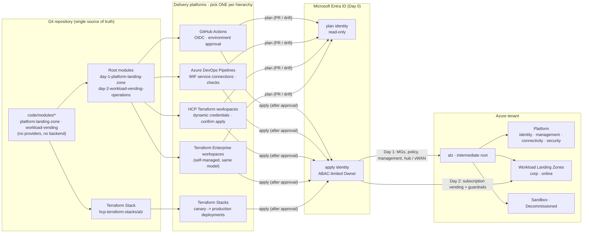

</details>

**How to read this diagram:**

- **Left - one codebase:** all logic lives in two provider-less modules. Two thin root modules (backend + authentication) and one Terraform Stack consume them, so no logic is duplicated per platform.
- **Centre - five interchangeable delivery platforms:** GitHub Actions, Azure DevOps, HCP Terraform workspaces and Terraform Enterprise workspaces run the root modules; Terraform Stacks runs the Stack. Only **one** platform may own a given management group hierarchy.
- **Entra ID - the same two identities everywhere:** created once in Day 0. Plans (pull requests, drift detection) use the read-only identity; applies use the privileged identity, reachable only after a human approval (or a Stacks auto-approve rule for the canary). Stacks use the apply identity for plan and apply of each deployment.
- **Right - what gets deployed:** Day 1 builds the management group hierarchy, policy, management resources and connectivity (hub-and-spoke or Virtual WAN); Day 2 vends subscriptions into the Workload Landing Zones and assigns the workload guardrails.
- **No secrets anywhere:** every arrow into Entra ID is a workload identity federation (OIDC) token exchange.

### 2.2 Management group hierarchy, archetypes and subscription placement

#### 🖼️ Architectural Infographic: Architecture & Governance Framework


**Detailed Architectural Breakdown & Governance Takeaways:**

- **Hierarchy Structure & Archetype Boundaries:**
  - **Intermediate Root (`alz`):** Sits directly below the Tenant Root Group. Houses the `root_masterclass` archetype, enforcing organization-wide baselines (Defender for Cloud, Azure Activity Log export, diagnostic logging, classic resource retirement, and allowed deployment regions) without impacting root-level break-glass accounts.
  - **Identity Management Group (`identity`):** Hosts directory services, domain controllers, and identity sync infrastructure. Enforces policies strictly denying public IP addresses, blocking open internet management ports (RDP 3389, SSH 22), and prohibiting subnets without Network Security Groups (NSGs).
  - **Management Management Group (`management`):** Centralizes enterprise operational telemetry, Log Analytics workspaces, Azure Monitor Agent (AMA) associations, Data Collection Rules (DCRs), and Microsoft Sentinel SIEM onboarding.
  - **Connectivity Management Group (`connectivity`):** Manages shared transit infrastructure, including regional Hub VNets, Virtual WAN hubs, Azure Firewall Premium, Private DNS Resolver inbound/outbound endpoints, Azure Bastion, and ExpressRoute / VPN gateways.
  - **Security Management Group (`security`):** A dedicated 2026 ALZ architecture archetype designed specifically to isolate Security Operations Center (SOC) tooling, security telemetry exports, specialized SIEM forwarders, and threat intelligence workloads.
  - **Corp Workload Landing Zones (`corp`):** Dedicated to internal corporate applications. Policies strictly deny public IPs on virtual network interfaces (`Deny-Public-IP-On-NIC`), prohibit public endpoints on PaaS resources (`Deny-Public-Endpoints`), and enforce Private Endpoints with centralized DNS registration.
  - **Online Workload Landing Zones (`online`):** Dedicated to public-facing applications. Inbound traffic is fronted by Application Gateway or Azure Front Door with Web Application Firewall (WAF) inspection; direct outbound internet traffic is routed through the central firewall.

- **Policy-as-Code Phased Lifecycle (ALZ Library 2026):**
  - **Phase 1: Audit Mode (`audit` / `DoNotEnforce`):** Deploys policies with `effect = Audit` or `enforcement_mode = DoNotEnforce`. Platform teams assess compliance gaps and monitor violation logs across existing brownfield workloads with zero risk of deployment disruption.
  - **Phase 2: Remediate Mode (`DeployIfNotExists` / `Modify`):** Activates auto-remediation policies (`effect = DeployIfNotExists` / `Modify`). Remediation tasks automatically backfill missing diagnostic logs, deploy monitoring agents, and attach default network security rules without blocking day-to-day deployments.
  - **Phase 3: Enforce Mode (`enforce` / `Deny`):** Flips guardrail policies to active enforcement (`effect = Deny`). Non-compliant resource deployments (such as assigning a public IP in a `corp` landing zone) are actively blocked at the ARM control plane before creation.

- **Policy Enforcement State Matrix Across Rollout Phases:**
  - **Standard ALZ Phased Deny Policies:** Audit (`DoNotEnforce`) -> Remediate (`DoNotEnforce`) -> Enforce (`enforced` / Active Deny).
  - **ALZ Phased DINE / Modify Policies:** Audit (`DoNotEnforce`) -> Remediate (`enforced` / Auto-deploy tasks) -> Enforce (`enforced`).
  - **Workload Custom Guardrails:** Audit (`DoNotEnforce`) -> Remediate (`DoNotEnforce` / Compliance remediation) -> Enforce (`enforced`).

<details>
<summary><strong>📊 Diagram: 2.2 Management group hierarchy, archetypes and subscription placement</strong> <em>(click to expand)</em></summary>


</details>

**How to read this diagram:**

- **Boxes are management groups, rounded dashed boxes are subscriptions.** Blue = platform landing zone (platform team), green = Workload Landing Zones, grey = special-purpose groups. The tree is defined in [`alz_2026_masterclass.alz_architecture_definition.yaml`](code/modules/platform-landing-zone/lib/architecture_definitions/alz_2026_masterclass.alz_architecture_definition.yaml); each box names its **archetype** and representative **policy assignments** from the ALZ Library `2026.10.0` plus this repository's overrides.
- **Inheritance flows downwards:** a subscription in `corp` is governed by `alz` + `landingzones` + `corp`. That is why the organisation-wide baseline (Defender for Cloud, activity log and diagnostics to the central workspace, classic resources denied, Microsoft cloud security benchmark, data residency) sits at `alz` and nowhere else.
- **The Tenant Root Group is not used for policy:** `alz` is an intermediate root, so tenant-wide guardrails can be tested, replaced or duplicated (canary) without touching the root.
- **Platform subscriptions are placed by Day 1** (`subscription_placement`); **workload subscriptions are placed by Day 2** vending, which picks `corp`, `online` or `sandbox` from the entry's `archetype`, or `decommissioned` when `decommissioned = true`.
- **`corp` vs `online` is an exposure model, not an org chart:** `corp` workloads are private and hub-connected (public endpoints and public IPs on NICs are denied); `online` workloads may be internet-facing behind WAF / Front Door. Environments (`prod` / `nonprod`) are separate **subscriptions** in the same MG, never separate MGs.
- **Phased assignments:** the `Deny-*` and `Deploy-*` assignments listed for `landingzones`, `corp` and `identity` change enforcement with `policy_enforcement_phase` (section [2.12](#212-policy-as-code-lifecycle)).
- **The security MG** is the 2026 ALZ addition for SOC tooling (Sentinel workspace, Defender exports, threat intelligence); its subscription is optional.

### 2.3 Platform landing zone (Day 1): what is deployed in each platform subscription

<details>
<summary><strong>📊 Diagram: 2.3 Platform landing zone (Day 1): what is deployed in each platform subscription</strong> <em>(click to expand)</em></summary>

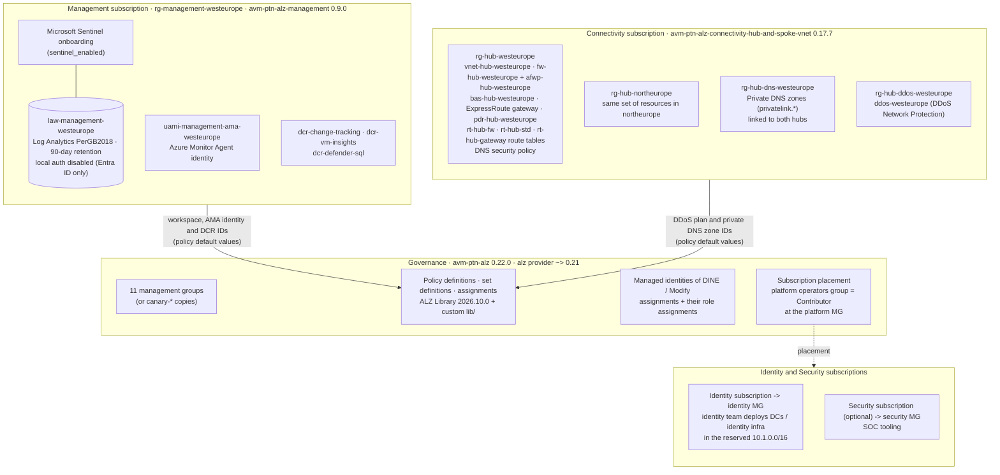

</details>

**How to read this diagram:**

- **Four AVM modules, one root module:** `avm-ptn-alz` (governance), `avm-ptn-alz-management` (logging), one connectivity pattern module (hub-and-spoke shown; `avm-ptn-alz-connectivity-virtual-wan 0.18.0` when `connectivity_type = "virtual_wan"`) and `avm-res-resources-resourcegroup 0.4.0` for the connectivity resource groups.
- **Management:** one central Log Analytics workspace (Entra ID-only ingestion and query), the user-assigned identity used by the Azure Monitor Agent, three data collection rules and optional Microsoft Sentinel. Azure Automation is **not** deployed - Update Manager and AMA replace it in ALZ 2026.
- **Connectivity, per region:** a hub VNet with zone-redundant Azure Firewall (SKU per region, `Premium` in the example) and its policy (DNS proxy on), Azure Bastion, the gateways you enable (ExpressRoute in the example, VPN off), a DNS Private Resolver inbound endpoint and the route tables the module manages. **Shared, once:** the private DNS zones and one DDoS Network Protection plan for all regions.
- **Policy is wired to the resources:** IDs of the workspace, AMA identity, DCRs, DDoS plan and DNS zones are composed at plan time and passed as ALZ *policy default values*, so `DeployIfNotExists` policies point at the right resources from the first apply. Policy assignments (and their role assignments) explicitly wait for the management and connectivity modules.
- **Identity and Security subscriptions** are only *placed* by Day 1; their content belongs to the identity and SOC teams. The identity `/16` is reserved in the address plan so identity VNets never overlap.
- **Feature toggles** (`connectivity_features`) switch every optional component on or off - the canary deployment turns off DDoS, Bastion and gateways to stay cheap.

### 2.4 Network topology A: customer-managed hub-and-spoke (default)

#### 🖼️ Architectural Infographic: Hub-and-Spoke vs. Virtual WAN Reference Architecture

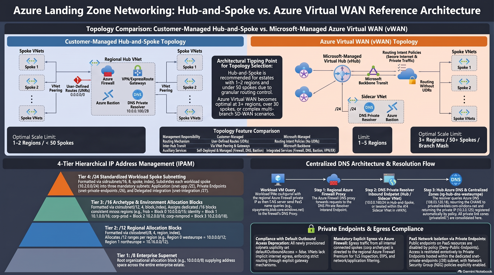

**Detailed Architectural Breakdown & Network Sizing Takeaways:**

- **Topology Trade-Offs: Customer-Managed vs. Microsoft-Managed:**
  - **Customer-Managed Hub-and-Spoke:**
    - *Core Fabric:* Regional customer-managed hub VNets hosting Azure Firewall Premium, GatewaySubnet (ExpressRoute / VPN), Azure Bastion, and Private DNS Resolvers.
    - *Routing Mechanics:* Explicit User-Defined Routes (UDRs) deployed to spoke subnets forcing all egress traffic (`0.0.0.0/0`) through the central firewall private IP. Spoke VNets peer bilaterally with the hub (`allow_gateway_transit = true` on hub, `use_remote_gateways = true` on spokes).
    - *Optimal Scale:* Ideal for enterprises with fewer than 50 spoke VNets, single or dual-region deployments, or complex third-party Next-Generation Firewall (NVA) clustering requirements.
  - **Microsoft-Managed Azure Virtual WAN (vWAN):**
    - *Core Fabric:* Microsoft-orchestrated Virtual Hubs (`vHubs`) delivering an automated, scalable software-defined transit mesh.
    - *Routing Mechanics:* Declarative Routing Intent policies configure automated transit, routing `InternetTraffic` and `PrivateTraffic` directly through integrated secured hub firewalls, eliminating hundreds of individual UDR route tables.
    - *Optimal Scale:* Engineered for large global enterprises with 50+ spoke VNets, 3 or more cloud regions, extensive branch connectivity (SD-WAN / IPsec), and automated transitive routing demands.

- **PaaS Security & Centralized Private DNS Integration:**
  - **Private Endpoints by Default:** Workload PaaS services (Azure Storage, Key Vault, Azure SQL) connect exclusively via Private Endpoints in spoke subnets with private RFC 1918 IPs.
  - **Centralized Private DNS Zones:** All private DNS zones (`privatelink.blob.core.windows.net`, `privatelink.vaultcore.azure.net`, etc.) reside in the Connectivity subscription.
  - **Private DNS Resolver:** Inbound endpoints receive DNS queries forwarded from on-premises; outbound rulesets resolve corporate DNS zones from cloud workloads, preventing split-brain DNS resolution.

- **Hierarchical Deterministic IPAM Allocation:**
  - **Root Cloud Block:** `/8` allocation reserved for global cloud enterprise networking.
  - **Regional Partitioning:** `/12` blocks assigned per cloud region (e.g. Primary vs Secondary).
  - **Archetype Segmentation:** `/16` blocks assigned cleanly by archetype (`10.2.0.0/16` Corp Prod, `10.3.0.0/16` Corp NonProd, `10.4.0.0/16` Online Prod, `10.15.0.0/16` Sandbox).
  - **Workload Spoke Slices:** Standardized `/24` subnets (providing up to 256 unique spoke VNets per `/16` block) split into `/25` App, `/26` Data, and `/27` Integration subnets with `defaultOutboundAccess = false`.

<details>
<summary><strong>📊 Diagram: 2.4 Network topology A: customer-managed hub-and-spoke (default)</strong> <em>(click to expand)</em></summary>

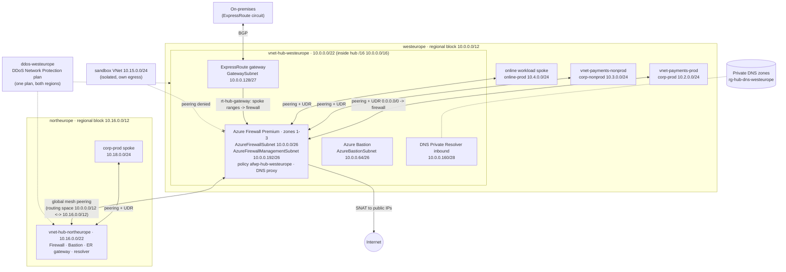

</details>

**How to read this diagram:**

- **One hub per region, one `/12` per region:** the hub VNet is a `/22` at the start of the region's hub `/16`; spokes take `/24`s from the archetype + environment `/16` (corp-prod `10.2.0.0/16`, corp-nonprod `10.3.0.0/16`, online-prod `10.4.0.0/16` ...). Subnet addresses come straight from `hub_vnet_layout` in [`locals.tf`](code/modules/platform-landing-zone/locals.tf).
- **Everything is inspected:** each spoke has a route table with `0.0.0.0/0 -> firewall private IP` and BGP propagation disabled, so internet, spoke-to-spoke and on-premises traffic all traverse the regional Azure Firewall. Traffic inside a spoke VNet (for example to its own Private Endpoints) stays local.
- **Multi-region:** the hubs are connected with global mesh peering and each hub advertises its whole regional `/12` as routing space, so a spoke in one region reaches a spoke in the other through both firewalls.
- **Hybrid:** the ExpressRoute gateway in `GatewaySubnet` exchanges routes with on-premises over BGP; the module's gateway route table sends traffic arriving from on-premises to the firewall, and spokes use the hub gateway through `use_remote_gateways` when `hub_gateways_present = true`.
- **DNS:** spokes use the firewall (DNS proxy) as their DNS server; the firewall forwards to the DNS Private Resolver inbound endpoint, which resolves the `privatelink.*` zones linked to the hub (section [2.7](#27-traffic-flows-and-dns-resolution)).
- **Protection:** one DDoS Network Protection plan in the primary region protects VNets in both regions (`Enable-DDoS-VNET` policy keeps them associated).
- **Sandboxes** are never peered (crossed line): they have their own explicit egress and still use a unique range from `10.15.0.0/16`.

### 2.5 Network topology B: Azure Virtual WAN (toggle)

<details>
<summary><strong>📊 Diagram: 2.5 Network topology B: Azure Virtual WAN (toggle)</strong> <em>(click to expand)</em></summary>

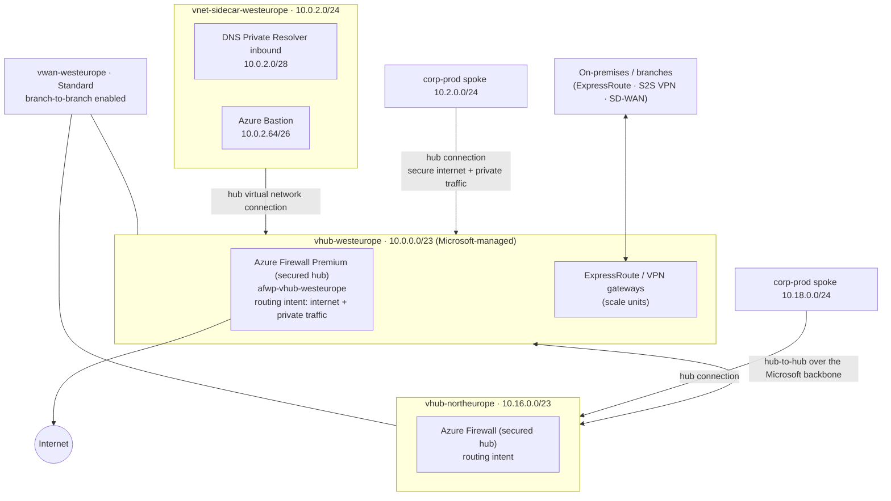

</details>

**How to read this diagram:**

- **Same address plan, different hub:** with `connectivity_type = "virtual_wan"` each region's hub `/16` holds a `/23` virtual hub and a `/24` **sidecar VNet** (`vwan_layout` in `locals.tf`). Spoke `/24`s are identical to hub-and-spoke, so switching topology does not re-address workloads.
- **Sidecar VNet:** a virtual hub cannot host the DNS Private Resolver or Azure Bastion, so they live in a small VNet connected to the hub like any spoke.
- **Routing intent replaces UDRs:** spokes are connected with `secure_internet_traffic` and `secure_private_traffic` enabled, so the hub firewall inspects internet and private traffic without route tables in the spokes (vending skips the route table in Virtual WAN).
- **Microsoft-managed transit:** hub-to-hub, branch-to-branch and branch-to-spoke routing are provided by the service; this is what makes Virtual WAN attractive at 3+ regions, 50+ spokes or many branches (decision matrix in [docs/03](docs/03-networking-hubspoke-vs-vwan.md#2-decision-matrix-12-criteria)).
- **Gateways are hub features:** ExpressRoute and VPN gateways are deployed inside the virtual hub in scale units rather than in a `GatewaySubnet`.

### 2.6 IP address management (IPAM)

<details>
<summary><strong>📊 Diagram: 2.6 IP address management (IPAM)</strong> <em>(click to expand)</em></summary>

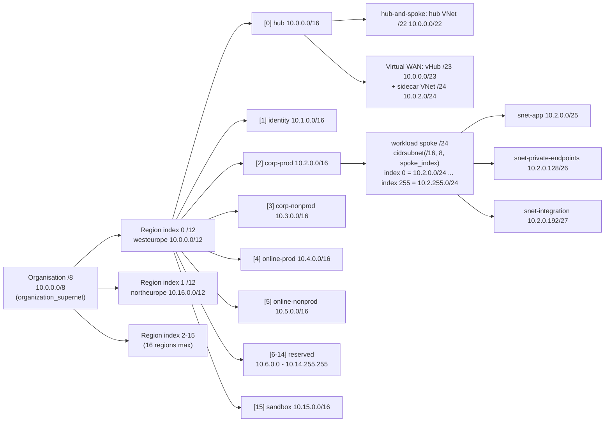

</details>

**How to read this diagram:**

- **Four levels, all computed:** `/8` organisation -> `/12` per region (`cidrsubnet(/8, 4, region.index)`) -> `/16` per archetype + environment (`cidrsubnet(/12, 4, block_index)`) -> `/24` per workload (`cidrsubnet(/16, 8, spoke_index)`). Day 1 publishes the result as the `ipam_plan` output; Day 2 only adds a `spoke_index`.
- **Block indexes are fixed across regions:** corp-prod is block `2` everywhere (`10.2.0.0/16` in westeurope, `10.18.0.0/16` in northeurope), so a range tells you region and archetype at a glance and firewall rules can be written per block.
- **Capacity:** 256 spokes per archetype + environment per region, 9 reserved `/16`s per region for new archetypes, AI / data platforms or AKS pod ranges.
- **Fixed subnet layout per spoke:** an application `/25`, a Private Endpoint `/26` (network policies enabled so NSGs and UDRs apply to Private Endpoints) and an integration `/27` for delegated subnets. All are private subnets (`default_outbound_access_enabled = false`).
- **Collision-free by construction:** a Day 2 validation rejects two entries with the same `(region, archetype, environment, spoke_index)`; Azure Virtual Network Manager IPAM pools can be used instead with the same hierarchy (docs/03 section 3).

### 2.7 Traffic flows and DNS resolution

| Flow (hub-and-spoke) | Path | Inspected by |
|---|---|---|
| Spoke -> internet | spoke UDR `0.0.0.0/0` -> regional firewall -> SNAT to firewall public IP | Azure Firewall (application + network rules, TLS inspection / IDPS with Premium) |
| Spoke -> spoke (same region) | spoke UDR -> firewall -> peered spoke | Azure Firewall |
| Spoke -> spoke (other region) | firewall (region A) -> global hub peering -> firewall (region B) | Both firewalls |
| Spoke <-> on-premises | spoke UDR -> firewall -> ExpressRoute gateway; return via the gateway route table -> firewall | Azure Firewall (BGP propagation disabled on spoke route tables) |
| Spoke -> its own Private Endpoint | stays inside the spoke VNet (more specific system route) | NSG on `snet-private-endpoints` |
| Admin -> VM | Azure Bastion in the hub -> VM private IP over peering | Bastion + NSG (management ports from the internet are denied by policy) |
| Sandbox -> internet | sandbox's own NAT Gateway or public IP | Nothing central - isolated by policy |

<details>
<summary><strong>📊 Diagram: 2.7 Traffic flows and DNS resolution</strong> <em>(click to expand)</em></summary>

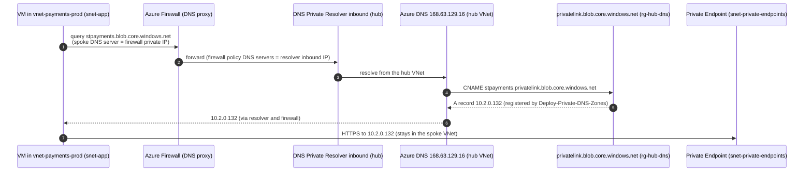

</details>

**How to read this diagram:**

- **Steps 1-2 - one DNS entry point per region:** every vended spoke gets the regional firewall IP as its DNS server (`dns_server_ip_addresses` output), and the firewall's DNS proxy forwards to the resolver inbound endpoint. The firewall therefore sees every name lookup, which FQDN-based network rules need.
- **Steps 3-5 - zones live once, in the hub:** the `privatelink.*` zones are created once in `rg-hub-dns-westeurope` and linked to the hub VNets, not to spokes. The `Deploy-Private-DNS-Zones` policy (corp) creates the A record automatically when a Private Endpoint is created, so workload teams never manage DNS.
- **Step 7 - data path:** the connection to the Private Endpoint stays inside the spoke VNet; nothing traverses the public endpoint, which `Deny-Public-Endpoints` keeps disabled in `corp`.
- **On-premises** resolves the same names by forwarding the public zones (`blob.core.windows.net`, ...) to the resolver inbound endpoint over ExpressRoute.
- **Virtual WAN difference:** the resolver lives in the sidecar VNet and spokes use the hub firewall DNS proxy or the resolver IP; the flow is otherwise identical.
- **Exception path:** `private_dns_zone_links = true` on a vending entry links zones to that spoke directly (documented exception in [`dns.tf`](code/modules/workload-vending/dns.tf)).

### 2.8 Identity, OIDC trust and Terraform state

<details>
<summary><strong>📊 Diagram: 2.8 Identity, OIDC trust and Terraform state</strong> <em>(click to expand)</em></summary>

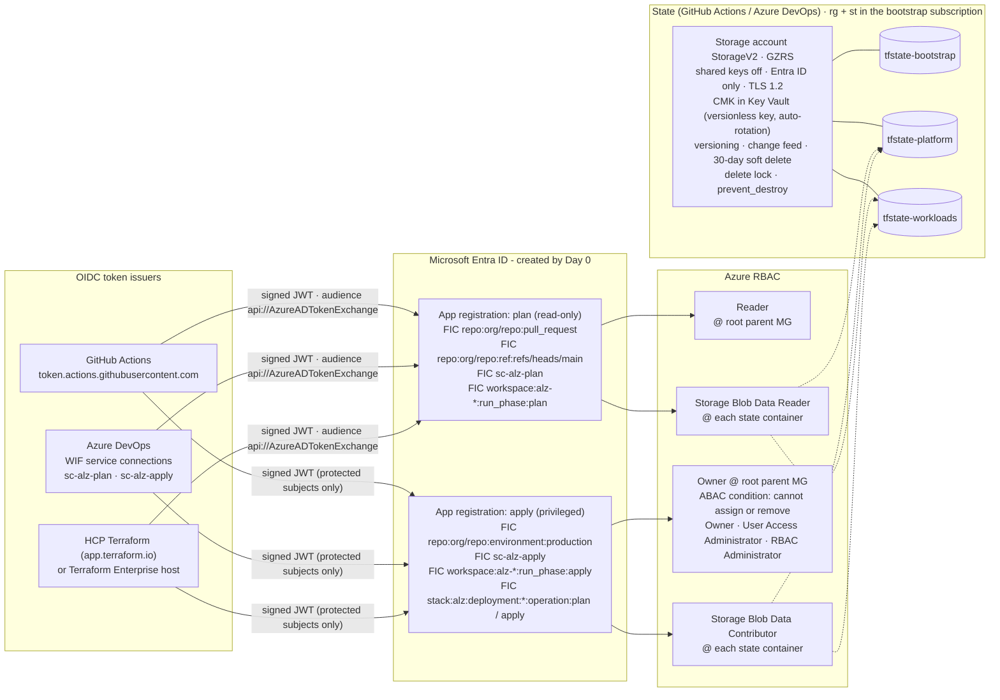

</details>

**How to read this diagram:**

- **Two identities, many issuers:** Day 0 creates exactly one *plan* and one *apply* app registration. Each delivery platform you enable adds **federated identity credentials (FICs)** - an `(issuer, subject)` pair - to them; Azure DevOps FICs are added by `day-0-cicd-azure-devops` because the service-connection subject is only known once the connection exists.
- **The subject is the security boundary:** pull requests and the default branch can only obtain the read-only identity; only jobs bound to the protected `production` environment (GitHub), the `sc-alz-apply` connection behind branch control and approvals (Azure DevOps), or the `apply` run phase (HCP Terraform / TFE) can obtain the privileged one. Terraform Stacks use one client ID per deployment, so both Stack subjects trust the apply identity and HCP Terraform approvals gate the apply.
- **Least privilege:** the plan identity is `Reader` on the hierarchy and can only read state (PR plans run with `-lock=false`). The apply identity needs `Owner` at the root parent management group because ALZ creates role assignments for policy managed identities - the ABAC condition stops it from minting new Owners, User Access Administrators or RBAC Administrators.
- **State is a crown jewel:** one container per lifecycle stage limits blast radius; the account accepts Entra ID authentication only, is encrypted with a customer-managed key and keeps versions and soft-deleted blobs for 30 days. HCP Terraform, TFE and Stacks keep state in the platform instead.
- **No secrets anywhere:** there is no client secret or certificate on either app registration; tokens are short-lived and minted per job.

### 2.9 Delivery: the lifecycle of a change

#### 🖼️ Architectural Infographic: Zero-Secret Delivery (15-Step OIDC Deployment Pipeline)

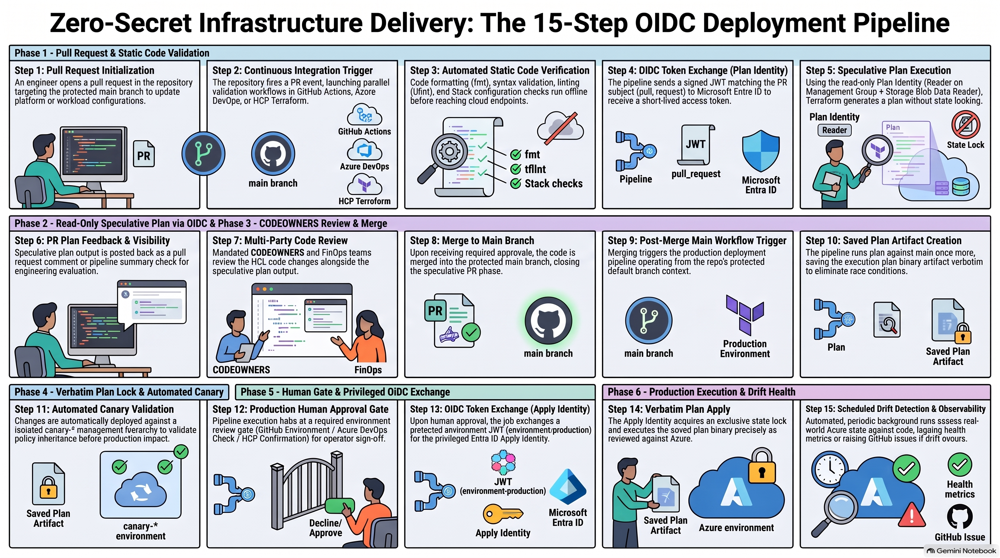

**Detailed Architectural Breakdown & Pipeline Lifecycle Takeaways:**

- **Phase 1 — Pull Request & Static Code Validation (Steps 1–3):**
  - **Step 1 (PR Initialization):** An engineer opens a pull request targeting the protected `main` branch to update platform modules, policies, or workload declarations.
  - **Step 2 (CI Trigger):** The repository fires a pull request webhook, initiating parallel CI workflows across GitHub Actions, Azure DevOps, or HCP Terraform.
  - **Step 3 (Offline Static Checks):** Formatting (`terraform fmt -check`), linting (`tflint`), OpenTofu validation, and Terraform Stacks static checks execute offline without connecting to cloud APIs.

- **Phase 2 — Read-Only Speculative Plan via OIDC (Steps 4–6):**
  - **Step 4 (Plan OIDC Token Exchange):** The runner presents a signed OIDC JWT with subject claim `repo:<org>/<repo>:pull_request` to Microsoft Entra ID, receiving a short-lived, unprivileged access token.
  - **Step 5 (Speculative Plan Execution):** The Plan Identity (granted `Reader` on Management Groups and `Storage Blob Data Reader` on Terraform state) runs `terraform plan` without state locking.
  - **Step 6 (PR Plan Feedback):** The plan output, resource delta, and cost estimates are posted directly back into the pull request review thread.

- **Phase 3 — CODEOWNERS Review & Merge (Steps 7–8):**
  - **Step 7 (Multi-Party Peer Review):** CODEOWNERS, cloud platform architects, and FinOps review the HCL changes and plan output.
  - **Step 8 (Merge to Main):** Once all branch protection rules and reviews pass, code is merged into the protected `main` branch.

- **Phase 4 — Production Plan & Immutable Artifact Creation (Steps 9–10):**
  - **Step 9 (Post-Merge Trigger):** Merging to `main` triggers the production deployment pipeline in the default branch context.
  - **Step 10 (Saved Plan Binary):** Terraform runs `plan` against the latest state and writes the execution plan to an immutable binary artifact (`tfplan`), preventing execution drift and race conditions.

- **Phase 5 — Canary Validation & Human Approval Gate (Steps 11–13):**
  - **Step 11 (Automated Canary Deployment):** The pipeline deploys the plan first against the isolated `canary-*` management group hierarchy to validate policy inheritance and API responses.
  - **Step 12 (Production Approval Gate):** Execution pauses at an environment protection gate (GitHub Environment, Azure DevOps Approval Check, or HCP Confirmation) requiring explicit operator sign-off.
  - **Step 13 (Apply OIDC Token Exchange):** Upon sign-off, the pipeline exchanges a protected environment JWT (`environment:production`) for the privileged Entra ID Apply Identity.

- **Phase 6 — Production Execution & Continuous Drift Health (Steps 14–15):**
  - **Step 14 (Verbatim Plan Apply):** The Apply Identity acquires an exclusive state lock and applies the saved binary plan artifact verbatim against Azure.
  - **Step 15 (Scheduled Drift Observability):** Automated recurring background pipelines run `terraform plan` on a schedule, dispatching telemetry metrics and raising GitHub issues upon detecting configuration drift.

<details>
<summary><strong>📊 Diagram: 2.9 Delivery: the lifecycle of a change</strong> <em>(click to expand)</em></summary>

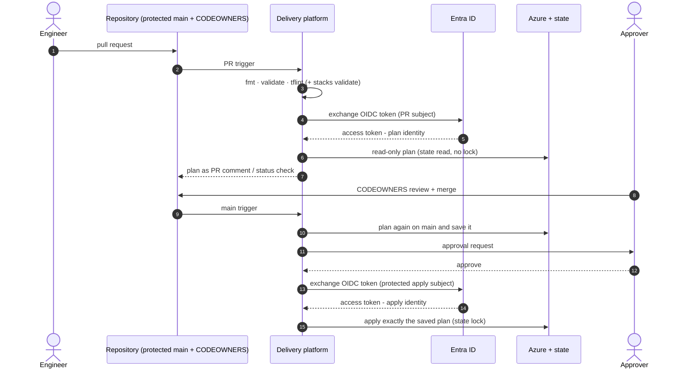

</details>

| Step | GitHub Actions | Azure DevOps Pipelines | HCP Terraform / TFE workspaces | Terraform Stacks |
|---|---|---|---|---|
| 3 - static checks | `terraform-plan.yml` (reusable stack workflow) | `alz-pr-validation.yml` | VCS speculative plan | `terraform stacks validate` in CI |
| 4-6 - read-only plan | `pull_request` subject -> plan identity | `sc-alz-plan` | `run_phase:plan` -> `TFC_AZURE_PLAN_CLIENT_ID` | deployment `operation:plan` (apply identity) |
| 10 - plan on `main` | `terraform-apply.yml`, plan job | `Plan_platform` / `Plan_workloads` stages | run queued in `alz-platform` | new configuration version, plan per deployment |
| 11-12 - approval | environment `production`, required reviewers | environment `alz-production`: approval, exclusive lock, branch control | *Confirm & apply* (`auto_apply = false`) | manual for `production`; auto-approve rule for `canary` (Premium) |
| 13-15 - apply | `environment:production` subject -> apply identity | `sc-alz-apply` (branch control: `main` only) | `run_phase:apply` -> `TFC_AZURE_APPLY_CLIENT_ID` | deployment `operation:apply` |
| Day 2 ordering | `workloads` job `needs: platform` | `Apply_workloads` after `Apply_platform` | run trigger `alz-platform` -> `alz-workloads` | component dependency `platform` -> `workloads` |
| Drift | `terraform-drift-detection.yml` -> GitHub issues | `alz-drift-detection.yml` | health assessments | per deployment |

**How to read this diagram and table:**

- **The same 15 steps on every platform:** only *where* each step is implemented changes. The table maps every numbered step to the concrete workflow, stage, setting or feature that implements it.
- **Two plans:** the PR plan (step 6) is informational and runs with read-only rights; the plan that is applied (step 10) is produced on `main` after the merge and applied verbatim, so nothing un-reviewed reaches Azure.
- **Gates live outside the YAML:** GitHub environments, Azure DevOps checks, HCP Terraform confirmation and Stacks deployment groups are configured by Day 0 bootstrap code, so a pull request cannot remove its own gate.
- **Full flows per platform:** [`architecture/diagrams/delivery-platforms.md`](architecture/diagrams/delivery-platforms.md); comparison and decision guide: [docs/07](docs/07-delivery-platforms.md) and [ADR-006](architecture/decision-matrices/ADR-006-delivery-platform.md).

### 2.10 Deployment stages and the platform contract

<details>
<summary><strong>📊 Diagram: 2.10 Deployment stages and the platform contract</strong> <em>(click to expand)</em></summary>

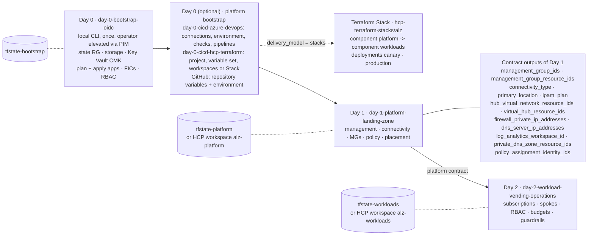

</details>

**How to read this diagram:**

- **Day 0 is the only CLI step:** it creates the trust anchor (state + identities) with an operator's elevated, temporary rights; everything after it runs through the chosen delivery platform with the Day 0 identities.
- **Optional platform bootstrap:** Azure DevOps and HCP Terraform / TFE configuration (service connections, checks, workspaces, variable sets, the Stack) is itself Terraform, so the gates are reviewed code too. GitHub needs only repository variables and the `production` environment, printed by a Day 0 output.
- **Day 1 -> Day 2 through a versioned contract:** Day 2 never reads Day 1 resources directly; it reads the outputs listed in the box through `terraform_remote_state` (Azure Storage or HCP Terraform remote state, shared only with `alz-workloads`). In the Stack the same values flow from the `platform` component to the `workloads` component.
- **Separate state per stage:** a broken workload change cannot corrupt platform state, and the platform team can restrict who may write `tfstate-platform`.
- **Stacks replace the two root modules, not the modules:** the Stack wires the same two modules as components and adds the `canary` deployment.

### 2.11 Subscription vending: what one entry creates

#### 🖼️ Architectural Infographic: Subscription Vending Architecture


**Detailed Architectural Breakdown & Provisioning Takeaways:**

- **The Input Trigger (Declarative HCL Order Form):**
  - Platform users or workload teams submit a pull request with a single map entry in `workloads.auto.tfvars`.
  - Parameters specify: `archetype = corp`, `environment = prod`, target `region`, deterministic `spoke_index = 0`, `budget_amount = 4000`, `github_repository = "org/payments-api"`, and `owner_group_object_id`.

- **Automated Vending & Governance Placement:**
  - **Subscription Creation:** The engine provisions a dedicated subscription (`sub-payments-prod`) via Azure billing APIs (MCA / EA) and moves it into the target management group (`corp`).
  - **Policy Inheritance:** The subscription immediately inherits baseline security policies from `alz`, `platform`, `landingzones`, and `corp` (denying public IPs and enforcing Private Endpoints).

- **Standardized Resource Group Hierarchy:**
  - `rg-network-payments-prod`: Platform-controlled resource group hosting the spoke VNet, route tables, and NSGs.
  - `rg-identity-payments-prod`: Platform-controlled resource group hosting the User-Assigned Managed Identity and federated credential.
  - `rg-app-payments-prod`: Application team-owned resource group where workload engineers deploy business PaaS/IaaS resources.

- **Automated Networking, Routing & Security:**
  - **Spoke Virtual Network:** Deterministically calculated from `spoke_index = 0` as `10.2.0.0/24` with subnets: `snet-app` (`10.2.0.0/25`), `snet-data` (`10.2.0.128/26`), and `snet-integration` (`10.2.0.192/27`).
  - **Private Subnets by Default:** Subnets are configured with `defaultOutboundAccess = false` in compliance with 2026 security baselines.
  - **Hub Peering & UDR:** Bilateral VNet peering connects the spoke to the regional hub. A User-Defined Route (`rt-payments-prod`) routes all outbound traffic (`0.0.0.0/0`) to the Azure Firewall private IP.
  - **DNS Proxy:** Spoke VNet points to the regional hub firewall or Private DNS Resolver inbound IP for seamless private endpoint resolution.

- **Access Control, FinOps & Secret-Less CI/CD:**
  - **RBAC Scoping:** Contributor role on the subscription is assigned exclusively to the workload team Entra ID group (`owner_group_object_id`).
  - **FinOps Budget Guardrails:** An automated Azure Budget (`budget-payments-prod-monthly`) is provisioned with alerts configured at 80% actual spend and 100% forecasted spend.
  - **Workload Identity Federation:** User-Assigned Managed Identity (`id-payments-prod-deploy`) is created with a federated credential bound to the workload GitHub repository and environment (`repo:org/payments-api:environment:prod`), eliminating static secrets.

- **Outputs & Team Handoff:**
  - The pipeline outputs subscription ID, VNet resource IDs, subnet IDs, and the Managed Identity Client ID directly into the PR, enabling the application team to deploy their workload immediately.

<details>
<summary><strong>📊 Diagram: 2.11 Subscription vending: what one entry creates</strong> <em>(click to expand)</em></summary>

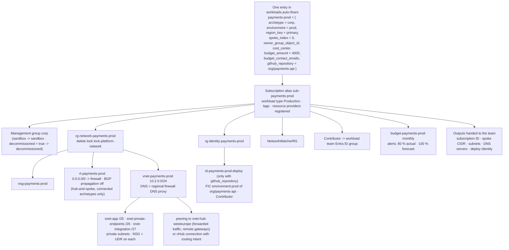

</details>

**How to read this diagram:**

- **One map entry is the whole request:** `avm-ptn-alz-sub-vending 0.3.4` turns it into a subscription and everything around it in a single plan; the only number the team chooses is `spoke_index`.
- **Platform-owned vs team-owned:** the network resource group carries a delete lock and the route table and peering are platform-managed, so the team's `Contributor` role cannot break connectivity; the team deploys workloads in its own resource groups.
- **Connected vs isolated:** `corp` and `online` entries get the route table, hub peering (or vHub connection) and hub DNS; `sandbox` entries get none of them, must set `expires_on` and use the `10.15.0.0/16` block.
- **Workload pipelines stay secret-less too:** with `github_repository`, a user-assigned identity with a federated credential for that repository's environment is created, scoped to the new subscription only.
- **Guardrails from minute one:** the subscription lands in a management group that already carries the ALZ policies and the `Wlz-Guardrails-2026` initiative (section [2.12](#212-policy-as-code-lifecycle)). The sequence of the request itself (PR, review, approval) is in [`subscription-vending-flow.md`](architecture/diagrams/subscription-vending-flow.md).

### 2.12 Policy-as-Code lifecycle

<details>
<summary><strong>📊 Diagram: 2.12 Policy-as-Code lifecycle</strong> <em>(click to expand)</em></summary>

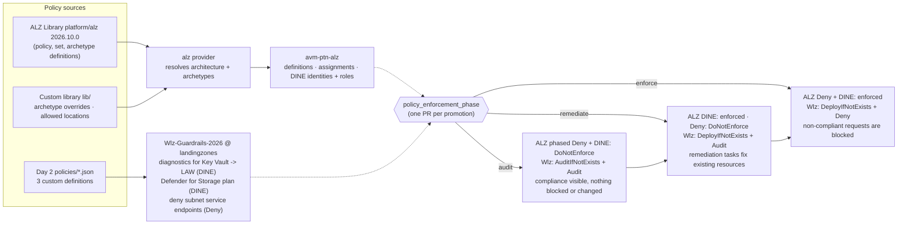

</details>

| Phase-controlled ALZ assignments | Deny (enforced only in `enforce`) | DeployIfNotExists (enforced from `remediate`) |
|---|---|---|
| `landingzones` | `Deny-IP-forwarding`, `Deny-MgmtPorts-Internet`, `Deny-Subnet-Without-Nsg`, `Deny-Storage-http`, `Deny-Priv-Esc-AKS`, `Deny-Privileged-AKS` | `Deploy-VM-Backup`, `Deploy-SQL-TDE`, `Deploy-SQL-Threat`, `Deploy-AzSqlDb-Auditing` |
| `corp` | `Deny-Public-Endpoints`, `Deny-Public-IP-On-NIC`, `Deny-HybridNetworking` | `Deploy-Private-DNS-Zones` |
| `identity` | `Deny-MgmtPorts-Internet`, `Deny-Public-IP`, `Deny-Subnet-Without-Nsg` | - |

**How to read this diagram and table:**

- **Two sources, one lifecycle:** the ALZ Library (through the `alz` provider and `avm-ptn-alz`) supplies the reference policy set; Day 2 adds a small custom initiative for gaps. Both read the same `policy_enforcement_phase` variable.
- **Audit -> remediate -> enforce:** ALZ assignments are switched with `enforcementMode` (`DoNotEnforce` keeps evaluation, so compliance is still reported); the custom initiative switches **effects** (`AuditIfNotExists`/`Audit` -> `DeployIfNotExists` -> `Deny`). In `remediate` and `enforce`, Day 2 also creates remediation tasks for existing resources (stopping if more than 10 % fail).
- **Always-on baseline:** assignments not in the table (Defender for Cloud, activity log, diagnostics, classic resources, data residency, the sandbox and decommissioned initiatives) are enforced from the first apply.
- **Reviewed overrides only:** parameters, enforcement and `creation_enabled` changes are explicit HCL in `locals.tf` (for example all Defender plans set to `DeployIfNotExists`, `Enable-DDoS-VNET` disabled when there is no DDoS plan); nothing is edited in the portal.
- Runbook and trade-offs per WAF pillar: [docs/06](docs/06-waf-simplicity-vs-security.md); timeline diagram: [`policy-lifecycle.md`](architecture/diagrams/policy-lifecycle.md).

### 2.13 Management, monitoring and security operations

<details>
<summary><strong>📊 Diagram: 2.13 Management, monitoring and security operations</strong> <em>(click to expand)</em></summary>

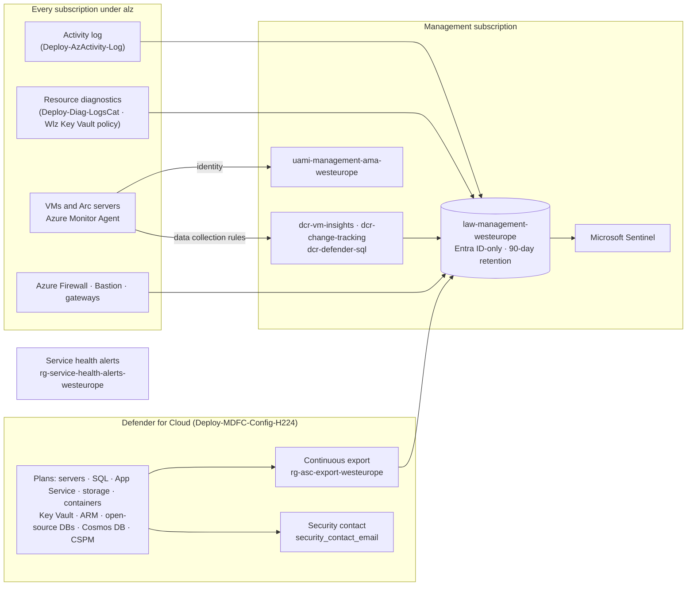

</details>

**How to read this diagram:**

- **One workspace for the platform:** activity logs and resource diagnostics of every subscription under `alz` are sent to the central workspace by policy, so new subscriptions are covered without any pipeline change.
- **Agent-based telemetry without Automation:** the Azure Monitor Agent authenticates with the shared user-assigned identity, and three data collection rules (VM insights, change tracking, Defender for SQL) are associated by ALZ policies using the IDs passed as policy default values.
- **Security operations:** every Defender for Cloud plan in the ALZ initiative is set to `DeployIfNotExists`; alerts and recommendations are exported to the workspace, where Microsoft Sentinel (optional) correlates them. The security contact receives Defender notifications.
- **Hardening of the workspace:** local (shared-key) authentication is disabled; public ingestion and query stay enabled until an Azure Monitor Private Link Scope is deployed (documented toggle in the management module call).
- **Service health:** ALZ policies deploy service health alert rules into a dedicated resource group, so platform and workload owners are notified of Azure incidents affecting their subscriptions.

### 2.14 Non-production: sandboxes, canary and corp-nonprod

#### 🖼️ Architectural Infographic: The 3-Tier Non-Production Strategy

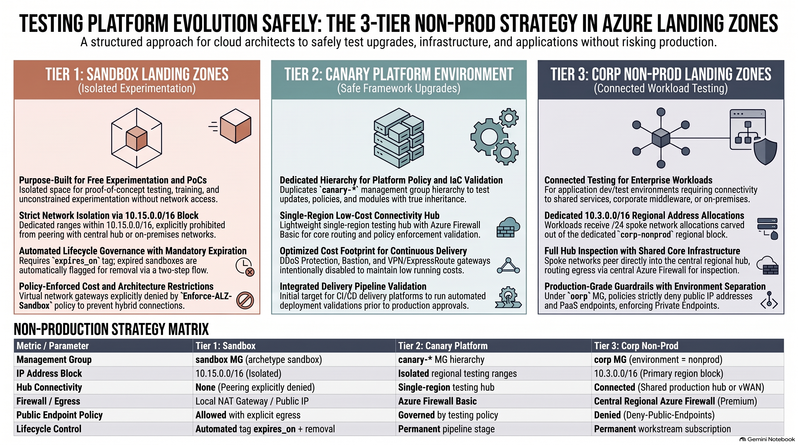

**Detailed Architectural Breakdown & Non-Production Strategy Takeaways:**

- **Tier 1: Sandbox Landing Zones (Isolated Experimentation):**
  - **Purpose:** Free experimentation, developer training, hackathons, and unconstrained proofs-of-concept without access to corporate data.
  - **Network Boundary:** Dedicated isolated address block within `10.15.0.0/16`. Peering to central regional hubs, Virtual WAN, or on-premises networks is strictly prohibited by policy.
  - **Egress Architecture:** Local NAT Gateway or direct public IPs permitted for fast experimentation; zero connectivity to shared enterprise services.
  - **Lifecycle Control:** Mandatory `expires_on` tag enforced by policy. Expired sandboxes are automatically flagged for deletion via a two-step automated cleanup workflow.
  - **Guardrail Policy:** The `Enforce-ALZ-Sandbox` policy explicitly denies virtual network gateways to prevent unauthorized hybrid connections.

- **Tier 2: Canary Platform Environment (Safe Framework Upgrades):**
  - **Purpose:** Testing ALZ Library upgrades, Terraform provider version bumps, and Policy-as-Code changes with authentic policy inheritance before touching production.
  - **Hierarchy Design:** Duplicates the management group tree under `canary-*` (`canary-platform`, `canary-landingzones`) in the same Microsoft Entra ID tenant.
  - **Reduced Cost Hub:** Deploys a lightweight, single-region testing hub utilizing **Azure Firewall Basic**. Expensive multi-region ExpressRoute gateways, Azure Bastion, and DDoS Protection plans are intentionally disabled to keep running costs negligible.
  - **Pipeline Role:** Acts as the initial automated deployment target for continuous delivery pipelines before production approval gates.

- **Tier 3: Corp Non-Prod Landing Zones (Connected Workload Testing):**
  - **Purpose:** Development, testing, and staging environments for business applications that require integration with corporate APIs, shared middleware, or on-premises databases.
  - **Network Boundary:** Workloads receive `/24` spoke network allocations carved out of the dedicated `10.3.0.0/16` non-production regional block.
  - **Hub Inspection:** Spoke VNets peer directly into the central regional hub or Virtual WAN, routing all egress traffic through the central Azure Firewall Premium for full packet inspection.
  - **Security Baseline:** Managed under the `corp` management group archetype. Policies strictly deny public IPs (`Deny-Public-IP-On-NIC`) and enforce PaaS Private Endpoints, guaranteeing that non-production matches production security posture.

- **Non-Production Strategy Comparison Matrix:**
  - **Sandbox:** Management Group = `sandbox`; IP Block = `10.15.0.0/16`; Hub Peering = None; Egress = Local NAT Gateway; Public IPs = Allowed; Lifecycle = Automated tag expiration.
  - **Canary Platform:** Management Group = `canary-*`; IP Block = Isolated testing range; Hub Peering = Reduced testing hub (Firewall Basic); Egress = Firewall Basic; Public IPs = Denied; Lifecycle = Permanent pipeline stage.
  - **Corp Non-Prod:** Management Group = `corp` (env=nonprod); IP Block = `10.3.0.0/16`; Hub Peering = Connected to shared hub/vWAN; Egress = Central Firewall Premium; Public IPs = Denied; Lifecycle = Permanent workload subscription.

<details>
<summary><strong>📊 Diagram: 2.14 Non-production: sandboxes, canary and corp-nonprod</strong> <em>(click to expand)</em></summary>

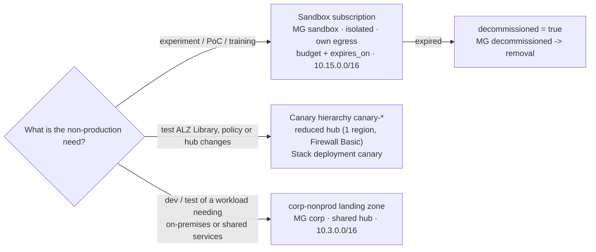

</details>

**How to read this diagram:**

- **Three different needs, three different answers:** sandboxes are for free experimentation and are never connected to the hub; the canary proves platform changes with real policy inheritance before production; non-production workloads that need connectivity are ordinary `corp` (or `online`) subscriptions with `environment = "nonprod"` behind the shared hub.
- **There is no "sandbox hub":** replicating the production hub per sandbox costs thousands of USD per month per sandbox and is partly impossible (gateways are denied by `Enforce-ALZ-Sandbox`).
- **Lifecycle is enforced:** sandboxes must declare `expires_on`; a weekly workflow reports expired ones, and decommissioning is two reviewed PRs (`decommissioned = true`, then removal).
- Full analysis with isolation controls, costs, the canary topology and the decision guide: [docs/03 section 5](docs/03-networking-hubspoke-vs-vwan.md#5-sandboxes-canary-and-non-production-environments-in-hub-and-spoke).

Detailed diagrams with ASCII fallbacks: [`architecture/diagrams/`](architecture/diagrams/README.md).

---

## 3. Repository map

```text
azure-landing-zones-2026-masterclass/
├── README.md                                   # This portal
├── docs/                                       # Architecture guides & decision matrices (01-07)
├── architecture/
│   ├── diagrams/                               # Mermaid + ASCII diagrams
│   └── decision-matrices/                      # ADR-style weighted decision records
├── code/
│   ├── backend.hcl.example                     # Shared partial backend config (local runs)
│   ├── day-0-bootstrap-oidc/                   # State storage (CMK), Entra apps, OIDC for every platform, RBAC
│   ├── day-0-cicd-azure-devops/                # (optional) WIF service connections, environment, checks, pipelines
│   ├── day-0-cicd-hcp-terraform/               # (optional) HCP Terraform / TFE project, workspaces or Stack
│   ├── modules/
│   │   ├── platform-landing-zone/              # AVM ALZ composition (no providers/backend)
│   │   │   └── lib/                            # Custom ALZ library (production + canary architectures)
│   │   └── workload-vending/                   # Subscription vending + guardrails (no providers/backend)
│   │       └── policies/                       # Custom policy definitions (JSON)
│   ├── day-1-platform-landing-zone/            # Root module: backend + auth -> modules/platform-landing-zone
│   ├── day-2-workload-vending-operations/      # Root module: backend + auth -> modules/workload-vending
│   └── hcp-terraform-stacks/alz/               # Terraform Stack: components + canary/production deployments
├── pipelines/
│   └── azure-devops/                           # Azure DevOps YAML: PR validation, apply, drift + templates
├── .github/
│   ├── workflows/                              # GitHub Actions: plan / apply / drift + reusable stack workflow
│   ├── CODEOWNERS                              # Separation of duties
│   └── dependabot.yml                          # SHA-pinned actions & Terraform updates
└── .tflint.hcl                                 # Lint rules (terraform + azurerm rulesets)
```

---

## 4. Documentation index

| # | Guide | Answers |
|---|---|---|
| 01 | [Conceptual architecture & MG hierarchy](docs/01-architecture-conceptual.md) | What is a landing zone in 2026? Which MGs, why, and who owns what? |
| 02 | [IaC provider matrix](docs/02-iac-provider-matrix.md) | When do I use AVM, `azurerm`, `azapi`, `azuread`, `alz`? |
| 03 | [Hub-and-spoke vs Virtual WAN + IPAM](docs/03-networking-hubspoke-vs-vwan.md) | Which topology, where is the tipping point, how do I plan IP space? Where do sandboxes, the canary and non-production workloads live, and what does each option cost? |
| 04 | [Private Endpoints vs Service Endpoints](docs/04-security-private-vs-service.md) | Why Private Endpoints are the default and when Service Endpoints are acceptable. |
| 05 | [CI/CD, OIDC & pipeline security](docs/05-cicd-oidc-security.md) | GitHub Actions vs Azure DevOps, Workload Identity Federation, least privilege. |
| 06 | [WAF: simplicity vs security & policy rollout](docs/06-waf-simplicity-vs-security.md) | Audit -> Remediate -> Enforce, trade-offs per WAF pillar. |
| 07 | [Delivery platforms](docs/07-delivery-platforms.md) | GitHub Actions vs Azure DevOps vs HCP Terraform vs Terraform Enterprise vs Terraform Stacks - and how one codebase serves them all. |

| Decision record | Topic |
|---|---|
| [ADR-001](architecture/decision-matrices/ADR-001-iac-tooling.md) | IaC tooling & providers |
| [ADR-002](architecture/decision-matrices/ADR-002-network-topology.md) | Network topology |
| [ADR-003](architecture/decision-matrices/ADR-003-paas-network-access.md) | PaaS network access |
| [ADR-004](architecture/decision-matrices/ADR-004-cicd-platform.md) | CI/CD platform & identity |
| [ADR-005](architecture/decision-matrices/ADR-005-policy-rollout.md) | Policy rollout strategy |
| [ADR-006](architecture/decision-matrices/ADR-006-delivery-platform.md) | Delivery platform (CI/CD vs HCP Terraform / TFE vs Stacks) |

---

## 5. 🎥 Video Guides, Technical Shorts & Multimedia Sessions (YouTube)

The architectural patterns, provider matrices, network topologies, zero-secret pipelines, delivery platforms, non-production testing strategies, and subscription vending mechanisms of this masterclass are accompanied by a dedicated series of architectural podcasts, technical video guides, and rapid architecture shorts synthesized with **Gemini NotebookLM**.

All sessions are hosted on the official YouTube channel [**@nubenetes**](https://youtube.com/@nubenetes).

> [!NOTE]
> **Multilingual Technical Content 🌐**:
> The architectural masterclasses, podcasts, and shorts feature native **English** and **Spanish** technical narration with auto-generated subtitles (CC) in over **20 languages** to assist cloud platform teams, enterprise architects, and site reliability engineers worldwide.

### 5.1 📊 Technical Multimedia Catalog (37 Sessions)

#### 5.1.1 🎙️ Architectural Podcasts & Long-Form Masterclasses (2 Episodes)

| Format | Title / Episode | Focus / Core Engineering Domain | Language | Duration | Direct YouTube Link |
| :---: | :--- | :--- | :---: | :---: | :--- |
| 🎙️ **Podcast** | [**Azure Verified Modules Replace Monolithic Architectures**](https://www.youtube.com/watch?v=5Z-TFcl8uGs) | **IaC Architecture & Modular Shift**: Monolith retirement, AVM pattern modules, ALZ Library decoupling, and AzAPI schema validation | 🇬🇧 English *(CC 20+)* | `38:28` | [▶️ Watch Podcast](https://www.youtube.com/watch?v=5Z-TFcl8uGs) |
| 🎙️ **Podcast** | [**La nueva arquitectura de Azure Landing Zones**](https://www.youtube.com/watch?v=BKkvEATTGfo) | **Arquitectura Conceptual & Analogía Llave Maestra**: Masterclass en español sobre gobernanza multi-suscripción, llaves maestras vs permisos granulares y transición AVM | 🇪🇸 Spanish *(CC 20+)* | `25:54` | [▶️ Watch Podcast](https://www.youtube.com/watch?v=BKkvEATTGfo) |

#### 5.1.2 📽️ Deep-Dive Architectural Video Guides (12 Episodes)

| Format | Title / Episode | Focus / Core Engineering Domain | Language | Duration | Direct YouTube Link |
| :---: | :--- | :--- | :---: | :---: | :--- |
| 📽️ **Video Guide** | [**The Cloud Metropolis: Azure Landing Zones Architecture Blueprint**](https://www.youtube.com/watch?v=u9rLpmpUf2Y) | **Conceptual Architecture & City Metaphor**: City planning analogy for enterprise cloud scale, multi-subscription isolation, zoning laws, and platform vs. workload separation | 🇬🇧 English *(CC 20+)* | `8:30` | [▶️ Watch Video](https://www.youtube.com/watch?v=u9rLpmpUf2Y) |
| 📽️ **Video Guide** | [**Azure Landing Zones 2026: Next-Gen Enterprise Architecture Masterclass**](https://www.youtube.com/watch?v=LE568gOjCkY) | **Microsoft CAF 2026 Blueprint**: Next-gen Cloud Adoption Framework, enterprise-scale landing zone hierarchy, subscription democratization, and governance baseline | 🇬🇧 English *(CC 20+)* | `8:03` | [▶️ Watch Video](https://www.youtube.com/watch?v=LE568gOjCkY) |
| 📽️ **Video Guide** | [**Azure Management Groups & Governance: Core Engine Architecture**](https://www.youtube.com/watch?v=xh84QXkuYm8) | **Core Engine & Hierarchy**: Management group archetypes (Platform: Identity, Management, Connectivity, Security vs Workloads: Corp, Online), Policy-as-Code, and WAF guardrails | 🇬🇧 English *(CC 20+)* | `8:41` | [▶️ Watch Video](https://www.youtube.com/watch?v=xh84QXkuYm8) |
| 📽️ **Video Guide** | [**Retiring the CAF Monolith: Azure Verified Modules (AVM) & ALZ Library**](https://www.youtube.com/watch?v=BNEGxzQgDB8) | **Modern IaC Stack**: Archiving legacy monolithic CAF modules, composable Azure Verified Modules (AVM), decoupled ALZ Library, and AzAPI-first provider architecture | 🇬🇧 English *(CC 20+)* | `7:59` | [▶️ Watch Video](https://www.youtube.com/watch?v=BNEGxzQgDB8) |
| 📽️ **Video Guide** | [**Azure Hub-and-Spoke vs Virtual WAN: 2026 Enterprise Network Architecture**](https://www.youtube.com/watch?v=mUmga-Nz6cc) | **Network Topology & Sizing**: Traditional Hub-and-Spoke vs. Virtual WAN (vWAN), routing intents, virtual network peering, NVA inspection, and hierarchical IPAM addressing | 🇬🇧 English *(CC 20+)* | `8:11` | [▶️ Watch Video](https://www.youtube.com/watch?v=mUmga-Nz6cc) |
| 📽️ **Video Guide** | [**Azure Private Endpoints vs Service Endpoints: PaaS Network Security Blueprint**](https://www.youtube.com/watch?v=ppqHvYNkII4) | **PaaS Network Security**: Private Endpoints default standard vs Service Endpoints exception, centralized Private DNS Zones, egress filtering, and data exfiltration mitigation | 🇬🇧 English *(CC 20+)* | `8:30` | [▶️ Watch Video](https://www.youtube.com/watch?v=ppqHvYNkII4) |
| 📽️ **Video Guide** | [**Azure Landing Zones 2026: Enterprise Architecture Mental Model & Deep Dive**](https://www.youtube.com/watch?v=nVpDkEKyBr8) | **Mental Model & Operational Synthesis**: Deconstructing monolithic blast radiuses, establishing day-1 workload agility, subscription vending engines, and zero-drift governance | 🇬🇧 English *(CC 20+)* | `10:40` | [▶️ Watch Video](https://www.youtube.com/watch?v=nVpDkEKyBr8) |
| 📽️ **Video Guide** | [**Day 0 to Day 2: Zero-Secret CI/CD Pipelines with GitHub Actions & OIDC**](https://www.youtube.com/watch?v=IcH7LalL5cc) | **Pipeline Security Deep Dive**: Workload Identity Federation (OIDC), read-only plan vs environment-gated apply identities, ABAC Owner scoping, and ephemeral Entra ID tokens | 🇬🇧 English *(CC 20+)* | `5:52` | [▶️ Watch Video](https://www.youtube.com/watch?v=IcH7LalL5cc) |
| 📽️ **Video Guide** | [**ALZ 2026 Masterclass: Modular Architecture & AVM Rebuild**](https://www.youtube.com/watch?v=HjLte2SGCk0) | **Modular Architecture & Migration Roadmap**: Managing the retirement deadlines (August 2026 CAF monolith, 2026/2027 Blueprints & Bicep classic), AVM patterns, and AzAPI schema enforcement | 🇬🇧 English *(CC 20+)* | `6:49` | [▶️ Watch Video](https://www.youtube.com/watch?v=HjLte2SGCk0) |
| 📽️ **Video Guide** | [**Azure Landing Zones Testing Strategies: Canary, Sandboxes & Non-Prod**](https://www.youtube.com/watch?v=N6PMQzmBwwE) | **Testing & Non-Production Topologies**: Three-tier testing model (sandboxes, canary hierarchy with reduced hub, corp-nonprod), blast radius containment, and cost-optimized validation | 🇬🇧 English *(CC 20+)* | `8:19` | [▶️ Watch Video](https://www.youtube.com/watch?v=N6PMQzmBwwE) |
| 📽️ **Video Guide** | [**2026 Cloud Metropolis**](https://www.youtube.com/watch?v=i5aBiDuzXr8) | **Enterprise Cloud Metropolis**: Evolving beyond disjointed cloud villages into an engineered metropolis with zoning laws and platform utilities | 🇬🇧 English *(CC 20+)* | `9:51` | [▶️ Watch Video](https://www.youtube.com/watch?v=i5aBiDuzXr8) |
| 📽️ **Video Guide** | [**Azure Landing Zones 2026 4**](https://www.youtube.com/watch?v=mZ944GFanYc) | **Automated ALZ Implementation**: End-to-end framework automation, credential elimination via WIF, and rapid enterprise rollout | 🇬🇧 English *(CC 20+)* | `6:19` | [▶️ Watch Video](https://www.youtube.com/watch?v=mZ944GFanYc) |

#### 5.1.3 ⚡ Technical Shorts & Architecture Takeaways (23 Episodes)

| Format | Title / Episode | Focus / Core Engineering Domain | Language | Duration | Direct YouTube Link |
| :---: | :--- | :--- | :---: | :---: | :--- |
| ⚡ **Short** | [**Why Azure is Killing the Landing Zone Monolith**](https://www.youtube.com/shorts/7S6HDnZXQhI) | **AVM Shift**: Why Microsoft archived CAF monoliths on August 1, 2026 in favor of modular Azure Verified Modules (AVM) | 🇬🇧 English *(CC 20+)* | `1:09` | [▶️ Watch Short](https://www.youtube.com/shorts/7S6HDnZXQhI) |
| ⚡ **Short** | [**How Workload Identity Federation Replaces Stored Secrets**](https://www.youtube.com/shorts/0mdEib04nTw) | **CI/CD Security**: Eliminating static client secrets in GitHub Actions pipelines using OpenID Connect (OIDC) and Entra ID | 🇬🇧 English *(CC 20+)* | `1:16` | [▶️ Watch Short](https://www.youtube.com/shorts/0mdEib04nTw) |
| ⚡ **Short** | [**Why Azure Landing Zones Split Corp and Online**](https://www.youtube.com/shorts/Uab5Y1nnt08) | **Hierarchy Design**: Why management groups split Corp vs Online rather than dev/stage/prod environments | 🇬🇧 English *(CC 20+)* | `1:24` | [▶️ Watch Short](https://www.youtube.com/shorts/Uab5Y1nnt08) |
| ⚡ **Short** | [**Choosing Between Azure Private and Service Endpoints**](https://www.youtube.com/shorts/E1rnKNKWWUg) | **PaaS Decision Rules**: Key decision criteria between Private Endpoints and Service Endpoints for enterprise data boundary defense | 🇬🇧 English *(CC 20+)* | `1:20` | [▶️ Watch Short](https://www.youtube.com/shorts/E1rnKNKWWUg) |
| ⚡ **Short** | [**How OIDC Eradicates Pipeline Secrets**](https://www.youtube.com/shorts/-iBnp37YS3k) | **Zero-Secret Pipelines**: Eradicating repository passwords and long-lived credentials with short-lived JWT exchange | 🇬🇧 English *(CC 20+)* | `1:18` | [▶️ Watch Short](https://www.youtube.com/shorts/-iBnp37YS3k) |
| ⚡ **Short** | [**How Azure Private Endpoints Secure PaaS**](https://www.youtube.com/shorts/XDOoQBp12dk) | **PaaS Perimeter**: Private RFC 1918 IPs in subnets and navigating the 2026 default outbound access retirement | 🇬🇧 English *(CC 20+)* | `1:19` | [▶️ Watch Short](https://www.youtube.com/shorts/XDOoQBp12dk) |
| ⚡ **Short** | [**Why Azure Networks Switch to vWAN**](https://www.youtube.com/shorts/DmKLtsW8O8Y) | **Global Transit**: Automated mesh routing and crossing the regional tipping point beyond 50 spoke VNets | 🇬🇧 English *(CC 20+)* | `1:28` | [▶️ Watch Short](https://www.youtube.com/shorts/DmKLtsW8O8Y) |
| ⚡ **Short** | [**How Phased Policy as Code Works**](https://www.youtube.com/shorts/bh9-IuX7Qb0) | **Policy-as-Code Lifecycle**: Preventing brownfield production outages through Audit -> Remediate -> Enforce stages | 🇬🇧 English *(CC 20+)* | `1:15` | [▶️ Watch Short](https://www.youtube.com/shorts/bh9-IuX7Qb0) |
| ⚡ **Short** | [**How Subscription Vending Automates Azure**](https://www.youtube.com/shorts/GVoFBsgFtms) | **Subscription Vending**: Eliminating IT approval tickets and delivering pre-governed workload environments via GitOps | 🇬🇧 English *(CC 20+)* | `1:19` | [▶️ Watch Short](https://www.youtube.com/shorts/GVoFBsgFtms) |
| ⚡ **Short** | [**Why Azure Separates Corp and Online**](https://www.youtube.com/shorts/n2lvZtLn8Ag) | **Network Segmentation**: Establishing clean hybrid corporate transit boundaries versus public internet ingress | 🇬🇧 English *(CC 20+)* | `1:21` | [▶️ Watch Short](https://www.youtube.com/shorts/n2lvZtLn8Ag) |
| ⚡ **Short** | [**Why Microsoft Killed the Azure Landing Zone Monolith**](https://www.youtube.com/shorts/bB2fs8A28RI) | **Modular Shift**: Escaping monolithic state file bottlenecks and adopting single-purpose AVM building blocks | 🇬🇧 English *(CC 20+)* | `1:26` | [▶️ Watch Short](https://www.youtube.com/shorts/bB2fs8A28RI) |
| ⚡ **Short** | [**How Azure Canaries Prevent Cloud Outages**](https://www.youtube.com/shorts/0mDvTs3aO2I) | **Canary Governance**: Deploying parallel canary- management groups to test security baselines with real policy inheritance | 🇬🇧 English *(CC 20+)* | `0:59` | [▶️ Watch Short](https://www.youtube.com/shorts/0mDvTs3aO2I) |
| ⚡ **Short** | [**Where to Put Test Workloads in Azure**](https://www.youtube.com/shorts/sj7JF4KIKPo) | **Non-Prod Segmentation**: Splitting non-production into isolated sandboxes, canary hierarchies, and corp-nonprod landing zones | 🇬🇧 English *(CC 20+)* | `1:11` | [▶️ Watch Short](https://www.youtube.com/shorts/sj7JF4KIKPo) |
| ⚡ **Short** | [**How Azure Canary Hubs Test Routing Affordably**](https://www.youtube.com/shorts/Sb3G1tMJaQQ) | **Reduced Canary Hub**: Deploying cost-optimized single-region canary hubs with Firewall Basic to validate routing without duplicate hardware costs | 🇬🇧 English *(CC 20+)* | `1:18` | [▶️ Watch Short](https://www.youtube.com/shorts/Sb3G1tMJaQQ) |
| ⚡ **Short** | [**Why Azure Platform Teams Choose AzAPI Complexity**](https://www.youtube.com/shorts/ptetbW0C0P8) | **IaC Provider Trade-offs**: Why platform engineers accept AzAPI complexity over AzureRM to secure day-zero ARM REST access | 🇬🇧 English *(CC 20+)* | `1:06` | [▶️ Watch Short](https://www.youtube.com/shorts/ptetbW0C0P8) |
| ⚡ **Short** | [**How AVM and AzAPI Beat AzureRM Updates**](https://www.youtube.com/shorts/Q2fhHPqJnKk) | **Provider Synergy**: Eliminating weeks of waiting time for upstream provider patches with AVM and AzAPI | 🇬🇧 English *(CC 20+)* | `1:08` | [▶️ Watch Short](https://www.youtube.com/shorts/Q2fhHPqJnKk) |
| ⚡ **Short** | [**How AzAPI Enables Day Zero Deployments**](https://www.youtube.com/shorts/O_Mfirh5xqM) | **Day-Zero ARM API**: Deploying brand new cloud security features the exact hour they release in ARM | 🇬🇧 English *(CC 20+)* | `1:06` | [▶️ Watch Short](https://www.youtube.com/shorts/O_Mfirh5xqM) |
| ⚡ **Short** | [**How AzAPI Unlocks Day Zero Azure Features**](https://www.youtube.com/shorts/YWNUZfYelIM) | **Cutting-Edge Properties**: Bypassing traditional IaC release cycles by configuring raw ARM properties directly in AVM modules | 🇬🇧 English *(CC 20+)* | `1:16` | [▶️ Watch Short](https://www.youtube.com/shorts/YWNUZfYelIM) |
| ⚡ **Short** | [**How Secretless Azure Deployments Work**](https://www.youtube.com/shorts/dn29uxmC7NM) | **Workload Identity Federation**: Deploying cloud infrastructure without saving passwords, client secrets, or static keys | 🇬🇧 English *(CC 20+)* | `1:20` | [▶️ Watch Short](https://www.youtube.com/shorts/dn29uxmC7NM) |
| ⚡ **Short** | [**How Secretless Azure Deployments Work 1**](https://www.youtube.com/shorts/QF24DXGSTgg) | **PR Claims Isolation**: Restricting pull request plans to read-only tokens and enforcing environment-gated write permissions | 🇬🇧 English *(CC 20+)* | `1:19` | [▶️ Watch Short](https://www.youtube.com/shorts/QF24DXGSTgg) |
| ⚡ **Short** | [**Why App Branching Breaks Azure Landing Zones**](https://www.youtube.com/shorts/QuIJJDU70fk) | **Branching Anti-Patterns**: Why applying app development branching models to multi-subscription IaC causes disastrous state drift | 🇬🇧 English *(CC 20+)* | `1:26` | [▶️ Watch Short](https://www.youtube.com/shorts/QuIJJDU70fk) |
| ⚡ **Short** | [**How to Build a Canary Hub**](https://www.youtube.com/shorts/jSKGE-2jlhI) | **Canary Hub Engineering**: Testing routing intent and firewall policies using Terraform Stacks and Firewall Basic without doubling costs | 🇬🇧 English *(CC 20+)* | `1:22` | [▶️ Watch Short](https://www.youtube.com/shorts/jSKGE-2jlhI) |
| ⚡ **Short** | [**How Azure Tests Policies Without Dev Branches**](https://www.youtube.com/shorts/4vuevTKihJk) | **Canary Policy Testing**: Testing enterprise policy guardrails via management group hierarchies rather than git branches | 🇬🇧 English *(CC 20+)* | `1:22` | [▶️ Watch Short](https://www.youtube.com/shorts/4vuevTKihJk) |

<details>
<summary>📂 <strong>Detailed Agendas, Transcripts & Engineering Takeaways</strong></summary>

<br/>

### 5.2 Section A: Architectural Podcasts & Long-Form Masterclasses (2 Sessions)

#### 5.2.1 Azure Verified Modules Replace Monolithic Architectures (38:28)
- 🔗 **Direct URL**: [https://www.youtube.com/watch?v=5Z-TFcl8uGs](https://www.youtube.com/watch?v=5Z-TFcl8uGs)
- ⏱️ **Duration**: 38:28 | 🌐 **Language**: 🇬🇧 English *(CC 20+)*
- 🏷️ **Domain**: IaC Architecture, Monolith Retirement, Composable AVM Modules, ALZ Library, AzAPI Provider
- 📝 **Technical Overview**:
> Comprehensive architectural masterclass podcast exploring the fundamental shift in Azure Infrastructure as Code: the retirement and archiving of the legacy monolithic `terraform-azurerm-caf-enterprise-scale` module on August 1, 2026, and the industry-wide transition to composable Azure Verified Modules (AVM). Analyzes the operational and blast-radius challenges of monolithic state files, the architectural decoupling of policy definitions into the versioned ALZ Library (`2026.10.0`), plan-time schema validation with the AzAPI provider, and lifecycle management for enterprise-scale platforms.

#### 5.2.2 La nueva arquitectura de Azure Landing Zones (25:54)
- 🔗 **Direct URL**: [https://www.youtube.com/watch?v=BKkvEATTGfo](https://www.youtube.com/watch?v=BKkvEATTGfo)
- ⏱️ **Duration**: 25:54 | 🌐 **Language**: 🇪🇸 Spanish *(CC 20+)*
- 🏷️ **Domain**: Arquitectura Conceptual, Analogía Llave Maestra vs Permisos Granulares, Transición AVM, Gobernanza Multi-Suscripción
- 📝 **Technical Overview**:
> Masterclass de arquitectura técnica en formato podcast en español que ilustra los principios de Azure Landing Zones a través de la analogía de un edificio corporativo: la diferencia crítica entre conceder llaves maestras indiscriminadas y proporcionar accesos granulares y controlados por oficina. Desglosa la transición desde los módulos monolíticos de CAF hacia los Azure Verified Modules (AVM), el desacoplamiento de directivas con la librería ALZ, la separación de arquetipos Platform (Identity, Connectivity, Management, Security) y Workloads (Corp, Online), y el autoservicio seguro mediante subscription vending.

### 5.3 Section B: Deep-Dive Architectural Video Guides (12 Sessions)

#### 5.3.1 The Cloud Metropolis: Azure Landing Zones Architecture Blueprint (8:30)
- 🔗 **Direct URL**: [https://www.youtube.com/watch?v=u9rLpmpUf2Y](https://www.youtube.com/watch?v=u9rLpmpUf2Y)
- ⏱️ **Duration**: 8:30 | 🌐 **Language**: 🇬🇧 English *(CC 20+)*
- 🏷️ **Domain**: Conceptual Architecture, City Metaphor, Multi-Subscription Governance, Zoning Laws
- 📝 **Technical Overview**:
> Conceptual architecture masterclass establishing the city planning metaphor for enterprise Azure environments. Compares cloud infrastructure to an organized metropolis with zoning laws, shared utilities (water, electricity, transit), and residential/commercial districts. Explains why single-subscription designs fail under enterprise scale and how Microsoft CAF management group hierarchies provide clean boundaries between platform utilities and application workloads.

#### 5.3.2 Azure Landing Zones 2026: Next-Gen Enterprise Architecture Masterclass (8:03)
- 🔗 **Direct URL**: [https://www.youtube.com/watch?v=LE568gOjCkY](https://www.youtube.com/watch?v=LE568gOjCkY)
- ⏱️ **Duration**: 8:03 | 🌐 **Language**: 🇬🇧 English *(CC 20+)*
- 🏷️ **Domain**: Microsoft CAF 2026 Framework, Enterprise Scale, Subscription Democratization
- 📝 **Technical Overview**:
> Exhaustive overview of Microsoft's late-2026 Cloud Adoption Framework (CAF) reference architecture. Breaks down the multi-subscription model, subscription vending mechanisms, and the shift from central IT gatekeeping to self-service application teams constrained by automated guardrails. Details how the platform provides security baselines, centralized connectivity, and compliance without slowing down feature delivery.

#### 5.3.3 Azure Management Groups & Governance: Core Engine Architecture (8:41)
- 🔗 **Direct URL**: [https://www.youtube.com/watch?v=xh84QXkuYm8](https://www.youtube.com/watch?v=xh84QXkuYm8)
- ⏱️ **Duration**: 8:41 | 🌐 **Language**: 🇬🇧 English *(CC 20+)*
- 🏷️ **Domain**: Management Group Archetypes, Platform vs Workloads, Policy-as-Code Lifecycle
- 📝 **Technical Overview**:
> Deep dive into the core engine of Azure Landing Zones: the management group hierarchy and Policy-as-Code governance engine. Examines the structural separation of Platform management groups (Identity, Management, Connectivity, and the new Security archetype) from Workload Landing Zones (Corp and Online). Details the phased policy rollout strategy (Audit -> Remediate -> Enforce) aligned with the Well-Architected Framework.

#### 5.3.4 Retiring the CAF Monolith: Azure Verified Modules (AVM) & ALZ Library (7:59)
- 🔗 **Direct URL**: [https://www.youtube.com/watch?v=BNEGxzQgDB8](https://www.youtube.com/watch?v=BNEGxzQgDB8)
- ⏱️ **Duration**: 7:59 | 🌐 **Language**: 🇬🇧 English *(CC 20+)*
- 🏷️ **Domain**: Infrastructure as Code (IaC), AVM Pattern Modules, ALZ Library, AzAPI Provider
- 📝 **Technical Overview**:
> Technical guide on the monumental 2026 shift in Azure Infrastructure as Code: the retirement of the monolithic `terraform-azurerm-caf-enterprise-scale` module (archived August 1, 2026) and the adoption of Microsoft-maintained Azure Verified Modules (AVM). Analyzes how decoupling policy definitions into the versioned ALZ Library processed by the `Azure/alz` provider and leveraging the AzAPI-first provider architecture guarantees day-zero API support and zero-regression upgrades.

#### 5.3.5 Azure Hub-and-Spoke vs Virtual WAN: 2026 Enterprise Network Architecture (8:11)
- 🔗 **Direct URL**: [https://www.youtube.com/watch?v=mUmga-Nz6cc](https://www.youtube.com/watch?v=mUmga-Nz6cc)
- ⏱️ **Duration**: 8:11 | 🌐 **Language**: 🇬🇧 English *(CC 20+)*
- 🏷️ **Domain**: Network Topology, Hub-and-Spoke, Virtual WAN, Routing Intent, IPAM
- 📝 **Technical Overview**:
> In-depth architectural trade-off analysis comparing traditional Hub-and-Spoke architectures to Azure Virtual WAN (vWAN) for 2026 deployments. Deconstructs the complexity inflection point (typically around 30 to 50 spoke VNets), analyzing transitive routing, NVA firewalls, Routing Intent policies, Azure Route Server, and private link resolution across regions. Provides sizing calculations and cost thresholds.

#### 5.3.6 Azure Private Endpoints vs Service Endpoints: PaaS Network Security Blueprint (8:30)
- 🔗 **Direct URL**: [https://www.youtube.com/watch?v=ppqHvYNkII4](https://www.youtube.com/watch?v=ppqHvYNkII4)
- ⏱️ **Duration**: 8:30 | 🌐 **Language**: 🇬🇧 English *(CC 20+)*
- 🏷️ **Domain**: PaaS Isolation, Private Endpoints, Service Endpoints, DNS Architecture, Data Perimeter
- 📝 **Technical Overview**:
> Comprehensive network security blueprint detailing the definitive design rule for modern PaaS access: Private Endpoints by default, Service Endpoints only by documented exception. Covers DNS integration at enterprise scale with centralized Private DNS Zones in the Connectivity subscription, private DNS resolver rulesets, egress lockdown, and eliminating data exfiltration risks.

#### 5.3.7 Azure Landing Zones 2026: Enterprise Architecture Mental Model & Deep Dive (10:40)
- 🔗 **Direct URL**: [https://www.youtube.com/watch?v=nVpDkEKyBr8](https://www.youtube.com/watch?v=nVpDkEKyBr8)
- ⏱️ **Duration**: 10:40 | 🌐 **Language**: 🇬🇧 English *(CC 20+)*
- 🏷️ **Domain**: Architecture Mental Model, Operational Governance, Workload Agility, Enterprise Synthesis
- 📝 **Technical Overview**:
> Extensive architecture mental model and operational synthesis connecting all landing zone dimensions together. Deconstructs how platform teams maintain rock-solid enterprise governance without becoming a delivery bottleneck. Explains how subscription vending engines, centralized platform baselines, and decoupled workload repositories create an agile yet secure operational environment.

#### 5.3.8 Day 0 to Day 2: Zero-Secret CI/CD Pipelines with GitHub Actions & OIDC (5:52)
- 🔗 **Direct URL**: [https://www.youtube.com/watch?v=IcH7LalL5cc](https://www.youtube.com/watch?v=IcH7LalL5cc)
- ⏱️ **Duration**: 5:52 | 🌐 **Language**: 🇬🇧 English *(CC 20+)*
- 🏷️ **Domain**: CI/CD Security, GitHub Actions, Workload Identity Federation, OIDC, ABAC Scoping
- 📝 **Technical Overview**:
> Security-focused technical walkthrough of zero-secret CI/CD pipeline automation for Azure Landing Zones. Demonstrates how to eliminate stored credentials and service principal passwords using OpenID Connect (OIDC) and Workload Identity Federation. Explains the segregation between read-only pull request validation identities and environment-gated, ABAC-conditioned deployment identities.

#### 5.3.9 ALZ 2026 Masterclass: Modular Architecture & AVM Rebuild (6:49)
- 🔗 **Direct URL**: [https://www.youtube.com/watch?v=HjLte2SGCk0](https://www.youtube.com/watch?v=HjLte2SGCk0)
- ⏱️ **Duration**: 6:49 | 🌐 **Language**: 🇬🇧 English *(CC 20+)*
- 🏷️ **Domain**: Modern IaC Blueprint, Retirement Milestones, AVM Pattern Modules, AzAPI Provider
- 📝 **Technical Overview**:
> Advanced architectural synthesis examining how the masterclass was rebuilt from first principles using Azure Verified Modules (AVM). Analyzes the 2026/2027 deprecation landscape: legacy CAF monolith retirement (August 2026), Azure Blueprints complete retirement (January 2027), and ALZ-Bicep classic phase-out (February 2027). Details the dual-provider pattern (`azurerm` + `azapi`) for day-zero ARM feature velocity.

#### 5.3.10 Azure Landing Zones Testing Strategies: Canary, Sandboxes & Non-Prod (8:19)
- 🔗 **Direct URL**: [https://www.youtube.com/watch?v=N6PMQzmBwwE](https://www.youtube.com/watch?v=N6PMQzmBwwE)
- ⏱️ **Duration**: 8:19 | 🌐 **Language**: 🇬🇧 English *(CC 20+)*
- 🏷️ **Domain**: Testing Strategies, Canary Management Groups, Sandboxes, Non-Prod Segmentation
- 📝 **Technical Overview**:
> Exhaustive engineering guide on how to test enterprise landing zones without risking production outages or doubling cloud spend. Details the 3-tier testing model: completely isolated Sandboxes, the parallel Canary management group hierarchy in the same Entra ID tenant with reduced hubs (Azure Firewall Basic), and the Corp-Nonprod landing zone tier for application workload testing.

#### 5.3.11 2026 Cloud Metropolis (9:51)
- 🔗 **Direct URL**: [https://www.youtube.com/watch?v=i5aBiDuzXr8](https://www.youtube.com/watch?v=i5aBiDuzXr8)
- ⏱️ **Duration**: 9:51 | 🌐 **Language**: 🇬🇧 English *(CC 20+)*
- 🏷️ **Domain**: Conceptual Architecture, Cloud Metropolis Blueprint, Platform vs Workloads, Enterprise Scale
- 📝 **Technical Overview**:
> Architectural deep dive exploring the evolution of enterprise cloud from disjointed, chaotic "villages" of ad-hoc resource groups into an engineered "Cloud Metropolis". Explains how clear zoning laws (management group archetypes), shared city utilities (centralized networking, identity boundaries, security logging), and isolated commercial districts (workload landing zones) enable high-speed application deployment while maintaining uncompromised enterprise compliance and resilience.

#### 5.3.12 Azure Landing Zones 2026 4 (6:19)
- 🔗 **Direct URL**: [https://www.youtube.com/watch?v=mZ944GFanYc](https://www.youtube.com/watch?v=mZ944GFanYc)
- ⏱️ **Duration**: 6:19 | 🌐 **Language**: 🇬🇧 English *(CC 20+)*
- 🏷️ **Domain**: Automated Deployment Framework, Zero-Secret Security, Rapid Workload Onboarding
- 📝 **Technical Overview**:
> Engineering guide unpacking the modern automated 2026 Azure Landing Zone framework. Focuses on resolving operational headaches and sleepless nights caused by compromised credentials and cumbersome rollouts. Details how Workload Identity Federation (WIF) eliminates static passwords across the entire deployment lifecycle, enforces least-privilege RBAC roles, and empowers workload teams through automated subscription vending engines.

### 5.4 Section C: Technical Shorts & Architecture Takeaways (23 Sessions)

#### 5.4.1 Why Azure is Killing the Landing Zone Monolith (1:09)
- 🔗 **Direct URL**: [https://www.youtube.com/shorts/7S6HDnZXQhI](https://www.youtube.com/shorts/7S6HDnZXQhI)
- ⏱️ **Duration**: 1:09 | 🌐 **Language**: 🇬🇧 English *(CC 20+)*
- 🏷️ **Domain**: IaC Architecture, Monolith Retirement, Composable AVM Modules
- 📝 **Technical Overview**:
> Rapid architectural takeaway exploring Microsoft's decision to retire the monolithic CAF Terraform module in August 2026. Highlights the transition toward modular Azure Verified Modules (AVM) to isolate failure blast radiuses and avoid monolithic state file locks.

#### 5.4.2 How Workload Identity Federation Replaces Stored Secrets (1:16)
- 🔗 **Direct URL**: [https://www.youtube.com/shorts/0mdEib04nTw](https://www.youtube.com/shorts/0mdEib04nTw)
- ⏱️ **Duration**: 1:16 | 🌐 **Language**: 🇬🇧 English *(CC 20+)*
- 🏷️ **Domain**: CI/CD Security, GitHub Actions, Entra ID, Workload Identity Federation
- 📝 **Technical Overview**:
> Security short explaining how Workload Identity Federation (WIF) eliminates client secrets and certificates from CI/CD runners. Shows how short-lived OpenID Connect (OIDC) JWT tokens eradicate credential rotation overhead and prevent lateral movement attacks.

#### 5.4.3 Why Azure Landing Zones Split Corp and Online (1:24)
- 🔗 **Direct URL**: [https://www.youtube.com/shorts/Uab5Y1nnt08](https://www.youtube.com/shorts/Uab5Y1nnt08)
- ⏱️ **Duration**: 1:24 | 🌐 **Language**: 🇬🇧 English *(CC 20+)*
- 🏷️ **Domain**: Management Group Hierarchy, Corp vs Online Archetypes, Routing Boundaries
- 📝 **Technical Overview**:
> Conceptual takeaway explaining the architectural necessity of separating landing zones by network archetype (Corp vs. Online) rather than business unit or environment lifecycle. Illustrates how routing to on-premises through private WANs dictates strict firewall and policy segregation.

#### 5.4.4 Choosing Between Azure Private and Service Endpoints (1:20)
- 🔗 **Direct URL**: [https://www.youtube.com/shorts/E1rnKNKWWUg](https://www.youtube.com/shorts/E1rnKNKWWUg)
- ⏱️ **Duration**: 1:20 | 🌐 **Language**: 🇬🇧 English *(CC 20+)*
- 🏷️ **Domain**: PaaS Security, Private Endpoints, Service Endpoints, Decision Framework
- 📝 **Technical Overview**:
> Decision framework short breaking down when to use Private Endpoints versus Service Endpoints. Summarizes the definitive 2026 rule: Private Endpoints by default for complete data plane isolation; Service Endpoints reserved exclusively for rare non-transitive cost exceptions.

#### 5.4.5 How OIDC Eradicates Pipeline Secrets (1:18)
- 🔗 **Direct URL**: [https://www.youtube.com/shorts/-iBnp37YS3k](https://www.youtube.com/shorts/-iBnp37YS3k)
- ⏱️ **Duration**: 1:18 | 🌐 **Language**: 🇬🇧 English *(CC 20+)*
- 🏷️ **Domain**: DevSecOps, GitHub Actions OIDC, Short-Lived Tokens, Blast Radius
- 📝 **Technical Overview**:
> DevSecOps short explaining the cryptographic exchange behind GitHub Actions OIDC. Details how federated identity credentials exchange an ephemeral token from GitHub's token authority for a scoped Entra ID access token, eliminating persistent keys from repository secrets.

#### 5.4.6 How Azure Private Endpoints Secure PaaS (1:19)
- 🔗 **Direct URL**: [https://www.youtube.com/shorts/XDOoQBp12dk](https://www.youtube.com/shorts/XDOoQBp12dk)
- ⏱️ **Duration**: 1:19 | 🌐 **Language**: 🇬🇧 English *(CC 20+)*
- 🏷️ **Domain**: PaaS Perimeter Defense, Private RFC 1918 IPs, Default Outbound Access
- 📝 **Technical Overview**:
> Network isolation short detailing how Private Endpoints project Azure PaaS services (Key Vault, Storage, SQL) into private virtual network subnets using RFC 1918 private IPs, eliminating public exposure and complying with the 2026 default outbound access retirement.

#### 5.4.7 Why Azure Networks Switch to vWAN (1:28)
- 🔗 **Direct URL**: [https://www.youtube.com/shorts/DmKLtsW8O8Y](https://www.youtube.com/shorts/DmKLtsW8O8Y)
- ⏱️ **Duration**: 1:28 | 🌐 **Language**: 🇬🇧 English *(CC 20+)*
- 🏷️ **Domain**: Enterprise Networking, Virtual WAN, Any-to-Any Mesh, 50-Spoke Inflection
- 📝 **Technical Overview**:
> Networking takeaway on the operational turning point where enterprises transition from customer-managed Hub-and-Spoke to Azure Virtual WAN. Highlights how automated full-mesh transitive routing and centralized Routing Intent policies replace hundreds of custom UDRs.

#### 5.4.8 How Phased Policy as Code Works (1:15)
- 🔗 **Direct URL**: [https://www.youtube.com/shorts/bh9-IuX7Qb0](https://www.youtube.com/shorts/bh9-IuX7Qb0)
- ⏱️ **Duration**: 1:15 | 🌐 **Language**: 🇬🇧 English *(CC 20+)*
- 🏷️ **Domain**: Policy-as-Code, Phased Rollout, Audit to Enforce, Governance Baseline
- 📝 **Technical Overview**:
> Governance short outlining the 3-stage Policy-as-Code promotion lifecycle: Audit (observe violations without breaking deployments), Remediate (auto-fix non-compliant resources), and Enforce (block non-compliant ARM/Bicep/Terraform requests at the control plane).

#### 5.4.9 How Subscription Vending Automates Azure (1:19)
- 🔗 **Direct URL**: [https://www.youtube.com/shorts/GVoFBsgFtms](https://www.youtube.com/shorts/GVoFBsgFtms)
- ⏱️ **Duration**: 1:19 | 🌐 **Language**: 🇬🇧 English *(CC 20+)*
- 🏷️ **Domain**: Platform Engineering, Subscription Vending, Infrastructure as Code, GitOps
- 📝 **Technical Overview**:
> Platform automation takeaway explaining subscription vending. Demonstrates how a simple Git PR containing workload metadata triggers automated subscription creation, management group placement, network peering, budget allocation, and RBAC assignment in minutes.

#### 5.4.10 Why Azure Separates Corp and Online (1:21)
- 🔗 **Direct URL**: [https://www.youtube.com/shorts/n2lvZtLn8Ag](https://www.youtube.com/shorts/n2lvZtLn8Ag)
- ⏱️ **Duration**: 1:21 | 🌐 **Language**: 🇬🇧 English *(CC 20+)*
- 🏷️ **Domain**: Management Group Archetypes, Perimeter Security, Lateral Movement Prevention
- 📝 **Technical Overview**:
> Architecture short explaining the perils of organizing management groups by environment lifecycles (dev/stage/prod) and why separating by network archetype (Corp vs. Online) prevents duplicated security policies.

#### 5.4.11 Why Microsoft Killed the Azure Landing Zone Monolith (1:26)
- 🔗 **Direct URL**: [https://www.youtube.com/shorts/bB2fs8A28RI](https://www.youtube.com/shorts/bB2fs8A28RI)
- ⏱️ **Duration**: 1:26 | 🌐 **Language**: 🇬🇧 English *(CC 20+)*
- 🏷️ **Domain**: IaC Architecture, Monolith Retirement, Composable AVM Modules
- 📝 **Technical Overview**:
> Concise breakdown explaining why Microsoft archived legacy monolithic modules in 2026. Demonstrates how modular Azure Verified Modules (AVM) allow independent module updates and blast radius isolation.

#### 5.4.12 How Azure Canaries Prevent Cloud Outages (0:59)
- 🔗 **Direct URL**: [https://www.youtube.com/shorts/0mDvTs3aO2I](https://www.youtube.com/shorts/0mDvTs3aO2I)
- ⏱️ **Duration**: 0:59 | 🌐 **Language**: 🇬🇧 English *(CC 20+)*
- 🏷️ **Domain**: Canary Hierarchy, Outage Prevention, Policy Inheritance Testing
- 📝 **Technical Overview**:
> Architecture short demonstrating how deploying a parallel canary management group hierarchy in the same Entra ID tenant validates strict security baselines and library upgrades with real policy inheritance before touching production workloads.

#### 5.4.13 Where to Put Test Workloads in Azure (1:11)
- 🔗 **Direct URL**: [https://www.youtube.com/shorts/sj7JF4KIKPo](https://www.youtube.com/shorts/sj7JF4KIKPo)
- ⏱️ **Duration**: 1:11 | 🌐 **Language**: 🇬🇧 English *(CC 20+)*
- 🏷️ **Domain**: Non-Production Segmentation, Sandboxes, Canary, Corp-Nonprod
- 📝 **Technical Overview**:
> Essential design guide explaining why dumping test workloads into a single dev environment causes security vulnerabilities and cost spikes. Details the 3-tier non-production segmentation: isolated Sandboxes, Canary platform hierarchy, and Corp-Nonprod workload landing zones.

#### 5.4.14 How Azure Canary Hubs Test Routing Affordably (1:18)
- 🔗 **Direct URL**: [https://www.youtube.com/shorts/Sb3G1tMJaQQ](https://www.youtube.com/shorts/Sb3G1tMJaQQ)
- ⏱️ **Duration**: 1:18 | 🌐 **Language**: 🇬🇧 English *(CC 20+)*
- 🏷️ **Domain**: Reduced Canary Hub, Network Testing, Routing Intent, Cost Optimization
- 📝 **Technical Overview**:
> Networking short explaining how to test risky firewall and route table changes using an affordable, reduced canary hub. Shows how using Azure Firewall Basic, a single region, and zero gateway/DDoS overhead keeps testing costs at a fraction of production while proving routing integrity.

#### 5.4.15 Why Azure Platform Teams Choose AzAPI Complexity (1:06)
- 🔗 **Direct URL**: [https://www.youtube.com/shorts/ptetbW0C0P8](https://www.youtube.com/shorts/ptetbW0C0P8)
- ⏱️ **Duration**: 1:06 | 🌐 **Language**: 🇬🇧 English *(CC 20+)*
- 🏷️ **Domain**: IaC Provider Strategy, AzAPI vs AzureRM, Day-Zero API Support
- 📝 **Technical Overview**:
> Architecture short explaining why enterprise cloud platform teams deliberately embrace the REST-level complexity of the AzAPI provider over AzureRM. Highlights how standard Terraform providers can lag weeks or months behind cloud releases, and how AzAPI eliminates upstream blockers by interacting directly with the ARM control plane.

#### 5.4.16 How AVM and AzAPI Beat AzureRM Updates (1:08)
- 🔗 **Direct URL**: [https://www.youtube.com/shorts/Q2fhHPqJnKk](https://www.youtube.com/shorts/Q2fhHPqJnKk)
- ⏱️ **Duration**: 1:08 | 🌐 **Language**: 🇬🇧 English *(CC 20+)*
- 🏷️ **Domain**: AVM & AzAPI Synergy, Eliminating Provider Lag, Upstream Decoupling
- 📝 **Technical Overview**:
> Architecture short showing how Microsoft's Azure Verified Modules (AVM) leverage AzAPI under the hood to bypass third-party provider release delays. Demonstrates how enterprise infrastructure teams can deploy newly released Azure capabilities immediately without waiting for provider schema updates.

#### 5.4.17 How AzAPI Enables Day Zero Deployments (1:06)
- 🔗 **Direct URL**: [https://www.youtube.com/shorts/O_Mfirh5xqM](https://www.youtube.com/shorts/O_Mfirh5xqM)
- ⏱️ **Duration**: 1:06 | 🌐 **Language**: 🇬🇧 English *(CC 20+)*
- 🏷️ **Domain**: Day-Zero Deployment, ARM Direct REST, Security Capabilities
- 📝 **Technical Overview**:
> Rapid architectural takeaway detailing how AzAPI enables day-zero deployment of cutting-edge cloud features. Uses the example of brand new Azure Firewall security capabilities deployed on launch day via direct ARM API endpoints, avoiding multi-week waiting periods.

#### 5.4.18 How AzAPI Unlocks Day Zero Azure Features (1:16)
- 🔗 **Direct URL**: [https://www.youtube.com/shorts/YWNUZfYelIM](https://www.youtube.com/shorts/YWNUZfYelIM)
- ⏱️ **Duration**: 1:16 | 🌐 **Language**: 🇬🇧 English *(CC 20+)*
- 🏷️ **Domain**: Cutting-Edge Feature Access, AVM Integration, Direct ARM Properties
- 📝 **Technical Overview**:
> Architecture short explaining how AzAPI embedded within Azure Verified Modules unlocks raw ARM properties. Demonstrates how teams can declare preview properties and next-generation security configurations directly in Terraform before standard providers add support.

#### 5.4.19 How Secretless Azure Deployments Work (1:20)
- 🔗 **Direct URL**: [https://www.youtube.com/shorts/dn29uxmC7NM](https://www.youtube.com/shorts/dn29uxmC7NM)
- ⏱️ **Duration**: 1:20 | 🌐 **Language**: 🇬🇧 English *(CC 20+)*
- 🏷️ **Domain**: CI/CD Security, Workload Identity Federation, Zero Static Secrets
- 📝 **Technical Overview**:
> Security architecture short explaining how to deploy multi-subscription landing zones without saving a single password or client secret. Breaks down Workload Identity Federation (WIF) and short-lived OIDC token exchange between GitHub Actions and Microsoft Entra ID.

#### 5.4.20 How Secretless Azure Deployments Work 1 (1:19)
- 🔗 **Direct URL**: [https://www.youtube.com/shorts/QF24DXGSTgg](https://www.youtube.com/shorts/QF24DXGSTgg)
- ⏱️ **Duration**: 1:19 | 🌐 **Language**: 🇬🇧 English *(CC 20+)*
- 🏷️ **Domain**: Pipeline Least Privilege, Pull Request Claims Isolation vs Environment Gating
- 📝 **Technical Overview**:
> CI/CD security breakdown explaining token claim scoping in secretless pipelines. Demonstrates how pull request plan workflows obtain read-only identities while apply workflows require manual approvals to assume write-capable identities bound to specific environment subjects.

#### 5.4.21 Why App Branching Breaks Azure Landing Zones (1:26)
- 🔗 **Direct URL**: [https://www.youtube.com/shorts/QuIJJDU70fk](https://www.youtube.com/shorts/QuIJJDU70fk)
- ⏱️ **Duration**: 1:26 | 🌐 **Language**: 🇬🇧 English *(CC 20+)*
- 🏷️ **Domain**: IaC Branching Anti-Patterns, State Drift, Monolithic State Hazards
- 📝 **Technical Overview**:
> Architecture short analyzing why adopting standard application development git branching (e.g., long-lived `develop` and `main` branches) breaks cloud infrastructure. Explains how dual branches lead to state file divergence, configuration drift, and catastrophic deployment collisions.

#### 5.4.22 How to Build a Canary Hub (1:22)
- 🔗 **Direct URL**: [https://www.youtube.com/shorts/jSKGE-2jlhI](https://www.youtube.com/shorts/jSKGE-2jlhI)
- ⏱️ **Duration**: 1:22 | 🌐 **Language**: 🇬🇧 English *(CC 20+)*
- 🏷️ **Domain**: Canary Hub Architecture, Terraform Stacks, Cost-Optimized Testing
- 📝 **Technical Overview**:
> Networking short demonstrating how to test complex enterprise transit architectures affordably using Terraform Stacks and Azure Firewall Basic. Explains how deploying a reduced canary hub validates routing intent and network rules at minimal cost without duplicating production gateway overhead.

#### 5.4.23 How Azure Tests Policies Without Dev Branches (1:22)
- 🔗 **Direct URL**: [https://www.youtube.com/shorts/4vuevTKihJk](https://www.youtube.com/shorts/4vuevTKihJk)
- ⏱️ **Duration**: 1:22 | 🌐 **Language**: 🇬🇧 English *(CC 20+)*
- 🏷️ **Domain**: Canary Management Group Hierarchy, Policy Testing, Outage Prevention
- 📝 **Technical Overview**:
> Governance architecture short showing how enterprise teams test tenant-wide policy rules without risking production outages. Demonstrates the canary management group hierarchy pattern, where parallel non-production branches test policy inheritance and compliance before promoting to root scope.

</details>

## 6. Quickstart: Day 0, Day 1, Day 2

> [!WARNING]
> Run everything first in a **sandbox tenant**. Day 1 creates management groups and policy assignments at tenant scope and moves subscriptions; Day 2 creates billable subscriptions.

The Terraform CLI is used **only** for the one-off Day 0 bootstrap (and break-glass). Every Day 1 and Day 2 change reaches Azure through a delivery platform - pick one:

| Delivery platform | Day 1 / Day 2 runs from | Bootstrap after Day 0 | Approvals | Drift detection |
|---|---|---|---|---|
| **GitHub Actions** | [`.github/workflows`](.github/workflows) | `terraform output -raw github_configuration_commands \| bash` | Environment `production` (required reviewers) | Scheduled workflow -> GitHub issues |
| **Azure DevOps Pipelines** | [`pipelines/azure-devops`](pipelines/azure-devops) | [`code/day-0-cicd-azure-devops`](code/day-0-cicd-azure-devops) | Environment `alz-production` checks + branch control on `sc-alz-apply` | Scheduled pipeline |
| **HCP Terraform workspaces** | VCS-driven workspaces `alz-platform` -> `alz-workloads` | [`code/day-0-cicd-hcp-terraform`](code/day-0-cicd-hcp-terraform) (`delivery_model = "workspaces"`) | Confirm apply (no auto-apply) | Health assessments |
| **Terraform Enterprise** (self-managed) | Same as HCP Terraform, on your TFE host | Same, with `hostname = "tfe.example.com"` | Same | Same |
| **Terraform Stacks** (HCP Terraform; TFE 2.0+) | [`code/hcp-terraform-stacks/alz`](code/hcp-terraform-stacks/alz) | Same, with `delivery_model = "stacks"` | Production manual; canary auto-approve rules (Premium) | Per deployment |

All five run the **same modules** (`code/modules/*`) - see [docs/07](docs/07-delivery-platforms.md).

### 6.1 Prerequisites

| Item | Requirement |
|---|---|
| Tools (Day 0 only) | Terraform `~> 1.12` (CI pins 1.16.6), Azure CLI; plus `gh` (GitHub), `AZDO_ORG_SERVICE_URL` (Azure DevOps) or `TFE_TOKEN` (HCP Terraform / TFE) |
| Entra ID | Permission to create app registrations (Application Developer or higher) |
| Azure RBAC | Owner (or User Access Administrator + Contributor) at the Tenant Root Group for the Day 0 operator - elevate via PIM, drop afterwards |
| Subscriptions | Management, Connectivity, Identity (and optionally Security) subscriptions already exist |
| Billing (Day 2) | EA *Enrollment account subscription creator* or MCA *Azure subscription creator* role for the apply identity |

### 6.2 Day 0 - Bootstrap trust (local, once)

```bash
cd code/day-0-bootstrap-oidc
cp terraform.tfvars.example terraform.tfvars    # enable github_enabled and/or hcp_terraform
az login --tenant <tenant-id>
terraform init && terraform apply
terraform output federated_credentials          # every OIDC subject Entra ID now trusts
```

Outputs: state storage account (Entra-only, CMK), **one** `plan` and **one** `apply` app registration with federated credentials for each enabled platform, least-privilege RBAC. Then run the bootstrap of your platform from the table above.

### 6.3 Day 1 - Platform landing zone (through the platform)

1. Copy `code/day-1-platform-landing-zone/terraform.tfvars.example` to **`platform.auto.tfvars`**, edit it and open a PR (identifiers only - no secrets).
2. The platform posts a read-only plan (PR comment, pipeline summary or HCP speculative plan).
3. Merge; approve the gated apply. Order: management resources -> connectivity (hub-and-spoke **or** vWAN) -> management groups, policies and subscription placement.

### 6.4 Day 2 - Workload landing zones & operations (through the platform)

1. A workload team opens a PR adding one entry to `code/day-2-workload-vending-operations/workloads.auto.tfvars` (the *order form*).
2. CODEOWNERS routes it to platform + FinOps; the plan shows subscription, spoke CIDR, peering, RBAC and budget.
3. After merge and approval, the subscription is vended into `corp` / `online` / `sandbox` with networking, DNS, RBAC, budget and an optional OIDC identity for the workload's own pipeline.
4. Governance is promoted through `policy_enforcement_phase`: `audit` -> `remediate` -> `enforce` (one PR per promotion).
5. Drift is detected by the platform (scheduled workflow / pipeline or HCP health assessments).

---

## 7. Key design decisions

| Decision | Choice | Rationale | Details |
|---|---|---|---|
| IaC composition | AVM pattern modules + `alz` provider + custom library | Microsoft-maintained, versioned policy library, no monolith | [docs/02](docs/02-iac-provider-matrix.md) |
| Topology | Hub-and-spoke by default, vWAN toggle (`connectivity_type`) | 1-2 regions & < ~50 spokes favour hub-and-spoke; 3+ regions / 50+ spokes favour vWAN | [docs/03](docs/03-networking-hubspoke-vs-vwan.md) |
| IPAM | `/8` org -> `/12` region -> `/16` archetype+env -> `/24` workload | Deterministic, collision-free, computed in code | [docs/03](docs/03-networking-hubspoke-vs-vwan.md#3-ip-address-management-ipam) |
| PaaS access | Private Endpoints by default; Service Endpoints denied unless approved | Removes public exposure, closes the shadow-IT path | [docs/04](docs/04-security-private-vs-service.md) |
| CI/CD identity | Two Entra apps, OIDC only; apply bound to a protected environment; ABAC-conditioned Owner | No secrets, no standing path from a PR to production | [docs/05](docs/05-cicd-oidc-security.md) |
| Delivery platform | Platform-neutral modules; GitHub Actions, Azure DevOps, HCP Terraform / TFE workspaces or Terraform Stacks | Organisations differ; the code should not | [docs/07](docs/07-delivery-platforms.md) |
| Policy rollout | Phased: audit -> remediate -> enforce | Brownfield-safe, measurable, reversible | [docs/06](docs/06-waf-simplicity-vs-security.md) |

---

## 8. Version matrix

| Component | Version / constraint used | Notes |
|---|---|---|
| Terraform | `~> 1.12` (CI: 1.16.6) | Provider-defined functions (`provider::azapi::*`) require >= 1.8 |
| `hashicorp/azurerm` | `~> 4.35` (Day 1), `~> 4.81` (Day 0/2) | **v5 not supported** by ALZ AVM modules |
| `Azure/azapi` | `~> 2.12` | Required by every AVM pattern module |
| `hashicorp/azuread` | `~> 3.10` | Day 0 and Azure DevOps bootstrap |
| `Azure/alz` | `~> 0.21` | Library processing |
| ALZ Library | `platform/alz` `2026.10.0` | Pinned in `code/modules/platform-landing-zone/lib/alz_library_metadata.json` |
| `Azure/avm-ptn-alz/azurerm` | `0.22.0` | Management groups, policy, RBAC, placement |
| `Azure/avm-ptn-alz-management/azurerm` | `0.9.0` | Log Analytics, AMA identity + DCRs, Sentinel |
| `Azure/avm-ptn-alz-connectivity-hub-and-spoke-vnet/azurerm` | `0.17.7` | Customer-managed hubs |
| `Azure/avm-ptn-alz-connectivity-virtual-wan/azurerm` | `0.18.0` | Microsoft-managed hubs |
| `Azure/avm-ptn-alz-sub-vending/azure` | `0.3.4` | Subscription vending (AzAPI-based successor of `lz-vending`) |
| `Azure/avm-res-resources-resourcegroup/azurerm` | `0.4.0` | AzAPI-based - pass `azapi`, not `azurerm` |
| `microsoft/azuredevops` | `~> 1.16` | Azure DevOps bootstrap |
| `hashicorp/tfe` | `~> 0.82` | HCP Terraform / TFE bootstrap (workspaces, Stack) |
| Terraform Stacks | CLI 1.13+ (`.terraform-version` 1.16.6) | GA on HCP Terraform; Terraform Enterprise 2.0+ |
| GitHub Actions | `checkout@v7`, `azure/login@v3`, `setup-terraform@v4`, `setup-tflint@v6` | Pinned by commit SHA |
| Azure DevOps | `AzureCLI@2`, Terraform installed with SHA256 check | No Marketplace extension required |

> [!NOTE]
> Versions were current when this repository was generated (October 2026). The original brief asked for `azure/login@v2` and ALZ Library ref `2025.02.0`; newer releases (`v3`, `2026.10.0`) are used instead. Re-check every version before use.

---

## 9. Static checks performed at generation time

No Azure tenant was ever touched. The following **offline, static** checks were run when the repository was generated (October 2026):

| Check | Tool | Result |
|---|---|---|
| HCL formatting | `tofu fmt -check -recursive` | Pass |
| Validity of all root modules and modules (real provider schemas, AVM modules resolved at the pinned versions): Day 0, Day 1, Day 2, Azure DevOps bootstrap, both modules | `tofu validate` with AzureRM 4.81.0, AzureAD 3.10.0, AzAPI 2.13.0, ALZ 0.22.0, AzureDevOps 1.16.0 | Pass |
| HCP Terraform / TFE bootstrap | `terraform validate` in CI with the real `hashicorp/tfe` provider | Pass |
| Terraform Stack configuration | `terraform stacks fmt` / `init` / `validate` in CI (Terraform 1.16.6) | Pass |
| Lint | TFLint 0.64 (terraform + azurerm rulesets) | Pass |
| Day 1 / Day 0 locals (IPAM, policy defaults, rollout phase, OIDC subjects) evaluated with the example values | `tofu console` | Expected values |
| GitHub workflows | `actionlint`, `yamllint` | Pass |
| Azure DevOps pipelines | `yamllint` (no offline ADO schema validator) | Pass |
| Mermaid diagrams | `mermaid.parse` | Pass |
| Policy definitions / library files | JSON / YAML parsers | Pass |

> [!WARNING]
> Static validity is **not** deployment validity. `plan`/`apply` behaviour (Azure API responses, RBAC propagation, policy aliases, ALZ Library resolution, billing permissions) has **not** been exercised.

---

## 10. What this repository is not

- **Not tested in Azure.** Nothing here has been deployed. Expect to fix details during your first `terraform plan` against a sandbox tenant.
- **Not a replacement for the official ALZ IaC Accelerator.** For a supported, generated starting point, use the [Azure Landing Zones accelerator](https://azure.github.io/Azure-Landing-Zones/accelerator/); use this repository to understand *why* each decision is made and as a composition reference.
- **Not workload architecture.** Workload-specific design (AKS, AI Foundry, data platforms) belongs to the Azure Architecture Center and the Well-Architected Framework.

---

## 11. References

- Azure Landing Zones documentation (accelerator, Terraform, Bicep, policy): <https://azure.github.io/Azure-Landing-Zones/>
- ALZ Terraform module index and provider constraints: <https://azure.github.io/Azure-Landing-Zones/accelerator/starter-terraform/module-index/>
- ALZ-Bicep classic migration and retirement dates: <https://azure.github.io/Azure-Landing-Zones/bicep/migration/>
- Azure Blueprints retirement timeline: <https://learn.microsoft.com/azure/governance/blueprints/blueprint-retirement-faq>
- Default outbound access changes: <https://learn.microsoft.com/azure/virtual-network/ip-services/default-outbound-access>
- Terraform Stacks (GA) and HCP Terraform features: <https://www.hashicorp.com/blog/scale-infrastructure-with-new-terraform-and-packer-features-at-hashiconf-2025>
- Terraform Enterprise 2.0.x release notes: <https://developer.hashicorp.com/terraform/enterprise/releases/2.0.x>
- HCP Terraform dynamic provider credentials (Azure): <https://developer.hashicorp.com/terraform/cloud-docs/dynamic-provider-credentials/azure-configuration>
- Cloud Adoption Framework - Ready: <https://learn.microsoft.com/azure/cloud-adoption-framework/ready>
- Azure Verified Modules: <https://aka.ms/avm>
- ALZ Library: <https://github.com/Azure/Azure-Landing-Zones-Library>

---

<sub>Generated with Claude Opus 5.5 for the Nubenetes community. MIT licensed. Untested architectural reference - use at your own risk.</sub>
