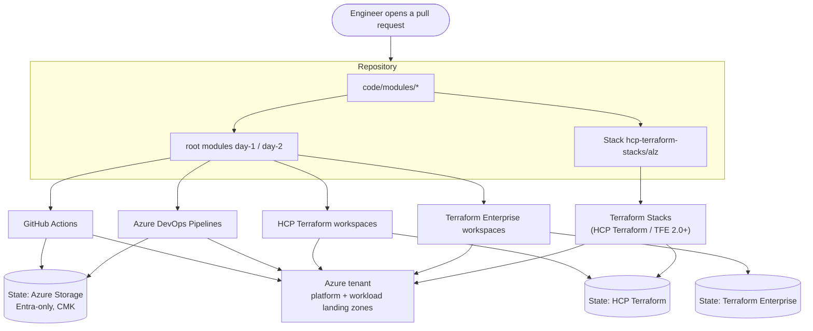
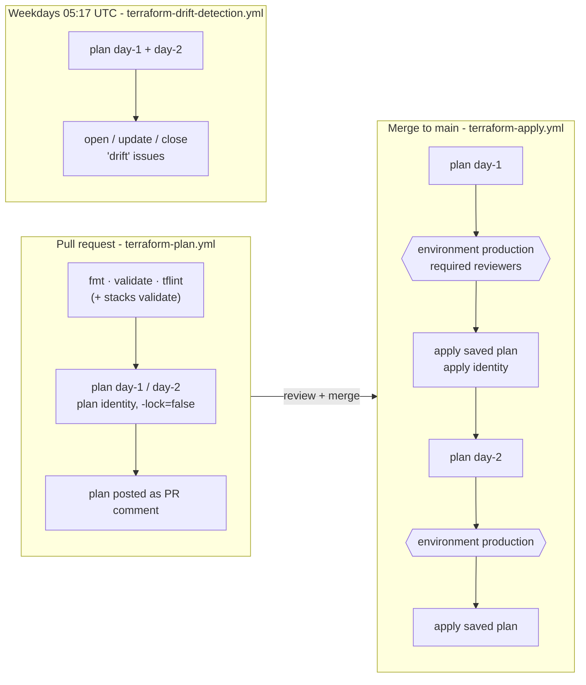
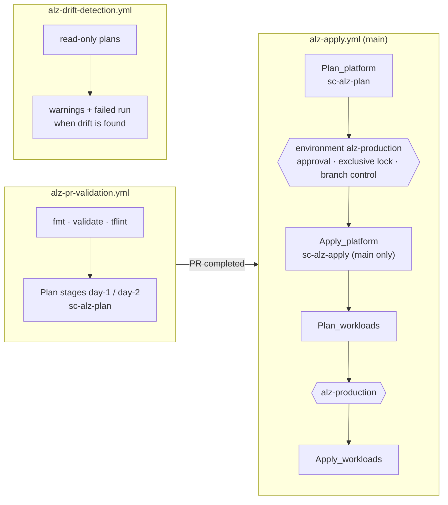
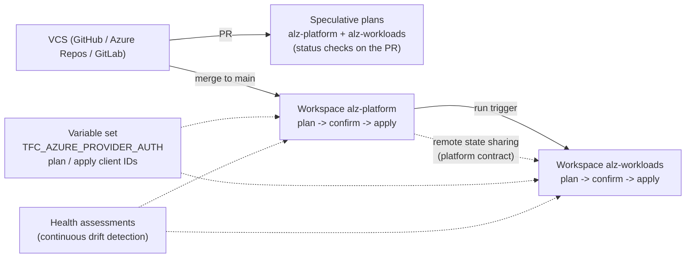
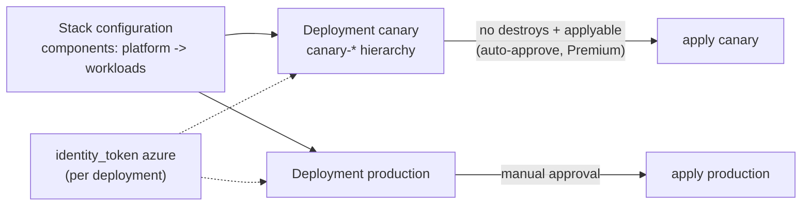

# Delivery Platforms - End-to-End Flows

> **Note**: This architectural reference framework and repository content were fully generated using **Claude Opus 5.5**. Untested reference - see the [disclaimer](../../README.md).

The same Terraform code reaches Azure through any of five delivery paths. One diagram per platform below; the comparison and decision guide are in [docs/07](../../docs/07-delivery-platforms.md).

## 1. Overview - one codebase, five delivery paths

**How to read this diagram:**

- **One entry for engineers:** every change starts as a pull request against the same repository, whatever platform is chosen.
- **Two kinds of entry points:** the root modules (`day-1`, `day-2`) serve the four "classic" platforms; the Terraform Stack serves Terraform Stacks. Both call the same `code/modules/*`.
- **State depends on the platform:** GitHub Actions and Azure DevOps keep state in the Day 0 storage account (Entra ID-only access, customer-managed key); HCP Terraform and Terraform Enterprise manage state themselves (per workspace, or per Stack deployment).
- **Same target:** every path deploys the identical platform and workload landing zones; choosing a platform changes *how* changes are gated, not *what* is built.

## 2. GitHub Actions

**How to read this diagram:**

- **Pull request:** static analysis runs for every stack (plus `terraform stacks validate`); read-only plans of Day 1 and Day 2 are posted as a PR comment. The plan identity cannot write to Azure or to state.
- **Merge to `main`:** Day 1 is planned, waits for a required reviewer on the `production` environment, then applies exactly the saved plan; Day 2 follows the same gate afterwards because it consumes Day 1 outputs.
- **Identity binding:** only jobs running inside the `production` environment receive a token the apply identity trusts (`environment:production` subject).
- **Drift detection:** a scheduled read-only plan opens a GitHub issue when Azure differs from `main` and closes it once they match again.
- **Before Day 0:** all Azure jobs are skipped (not failed) until the `AZURE_PLAN_CLIENT_ID` variable exists.

## 3. Azure DevOps Pipelines

**How to read this diagram:**

- **PR validation:** runs from the YAML `pr` trigger (GitHub-hosted repo) or from a build-validation branch policy (Azure Repos), using only the read-only `sc-alz-plan` service connection.
- **Gates live in Azure DevOps, not in YAML:** the `alz-production` environment carries approvals, an exclusive lock (no concurrent applies) and branch control; the `sc-alz-apply` service connection has its own branch-control check, so editing the YAML cannot bypass them.
- **Least-privilege authorisation:** only the `alz-apply` pipeline is authorised to use `sc-alz-apply` and the environment; the other pipelines can only use the plan connection.
- **Ordering:** `Apply_workloads` runs after the platform apply succeeds or is skipped (no platform changes), so Day 2 always reads a converged Day 1.
- **Drift:** the scheduled pipeline fails with warnings when a plan contains changes, which notifies subscribers (service hooks can forward it to Boards or Teams).

## 4. HCP Terraform / Terraform Enterprise workspaces

**How to read this diagram:**

- **Pull requests:** HCP Terraform / TFE run speculative plans in both workspaces and report them as VCS status checks.
- **Applies:** a merge queues a run in `alz-platform`; nothing applies until someone confirms it (`auto_apply = false`). A successful platform apply queues a run in `alz-workloads` through a run trigger, which again waits for confirmation.
- **Platform contract:** `alz-workloads` reads Day 1 outputs through remote state sharing, granted only to that workspace.
- **Dynamic credentials:** a project variable set enables Azure workload identity; the plan phase receives the read-only identity, the apply phase the privileged one.
- **Drift:** health assessments re-plan the workspaces continuously, replacing the scheduled jobs used by GitHub Actions and Azure DevOps.
- **Terraform Enterprise:** identical flow on a self-managed instance; only the hostname (which is also the OIDC issuer) changes.

## 5. Terraform Stacks

**How to read this diagram:**

- **One configuration, two deployments:** the Stack wires the `platform` component to the `workloads` component; each deployment (`canary`, `production`) gets its own isolated state.
- **Canary first:** the `canary` deployment builds an isolated `canary-` management group hierarchy with cheap SKUs and full policy enforcement; with HCP Terraform Premium it is auto-approved when the plan removes nothing.
- **Production is always manual:** it sits in the default deployment group, so every plan waits for an explicit approval.
- **Identity:** each deployment receives a token from the `identity_token` block; the Day 0 apply identity trusts the plan and apply subjects of each deployment.
- **Orchestration:** the dependency between components and values only known after apply (for example firewall IPs) are handled by Stacks itself, instead of a run trigger or a second pipeline stage.
