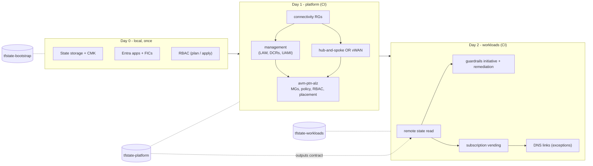

# Deployment Stages & State Layout

> **Note**: This architectural reference framework and repository content were fully generated using **Claude Opus 5.5**. Untested reference - see the [disclaimer](../../README.md).

| Stage | State container | Key | Runs from | Identity |
|---|---|---|---|---|
| Day 0 | `tfstate-bootstrap` (after migration) | `day-0-bootstrap-oidc.tfstate` | Operator workstation | Human (PIM-elevated) |
| Day 1 | `tfstate-platform` | `day-1-platform-landing-zone.tfstate` | GitHub Actions | plan / apply apps |
| Day 2 | `tfstate-workloads` | `day-2-workload-vending-operations.tfstate` | GitHub Actions | plan / apply apps |
