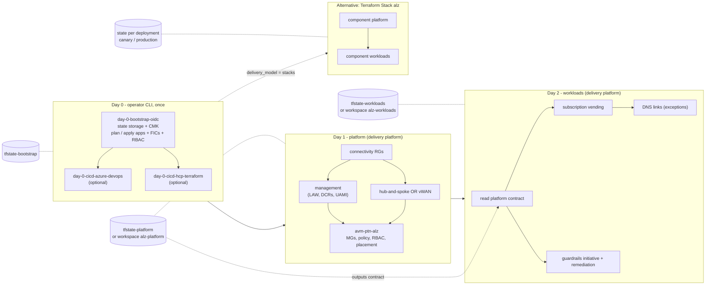

# Deployment Stages & State Layout

> **Note**: This architectural reference framework and repository content were fully generated using **Claude Opus 5.5**. Untested reference - see the [disclaimer](../../README.md).

<strong>📊 Diagram: Deployment Stages &amp; State Layout</strong> <em>(click to expand)</em>

**How to read this diagram:**

- **Day 0 is the only CLI step:** `day-0-bootstrap-oidc` creates the state storage and the two identities; the optional bootstraps then configure Azure DevOps or HCP Terraform / Terraform Enterprise. GitHub Actions needs only repository variables printed by Day 0.
- **Day 1 order inside the stage:** resource groups first, then management resources and connectivity in parallel, and the ALZ governance module last, so DeployIfNotExists policies never point at resources that do not exist yet.
- **Day 2 depends on Day 1 outputs:** it reads the platform contract (management groups, IPAM plan, DNS servers, firewall IPs, Private DNS zones) from remote state, then vends subscriptions and assigns guardrails.
- **State follows the platform:** Azure Storage containers for GitHub Actions / Azure DevOps, workspaces for HCP Terraform / TFE.
- **Stacks replace Day 1 + Day 2 with one configuration:** the `platform` and `workloads` components run in each deployment with their own state, and the component dependency replaces the remote-state contract.

Day 1 and Day 2 root modules are thin wrappers around `code/modules/platform-landing-zone` and `code/modules/workload-vending`; the Terraform Stack (`code/hcp-terraform-stacks/alz`) uses the same modules as components, with state managed per deployment by HCP Terraform / TFE.

| Stage | State container | Key | Runs from | Identity |
|---|---|---|---|---|
| Day 0 | `tfstate-bootstrap` (after migration) | `day-0-bootstrap-oidc.tfstate` | Operator workstation | Human (PIM-elevated) |
| Day 0 (optional) | `tfstate-bootstrap` | `day-0-cicd-azure-devops.tfstate` / HCP | Operator workstation | Human (PIM-elevated) |
| Day 1 | `tfstate-platform` (HCP/TFE: workspace `alz-platform`) | `day-1-platform-landing-zone.tfstate` | GitHub Actions / Azure DevOps / HCP Terraform / TFE | plan / apply apps |
| Day 2 | `tfstate-workloads` (HCP/TFE: workspace `alz-workloads`) | `day-2-workload-vending-operations.tfstate` | GitHub Actions / Azure DevOps / HCP Terraform / TFE | plan / apply apps |
| Stack `alz` | managed per deployment | - | HCP Terraform / TFE 2.0+ | apply app (per deployment) |
