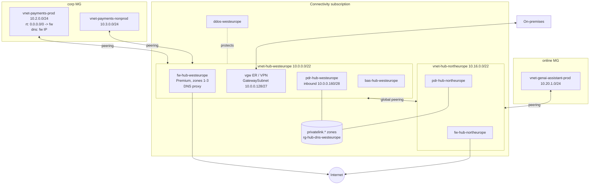

# Hub-and-Spoke Topology (customer-managed)

> **Note**: This architectural reference framework and repository content were fully generated using **Claude Opus 5.5**. Untested reference - see the [disclaimer](../../README.md).



## ASCII

```text
                      Internet
                         ^
                         | SNAT egress (only path out)
 On-prem <==ER/VPN==> [ HUB westeurope 10.0.0.0/22 ] <==global peering==> [ HUB northeurope 10.16.0.0/22 ]
                      |  Azure Firewall (DNS proxy)                         |  Azure Firewall
                      |  Private DNS Resolver ---- central privatelink.* zones ---- Resolver
                      |  Bastion, Gateways                                  |
            peering + UDR 0/0                                      peering + UDR 0/0
            /                  \                                          |
 [corp] payments-prod     [corp] payments-nonprod               [online] genai-assistant-prod
        10.2.0.0/24              10.3.0.0/24                             10.20.1.0/24
```
