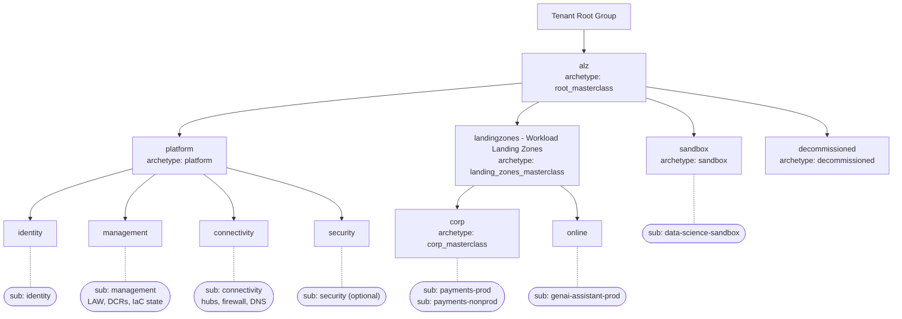

# Management Group Hierarchy (ALZ 2026)

> **Note**: This architectural reference framework and repository content were fully generated using **Claude Opus 5.5**. Untested reference - see the [disclaimer](../../README.md).

<details>
<summary><strong>📊 Diagram: Management Group Hierarchy (ALZ 2026)</strong> <em>(click to expand)</em></summary>



</details>

**How to read this diagram:**

- **Solid arrows** are parent -> child management groups; each box names the ALZ **archetype** (the set of policy and role assignments) applied at that level.
- **Rounded boxes on dotted lines** are subscriptions placed in that management group: platform subscriptions under Platform, example workload subscriptions under Corp / Online, an isolated subscription under Sandbox.
- Policies are **inherited downwards**: anything assigned at `alz` (Defender, diagnostics, data residency) also applies to every platform and workload subscription.
- `landingzones` is displayed as *Workload Landing Zones*; its archetype adds the Day 2 `Wlz-Guardrails-2026` initiative to every workload.

## ASCII

```text
Tenant Root Group
└── alz ................................. root_masterclass (MDFC, diagnostics, data residency)
    ├── platform ........................ platform (AMA, guardrails, private subnets)
    │   ├── identity .................... [sub] identity
    │   ├── management .................. [sub] management  (Log Analytics, DCRs, IaC state)
    │   ├── connectivity ................ [sub] connectivity (hubs/vWAN, firewall, DNS, DDoS)
    │   └── security .................... [sub] security    (Sentinel, SOC tooling) - optional
    ├── landingzones (Workload LZs) ..... landing_zones_masterclass (+ Wlz-Guardrails-2026)
    │   ├── corp ........................ corp_masterclass (no public endpoints, PE DNS DINE)
    │   │   ├── [sub] payments-prod       10.2.0.0/24
    │   │   └── [sub] payments-nonprod    10.3.0.0/24
    │   └── online ...................... online
    │       └── [sub] genai-assistant-prod 10.20.1.0/24
    ├── sandbox ......................... sandbox (isolated)
    │   └── [sub] data-science-sandbox    10.15.0.0/24 (not peered)
    └── decommissioned .................. decommissioned
```
