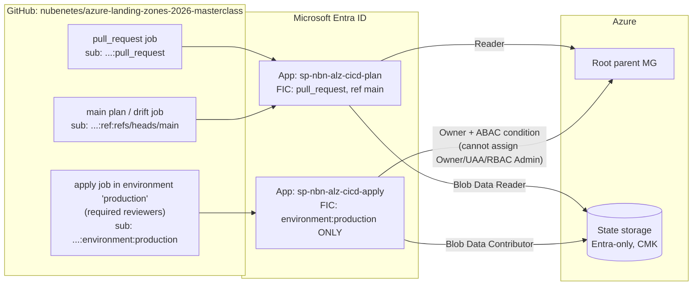
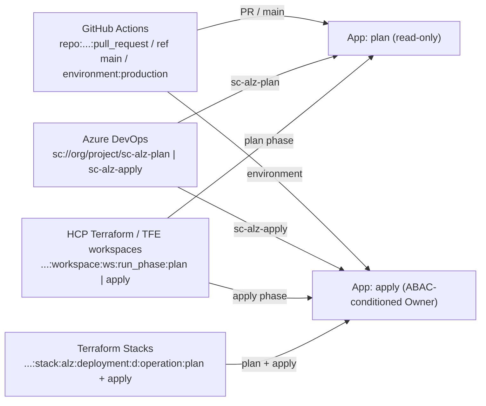

# OIDC CI/CD Trust Flow

> **Note**: This architectural reference framework and repository content were fully generated using **Claude Opus 5.5**. Untested reference - see the [disclaimer](../../README.md).

<details>
<summary><strong>📊 Diagram: OIDC CI/CD Trust Flow</strong> <em>(click to expand)</em></summary>



</details>

**How to read this diagram:**

- This is the **GitHub Actions view**: three job contexts produce three OIDC token subjects (`pull_request`, `ref:refs/heads/main`, `environment:production`).
- Entra ID maps the first two subjects to the **plan** app (read-only) and only the environment subject to the **apply** app.
- The plan app has `Reader` on the management group tree and `Storage Blob Data Reader` on state, so a pull request can never change Azure or state.
- The apply app has `Owner` restricted by an **ABAC condition** (it cannot grant or remove Owner, User Access Administrator or RBAC Administrator) and write access to state.

## ASCII

```text
 GitHub job ──(1) request JWT──> token.actions.githubusercontent.com
     │  <──(2) JWT {iss, aud=api://AzureADTokenExchange, sub=repo:<org>/<repo>:<context>}──
     │
     └──(3) client_assertion=JWT, client_id=<app>──> Entra ID
                                                     │ match issuer + subject + audience
            <──────────(4) short-lived access token──┘
     ──(5) Terraform -> ARM / Storage (RBAC + ABAC evaluated)

 context = pull_request | ref:refs/heads/main      -> PLAN app  (read-only)
 context = environment:production (after approval) -> APPLY app (write, ABAC-limited)
```

## Same identities, every delivery platform

<details>
<summary><strong>📊 Diagram: Same identities, every delivery platform</strong> <em>(click to expand)</em></summary>



</details>

**How to read this diagram:**

- **Every delivery platform reuses the same two identities**; only the token issuer and subject differ (GitHub job context, Azure DevOps service connection, HCP Terraform run phase, Stack deployment operation).
- GitHub Actions, Azure DevOps and HCP Terraform / TFE workspaces keep the **plan / apply split**: plans and drift detection use the plan app, applies use the apply app.
- **Terraform Stacks** use one client ID per deployment for both operations, so both subjects point to the apply app; the production approval and the ABAC condition compensate.

Full subject list: [docs/07](../../docs/07-delivery-platforms.md#federated-identity-credentials-entra-id-trusts-exactly-these-subjects).
