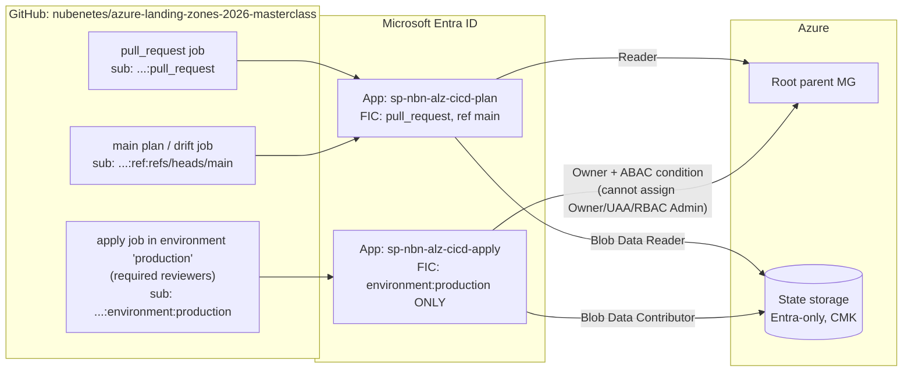

# OIDC CI/CD Trust Flow

> **Note**: This architectural reference framework and repository content were fully generated using **Claude Opus 5.5**. Untested reference - see the [disclaimer](../../README.md).



## ASCII

```text
 GitHub job ──(1) request JWT──> token.actions.githubusercontent.com
     │  <──(2) JWT {iss, aud=api://AzureADTokenExchange, sub=repo:<org>/<repo>:<context>}──
     │
     └──(3) client_assertion=JWT, client_id=<app>──> Entra ID
                                                     │ match issuer + subject + audience
            <──────────(4) short-lived access token──┘
     ──(5) Terraform -> ARM / Storage (RBAC + ABAC evaluated)

 context = pull_request | ref:refs/heads/main      -> PLAN app  (read-only)
 context = environment:production (after approval) -> APPLY app (write, ABAC-limited)
```
