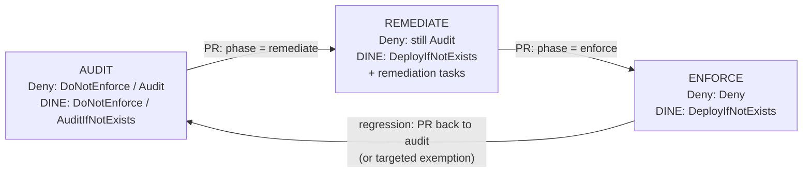

# Policy Rollout Lifecycle

> **Note**: This architectural reference framework and repository content were fully generated using **Claude Opus 5.5**. Untested reference - see the [disclaimer](../../README.md).



**How to read this diagram:**

- Each box is a **rollout phase** set by `policy_enforcement_phase`; each arrow is a **pull request** changing that one variable.
- **Audit**: nothing is blocked or changed; the compliance dashboard shows what would be denied or remediated.
- **Remediate**: DeployIfNotExists / Modify policies start fixing resources (including existing ones via remediation tasks) while Deny policies still only audit.
- **Enforce**: Deny policies block non-compliant deployments; going back to Audit (or adding a targeted exemption) is the documented rollback.

```text
 AUDIT ───PR───> REMEDIATE ───PR───> ENFORCE
   │  measure        │ fix existing       │ prevent new
   │  compliance     │ (remediation)      │ (Deny) + keep fixing (DINE)
   └──────── exemptions as code, reviewed by security ────────┘
```
