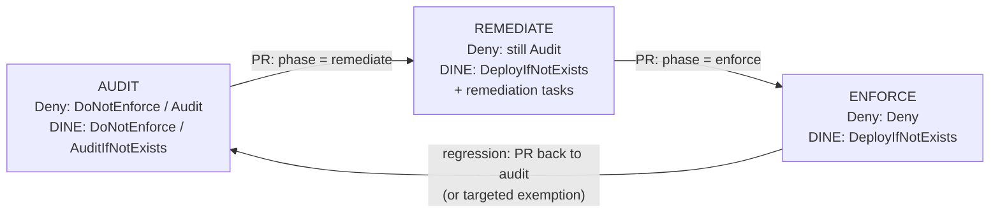

# Policy Rollout Lifecycle

> **Note**: This architectural reference framework and repository content were fully generated using **Claude Opus 5.5**. Untested reference - see the [disclaimer](../../README.md).



```text
 AUDIT ───PR───> REMEDIATE ───PR───> ENFORCE
   │  measure        │ fix existing       │ prevent new
   │  compliance     │ (remediation)      │ (Deny) + keep fixing (DINE)
   └──────── exemptions as code, reviewed by security ────────┘
```
