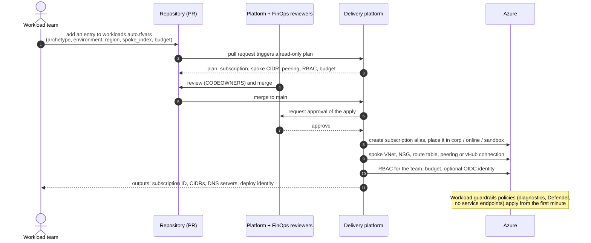

# Subscription Vending Flow (Day 2)

> **Note**: This architectural reference framework and repository content were fully generated using **Claude Opus 5.5**. Untested reference - see the [disclaimer](../../README.md).

How a workload team gets a new Workload Landing Zone, regardless of the delivery platform.

**How to read this diagram:**

- **Steps 1-3 - request as code:** the team does not open a ticket; it adds one map entry (the "order form") and the pull request shows exactly what will be created, including the deterministic `/24` spoke range.
- **Step 4 - separation of duties:** CODEOWNERS routes the request to the platform team and FinOps; the workload team cannot approve its own landing zone.
- **Steps 5-7 - gated apply:** the merge triggers the delivery platform (GitHub Actions, Azure DevOps, HCP Terraform / TFE or Stacks), which waits for a human approval before using the privileged identity.
- **Steps 8-10 - fully wired landing zone:** the subscription is placed in the right management group, connected to the hub (peering + firewall route, or a Virtual WAN connection with routing intent), and handed to the team's Entra ID group with a budget and, optionally, an OIDC identity for the team's own pipeline.
- **Step 11 - handover:** the outputs give the team everything needed to deploy workloads; policy guardrails inherited from the management group apply immediately.
