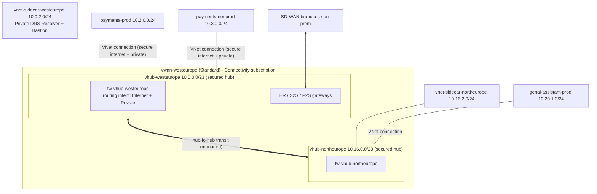

# Azure Virtual WAN Topology (Microsoft-managed)

> **Note**: This architectural reference framework and repository content were fully generated using **Claude Opus 5.5**. Untested reference - see the [disclaimer](../../README.md).

<details>
<summary><strong>📊 Diagram: Azure Virtual WAN Topology (Microsoft-managed)</strong> <em>(click to expand)</em></summary>



</details>

**How to read this diagram:**

- A single **Virtual WAN** contains one Microsoft-managed **secured virtual hub** per region, each with an Azure Firewall and routing intent for internet and private traffic.
- Hubs are connected by **managed transit**: no hub-to-hub peering or route tables to maintain.
- **Spokes** attach to their regional hub through a VNet connection; routing intent forces their traffic through the hub firewall without UDRs.
- Services that cannot live inside a virtual hub (Private DNS Resolver, Bastion) sit in a **sidecar VNet** connected to the hub.
- **Branches, SD-WAN and on-premises** terminate on the hub gateways (ExpressRoute, site-to-site, point-to-site).

## ASCII

```text
  SD-WAN / ER / VPN / P2S
            |
  +---------v---------------+      managed transit      +-------------------------+
  | vhub-westeurope /23     |<=========================>| vhub-northeurope /23    |
  | secured: Azure Firewall |                           | secured: Azure Firewall |
  | routing intent (I + P)  |                           | routing intent (I + P)  |
  +--+---------+---------+--+                           +-----+--------------+----+
     |         |         |                                    |              |
  sidecar   payments  payments-                           sidecar        genai-assistant
  /24 (DNS  -prod     nonprod                              /24            -prod 10.20.1.0/24
  resolver, 10.2.0.0  10.3.0.0
  Bastion)  /24       /24
```
