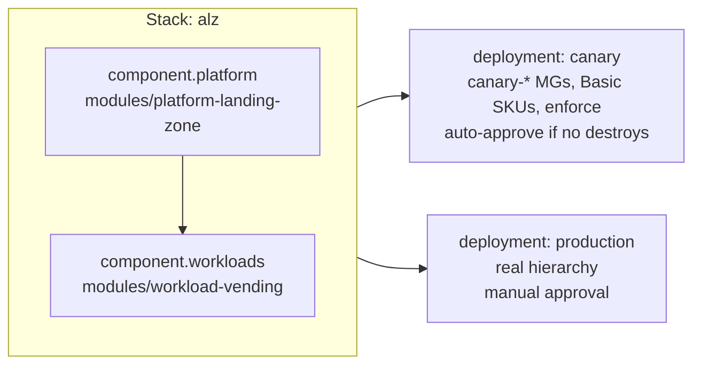

# Terraform Stack `alz` (HCP Terraform / Terraform Enterprise 2.0+)

> **Note**: This architectural reference framework and repository content were fully generated using **Claude Opus 5.5**. Untested reference - see the [disclaimer](../../../README.md).

> [!WARNING]
> This Stack configuration has **not** been validated with `terraform stacks validate` (the Stacks CLI was not available in the generation environment) and has never been deployed. The modules it uses are the same ones validated for the root-module delivery paths.

One Stack, two components, two deployments:



| File | Content |
|---|---|
| `.terraform-version` | Terraform CLI used by the Stack (Stacks need 1.13+) |
| `variables.tfcomponent.hcl` | Inputs (mirrors the two modules) |
| `providers.tfcomponent.hcl` | Provider instances with workload identity (`use_oidc` + `oidc_token`) |
| `components.tfcomponent.hcl` | `platform` and `workloads` components (local module sources) |
| `outputs.tfcomponent.hcl` | Stack outputs |
| `deployments.tfdeploy.hcl` | `identity_token`, `canary` and `production` deployments, auto-approve rules |

## Why Stacks for a landing zone

| Need | Root-module delivery (Actions / ADO / workspaces) | Stacks |
|---|---|---|
| Day 1 -> Day 2 ordering | Two states, remote-state contract, run trigger | One configuration; dependency inferred from `component.platform.*` |
| Values unknown until apply (firewall IPs) | Second run of Day 2 | **Deferred changes** handled by the orchestrator |
| Canary before production | Separate workspace / pipeline stage | **Deployments** of the same configuration + **deployment groups** with auto-approve rules |
| Identity | Plan and apply identities per phase | One identity per deployment (plan + apply subjects); human approval gates production |

## Run it

1. Day 0 with `hcp_terraform.stack` set (creates the federated credentials for both deployments).
2. `code/day-0-cicd-hcp-terraform` with `delivery_model = "stacks"` (creates the Stack connected to this repository).
3. Replace the placeholder GUIDs in `deployments.tfdeploy.hcl`, then generate the lock file:

   ```bash
   terraform stacks init
   terraform stacks providers-lock -platform=linux_amd64
   terraform stacks validate
   git add .terraform.lock.hcl && git commit -m "chore(stacks): provider lock file"
   ```

4. Merge to `main` - HCP Terraform plans both deployments; canary auto-applies (Premium) or waits; production always waits for approval.

> [!IMPORTANT]
> Component sources are relative paths (`../../modules/...`). They resolve when the Stack is connected to the repository through VCS (the bootstrap sets `working_directory = code/hcp-terraform-stacks/alz`). For `terraform stacks configuration upload` from a laptop, switch them to `git::https://github.com/nubenetes/azure-landing-zones-2026-masterclass.git//code/modules/<module>?ref=<tag>`.

> [!NOTE]
> The canary hierarchy shares the tenant with production. Management group IDs are prefixed (`canary-`), but tenant-wide names such as **custom role definition names** must also be unique - check the ALZ provider's role naming before the first canary apply.
