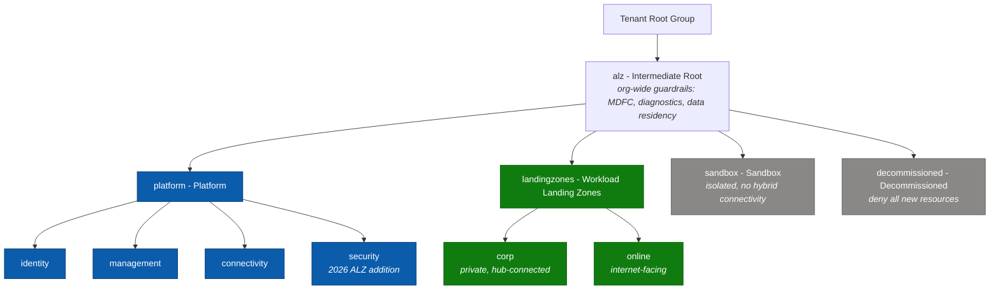
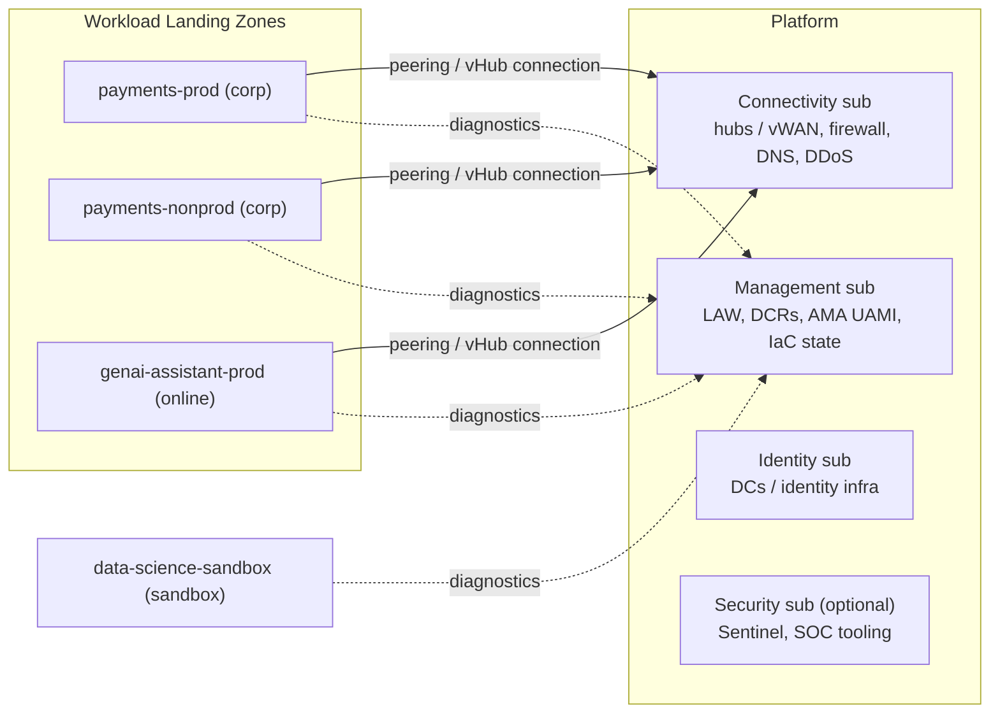

# 01 - Conceptual Architecture & Management Group Hierarchy (CAF 2026)

> **Note**: This architectural reference framework and repository content were fully generated using **Claude Opus 5.5**.

> **Disclaimer**: This repository serves purely as an advanced theoretical and architectural reference framework incorporating the latest 2026 Microsoft Azure Landing Zone best practices. The code, Terraform manifests, and pipeline configurations provided herein **have not been physically deployed, executed, or tested in a live production environment**. Users should thoroughly validate, plan, and test all code in a sandbox environment prior to enterprise implementation.

---

> 🧭 **Navigation**: [🏠 Masterclass Portal](../README.md) | [📚 Documentation Index](../README.md#4-documentation-index) | [➡️ Next: 02. IaC Provider Matrix](02-iac-provider-matrix.md)

> 🎥 **Multimedia Sessions & Video Guides**:
> - 📽️ [**The Cloud Metropolis: Azure Landing Zones Architecture Blueprint**](https://www.youtube.com/watch?v=u9rLpmpUf2Y) (`8:30`, 🇬🇧 English CC 20+) — *City planning analogy for enterprise cloud scale, multi-subscription isolation, and zoning governance.*
> - 📽️ [**Azure Landing Zones 2026: Next-Gen Enterprise Architecture Masterclass**](https://www.youtube.com/watch?v=LE568gOjCkY) (`8:03`, 🇬🇧 English CC 20+) — *Deep dive into the 2026 Microsoft CAF framework, platform vs. workload landing zones, and scalable foundations.*
> - 📽️ [**Azure Management Groups & Governance: Core Engine Architecture**](https://www.youtube.com/watch?v=xh84QXkuYm8) (`8:41`, 🇬🇧 English CC 20+) — *Architectural engine breakdown: Platform (Identity, Management, Connectivity, Security) vs. Workload Landing Zones.*
> - ⚡ [**Why Azure Landing Zones Split Corp and Online**](https://www.youtube.com/shorts/Uab5Y1nnt08) (`1:24`, 🇬🇧 English CC 20+) — *Architecture short on Corp vs. Online archetypes, routing boundaries, and avoiding dev/test/prod anti-patterns.*

---

## 1. What a landing zone is in 2026

An **Azure landing zone** is the output of a multi-subscription environment that has been prepared for scale, security, governance, networking and identity *before* workloads arrive. CAF splits it into two layers:

| Layer | Cardinality | Owner | Contains |
|---|---|---|---|
| **Platform landing zone** | Usually one per Entra ID tenant | Platform team | Management groups, policy, identity infrastructure, central logging, connectivity hubs, DNS, firewall, security tooling |
| **Workload landing zones** | Many - one or more subscriptions **per workload per environment** | Workload teams (inside platform guardrails) | Application, AI/ML, data-platform or container workload resources and the spoke network that the platform vends to them |

### Terminology

Microsoft Learn presents the second layer as **application (workload) landing zones**. This repository consistently uses **Workload Landing Zones**, because in 2026 the same vending, policy and network model serves applications, AI/ML model hosting, data platforms and containerised platforms alike. The management group that hosts them keeps the ALZ ID `landingzones` (so the ALZ Library archetypes apply unchanged) but is displayed as *Workload Landing Zones* through the custom library in [`code/modules/platform-landing-zone/lib`](../code/modules/platform-landing-zone/lib).

> [!NOTE]
> Choose one term and use it everywhere: pipelines, tags, RBAC group names and runbooks. Mixed terminology is a common source of governance gaps ("is a data platform a landing zone?" - yes, it is a workload landing zone).

---

## 2. Design areas

The eight CAF design areas map onto this repository as follows:

| Design area | Where it is implemented | Key choices |
|---|---|---|
| Azure billing & Entra tenant | Day 0 / Day 2 (`subscription_billing_scope`) | One tenant, subscription aliases created through vending |
| Identity & access management | Day 0 (OIDC, RBAC), Day 1 (`management_group_role_assignments`), Day 2 (workload RBAC) | No secrets, PIM for privileged roles, ABAC-conditioned pipeline Owner |
| Resource organisation | Day 1 custom library (architecture definition) | ALZ hierarchy + Security MG; one subscription per workload per environment |
| Network topology & connectivity | Day 1 (`connectivity_type`), Day 2 (spokes) | Hub-and-spoke default, vWAN toggle, deterministic IPAM |
| Security | Day 1 (ALZ policy, Defender plans), Day 2 (guardrails initiative) | Private Endpoints by default, Defender for Cloud everywhere |
| Management | Day 1 (`avm-ptn-alz-management`) | Central Log Analytics, AMA + DCRs, optional Sentinel |
| Governance | Day 1 (ALZ Library), Day 2 (custom initiative), docs/06 | Phased rollout audit -> remediate -> enforce |
| Platform automation & DevOps | `.github/workflows`, CODEOWNERS | PR-driven, environment-gated, drift detection |

---

## 3. Management group hierarchy



**How to read this diagram:**

- **Blue** boxes are the platform landing zone (owned by the platform team), **green** boxes the Workload Landing Zones, **grey** boxes the special-purpose groups.
- `alz` (intermediate root) is created under the Tenant Root Group so that tenant-wide guardrails apply to everything below it without touching the root itself.
- Workloads are separated by **connectivity / exposure model** (Corp = private, hub-connected; Online = internet-facing), not by department or environment.
- Sandbox is outside the workload tree so experiments never inherit hybrid connectivity; Decommissioned parks subscriptions before cancellation.

### 3.1 Why each management group exists

| MG | Archetype (ALZ Library) | Purpose | Representative assignments |
|---|---|---|---|
| `alz` | `root` + custom data-residency assignments | Tenant-wide baseline that applies to *everything* below | `Deploy-MDFC-Config-H224`, `Deploy-Diag-LogsCat`, `Deploy-AzActivity-Log`, `Deny-Classic-Resources`, `Enforce-ACSB`, `Enforce-Allowed-Locations` (custom) |
| `platform` | `platform` | Controls shared by all platform subscriptions | AMA monitoring, guardrail initiatives (`Enforce-GR-*`), `Enforce-Subnet-Private` |
| `identity` | `identity` | Domain controllers / identity infrastructure | `Deny-Public-IP`, `Deny-MgmtPorts-Internet`, `Deny-Subnet-Without-Nsg` |
| `management` | `management` | Logging, monitoring, automation | (inherits) |
| `connectivity` | `connectivity` | Hubs, firewalls, gateways, DNS | `Enable-DDoS-VNET` |
| `security` | `security` | SOC tooling - Sentinel, Defender exports, threat intelligence | (inherits; reserved for SOC-specific controls) |
| `landingzones` | `landing_zones` | Every workload, regardless of connectivity model | `Deny-IP-forwarding`, `Deny-Subnet-Without-Nsg`, `Deny-Storage-http`, `Deploy-VM-Backup`, `Enforce-TLS-SSL-*`, plus the Day 2 **Wlz-Guardrails-2026** initiative |
| `corp` | `corp` | Private workloads reachable only through the hub | `Deny-Public-Endpoints`, `Deny-Public-IP-On-NIC`, `Deploy-Private-DNS-Zones`, `Audit-PeDnsZones` |
| `online` | `online` | Internet-facing workloads (WAF/Front Door in front) | (inherits landing zone controls) |
| `sandbox` | `sandbox` | Experimentation, no hybrid connectivity | `Enforce-ALZ-Sandbox` |
| `decommissioned` | `decommissioned` | Parking area before cancellation | `Enforce-ALZ-Decomm` |

> [!TIP]
> **Do not** create management groups per environment (`prod`/`dev`) or per department. Environments are separate *subscriptions* inside the same archetype MG; policy should differ by **archetype** (connectivity and exposure model), not by org chart. Use tags (`environment`, `cost_center`) and Azure **service groups** for cross-cutting views.

### 3.2 The local library (how the hierarchy is defined in code)

```text
code/modules/platform-landing-zone/lib/
├── alz_library_metadata.json                     # depends on platform/alz @ 2026.10.0
├── alz_policy_default_values.json                # adds the "allowed_locations" default
├── architecture_definitions/
│   ├── alz_2026_masterclass.alz_architecture_definition.yaml          # the MG tree above
│   └── alz_2026_masterclass_canary.alz_architecture_definition.yaml   # same tree, "canary-" IDs
├── archetype_definitions/
│   ├── root_masterclass.alz_archetype_override.yaml            # root + data residency
│   ├── landing_zones_masterclass.alz_archetype_override.yaml   # opt-out examples
│   └── corp_masterclass.alz_archetype_override.yaml            # private-by-default notes
└── policy_assignments/
    ├── Enforce-Allowed-Locations.alz_policy_assignment.json
    └── Enforce-Allowed-Loc-RG.alz_policy_assignment.json
```

> [!TIP]
> **Canary hierarchy.** CAF recommends validating platform and policy changes in a canary environment before production. Because management group IDs are tenant-unique, the canary architecture uses the same tree with `canary-` IDs (`management_group_id_prefix = "canary-"`). The Terraform Stack in `code/hcp-terraform-stacks/alz` deploys it as its `canary` deployment (docs/07).

Three levers, in order of preference:

1. **Library dependency ref** (`alz_library_metadata.json`) - adopt Microsoft's updated policies as a single, reviewable diff.
2. **Archetype overrides** (YAML) - add/remove assignments, definitions, role definitions per archetype. Recommended for *structural* changes.
3. **`policy_assignments_to_modify`** (HCL in `locals.tf`) - change parameters, enforcement mode, identities, non-compliance messages or `creation_enabled`. Recommended for *tuning*.

---

## 4. Subscription model



**How to read this diagram:**

- The left group shows the **platform subscriptions** and what each hosts (Management also hosts the IaC state from Day 0).
- **Solid arrows**: workload spokes connect to the Connectivity subscription (hub peering or Virtual WAN connection).
- **Dotted arrows**: every subscription, including the sandbox, sends diagnostics to the central Log Analytics workspace in Management.
- The sandbox has **no network path** to the hub: it is isolated by design.

Rules of thumb:

- **One subscription per workload per environment.** Subscriptions are the unit of RBAC, budget, quota and blast radius - and they are free.
- **Vend, never hand-build.** Every workload subscription comes from [Day 2 vending](../code/modules/workload-vending/main.tf) with network, DNS, RBAC, budget and identity pre-wired.
- **Platform state lives in the Management subscription** (Day 0), separate from any workload.

---

## 5. Separation of duties

| Responsibility | Platform team | Workload team |
|---|---|---|
| Management groups, policy, ALZ Library version | **Owns** | Requests exemptions via PR |
| Platform subscriptions (identity, management, connectivity, security) | **Owns** | No access |
| Hub networking, firewall rules, DNS zones | **Owns** | Requests rules via PR |
| Workload subscription creation, spoke VNet, peering, NSG/UDR baseline | **Owns** (vending code) | Requests via order-form PR |
| Resources inside the workload subscription | Guardrails only | **Owns** (Contributor) |
| Workload CI/CD identity | Vends it (OIDC UAMI) | **Uses** it |
| Budgets & cost | Sets defaults | **Owns** consumption |

Technical enforcement of the split:

- **CODEOWNERS** - platform, security and FinOps reviewers per path ([`.github/CODEOWNERS`](../.github/CODEOWNERS)).
- **RBAC** - workload groups get `Contributor` on their subscription; the network resource group carries a `CanNotDelete` lock that Contributors cannot remove.
- **Policy** - Deny/DINE at MG scope cannot be overridden from inside a subscription.
- **Pipeline identity** - only the environment-gated apply identity can write platform resources; its Owner assignment cannot grant Owner/UAA/RBAC Administrator (ABAC condition, see [docs/05](05-cicd-oidc-security.md)).

---

## 6. Brownfield adoption

| Starting point | Approach |
|---|---|
| `caf-enterprise-scale` (archived 1 Aug 2026) | Follow the official Terraform migration guidance: generate AVM code, align MG IDs and resource names, then `terraform import` / `moved` blocks so state ownership moves to the AVM module paths **without recreating resources**. |
| ALZ-Bicep classic | Converge the AVM Bicep accelerator onto existing IDs (MG IDs and logging names must match). Expect `InvalidPolicyParameterUpdate` on custom definitions whose parameters were removed: remove assignments -> initiatives -> definitions, then re-apply. |
| Azure Blueprints | Export definitions and assignments before **31 January 2027**; recreate resource grouping and locks with **Deployment Stacks** (deny settings) and policy with **Policy-as-Code**. |
| Hand-built hierarchy | Set each `id` in the architecture definition to the existing MG name, start with `policy_enforcement_phase = "audit"` and import existing subscriptions into Day 2 with `existing_subscription_id`. |

> [!WARNING]
> Changing an MG `id` in the architecture definition **creates a new management group**. Always verify with a plan that existing MGs show as in-place updates, never as create + destroy.

---

## References

- CAF - Ready your Azure environment: <https://learn.microsoft.com/azure/cloud-adoption-framework/ready>
- CAF - What's new: <https://learn.microsoft.com/azure/cloud-adoption-framework/whats-new>
- ALZ Terraform - modifying the management group hierarchy: <https://azure.github.io/Azure-Landing-Zones/terraform/howtos/modifyingmghierarchy/>
- ALZ Terraform migration guidance: <https://azure.github.io/Azure-Landing-Zones/terraform/migration/>
- ALZ-Bicep classic migration: <https://azure.github.io/Azure-Landing-Zones/bicep/migration/>
- Azure Blueprints retirement: <https://learn.microsoft.com/azure/governance/blueprints/blueprint-retirement-faq>
