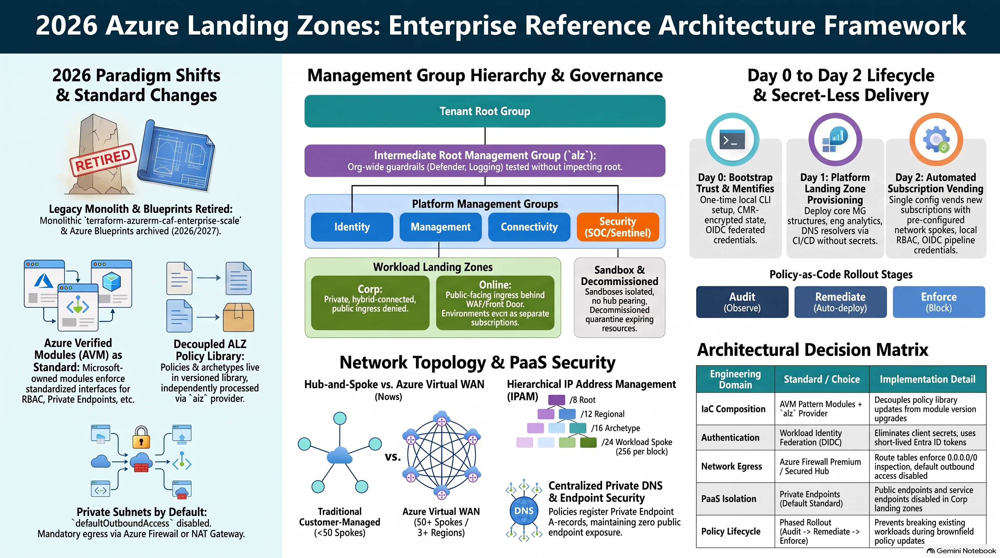
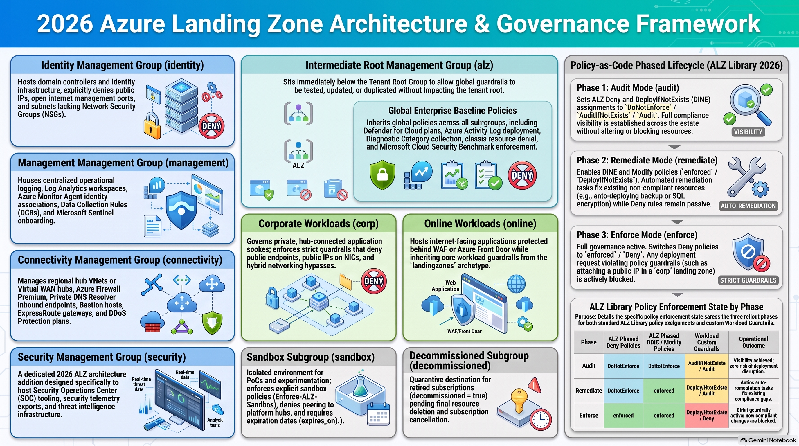
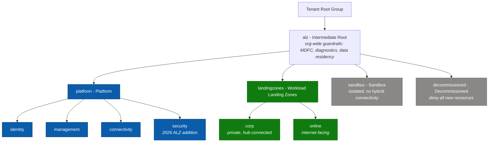
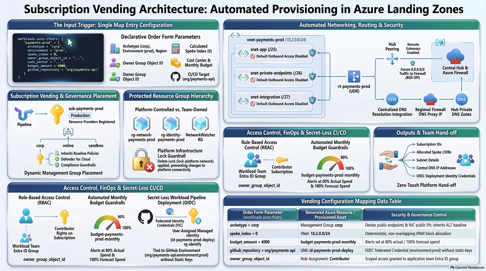
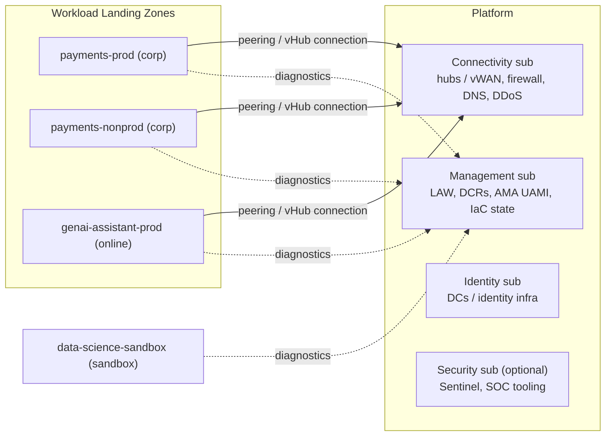

# 01 - Conceptual Architecture & Management Group Hierarchy (CAF 2026)

> **Note**: This architectural reference framework and repository content were fully generated using **Claude Opus 5.5**.

> **Disclaimer**: This repository serves purely as an advanced theoretical and architectural reference framework incorporating the latest 2026 Microsoft Azure Landing Zone best practices. The code, Terraform manifests, and pipeline configurations provided herein **have not been physically deployed, executed, or tested in a live production environment**. Users should thoroughly validate, plan, and test all code in a sandbox environment prior to enterprise implementation.

---

> 🧭 **Navigation**: [🏠 Masterclass Portal](../README.md) | [📚 Documentation Index](../README.md#4-documentation-index) | [➡️ Next: 02. IaC Provider Matrix](02-iac-provider-matrix.md)

> 🎥 **Multimedia Sessions, Podcasts & Video Guides**:
> - 🎙️ [**La nueva arquitectura de Azure Landing Zones**](https://www.youtube.com/watch?v=BKkvEATTGfo) (`25:54`, 🇪🇸 Spanish CC 20+) — *Masterclass de arquitectura en español: analogía de llaves maestras vs. permisos granulares, transición AVM y gobernanza.*
> - 📽️ [**The Cloud Metropolis: Azure Landing Zones Architecture Blueprint**](https://www.youtube.com/watch?v=u9rLpmpUf2Y) (`8:30`, 🇬🇧 English CC 20+) — *City planning analogy for enterprise cloud scale, multi-subscription isolation, and zoning governance.*
> - 📽️ [**2026 Cloud Metropolis**](https://www.youtube.com/watch?v=i5aBiDuzXr8) (`9:51`, 🇬🇧 English CC 20+) — *Evolutionary architecture blueprint transforming fragmented cloud villages into an engineered enterprise cloud metropolis.*
> - 📽️ [**Azure Landing Zones 2026: Next-Gen Enterprise Architecture Masterclass**](https://www.youtube.com/watch?v=LE568gOjCkY) (`8:03`, 🇬🇧 English CC 20+) — *Deep dive into the 2026 Microsoft CAF framework, platform vs. workload landing zones, and scalable foundations.*
> - 📽️ [**Azure Management Groups & Governance: Core Engine Architecture**](https://www.youtube.com/watch?v=xh84QXkuYm8) (`8:41`, 🇬🇧 English CC 20+) — *Architectural engine breakdown: Platform (Identity, Management, Connectivity, Security) vs. Workload Landing Zones.*
> - 📽️ [**Azure Landing Zones 2026: Enterprise Architecture Mental Model & Deep Dive**](https://www.youtube.com/watch?v=nVpDkEKyBr8) (`10:40`, 🇬🇧 English CC 20+) — *Actionable operational mental model, deconstructing blast radiuses, and day-1 subscription vending.*
> - ⚡ [**Why Azure Landing Zones Split Corp and Online**](https://www.youtube.com/shorts/Uab5Y1nnt08) (`1:24`, 🇬🇧 English CC 20+) — *Architecture short on Corp vs. Online archetypes, routing boundaries, and avoiding dev/test/prod anti-patterns.*
> - ⚡ [**Why Azure Separates Corp and Online**](https://www.youtube.com/shorts/n2lvZtLn8Ag) (`1:21`, 🇬🇧 English CC 20+) — *Architecture short on why mirroring dev/stage/prod lifecycles in management groups creates security blind spots.*
> - ⚡ [**Why App Branching Breaks Azure Landing Zones**](https://www.youtube.com/shorts/QuIJJDU70fk) (`1:26`, 🇬🇧 English CC 20+) — *Architecture short on why standard app development branching models cause catastrophic state drift in landing zone IaC.*
> - ⚡ [**How Subscription Vending Automates Azure**](https://www.youtube.com/shorts/GVoFBsgFtms) (`1:19`, 🇬🇧 English CC 20+) — *Architecture short on eliminating IT approval tickets and vending pre-governed subscriptions with GitOps.*
> - ⚡ [**How Azure Canaries Prevent Cloud Outages**](https://www.youtube.com/shorts/0mDvTs3aO2I) (`0:59`, 🇬🇧 English CC 20+) — *Architecture short on deploying parallel canary- management groups to test security baselines with real policy inheritance.*

---

## 1. What a landing zone is in 2026

#### 🖼️ Architectural Infographic: Enterprise Reference Architecture Framework



**Detailed Architectural Breakdown & Engineering Takeaways:**

- **2026 Paradigm Shifts & Deprecation Timelines:**
  - **CAF Monolith Retirement:** The legacy `terraform-azurerm-caf-enterprise-scale` module reached extended support end-of-life and was officially **archived on August 1, 2026**. Modern landing zones assemble composable, single-purpose Azure Verified Modules (AVM).
  - **Azure Blueprints Sunset:** Microsoft Azure Blueprints permanently sunsets (no new assignments from October 31, 2026; complete service retirement on January 31, 2027), replaced by native **Deployment Stacks** and declarative Policy-as-Code.
  - **Azure Verified Modules (AVM) Standard:** Microsoft-owned and engineered pattern modules (`avm-ptn-alz`, `avm-ptn-alz-management`, `avm-ptn-alz-connectivity-*`) enforce consistent, hardened interfaces for Private Endpoints, diagnostics, managed identities, and customer locks.
  - **Decoupled ALZ Policy Library:** Architectural archetypes and Azure Policy definitions reside in the versioned `Azure/Azure-Landing-Zones-Library` (`platform/alz` `2026.10.0`), processed independently by the `Azure/alz` provider to eliminate upgrade regressions.
  - **AzAPI-First Validation:** Modern AVM modules prioritize the `azapi` provider over `azurerm` to interact directly with ARM REST APIs, guaranteeing day-zero access to new Azure capabilities and plan-time OpenAPI schema validation.
  - **Private Subnets by Default:** In alignment with Microsoft's 2026 network security standards, new virtual networks default to `defaultOutboundAccess = false`, making explicit outbound routing via Azure Firewall or NAT Gateway mandatory.

- **Management Group Hierarchy & Governance:**
  - **Tenant Root Group:** Maintained free of direct policy assignments to avoid locking out break-glass credentials or breaking non-standard tenant workloads.
  - **Intermediate Root (`alz`):** Anchors tenant-wide security baselines (Defender for Cloud, centralized Azure Activity Logs, TLS 1.3 enforcement) without root pollution.
  - **Platform Management Groups:** Segregates foundational utilities into dedicated subscriptions: `Identity` (AD DS, no public IPs), `Management` (Log Analytics, Sentinel), `Connectivity` (Hub/vWAN, Azure Firewall Premium), and the dedicated 2026 `Security` archetype (SOC operations and threat intelligence).
  - **Workload Landing Zones:** Strictly segregates internal hybrid workloads (`Corp`) requiring on-premises transit from internet-facing workloads (`Online`) fronted by WAF perimeters.

An **Azure landing zone** is the output of a multi-subscription environment that has been prepared for scale, security, governance, networking and identity *before* workloads arrive. CAF splits it into two layers:

| Layer | Cardinality | Owner | Contains |
|---|---|---|---|
| **Platform landing zone** | Usually one per Entra ID tenant | Platform team | Management groups, policy, identity infrastructure, central logging, connectivity hubs, DNS, firewall, security tooling |
| **Workload landing zones** | Many - one or more subscriptions **per workload per environment** | Workload teams (inside platform guardrails) | Application, AI/ML, data-platform or container workload resources and the spoke network that the platform vends to them |

### Terminology

Microsoft Learn presents the second layer as **application (workload) landing zones**. This repository consistently uses **Workload Landing Zones**, because in 2026 the same vending, policy and network model serves applications, AI/ML model hosting, data platforms and containerised platforms alike. The management group that hosts them keeps the ALZ ID `landingzones` (so the ALZ Library archetypes apply unchanged) but is displayed as *Workload Landing Zones* through the custom library in [`code/modules/platform-landing-zone/lib`](../code/modules/platform-landing-zone/lib).

> [!NOTE]
> Choose one term and use it everywhere: pipelines, tags, RBAC group names and runbooks. Mixed terminology is a common source of governance gaps ("is a data platform a landing zone?" - yes, it is a workload landing zone).

---

## 2. Design areas

The eight CAF design areas map onto this repository as follows:

| Design area | Where it is implemented | Key choices |
|---|---|---|
| Azure billing & Entra tenant | Day 0 / Day 2 (`subscription_billing_scope`) | One tenant, subscription aliases created through vending |
| Identity & access management | Day 0 (OIDC, RBAC), Day 1 (`management_group_role_assignments`), Day 2 (workload RBAC) | No secrets, PIM for privileged roles, ABAC-conditioned pipeline Owner |
| Resource organisation | Day 1 custom library (architecture definition) | ALZ hierarchy + Security MG; one subscription per workload per environment |
| Network topology & connectivity | Day 1 (`connectivity_type`), Day 2 (spokes) | Hub-and-spoke default, vWAN toggle, deterministic IPAM |
| Security | Day 1 (ALZ policy, Defender plans), Day 2 (guardrails initiative) | Private Endpoints by default, Defender for Cloud everywhere |
| Management | Day 1 (`avm-ptn-alz-management`) | Central Log Analytics, AMA + DCRs, optional Sentinel |
| Governance | Day 1 (ALZ Library), Day 2 (custom initiative), docs/06 | Phased rollout audit -> remediate -> enforce |
| Platform automation & DevOps | `.github/workflows`, CODEOWNERS | PR-driven, environment-gated, drift detection |

---

## 3. Management group hierarchy

#### 🖼️ Architectural Infographic: Architecture & Governance Framework



**Detailed Architectural Breakdown & Governance Takeaways:**

- **Hierarchy Structure & Archetype Boundaries:**
  - **Intermediate Root (`alz`):** Sits directly below the Tenant Root Group. Houses the `root_masterclass` archetype, enforcing organization-wide baselines (Defender for Cloud, Azure Activity Log export, diagnostic logging, classic resource retirement, and allowed deployment regions) without impacting root-level break-glass accounts.
  - **Identity Management Group (`identity`):** Hosts directory services, domain controllers, and identity sync infrastructure. Enforces policies strictly denying public IP addresses, blocking open internet management ports (RDP 3389, SSH 22), and prohibiting subnets without Network Security Groups (NSGs).
  - **Management Management Group (`management`):** Centralizes enterprise operational telemetry, Log Analytics workspaces, Azure Monitor Agent (AMA) associations, Data Collection Rules (DCRs), and Microsoft Sentinel SIEM onboarding.
  - **Connectivity Management Group (`connectivity`):** Manages shared transit infrastructure, including regional Hub VNets, Virtual WAN hubs, Azure Firewall Premium, Private DNS Resolver inbound/outbound endpoints, Azure Bastion, and ExpressRoute / VPN gateways.
  - **Security Management Group (`security`):** A dedicated 2026 ALZ architecture archetype designed specifically to isolate Security Operations Center (SOC) tooling, security telemetry exports, specialized SIEM forwarders, and threat intelligence workloads.
  - **Corp Workload Landing Zones (`corp`):** Dedicated to internal corporate applications. Policies strictly deny public IPs on virtual network interfaces (`Deny-Public-IP-On-NIC`), prohibit public endpoints on PaaS resources (`Deny-Public-Endpoints`), and enforce Private Endpoints with centralized DNS registration.
  - **Online Workload Landing Zones (`online`):** Dedicated to public-facing applications. Inbound traffic is fronted by Application Gateway or Azure Front Door with Web Application Firewall (WAF) inspection; direct outbound internet traffic is routed through the central firewall.

- **Policy-as-Code Phased Lifecycle (ALZ Library 2026):**
  - **Phase 1: Audit Mode (`audit` / `DoNotEnforce`):** Deploys policies with `effect = Audit` or `enforcement_mode = DoNotEnforce`. Platform teams assess compliance gaps and monitor violation logs across existing brownfield workloads with zero risk of deployment disruption.
  - **Phase 2: Remediate Mode (`DeployIfNotExists` / `Modify`):** Activates auto-remediation policies (`effect = DeployIfNotExists` / `Modify`). Remediation tasks automatically backfill missing diagnostic logs, deploy monitoring agents, and attach default network security rules without blocking day-to-day deployments.
  - **Phase 3: Enforce Mode (`enforce` / `Deny`):** Flips guardrail policies to active enforcement (`effect = Deny`). Non-compliant resource deployments (such as assigning a public IP in a `corp` landing zone) are actively blocked at the ARM control plane before creation.

<details>
<summary><strong>📊 Diagram: 3. Management group hierarchy</strong> <em>(click to expand)</em></summary>



</details>

**How to read this diagram:**

- **Blue** boxes are the platform landing zone (owned by the platform team), **green** boxes the Workload Landing Zones, **grey** boxes the special-purpose groups.
- `alz` (intermediate root) is created under the Tenant Root Group so that tenant-wide guardrails apply to everything below it without touching the root itself.
- Workloads are separated by **connectivity / exposure model** (Corp = private, hub-connected; Online = internet-facing), not by department or environment.
- Sandbox is outside the workload tree so experiments never inherit hybrid connectivity; Decommissioned parks subscriptions before cancellation.

### 3.1 Why each management group exists

| MG | Archetype (ALZ Library) | Purpose | Representative assignments |
|---|---|---|---|
| `alz` | `root` + custom data-residency assignments | Tenant-wide baseline that applies to *everything* below | `Deploy-MDFC-Config-H224`, `Deploy-Diag-LogsCat`, `Deploy-AzActivity-Log`, `Deny-Classic-Resources`, `Enforce-ACSB`, `Enforce-Allowed-Locations` (custom) |
| `platform` | `platform` | Controls shared by all platform subscriptions | AMA monitoring, guardrail initiatives (`Enforce-GR-*`), `Enforce-Subnet-Private` |
| `identity` | `identity` | Domain controllers / identity infrastructure | `Deny-Public-IP`, `Deny-MgmtPorts-Internet`, `Deny-Subnet-Without-Nsg` |
| `management` | `management` | Logging, monitoring, automation | (inherits) |
| `connectivity` | `connectivity` | Hubs, firewalls, gateways, DNS | `Enable-DDoS-VNET` |
| `security` | `security` | SOC tooling - Sentinel, Defender exports, threat intelligence | (inherits; reserved for SOC-specific controls) |
| `landingzones` | `landing_zones` | Every workload, regardless of connectivity model | `Deny-IP-forwarding`, `Deny-Subnet-Without-Nsg`, `Deny-Storage-http`, `Deploy-VM-Backup`, `Enforce-TLS-SSL-*`, plus the Day 2 **Wlz-Guardrails-2026** initiative |
| `corp` | `corp` | Private workloads reachable only through the hub | `Deny-Public-Endpoints`, `Deny-Public-IP-On-NIC`, `Deploy-Private-DNS-Zones`, `Audit-PeDnsZones` |
| `online` | `online` | Internet-facing workloads (WAF/Front Door in front) | (inherits landing zone controls) |
| `sandbox` | `sandbox` | Experimentation, no hybrid connectivity | `Enforce-ALZ-Sandbox` |
| `decommissioned` | `decommissioned` | Parking area before cancellation | `Enforce-ALZ-Decomm` |

> [!TIP]
> **Do not** create management groups per environment (`prod`/`dev`) or per department. Environments are separate *subscriptions* inside the same archetype MG; policy should differ by **archetype** (connectivity and exposure model), not by org chart. Use tags (`environment`, `cost_center`) and Azure **service groups** for cross-cutting views.

### 3.2 The local library (how the hierarchy is defined in code)

```text
code/modules/platform-landing-zone/lib/
├── alz_library_metadata.json                     # depends on platform/alz @ 2026.10.0
├── alz_policy_default_values.json                # adds the "allowed_locations" default
├── architecture_definitions/
│   ├── alz_2026_masterclass.alz_architecture_definition.yaml          # the MG tree above
│   └── alz_2026_masterclass_canary.alz_architecture_definition.yaml   # same tree, "canary-" IDs
├── archetype_definitions/
│   ├── root_masterclass.alz_archetype_override.yaml            # root + data residency
│   ├── landing_zones_masterclass.alz_archetype_override.yaml   # opt-out examples
│   └── corp_masterclass.alz_archetype_override.yaml            # private-by-default notes
└── policy_assignments/
    ├── Enforce-Allowed-Locations.alz_policy_assignment.json
    └── Enforce-Allowed-Loc-RG.alz_policy_assignment.json
```

> [!TIP]
> **Canary hierarchy.** CAF recommends validating platform and policy changes in a canary environment before production. Because management group IDs are tenant-unique, the canary architecture uses the same tree with `canary-` IDs (`management_group_id_prefix = "canary-"`). The Terraform Stack in `code/hcp-terraform-stacks/alz` deploys it as its `canary` deployment (docs/07).

Three levers, in order of preference:

1. **Library dependency ref** (`alz_library_metadata.json`) - adopt Microsoft's updated policies as a single, reviewable diff.
2. **Archetype overrides** (YAML) - add/remove assignments, definitions, role definitions per archetype. Recommended for *structural* changes.
3. **`policy_assignments_to_modify`** (HCL in `locals.tf`) - change parameters, enforcement mode, identities, non-compliance messages or `creation_enabled`. Recommended for *tuning*.

---

## 4. Subscription model

#### 🖼️ Architectural Infographic: Subscription Vending Architecture



**Detailed Architectural Breakdown & Provisioning Takeaways:**

- **The Input Trigger (Declarative HCL Order Form):**
  - Platform users or workload teams submit a pull request with a single map entry in `workloads.auto.tfvars`.
  - Parameters specify: `archetype = corp`, `environment = prod`, target `region`, deterministic `spoke_index = 0`, `budget_amount = 4000`, `github_repository = "org/payments-api"`, and `owner_group_object_id`.

- **Automated Vending & Governance Placement:**
  - **Subscription Creation:** The engine provisions a dedicated subscription (`sub-payments-prod`) via Azure billing APIs (MCA / EA) and moves it into the target management group (`corp`).
  - **Policy Inheritance:** The subscription immediately inherits baseline security policies from `alz`, `platform`, `landingzones`, and `corp` (denying public IPs and enforcing Private Endpoints).

- **Standardized Resource Group Hierarchy:**
  - `rg-network-payments-prod`: Platform-controlled resource group hosting the spoke VNet, route tables, and NSGs.
  - `rg-identity-payments-prod`: Platform-controlled resource group hosting the User-Assigned Managed Identity and federated credential.
  - `rg-app-payments-prod`: Application team-owned resource group where workload engineers deploy business PaaS/IaaS resources.

- **Automated Networking, Routing & Security:**
  - **Spoke Virtual Network:** Deterministically calculated from `spoke_index = 0` as `10.2.0.0/24` with subnets: `snet-app` (`10.2.0.0/25`), `snet-data` (`10.2.0.128/26`), and `snet-integration` (`10.2.0.192/27`).
  - **Private Subnets by Default:** Subnets are configured with `defaultOutboundAccess = false` in compliance with 2026 security baselines.
  - **Hub Peering & UDR:** Bilateral VNet peering connects the spoke to the regional hub. A User-Defined Route (`rt-payments-prod`) routes all outbound traffic (`0.0.0.0/0`) to the Azure Firewall private IP.
  - **DNS Proxy:** Spoke VNet points to the regional hub firewall or Private DNS Resolver inbound IP for seamless private endpoint resolution.

- **Access Control, FinOps & Secret-Less CI/CD:**
  - **RBAC Scoping:** Contributor role on the subscription is assigned exclusively to the workload team Entra ID group (`owner_group_object_id`).
  - **FinOps Budget Guardrails:** An automated Azure Budget (`budget-payments-prod-monthly`) is provisioned with alerts configured at 80% actual spend and 100% forecasted spend.
  - **Workload Identity Federation:** User-Assigned Managed Identity (`id-payments-prod-deploy`) is created with a federated credential bound to the workload GitHub repository and environment (`repo:org/payments-api:environment:prod`), eliminating static secrets.

<details>
<summary><strong>📊 Diagram: 4. Subscription model</strong> <em>(click to expand)</em></summary>



</details>

**How to read this diagram:**

- The left group shows the **platform subscriptions** and what each hosts (Management also hosts the IaC state from Day 0).
- **Solid arrows**: workload spokes connect to the Connectivity subscription (hub peering or Virtual WAN connection).
- **Dotted arrows**: every subscription, including the sandbox, sends diagnostics to the central Log Analytics workspace in Management.
- The sandbox has **no network path** to the hub: it is isolated by design.

Rules of thumb:

- **One subscription per workload per environment.** Subscriptions are the unit of RBAC, budget, quota and blast radius - and they are free.
- **Vend, never hand-build.** Every workload subscription comes from [Day 2 vending](../code/modules/workload-vending/main.tf) with network, DNS, RBAC, budget and identity pre-wired.
- **Platform state lives in the Management subscription** (Day 0), separate from any workload.

---

## 5. Separation of duties

| Responsibility | Platform team | Workload team |
|---|---|---|
| Management groups, policy, ALZ Library version | **Owns** | Requests exemptions via PR |
| Platform subscriptions (identity, management, connectivity, security) | **Owns** | No access |
| Hub networking, firewall rules, DNS zones | **Owns** | Requests rules via PR |
| Workload subscription creation, spoke VNet, peering, NSG/UDR baseline | **Owns** (vending code) | Requests via order-form PR |
| Resources inside the workload subscription | Guardrails only | **Owns** (Contributor) |
| Workload CI/CD identity | Vends it (OIDC UAMI) | **Uses** it |
| Budgets & cost | Sets defaults | **Owns** consumption |

Technical enforcement of the split:

- **CODEOWNERS** - platform, security and FinOps reviewers per path ([`.github/CODEOWNERS`](../.github/CODEOWNERS)).
- **RBAC** - workload groups get `Contributor` on their subscription; the network resource group carries a `CanNotDelete` lock that Contributors cannot remove.
- **Policy** - Deny/DINE at MG scope cannot be overridden from inside a subscription.
- **Pipeline identity** - only the environment-gated apply identity can write platform resources; its Owner assignment cannot grant Owner/UAA/RBAC Administrator (ABAC condition, see [docs/05](05-cicd-oidc-security.md)).

---

## 6. Brownfield adoption

| Starting point | Approach |
|---|---|
| `caf-enterprise-scale` (archived 1 Aug 2026) | Follow the official Terraform migration guidance: generate AVM code, align MG IDs and resource names, then `terraform import` / `moved` blocks so state ownership moves to the AVM module paths **without recreating resources**. |
| ALZ-Bicep classic | Converge the AVM Bicep accelerator onto existing IDs (MG IDs and logging names must match). Expect `InvalidPolicyParameterUpdate` on custom definitions whose parameters were removed: remove assignments -> initiatives -> definitions, then re-apply. |
| Azure Blueprints | Export definitions and assignments before **31 January 2027**; recreate resource grouping and locks with **Deployment Stacks** (deny settings) and policy with **Policy-as-Code**. |
| Hand-built hierarchy | Set each `id` in the architecture definition to the existing MG name, start with `policy_enforcement_phase = "audit"` and import existing subscriptions into Day 2 with `existing_subscription_id`. |

> [!WARNING]
> Changing an MG `id` in the architecture definition **creates a new management group**. Always verify with a plan that existing MGs show as in-place updates, never as create + destroy.

---

## References

- CAF - Ready your Azure environment: <https://learn.microsoft.com/azure/cloud-adoption-framework/ready>
- CAF - What's new: <https://learn.microsoft.com/azure/cloud-adoption-framework/whats-new>
- ALZ Terraform - modifying the management group hierarchy: <https://azure.github.io/Azure-Landing-Zones/terraform/howtos/modifyingmghierarchy/>
- ALZ Terraform migration guidance: <https://azure.github.io/Azure-Landing-Zones/terraform/migration/>
- ALZ-Bicep classic migration: <https://azure.github.io/Azure-Landing-Zones/bicep/migration/>
- Azure Blueprints retirement: <https://learn.microsoft.com/azure/governance/blueprints/blueprint-retirement-faq>
