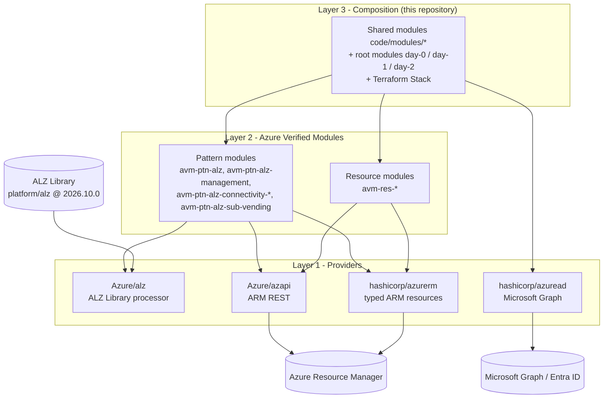
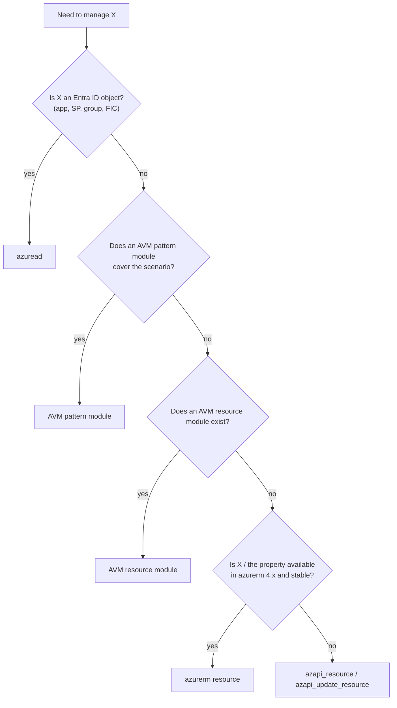
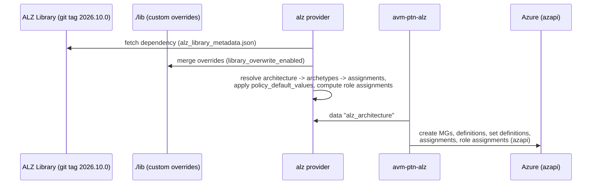

# 02 - IaC Provider Matrix: AVM vs `azurerm` vs `azapi` vs `azuread` vs `alz`

> **Note**: This architectural reference framework and repository content were fully generated using **Claude Opus 5.5**.

> **Disclaimer**: This repository serves purely as an advanced theoretical and architectural reference framework incorporating the latest 2026 Microsoft Azure Landing Zone best practices. The code, Terraform manifests, and pipeline configurations provided herein **have not been physically deployed, executed, or tested in a live production environment**. Users should thoroughly validate, plan, and test all code in a sandbox environment prior to enterprise implementation.

---

> 🧭 **Navigation**: [🏠 Masterclass Portal](../README.md) | [⬅️ Previous: 01. Conceptual Architecture](01-architecture-conceptual.md) | [➡️ Next: 03. Network Topology](03-networking-hubspoke-vs-vwan.md)

> 🎥 **Multimedia Sessions & Video Guides**:
> - 📽️ [**Retiring the CAF Monolith: Azure Verified Modules (AVM) & ALZ Library**](https://www.youtube.com/watch?v=BNEGxzQgDB8) (`7:59`, 🇬🇧 English CC 20+) — *Technical breakdown on retiring legacy monolithic CAF modules for Azure Verified Modules (AVM) and ALZ Library.*
> - ⚡ [**Why Azure is Killing the Landing Zone Monolith**](https://www.youtube.com/shorts/7S6HDnZXQhI) (`1:09`, 🇬🇧 English CC 20+) — *Architecture short on why Microsoft archived monolithic CAF modules in favor of composable AVM pattern modules.*

---

## 1. The layering model

AVM is **not** a provider - it is a library of Terraform (and Bicep) *modules* built on top of providers. A 2026 landing zone uses five building blocks at three layers:



**How to read this diagram:**

- Read **top-down**: this repository composes Azure Verified Modules, and the modules call the providers that talk to Azure.
- **Pattern modules** (`avm-ptn-*`) assemble whole capabilities (ALZ governance, management, connectivity, vending); **resource modules** (`avm-res-*`) wrap a single resource type.
- The `alz` provider reads the versioned **ALZ Library**; `azapi` and `azurerm` call Azure Resource Manager; `azuread` calls Microsoft Graph (used only in Day 0 and the Azure DevOps bootstrap).

---

## 2. Provider decision matrix

| Criterion | **AVM modules** (`Azure/avm-*`) | **`hashicorp/azurerm`** | **`Azure/azapi`** | **`hashicorp/azuread`** | **`Azure/alz`** |
|---|---|---|---|---|---|
| Kind | Terraform modules (pattern / resource / utility) | Provider | Provider | Provider | Provider |
| API layer | Whatever the module uses - pattern modules are predominantly `azapi` | ARM through hand-written, typed resource schemas | ARM REST directly (`type@apiVersion` + JSON body) | Microsoft Graph | No Azure write calls; reads the ALZ Library (and Azure for built-in definitions) |
| Day-zero capability | Inherits from providers; modules release independently | Waits for a provider release that adds the resource/property | **Yes** - any GA or preview API version on the day it ships | Waits for provider support of Graph features | Library updates ship as tagged refs, independent of code |
| Validation engine | Typed module variables + preconditions + provider validation | Provider schema at plan; API errors at apply | **Embedded Azure API specs**: request bodies validated against the REST schema at plan time | Provider schema; Graph errors at apply | Library schema validation; deterministic assignment/role computation |
| Retry / consistency | Module-level `retry`/`timeouts` inputs | Built-in for many resources | Configurable `retry` blocks (status codes, error regex) per resource | Built-in for replication delays | n/a |
| Scope | Tenant, MG, subscription, RG, resource | Mostly subscription/RG/resource; MG resources available | Any ARM scope, including extension resources | Entra ID tenant | Policy/role/archetype model at MG scope |
| State fidelity | As providers | Strongly typed attributes | `body` is dynamic; use `response_export_values` for outputs | Strongly typed | Data sources only |
| Maintainer | Microsoft (AVM program, module owners are Microsoft FTEs) | HashiCorp + Microsoft | Microsoft | HashiCorp | Microsoft (ALZ team) |
| Version used here | Exact pins (`0.22.0`, `0.9.0`, `0.17.7`, `0.18.0`, `0.3.4`) | `~> 4.x` (**not** v5) | `~> 2.12` | `~> 3.10` | `~> 0.21` |
| Target use case | Default for anything an AVM module covers | Simple, stable resources (resource groups, role assignments, policy objects, DNS links) | New/preview features, properties missing in azurerm, tenant/MG-scope resources, provider functions | App registrations, service principals, federated credentials, groups | Turning the ALZ Library into policy definitions, assignments and role assignments |
| Used in | Day 1, Day 2 | Day 0, Day 1, Day 2 | Day 1 (functions), Day 2 (vending, functions) | Day 0 | Day 1 |

> [!IMPORTANT]
> **AzureRM v5 is released but not supported by the ALZ AVM modules.** Microsoft's guidance is to keep the root module on `~> 4.x` because the platform modules are moving to AzAPI. If a root module requests v5, `terraform init` fails with *no available releases match the given constraints*.

---

## 3. Choosing per resource



**How to read this diagram:**

- Use it **per resource**: start at the top and stop at the first `yes`.
- Entra ID objects always use `azuread`; otherwise prefer an AVM **pattern** module, then an AVM **resource** module.
- Only when no module exists choose between `azurerm` (stable, typed) and `azapi` (new or preview API versions, missing properties).

---

## 4. What `azapi` adds (and why AVM depends on it)

| Capability | Example |
|---|---|
| Any API version | `type = "Microsoft.Network/virtualNetworks@2025-05-01"` - adopt a new property immediately |
| Plan-time schema validation | Wrong property names/types in `body` fail at `terraform plan`, not at apply |
| Provider-defined functions | `provider::azapi::resource_group_resource_id(...)`, `provider::azapi::parse_resource_id(...)` - used in this repo to compose IDs that must be **known at plan time** |
| Patch-style updates | `azapi_update_resource` modifies a property of a resource owned elsewhere |
| Retries | `retry = { error_message_regex = ["..."] }` for eventual consistency (e.g. role propagation) |
| Tenant / MG scope | Management groups, subscription aliases, policy at MG scope |

Example from Day 1 (plan-time-known ID used as a policy default value):

```hcl
log_analytics_workspace_id = provider::azapi::resource_group_resource_id(
  var.platform_subscription_ids.management,
  local.management_rg_name,
  "Microsoft.OperationalInsights/workspaces",
  [local.law_name]
)
```

---

## 5. How the `alz` provider decouples policy from code



**How to read this diagram:**

- The `alz` provider **fetches the pinned ALZ Library** release and merges the local overrides in `lib/`.
- It resolves architecture -> archetypes -> policy and role assets and computes the role assignments DeployIfNotExists identities need.
- `avm-ptn-alz` reads that model and creates everything in Azure through `azapi`, so upgrading policy (library ref) and upgrading code (module version) are independent changes.

Consequences:

- **Upgrading policy** = bump `ref` in `lib/alz_library_metadata.json`, review the plan diff.
- **Upgrading code** = bump the module `version`; library stays put.
- **Role assignments for DINE/Modify identities** are computed from `assignPermissions` metadata, including cross-scope targets (e.g. the Private DNS zone resource group).

> [!WARNING]
> The ALZ module cannot accept *unknown* values (it uses a data source from the `alz` provider). Never pass module outputs that are "known after apply" into `policy_default_values`; compose IDs from inputs and express ordering with `policy_assignments_dependencies` / `policy_role_assignments_dependencies` - exactly as `code/day-1-platform-landing-zone/locals.tf` does.

---

## 6. Authentication matrix (all providers, no secrets)

| Context | `azurerm` / `azapi` / `alz` | `azuread` | Terraform backend |
|---|---|---|---|
| Local (Day 0 operator) | Azure CLI (`az login`) | Azure CLI | `use_azuread_auth = true` with CLI token |
| GitHub Actions | `ARM_USE_OIDC=true`, `ARM_CLIENT_ID`, `ARM_TENANT_ID`, `ARM_SUBSCRIPTION_ID` | Same (`ARM_*`) | Same + `use_azuread_auth=true` (`ARM_USE_AZUREAD=true`) |
| Azure DevOps | `ARM_USE_OIDC=true` + `ARM_OIDC_AZURE_SERVICE_CONNECTION_ID` (service connection with workload identity federation) | Same | Same |

---

## References

- ALZ Terraform getting started (provider constraints, dependencies pattern): <https://azure.github.io/Azure-Landing-Zones/terraform/gettingstarted/>
- ALZ Terraform module index: <https://azure.github.io/Azure-Landing-Zones/accelerator/starter-terraform/module-index/>
- `alz` provider: <https://registry.terraform.io/providers/Azure/alz/latest/docs>
- `azapi` provider functions: <https://registry.terraform.io/providers/Azure/azapi/latest/docs>
- Azure Verified Modules: <https://aka.ms/avm>
