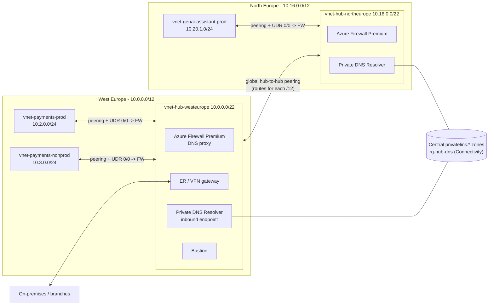
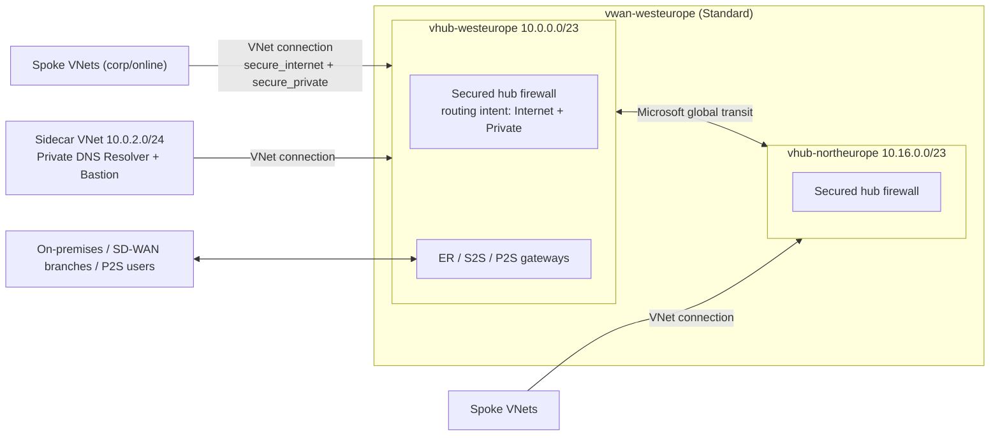
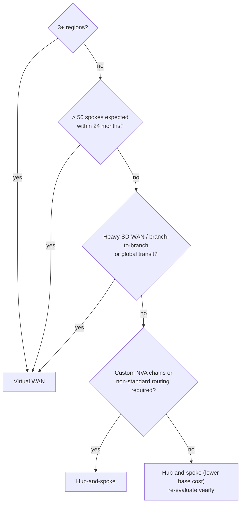
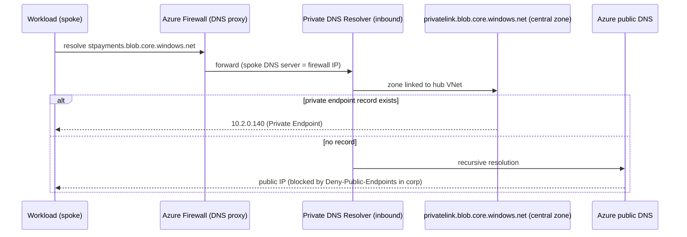

# 03 - Network Topology: Hub-and-Spoke vs Azure Virtual WAN, IPAM, DNS & Egress

> **Note**: This architectural reference framework and repository content were fully generated using **Claude Opus 5.5**.

> **Disclaimer**: This repository serves purely as an advanced theoretical and architectural reference framework incorporating the latest 2026 Microsoft Azure Landing Zone best practices. The code, Terraform manifests, and pipeline configurations provided herein **have not been physically deployed, executed, or tested in a live production environment**. Users should thoroughly validate, plan, and test all code in a sandbox environment prior to enterprise implementation.

---

> 🧭 **Navigation**: [🏠 Masterclass Portal](../README.md) | [⬅️ Previous: 02. IaC Provider Matrix](02-iac-provider-matrix.md) | [➡️ Next: 04. PaaS Network Security](04-security-private-vs-service.md)

> 🎥 **Multimedia Sessions & Video Guides**:
> - 📽️ [**Azure Hub-and-Spoke vs Virtual WAN: 2026 Enterprise Network Architecture**](https://www.youtube.com/watch?v=mUmga-Nz6cc) (`8:11`, 🇬🇧 English CC 20+) — *In-depth trade-off analysis: customer-managed Hub-and-Spoke vs. Microsoft-managed vWAN, routing intents, and IPAM.*

---

## 1. The two supported topologies

Both are first-class in the ALZ accelerator and in this repository; you switch with one variable:

```hcl
connectivity_type = "hub_and_spoke_vnet" # or "virtual_wan"
```

### 1.1 Customer-managed hub-and-spoke



You own: route tables, firewall placement, peering, gateway transit, BGP propagation. Microsoft owns: the individual managed services.

### 1.2 Microsoft-managed Azure Virtual WAN



Routing intent sends all internet and private traffic through the secured-hub firewall; you do not author UDRs. Services that cannot live inside a virtual hub (Private DNS Resolver, Bastion) live in a **sidecar VNet** connected to the hub.

---

## 2. Decision matrix (12 criteria)

| # | Criterion | Hub-and-spoke (customer-managed) | Virtual WAN (Microsoft-managed) |
|---|---|---|---|
| 1 | **Regional footprint** | Ideal for **1-2 regions**; hub-to-hub peering and route tables grow manually per region | Ideal for **3+ regions**; any-to-any transit across hubs out of the box |
| 2 | **Spoke scale** | Comfortable up to ~**40-50 spokes per hub**; hard limit is the VNet peering limit (500 by default) and UDR/route sprawl | **50+ spokes**; hundreds of VNet connections per hub, capacity scaled through routing infrastructure units |
| 3 | **Transit & routing control** | Full control: UDRs, BGP propagation per route table, custom next hops, forced tunnelling exactly as designed | Routing intent & route maps; powerful but opinionated - some custom patterns are not expressible |
| 4 | **NVA support** | Any NVA, any HA pattern (ILB sandwich, Gateway Load Balancer, active/active) | Integrated NVAs from supported partners inside the hub, or NVAs in a spoke with routing intent/BGP peering; fewer patterns |
| 5 | **Hybrid connectivity** | ExpressRoute and VPN gateways you size and operate; branch-to-branch requires extra design | Native S2S/P2S/ER aggregation, **SD-WAN partner automation**, branch-to-branch built in |
| 6 | **Security inspection** | Azure Firewall or NVA in the hub; east-west via UDR | Secured virtual hub (Azure Firewall or SaaS/NVA) with routing intent for internet **and** private traffic |
| 7 | **DNS** | Firewall DNS proxy -> Private DNS Resolver in the hub VNet | Resolver in a sidecar VNet; firewall DNS proxy optional |
| 8 | **Base cost** | **Lower** - you pay for gateways, firewall and peering data transfer; no hub fee | Higher fixed cost - **per-hub hourly fee** plus hub data processing, on top of firewall/gateways |
| 9 | **Data-path cost** | Peering ingress/egress charges per GB on both sides | Hub data processing per GB + connection charges; often cheaper than mesh peering at large scale |
| 10 | **Operational complexity** | Higher at scale (routes, peerings, gateway transit flags per spoke) | Lower day-2 toil at scale; less low-level visibility and fewer knobs |
| 11 | **Change velocity** | Any feature as soon as GA in VNets | Some features arrive later in vWAN hubs; check support matrix before committing |
| 12 | **Migration / reversibility** | Moving to vWAN later is a planned re-connection of spokes (address plan in this repo is compatible) | Moving back is harder (hub address prefixes, routing intent, sidecar patterns) |

### Tipping point



> [!NOTE]
> **Tipping point: 3+ regions or more than ~50 spoke VNets.** Below it, hub-and-spoke is usually cheaper and more flexible. Above it, vWAN's managed transit removes most of the routing toil. The IPAM below is identical for both, so the decision is reversible in planning terms.

### Indicative cost anchors

> [!CAUTION]
> List prices change and differ by region and agreement. The figures below are **indicative pay-as-you-go anchors for orientation only**; always confirm with the [Azure pricing calculator](https://azure.microsoft.com/pricing/calculator/).

| Component | Indicative order of magnitude |
|---|---|
| Virtual WAN Standard hub | ~USD 0.25 per hub-hour (~USD 180/month) + ~USD 0.02 per GB processed |
| Azure Firewall Standard / Premium | ~USD 1.25 / ~USD 1.75 per deployment-hour + per-GB processing |
| VNet peering (intra-region) | ~USD 0.01 per GB in **and** out |
| Private Endpoint | ~USD 0.01 per endpoint-hour + ~USD 0.01 per GB (see docs/04) |

---

## 3. IP Address Management (IPAM)

### 3.1 The hierarchy

| Level | Size | Rule | Example (primary region, index 0) |
|---|---|---|---|
| Organisation | `/8` | One non-overlapping RFC 1918 supernet, reserved in the enterprise IPAM | `10.0.0.0/8` |
| Region | `/12` | `cidrsubnet(/8, 4, region.index)` - 16 regions max | `10.0.0.0/12` |
| Archetype + environment (MG/env) | `/16` | `cidrsubnet(/12, 4, block_index)` | corp-prod `10.2.0.0/16` |
| Workload spoke | `/24` | `cidrsubnet(/16, 8, spoke_index)` - 256 spokes per archetype/env/region | `10.2.0.0/24` |
| Subnets | `/25`-`/27` | fixed layout per spoke | app `.0/25`, PE `.128/26`, integration `.192/27` |

### 3.2 Block allocation inside each regional `/12`

| Block index | Purpose | Primary (`10.0.0.0/12`) | Secondary (`10.16.0.0/12`) |
|---|---|---|---|
| 0 | Connectivity hub | `10.0.0.0/16` | `10.16.0.0/16` |
| 1 | Identity | `10.1.0.0/16` | `10.17.0.0/16` |
| 2 | Corp - prod | `10.2.0.0/16` | `10.18.0.0/16` |
| 3 | Corp - nonprod | `10.3.0.0/16` | `10.19.0.0/16` |
| 4 | Online - prod | `10.4.0.0/16` | `10.20.0.0/16` |
| 5 | Online - nonprod | `10.5.0.0/16` | `10.21.0.0/16` |
| 6-14 | Reserved (AI/data platforms, new archetypes, AKS pod CIDRs) | `10.6-10.14.0.0/16` | `10.22-10.30.0.0/16` |
| 15 | Sandbox (never peered, still unique) | `10.15.0.0/16` | `10.31.0.0/16` |

### 3.3 Hub layouts

| Hub-and-spoke (`/22` inside the hub `/16`) | Prefix | Virtual WAN | Prefix |
|---|---|---|---|
| `AzureFirewallSubnet` | `10.0.0.0/26` | Virtual hub address prefix | `10.0.0.0/23` |
| `AzureBastionSubnet` | `10.0.0.64/26` | Sidecar VNet | `10.0.2.0/24` |
| `GatewaySubnet` | `10.0.0.128/27` | Resolver inbound subnet (sidecar) | `10.0.2.0/28` |
| Resolver inbound subnet | `10.0.0.160/28` | Bastion subnet (sidecar) | `10.0.2.64/26` |
| `AzureFirewallManagementSubnet` | `10.0.0.192/26` | | |

All of this is computed in [`locals.tf`](../code/modules/platform-landing-zone/locals.tf) and exported as the `ipam_plan` output that Day 2 consumes - **no spreadsheet, no manual allocation, no overlap**. Uniqueness of `(region, archetype, environment, spoke_index)` is enforced by a variable validation in Day 2.

> [!TIP]
> If you already run **Azure Virtual Network Manager IPAM pools**, the Day 2 vending module also accepts `ipam_pools` instead of `address_space`; keep the same block structure as the pool hierarchy.

---

## 4. Private DNS and egress

### 4.1 Name resolution path (hub-and-spoke)



Key properties:

- **Zones are central** (Connectivity subscription, `rg-hub-dns-<region>`). Spokes never host `privatelink.*` zones (`Audit-PeDnsZones` flags violations).
- **Records are automatic**: the `Deploy-Private-DNS-Zones` DINE assignment at `corp` writes the Private Endpoint A-record into the central zone.
- **Firewall as DNS proxy** gives FQDN-based network rules a consistent view of name resolution.
- **On-premises** forwards Azure private zones to the resolver inbound endpoint; Azure forwards on-prem zones through an outbound endpoint + forwarding ruleset.
- **DNS Security Policy** (`dns_security_policy = true`) adds DNS-layer filtering/logging on the hub VNet.

### 4.2 Egress

| Topology | Mechanism | Configured by |
|---|---|---|
| Hub-and-spoke | UDR `0.0.0.0/0 -> Azure Firewall private IP`, BGP propagation disabled on spoke route tables | Day 2 vending (`rt-<lz>`) |
| Virtual WAN | Routing intent (internet + private) on the secured hub | Day 2 vending (`vwan_security_configuration`) |
| Both | **Private subnets** (`default_outbound_access_enabled = false`) - no implicit outbound IPs | Day 1 hub subnets, Day 2 spoke subnets, ALZ `Enforce-Subnet-Private` |

> [!IMPORTANT]
> New VNets created with API versions released after 31 March 2026 are private-subnet by default. Workloads that silently relied on default outbound access must use the firewall (or an explicit NAT Gateway in documented exceptions).

---

## References

- ALZ Terraform scenarios (hub-and-spoke vs vWAN, single/multi region): <https://azure.github.io/Azure-Landing-Zones/accelerator/starter-terraform/scenarios/>
- ALZ IP address customisation: <https://azure.github.io/Azure-Landing-Zones/accelerator/starter-terraform/options/ip-addresses/>
- Default outbound access: <https://learn.microsoft.com/azure/virtual-network/ip-services/default-outbound-access>
- Virtual WAN pricing concepts: <https://learn.microsoft.com/azure/virtual-wan/pricing-concepts>
- Azure Private Link pricing: <https://azure.microsoft.com/pricing/details/private-link/>
