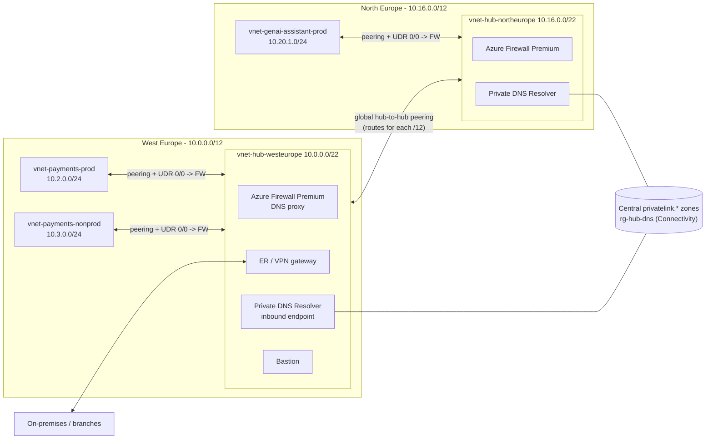
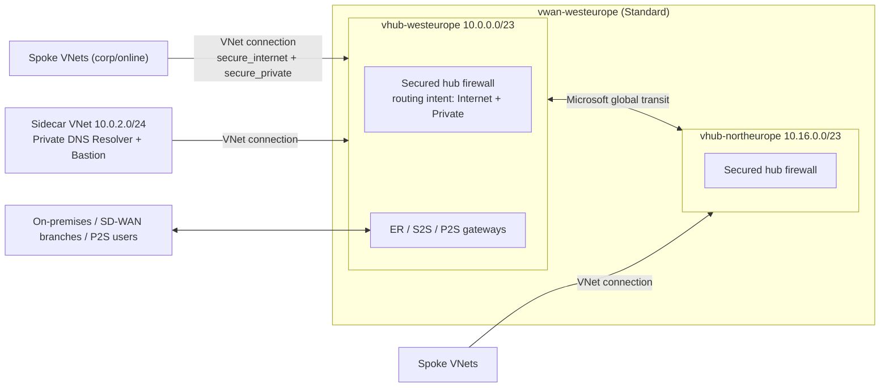
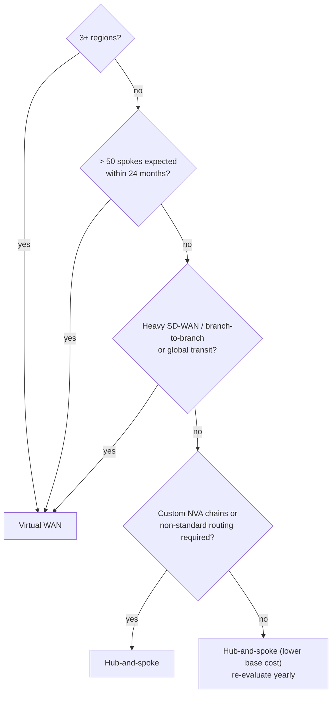
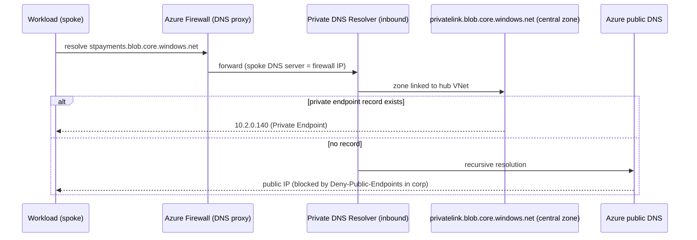
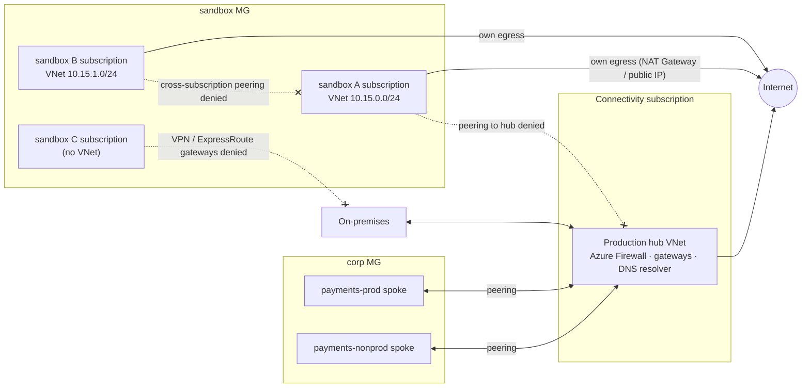
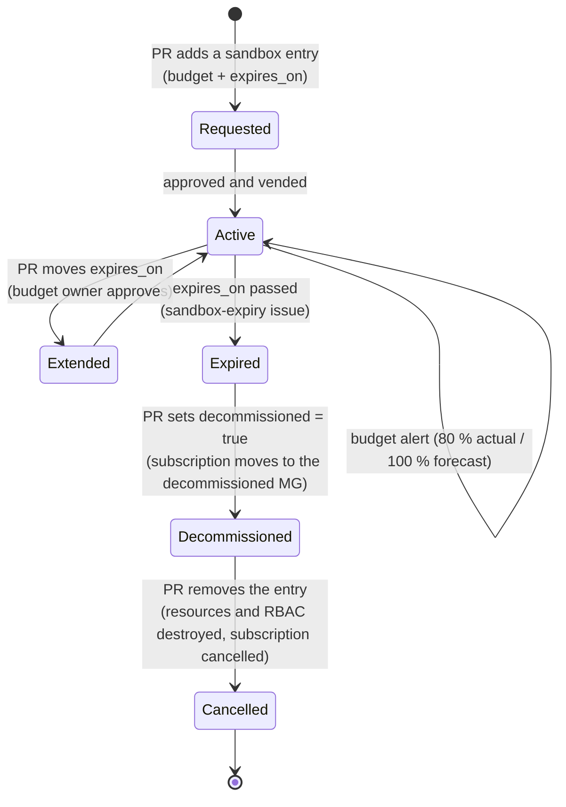
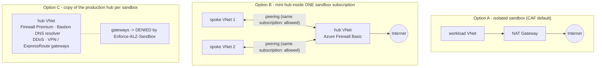
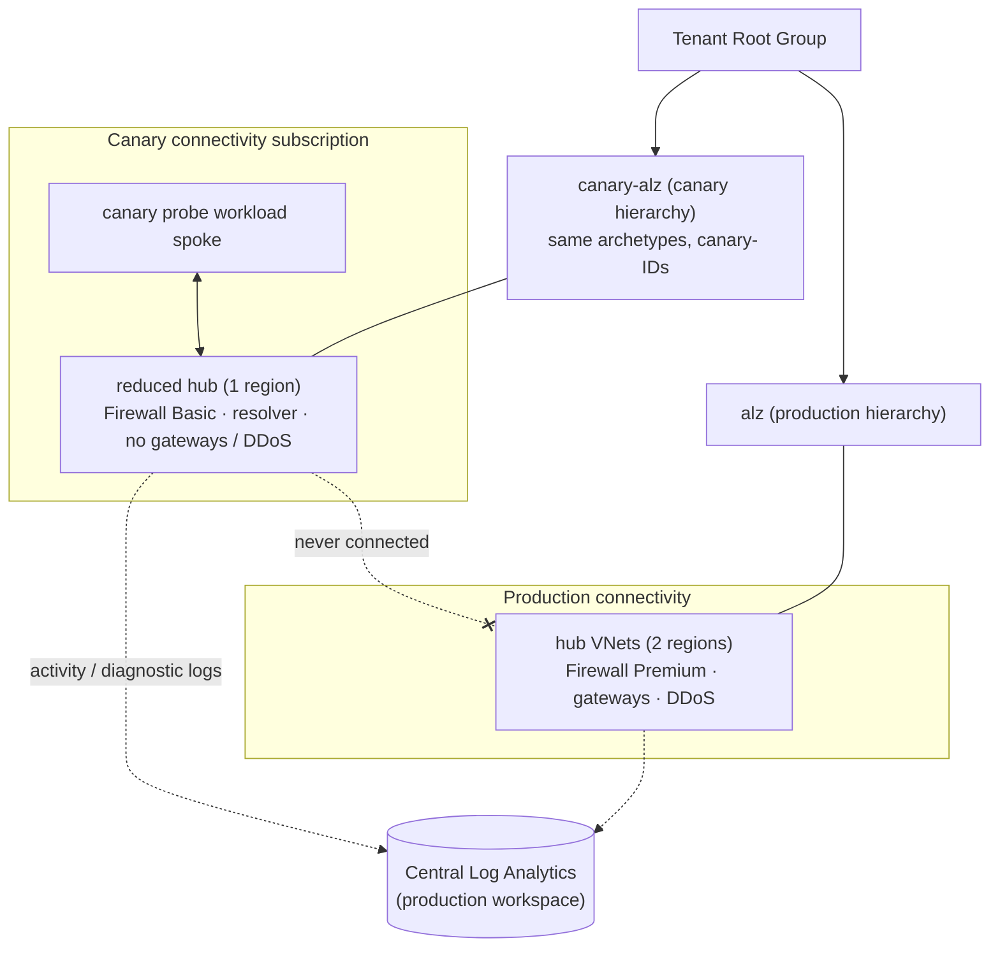
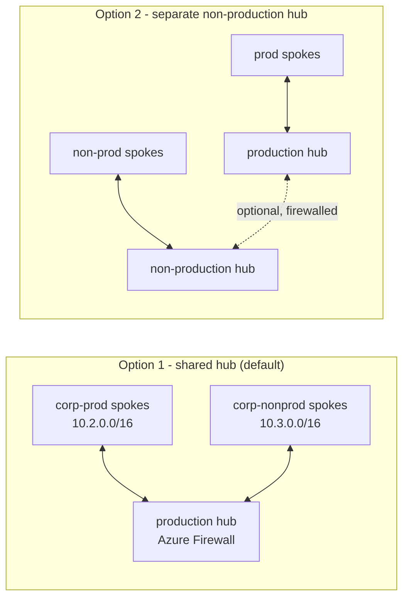
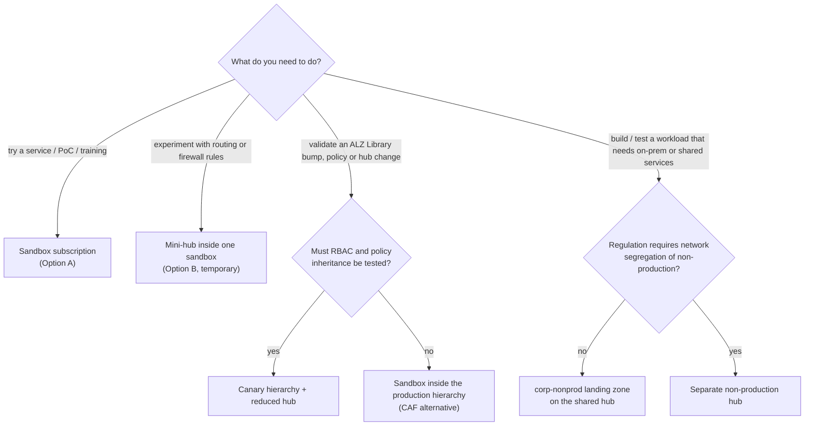

# 03 - Network Topology: Hub-and-Spoke vs Azure Virtual WAN, IPAM, DNS & Egress

> **Note**: This architectural reference framework and repository content were fully generated using **Claude Opus 5.5**.

> **Disclaimer**: This repository serves purely as an advanced theoretical and architectural reference framework incorporating the latest 2026 Microsoft Azure Landing Zone best practices. The code, Terraform manifests, and pipeline configurations provided herein **have not been physically deployed, executed, or tested in a live production environment**. Users should thoroughly validate, plan, and test all code in a sandbox environment prior to enterprise implementation.

---

> 🧭 **Navigation**: [🏠 Masterclass Portal](../README.md) | [⬅️ Previous: 02. IaC Provider Matrix](02-iac-provider-matrix.md) | [➡️ Next: 04. PaaS Network Security](04-security-private-vs-service.md)

> 🎥 **Multimedia Sessions & Video Guides**:
> - 📽️ [**Azure Hub-and-Spoke vs Virtual WAN: 2026 Enterprise Network Architecture**](https://www.youtube.com/watch?v=mUmga-Nz6cc) (`8:11`, 🇬🇧 English CC 20+) — *In-depth trade-off analysis: customer-managed Hub-and-Spoke vs. Microsoft-managed vWAN, routing intents, and IPAM.*
> - 📽️ [**Azure Landing Zones Testing Strategies: Canary, Sandboxes & Non-Prod**](https://www.youtube.com/watch?v=N6PMQzmBwwE) (`8:19`, 🇬🇧 English CC 20+) — *Masterclass on testing enterprise landing zones: isolated sandboxes, canary management groups with reduced hubs, and non-prod workloads.*
> - ⚡ [**Why Azure Networks Switch to vWAN**](https://www.youtube.com/shorts/DmKLtsW8O8Y) (`1:28`, 🇬🇧 English CC 20+) — *Architecture short on automated full-mesh routing and managing multi-region transit beyond the 50-spoke tipping point.*
> - ⚡ [**How Azure Canaries Prevent Cloud Outages**](https://www.youtube.com/shorts/0mDvTs3aO2I) (`0:59`, 🇬🇧 English CC 20+) — *Architecture short on deploying parallel canary- management groups to test security baselines with real policy inheritance.*
> - ⚡ [**Where to Put Test Workloads in Azure**](https://www.youtube.com/shorts/sj7JF4KIKPo) (`1:11`, 🇬🇧 English CC 20+) — *Architecture short on splitting non-production into sandboxes, canary hierarchies, and corp-nonprod landing zones.*
> - ⚡ [**How Azure Canary Hubs Test Routing Affordably**](https://www.youtube.com/shorts/Sb3G1tMJaQQ) (`1:18`, 🇬🇧 English CC 20+) — *Architecture short on deploying a cost-optimized canary hub with Firewall Basic to test routing without duplicate hardware costs.*
> - ⚡ [**How to Build a Canary Hub**](https://www.youtube.com/shorts/jSKGE-2jlhI) (`1:22`, 🇬🇧 English CC 20+) — *Architecture short on building a cost-effective canary hub with Terraform Stacks and Firewall Basic to test routing intent.*

---

## 1. The two supported topologies

Both are first-class in the ALZ accelerator and in this repository; you switch with one variable:

```hcl
connectivity_type = "hub_and_spoke_vnet" # or "virtual_wan"
```

### 1.1 Customer-managed hub-and-spoke

<details>
<summary><strong>📊 Diagram: 1.1 Customer-managed hub-and-spoke</strong> <em>(click to expand)</em></summary>



</details>

**How to read this diagram:**

- Each **region** owns a `/12`; the hub VNet takes the first `/22` of it and spokes get `/24` ranges from the archetype blocks.
- Spokes **peer** to their regional hub and route `0.0.0.0/0` to the hub firewall; hubs are joined by global peering.
- On-premises connects through the primary hub gateway; both regional resolvers use the same central `privatelink.*` zones.

You own: route tables, firewall placement, peering, gateway transit, BGP propagation. Microsoft owns: the individual managed services.

### 1.2 Microsoft-managed Azure Virtual WAN

<details>
<summary><strong>📊 Diagram: 1.2 Microsoft-managed Azure Virtual WAN</strong> <em>(click to expand)</em></summary>



</details>

**How to read this diagram:**

- One Virtual WAN with a **secured hub per region**; routing intent sends internet and private traffic through the hub firewall.
- Hub-to-hub transit is **managed by Microsoft**; spokes and the sidecar VNet attach through VNet connections.
- Branches, SD-WAN and point-to-site users connect directly to the hub gateways.

Routing intent sends all internet and private traffic through the secured-hub firewall; you do not author UDRs. Services that cannot live inside a virtual hub (Private DNS Resolver, Bastion) live in a **sidecar VNet** connected to the hub.

---

## 2. Decision matrix (12 criteria)

| # | Criterion | Hub-and-spoke (customer-managed) | Virtual WAN (Microsoft-managed) |
|---|---|---|---|
| 1 | **Regional footprint** | Ideal for **1-2 regions**; hub-to-hub peering and route tables grow manually per region | Ideal for **3+ regions**; any-to-any transit across hubs out of the box |
| 2 | **Spoke scale** | Comfortable up to ~**40-50 spokes per hub**; hard limit is the VNet peering limit (500 by default) and UDR/route sprawl | **50+ spokes**; hundreds of VNet connections per hub, capacity scaled through routing infrastructure units |
| 3 | **Transit & routing control** | Full control: UDRs, BGP propagation per route table, custom next hops, forced tunnelling exactly as designed | Routing intent & route maps; powerful but opinionated - some custom patterns are not expressible |
| 4 | **NVA support** | Any NVA, any HA pattern (ILB sandwich, Gateway Load Balancer, active/active) | Integrated NVAs from supported partners inside the hub, or NVAs in a spoke with routing intent/BGP peering; fewer patterns |
| 5 | **Hybrid connectivity** | ExpressRoute and VPN gateways you size and operate; branch-to-branch requires extra design | Native S2S/P2S/ER aggregation, **SD-WAN partner automation**, branch-to-branch built in |
| 6 | **Security inspection** | Azure Firewall or NVA in the hub; east-west via UDR | Secured virtual hub (Azure Firewall or SaaS/NVA) with routing intent for internet **and** private traffic |
| 7 | **DNS** | Firewall DNS proxy -> Private DNS Resolver in the hub VNet | Resolver in a sidecar VNet; firewall DNS proxy optional |
| 8 | **Base cost** | **Lower** - you pay for gateways, firewall and peering data transfer; no hub fee | Higher fixed cost - **per-hub hourly fee** plus hub data processing, on top of firewall/gateways |
| 9 | **Data-path cost** | Peering ingress/egress charges per GB on both sides | Hub data processing per GB + connection charges; often cheaper than mesh peering at large scale |
| 10 | **Operational complexity** | Higher at scale (routes, peerings, gateway transit flags per spoke) | Lower day-2 toil at scale; less low-level visibility and fewer knobs |
| 11 | **Change velocity** | Any feature as soon as GA in VNets | Some features arrive later in vWAN hubs; check support matrix before committing |
| 12 | **Migration / reversibility** | Moving to vWAN later is a planned re-connection of spokes (address plan in this repo is compatible) | Moving back is harder (hub address prefixes, routing intent, sidecar patterns) |

### Tipping point

<details>
<summary><strong>📊 Diagram: Tipping point</strong> <em>(click to expand)</em></summary>



</details>

**How to read this diagram:**

- Answer the questions **top-down**; any `yes` in the first three questions leads to Virtual WAN.
- The tipping point is **3+ regions, more than ~50 spokes, or heavy branch / SD-WAN transit**.
- Below it, hub-and-spoke wins on cost and routing control; re-evaluate yearly because the address plan works for both.

> [!NOTE]
> **Tipping point: 3+ regions or more than ~50 spoke VNets.** Below it, hub-and-spoke is usually cheaper and more flexible. Above it, vWAN's managed transit removes most of the routing toil. The IPAM below is identical for both, so the decision is reversible in planning terms.

### Indicative cost anchors

> [!CAUTION]
> List prices change and differ by region and agreement. The figures below are **indicative pay-as-you-go anchors for orientation only**; always confirm with the [Azure pricing calculator](https://azure.microsoft.com/pricing/calculator/).

| Component | Indicative order of magnitude |
|---|---|
| Virtual WAN Standard hub | ~USD 0.25 per hub-hour (~USD 180/month) + ~USD 0.02 per GB processed |
| Azure Firewall Standard / Premium | ~USD 1.25 / ~USD 1.75 per deployment-hour + per-GB processing |
| VNet peering (intra-region) | ~USD 0.01 per GB in **and** out |
| Private Endpoint | ~USD 0.01 per endpoint-hour + ~USD 0.01 per GB (see docs/04) |

---

## 3. IP Address Management (IPAM)

### 3.1 The hierarchy

| Level | Size | Rule | Example (primary region, index 0) |
|---|---|---|---|
| Organisation | `/8` | One non-overlapping RFC 1918 supernet, reserved in the enterprise IPAM | `10.0.0.0/8` |
| Region | `/12` | `cidrsubnet(/8, 4, region.index)` - 16 regions max | `10.0.0.0/12` |
| Archetype + environment (MG/env) | `/16` | `cidrsubnet(/12, 4, block_index)` | corp-prod `10.2.0.0/16` |
| Workload spoke | `/24` | `cidrsubnet(/16, 8, spoke_index)` - 256 spokes per archetype/env/region | `10.2.0.0/24` |
| Subnets | `/25`-`/27` | fixed layout per spoke | app `.0/25`, PE `.128/26`, integration `.192/27` |

### 3.2 Block allocation inside each regional `/12`

| Block index | Purpose | Primary (`10.0.0.0/12`) | Secondary (`10.16.0.0/12`) |
|---|---|---|---|
| 0 | Connectivity hub | `10.0.0.0/16` | `10.16.0.0/16` |
| 1 | Identity | `10.1.0.0/16` | `10.17.0.0/16` |
| 2 | Corp - prod | `10.2.0.0/16` | `10.18.0.0/16` |
| 3 | Corp - nonprod | `10.3.0.0/16` | `10.19.0.0/16` |
| 4 | Online - prod | `10.4.0.0/16` | `10.20.0.0/16` |
| 5 | Online - nonprod | `10.5.0.0/16` | `10.21.0.0/16` |
| 6-14 | Reserved (AI/data platforms, new archetypes, AKS pod CIDRs) | `10.6-10.14.0.0/16` | `10.22-10.30.0.0/16` |
| 15 | Sandbox (never peered, still unique) | `10.15.0.0/16` | `10.31.0.0/16` |

### 3.3 Hub layouts

| Hub-and-spoke (`/22` inside the hub `/16`) | Prefix | Virtual WAN | Prefix |
|---|---|---|---|
| `AzureFirewallSubnet` | `10.0.0.0/26` | Virtual hub address prefix | `10.0.0.0/23` |
| `AzureBastionSubnet` | `10.0.0.64/26` | Sidecar VNet | `10.0.2.0/24` |
| `GatewaySubnet` | `10.0.0.128/27` | Resolver inbound subnet (sidecar) | `10.0.2.0/28` |
| Resolver inbound subnet | `10.0.0.160/28` | Bastion subnet (sidecar) | `10.0.2.64/26` |
| `AzureFirewallManagementSubnet` | `10.0.0.192/26` | | |

All of this is computed in [`locals.tf`](../code/modules/platform-landing-zone/locals.tf) and exported as the `ipam_plan` output that Day 2 consumes - **no spreadsheet, no manual allocation, no overlap**. Uniqueness of `(region, archetype, environment, spoke_index)` is enforced by a variable validation in Day 2.

> [!TIP]
> If you already run **Azure Virtual Network Manager IPAM pools**, the Day 2 vending module also accepts `ipam_pools` instead of `address_space`; keep the same block structure as the pool hierarchy.

---

## 4. Private DNS and egress

### 4.1 Name resolution path (hub-and-spoke)

<details>
<summary><strong>📊 Diagram: 4.1 Name resolution path (hub-and-spoke)</strong> <em>(click to expand)</em></summary>



</details>

**How to read this diagram:**

- A workload in a spoke asks the **hub firewall** (its configured DNS server) to resolve a PaaS name.
- The firewall forwards to the **Private DNS Resolver** inbound endpoint, which can see the central `privatelink.*` zones.
- If a Private Endpoint record exists, the **private IP** is returned; otherwise public resolution applies, and Corp policies deny public endpoints.

Key properties:

- **Zones are central** (Connectivity subscription, `rg-hub-dns-<region>`). Spokes never host `privatelink.*` zones (`Audit-PeDnsZones` flags violations).
- **Records are automatic**: the `Deploy-Private-DNS-Zones` DINE assignment at `corp` writes the Private Endpoint A-record into the central zone.
- **Firewall as DNS proxy** gives FQDN-based network rules a consistent view of name resolution.
- **On-premises** forwards Azure private zones to the resolver inbound endpoint; Azure forwards on-prem zones through an outbound endpoint + forwarding ruleset.
- **DNS Security Policy** (`dns_security_policy = true`) adds DNS-layer filtering/logging on the hub VNet.

### 4.2 Egress

| Topology | Mechanism | Configured by |
|---|---|---|
| Hub-and-spoke | UDR `0.0.0.0/0 -> Azure Firewall private IP`, BGP propagation disabled on spoke route tables | Day 2 vending (`rt-<lz>`) |
| Virtual WAN | Routing intent (internet + private) on the secured hub | Day 2 vending (`vwan_security_configuration`) |
| Both | **Private subnets** (`default_outbound_access_enabled = false`) - no implicit outbound IPs | Day 1 hub subnets, Day 2 spoke subnets, ALZ `Enforce-Subnet-Private` |

> [!IMPORTANT]
> New VNets created with API versions released after 31 March 2026 are private-subnet by default. Workloads that silently relied on default outbound access must use the firewall (or an explicit NAT Gateway in documented exceptions).

---

## 5. Sandboxes, canary and non-production environments in hub-and-spoke

> [!IMPORTANT]
> **There is no "sandbox hub".** Sandboxes are never attached to the connectivity hub: each sandbox is its own isolated subscription, and there can be as many as needed. Testing *platform* changes (hub, firewall, policy) is the job of the **canary** environment, and non-production workloads that need hybrid connectivity are **`corp` non-production landing zones** on the shared hub - not sandboxes.

### 5.1 The four kinds of "non-production" and where each lives

| Need | What it is | Management group | Connected to the production hub? | Typical lifetime |
|---|---|---|---|---|
| Free experimentation (new services, PoCs, training) | **Sandbox** subscription | `sandbox` | **No** - isolated by policy | Days to weeks (`expires_on`) |
| Experiment with network patterns (firewall rules, UDRs, a hub design) | **Mini-hub inside one sandbox** subscription | `sandbox` | **No** | Days |
| Test platform changes (ALZ Library bumps, policy, RBAC, hub configuration) with real inheritance | **Canary** management group hierarchy + reduced hub | `canary-*` (parallel hierarchy) | **No** (own reduced hub) | Long-lived, applied before every production change |
| Develop / test a workload that needs on-premises or shared services | **Non-production workload landing zone** | `corp` (or `online`) | **Yes** - shared hub, `corp-nonprod` address block | Lifetime of the workload |

### 5.2 Sandbox isolation in a hub-and-spoke topology

<details>
<summary><strong>📊 Diagram: 5.2 Sandbox isolation in a hub-and-spoke topology</strong> <em>(click to expand)</em></summary>



</details>

**How to read this diagram:**

- **Top half - production connectivity:** workload spokes in `corp` (production *and* non-production) peer to the single production hub, which is the only path to on-premises and the internet for them.
- **Bottom half - sandboxes:** each sandbox is a separate subscription in the `sandbox` management group. Lines ending in **x** are paths that Azure Policy denies: peering to the hub, peering between sandboxes, and any gateway towards on-premises.
- **Egress:** sandboxes reach the internet directly through their own explicit egress (NAT Gateway or a public IP), because they do not go through the hub firewall. New VNets use private subnets by default, so without such egress a sandbox VM has no outbound internet at all.
- **Addressing:** sandboxes still get ranges from the reserved sandbox `/16` (`10.15.0.0/16` in the primary region), so an experiment can later be promoted to a real landing zone without re-addressing.
- **Count:** there is no limit of one sandbox per hub - the address plan allows 256 `/24` sandboxes per region, and a sandbox without a VNet consumes no address space.

### 5.3 How the isolation is enforced

| Control | Source | Effect in every sandbox subscription |
|---|---|---|
| `Enforce-ALZ-Sandbox` -> *Deny VNet peering cross subscription* | ALZ Library (`sandbox` archetype) | A sandbox VNet cannot peer with the hub, with workload spokes or with another sandbox. Peering **inside** the same subscription is allowed. |
| `Enforce-ALZ-Sandbox` -> *Not allowed resource types* | ALZ Library | Denies ExpressRoute circuits/ports/gateways, VPN gateways, VPN sites, point-to-site gateways, Virtual WANs and virtual hubs - no hybrid connectivity can be built. |
| Inherited root policies (`alz`) | ALZ Library | Defender for Cloud plans, activity-log and diagnostic settings to the central Log Analytics workspace, classic resources denied, data residency (if `allowed_locations` is set). |
| Vending: `archetype = "sandbox"` | `code/modules/workload-vending` | No hub peering, no firewall route table, no DNS servers pointing at the hub; subscription placed in the `sandbox` MG. |
| Vending: `budget_amount` | `code/modules/workload-vending` | Monthly budget with 80 % actual and 100 % forecast alerts. |
| Vending: `expires_on` (mandatory for sandboxes) | `code/modules/workload-vending` | Validation rejects a sandbox without an expiry date; the date is written as the `expires_on` tag on the subscription and its resources. |
| Vending: `decommissioned = true` | `code/modules/workload-vending` | Moves the subscription to the `decommissioned` management group (`Enforce-ALZ-Decomm`) and tags it `lifecycle_state = decommissioned`, before the entry is finally removed. |
| `sandbox-expiry` workflow | `.github/workflows/sandbox-expiry.yml` | Weekly Azure Resource Graph query: opens or updates one issue listing sandboxes expired, expiring within 14 days or missing `expires_on`. |

> [!NOTE]
> CAF also recommends assigning a default budget with the `Deploy-Budget` policy at the sandbox management group (a safety net for subscriptions not created by vending) and removing the sandbox users' Owner role when a sandbox is cancelled. This repository grants the workload group **Contributor** rather than Owner; give sandbox users Owner only if experiments need to manage RBAC.

### 5.4 Sandbox lifecycle

<details>
<summary><strong>📊 Diagram: 5.4 Sandbox lifecycle</strong> <em>(click to expand)</em></summary>



</details>

**How to read this diagram:**

- **Requested -> Active:** a sandbox exists only after a reviewed pull request with a budget and an expiry date; vending creates the subscription in the `sandbox` management group.
- **Active:** budget alerts are warnings only - CAF is explicit that an alert does not stop spending, so the owner must act or the platform team decommissions it.
- **Extended:** the only way to keep a sandbox longer is another pull request changing `expires_on`, approved by whoever owns the budget.
- **Expired -> Decommissioned:** the weekly `sandbox-expiry` issue triggers a PR that sets `decommissioned = true` on the entry. Vending moves the subscription to the `decommissioned` management group (where `Enforce-ALZ-Decomm` denies creating or updating resources) and tags the subscription `lifecycle_state = decommissioned`; nothing is deleted yet, so the owner can still export data.
- **Decommissioned -> Cancelled:** after the agreed grace period a second PR removes the entry. Terraform destroys the spoke, RBAC assignments, budget and identities; for subscriptions created by vending the alias is removed and the subscription cancelled. Azure keeps a cancelled subscription recoverable for a limited period before deleting it - check the current retention window in the Azure documentation.
- **Two PRs, not one:** separating "freeze" from "delete" gives a reversible step and an audit trail; reverting the first PR returns the sandbox to `Active`.

### 5.5 Can the hub be replicated inside a sandbox?

Three different things are often meant by "a hub in the sandbox". They differ greatly in feasibility and cost:

<details>
<summary><strong>📊 Diagram: 5.5 Can the hub be replicated inside a sandbox?</strong> <em>(click to expand)</em></summary>



</details>

**How to read this diagram:**

- **Option A** is what CAF and this repository implement: one VNet (or none), explicit egress, nothing shared. Cost is only what the experiment deploys.
- **Option B** is possible because the sandbox policy denies peering *across* subscriptions, not *within* one, and it does not block Azure Firewall. Use it to try routing, firewall rules or a hub design - it is still isolated from the real hub and on-premises.
- **Option C** cannot be a faithful copy: the gateways that make a hub a hub are denied by policy, and the fixed cost of the remaining components is multiplied by every sandbox. It also tests nothing that matters for the platform, because a sandbox does not inherit the production management group hierarchy.

### 5.6 Indicative cost comparison

> [!CAUTION]
> Indicative pay-as-you-go list prices (USD, US regions, 2026) for **fixed** components only - data processing, logs and workloads are extra. Always confirm with the [Azure pricing calculator](https://azure.microsoft.com/pricing/calculator/).

| Component | Hourly | ~Monthly (730 h) |
|---|---|---|
| Azure Firewall Basic / Standard / Premium | 0.395 / 1.25 / 1.75 USD | ~288 / ~912 / ~1,278 USD (+0.065 / 0.016 / 0.016 USD per GB) |
| DDoS Network Protection plan (up to 100 public IPs, shareable across subscriptions in the tenant) | - | ~2,900-3,000 USD |
| Azure Bastion Basic / Standard (Developer SKU: free, limited regions and features) | ~0.19 / ~0.29 USD | ~140 / ~210 USD |
| VPN or ExpressRoute virtual network gateway | SKU-dependent | from ~140 USD to over 1,000 USD |
| Azure DNS Private Resolver (per endpoint) | - | ~180 USD |
| NAT Gateway | ~0.045 USD | ~33 USD (+~0.045 USD per GB) |

| Scenario | Fixed cost per region per month (order of magnitude) | Verdict |
|---|---|---|
| Production hub (Firewall Premium, Bastion Standard, gateways, 2 resolver endpoints) | ~2,500-3,000 USD + one DDoS plan (~3,000 USD) for the whole tenant | Required once per region |
| **A** - isolated sandbox with NAT Gateway | ~33 USD | **Recommended default** |
| **B** - mini-hub in one sandbox (Firewall Basic + NAT) | ~320 USD while it exists | Short-lived network experiments only |
| **C** - full hub copy per sandbox | ~2,500 USD **per sandbox** (x10 sandboxes = ~25,000 USD) | **Not recommended** (and gateways are denied) |
| Canary with reduced hub (Firewall Basic, 1 resolver endpoint, no DDoS / gateways / Bastion) | ~470 USD (less if torn down between change windows) | Recommended when platform changes need real inheritance |
| Separate non-production hub | Same as a production hub, per region | Only when regulation requires prod / non-prod network segregation |

### 5.7 Testing platform changes: the canary environment

<details>
<summary><strong>📊 Diagram: 5.7 Testing platform changes: the canary environment</strong> <em>(click to expand)</em></summary>



</details>

**How to read this diagram:**

- **Two hierarchies in one tenant:** CAF's testing approach duplicates the production management group tree under the Tenant Root Group with a `canary` prefix or suffix, because management group IDs must be unique per tenant. Here it is the `alz_2026_masterclass_canary` architecture with `management_group_id_prefix = "canary-"`.
- **Same archetypes, real inheritance:** unlike a sandbox, the canary inherits policy and RBAC exactly like production, so a library bump or a policy phase change is proven before it reaches `alz`.
- **Reduced hub:** CAF does not mandate a canary hub; this repository gives the canary its own small hub (one region, Firewall Basic, no gateways, no DDoS) so connectivity changes can also be tested. It is never connected to the production hub or on-premises, so it may reuse production address ranges.
- **Shared observability:** canary logs still go to the production Log Analytics workspace, as CAF recommends.
- **How it runs:** as the `canary` deployment of the Terraform Stack (auto-approved when nothing is destroyed), or with any other delivery platform by deploying the platform root module a second time with the canary architecture, prefix and its own subscriptions.

> [!TIP]
> CAF notes the canary hierarchy is optional and not a common pattern. The cheaper alternative it describes is testing platform resources in sandbox subscriptions inside the production hierarchy - accepting that RBAC and policy inheritance from the management group tree is **not** tested that way.

### 5.8 Non-production workloads: shared hub or separate hub?

<details>
<summary><strong>📊 Diagram: 5.8 Non-production workloads: shared hub or separate hub?</strong> <em>(click to expand)</em></summary>



</details>

**How to read this diagram:**

- **Option 1 (this repository's default):** production and non-production workloads are separate **subscriptions** with separate address blocks (`corp-prod` vs `corp-nonprod`), behind the same hub. Isolation comes from firewall rules (default deny between the two blocks), NSGs, RBAC and policy - not from a second hub.
- **Option 2:** a second hub per region for non-production gives hard network segregation and an independent change window for hub updates, at the price of doubling the hub's fixed cost and operations. Choose it only when a regulation or risk assessment requires it.
- **Neither option is a sandbox:** both connect to shared services and on-premises, so the workloads inside them are governed by the `corp` / `online` archetypes, not the `sandbox` one.

### 5.9 Decision guide

<details>
<summary><strong>📊 Diagram: 5.9 Decision guide</strong> <em>(click to expand)</em></summary>



</details>

**How to read this diagram:**

- Start from the **intent**, not from the word "sandbox": most confusion comes from using the same word for experiments, platform testing and non-production workloads.
- Only the first two branches are sandboxes; the third is the canary (or CAF's sandbox-based alternative); the fourth is a regular workload landing zone.
- Every leaf maps to something this repository already implements: the `sandbox` archetype, the canary architecture definition and Stack deployment, and the `corp-nonprod` address block.

### 5.10 Frequently asked questions

| Question | Answer |
|---|---|
| Can there be only one sandbox per hub? | Sandboxes are not related to the hub at all. Create one subscription per person, team or experiment; CAF leaves the granularity to you. |
| Can a sandbox reach on-premises or the production hub? | No. Cross-subscription peering and all gateway types are denied by `Enforce-ALZ-Sandbox`. If that is needed, it is not a sandbox - use a `corp-nonprod` landing zone. |
| How does a sandbox reach the internet? | Through its own explicit egress (NAT Gateway, a VM public IP or a load balancer outbound rule). The sandbox owner adds it; it is not routed through the hub firewall. |
| Is Defender / logging still applied? | Yes, through policies inherited from `alz`: Defender plans, activity logs and diagnostics to the central workspace. |
| Why do sandboxes get unique IP ranges if they are isolated? | So a successful experiment can be promoted to a real landing zone without re-addressing, and to avoid conflicts if a peering is ever approved as an exception. |
| Can a sandbox be extended? | Yes, with a pull request that changes `expires_on`, approved by the budget owner. |
| Does the canary need its own hub? | CAF does not require it. A reduced hub is worth it only if hub or connectivity changes must be tested; it costs a fraction of a production hub and can be torn down between change windows. |

---

## References

- ALZ Terraform scenarios (hub-and-spoke vs vWAN, single/multi region): <https://azure.github.io/Azure-Landing-Zones/accelerator/starter-terraform/scenarios/>
- ALZ IP address customisation: <https://azure.github.io/Azure-Landing-Zones/accelerator/starter-terraform/options/ip-addresses/>
- Default outbound access: <https://learn.microsoft.com/azure/virtual-network/ip-services/default-outbound-access>
- Virtual WAN pricing concepts: <https://learn.microsoft.com/azure/virtual-wan/pricing-concepts>
- Azure Private Link pricing: <https://azure.microsoft.com/pricing/details/private-link/>
- CAF - Landing zone sandbox environments: <https://learn.microsoft.com/azure/cloud-adoption-framework/ready/considerations/sandbox-environments>
- CAF - Testing approach for Azure landing zones (canary): <https://learn.microsoft.com/azure/cloud-adoption-framework/ready/enterprise-scale/testing-approach>
- CAF - Manage application development environments: <https://learn.microsoft.com/azure/cloud-adoption-framework/ready/landing-zone/design-area/management-application-environments>
- Azure Firewall pricing: <https://azure.microsoft.com/pricing/details/azure-firewall/>
- Azure DDoS Protection tier comparison: <https://learn.microsoft.com/azure/ddos-protection/ddos-protection-sku-comparison>
