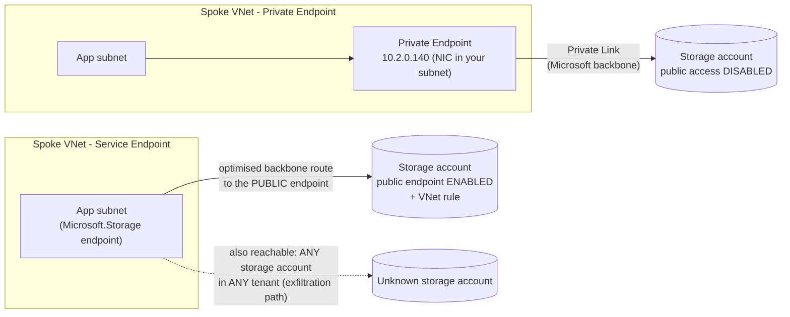
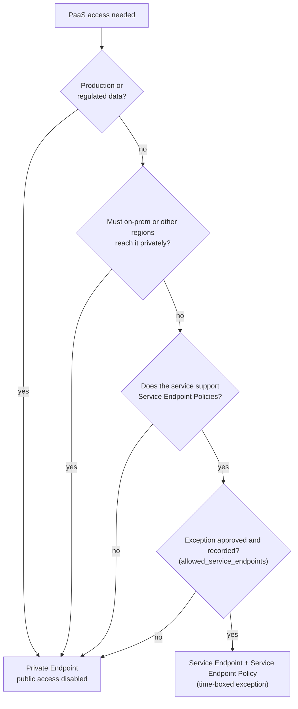

# 04 - PaaS Network Security: Private Endpoints vs Service Endpoints

> **Note**: This architectural reference framework and repository content were fully generated using **Claude Opus 5.5**.

> **Disclaimer**: This repository serves purely as an advanced theoretical and architectural reference framework incorporating the latest 2026 Microsoft Azure Landing Zone best practices. The code, Terraform manifests, and pipeline configurations provided herein **have not been physically deployed, executed, or tested in a live production environment**. Users should thoroughly validate, plan, and test all code in a sandbox environment prior to enterprise implementation.

---

> 🧭 **Navigation**: [🏠 Masterclass Portal](../README.md) | [⬅️ Previous: 03. Network Topology](03-networking-hubspoke-vs-vwan.md) | [➡️ Next: 05. CI/CD & Pipeline Security](05-cicd-oidc-security.md)

> 🎥 **Multimedia Sessions & Video Guides**:
> - 📽️ [**Azure Private Endpoints vs Service Endpoints: PaaS Network Security Blueprint**](https://www.youtube.com/watch?v=ppqHvYNkII4) (`8:30`, 🇬🇧 English CC 20+) — *PaaS isolation masterclass: Private Endpoints default standard vs Service Endpoints exceptions, DNS, and egress control.*
> - ⚡ [**Choosing Between Azure Private and Service Endpoints**](https://www.youtube.com/shorts/E1rnKNKWWUg) (`1:20`, 🇬🇧 English CC 20+) — *Architecture short on key decision criteria between Private Endpoints and Service Endpoints for data perimeter defense.*
> - ⚡ [**How Azure Private Endpoints Secure PaaS**](https://www.youtube.com/shorts/XDOoQBp12dk) (`1:19`, 🇬🇧 English CC 20+) — *Architecture short on assigning private RFC 1918 IPs and preparing for Azure's 2026 default outbound access retirement.*

---

## 1. Verdict

> [!IMPORTANT]
> **Private Endpoints are the non-negotiable default for enterprise production.** Service Endpoints are a documented, policy-approved exception - never a default.

This repository enforces the verdict with three controls:

| Control | Scope | Effect | Source |
|---|---|---|---|
| `Deny-Public-Endpoints` | `corp` | Denies public network access on PaaS services | ALZ Library |
| `Deploy-Private-DNS-Zones` | `corp` | DINE: Private Endpoint A-records land in central zones | ALZ Library |
| `Deny-Subnet-Service-Endpoints` (in `Wlz-Guardrails-2026`) | `landingzones` | Audit -> Deny service endpoints not on the approved list | [`policies/deny-subnet-service-endpoints.json`](../code/modules/workload-vending/policies/deny-subnet-service-endpoints.json) |

---

## 2. How each mechanism works

<strong>📊 Diagram: 2. How each mechanism works</strong> <em>(click to expand)</em>

**How to read this diagram:**

- **Top**: a Private Endpoint puts a private IP for one specific resource in the spoke, and the resource's public endpoint can be disabled.
- **Bottom**: a Service Endpoint only optimises the route to the service's **public** endpoint, which must stay enabled.
- The **dotted arrow** is the risk: with Service Endpoints the subnet can also reach any other instance of that service, including other tenants', unless Service Endpoint Policies restrict it.

- **Private Endpoint (Private Link)**: a NIC with a private IP from *your* subnet, mapped to **one specific resource** (or sub-resource such as `blob`). The service's public endpoint can be disabled entirely. Reachable from peered VNets, other regions and on-premises over ExpressRoute/VPN.
- **Service Endpoint**: the subnet gets an optimised route to the service's **public** endpoint; the source address seen by the service becomes the private VNet address so you can write VNet firewall rules. Nothing is assigned *to the resource* - the subnet can reach **every** instance of that service unless **Service Endpoint Policies** (supported only for a few services, e.g. Storage) restrict it.

---

## 3. Endpoint security matrix

| Dimension | Private Endpoints | Service Endpoints |
|---|---|---|
| **Transit path** | Private IP in your VNet -> Private Link -> resource; Microsoft backbone end-to-end | Subnet -> service **public endpoint** over the Microsoft backbone |
| **Public endpoint** | Can (and in corp *must*) be **disabled** | **Must remain enabled** (restricted by VNet rules) |
| **Granularity** | Per resource / sub-resource | Per service type for the whole subnet |
| **Cross-tenant / exfiltration risk** | Low: only mapped resources are reachable | **High** without Service Endpoint Policies: subnet reaches any tenant's instance ("shadow IT" path) |
| **On-premises & cross-region access** | Yes (via hub / ER / VPN) | No - only from the configured subnets in-region (some services allow paired region) |
| **DNS requirements** | `privatelink.*` zones (central), resolver/forwarders, on-prem conditional forwarding | None (public DNS name, public IP) |
| **Inspection capability** | Full: route PE traffic through Azure Firewall/NVA; NSGs and UDRs apply to PEs (`private_endpoint_network_policies = "Enabled"`) | Limited: traffic bypasses the hub firewall by design (service-tag routes); NSGs only by service tag |
| **Logging** | Firewall/NSG flow logs + resource logs | Resource logs only (source = VNet address) |
| **Cost** | Indicative ~USD 0.01 per endpoint-hour (~USD 7/month) + ~USD 0.01 per GB in and out | **Free** |
| **Operational complexity** | Higher: per-resource endpoints, DNS lifecycle, IP consumption | Low: a subnet property |
| **Compliance fit** | Meets "no public exposure" controls (PCI DSS, ISO 27001 network segmentation, DORA/NIS2 data-flow control, sovereign requirements) | Usually **insufficient** where controls require disabling public endpoints |
| **Multi-tenant boundary isolation** | Strong - mapped to a resource ID | Weak - service-wide |
| **Scale limits to watch** | PEs per VNet, IPs per subnet, records per zone | VNet rules per resource |

> [!CAUTION]
> Cost figures are **indicative** list prices for orientation; confirm in the Azure pricing calculator. At very high throughput (multi-PB/month), model the per-GB processing charge explicitly - it is the line item most often missed.

---

## 4. Decision flow

<strong>📊 Diagram: 4. Decision flow</strong> <em>(click to expand)</em>

**How to read this diagram:**

- Follow it **for each PaaS dependency**; almost every path ends in a Private Endpoint.
- A Service Endpoint is reached only for non-regulated data, no hybrid or cross-region need, a service that supports Service Endpoint Policies, **and** a recorded exception.
- The exception is implemented by adding the service to `allowed_service_endpoints`, which the Deny policy honours.

Legitimate exception examples: a non-production sandbox writing logs to a storage account where the cost per GB dominates; a service that has no Private Link support yet (verify before granting - coverage expands continuously).

---

## 5. Implementation in this repository

| Item | File |
|---|---|
| Spoke subnet dedicated to Private Endpoints (`/26`, NSG + UDR applied) | [`modules/workload-vending/main.tf`](../code/modules/workload-vending/main.tf) (`snet-private-endpoints`) |
| Central `privatelink.*` zones, resolver, firewall DNS proxy | [`modules/platform-landing-zone/main.tf`](../code/modules/platform-landing-zone/main.tf) (`private_dns_zones`, `private_dns_resolver`) |
| Policy defaults pointing DINE at the central zones | [`modules/platform-landing-zone/locals.tf`](../code/modules/platform-landing-zone/locals.tf) (`private_dns_zone_*`) |
| Exception path: direct zone links with `NxDomainRedirect` fallback | [`modules/workload-vending/dns.tf`](../code/modules/workload-vending/dns.tf) |
| Service Endpoint deny + approved list | [`policies/deny-subnet-service-endpoints.json`](../code/modules/workload-vending/policies/deny-subnet-service-endpoints.json), `allowed_service_endpoints` |

### Private Endpoint checklist for workload teams

1. Create the PE in `snet-private-endpoints` of your spoke - **do not** create `privatelink.*` zones in your subscription.
2. Set `publicNetworkAccess = Disabled` on the resource (corp policy will deny otherwise).
3. Wait for the DINE policy to create the A-record in the central zone (minutes), then test resolution from the spoke.
4. Request firewall application/network rules via PR if traffic crosses spokes or leaves Azure.

---

## References

- What is a private endpoint: <https://learn.microsoft.com/azure/private-link/private-endpoint-overview>
- Virtual network service endpoints: <https://learn.microsoft.com/azure/virtual-network/virtual-network-service-endpoints-overview>
- Service endpoint policies: <https://learn.microsoft.com/azure/virtual-network/virtual-network-service-endpoint-policies-overview>
- Private Link and DNS integration at scale (ALZ): <https://learn.microsoft.com/azure/cloud-adoption-framework/ready/azure-best-practices/private-link-and-dns-integration-at-scale>
- Azure Private Link pricing: <https://azure.microsoft.com/pricing/details/private-link/>
