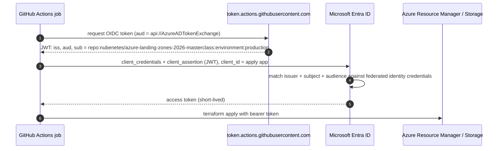
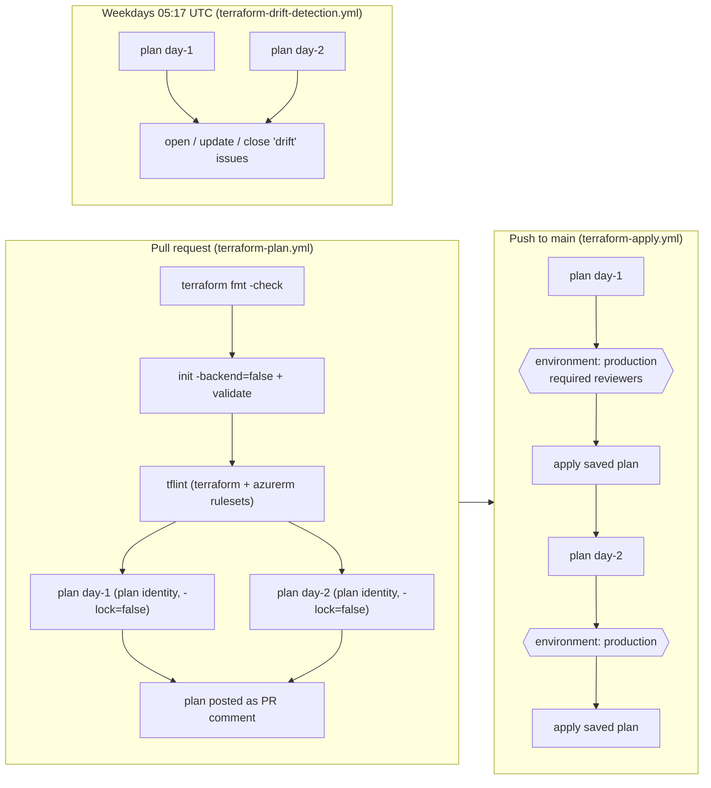

# 05 - CI/CD & Pipeline Security: GitHub Actions vs Azure DevOps, OIDC, Least Privilege

> **Note**: This architectural reference framework and repository content were fully generated using **Claude Opus 5.5**.

> **Disclaimer**: This repository serves purely as an advanced theoretical and architectural reference framework incorporating the latest 2026 Microsoft Azure Landing Zone best practices. The code, Terraform manifests, and pipeline configurations provided herein **have not been physically deployed, executed, or tested in a live production environment**. Users should thoroughly validate, plan, and test all code in a sandbox environment prior to enterprise implementation.

---

> 🧭 **Navigation**: [🏠 Masterclass Portal](../README.md) | [⬅️ Previous: 04. PaaS Network Security](04-security-private-vs-service.md) | [➡️ Next: 06. WAF & Policy Rollout](06-waf-simplicity-vs-security.md)

> 🎥 **Multimedia Sessions & Video Guides**:
> - ⚡ [**How Workload Identity Federation Replaces Stored Secrets**](https://www.youtube.com/shorts/0mdEib04nTw) (`1:16`, 🇬🇧 English CC 20+) — *Architecture short on eliminating long-lived client secrets in GitHub Actions pipelines using OpenID Connect (OIDC) and Entra ID.*

---

## 1. Principles

1. **No static secrets.** Every pipeline authenticates to Azure with **Workload Identity Federation (OIDC)**: a short-lived token from the CI platform is exchanged for an Entra ID access token. There is no client secret or certificate to leak, rotate or expire.
2. **Two identities, two trust boundaries.** A read-only *plan* identity for pull requests and drift detection; a privileged *apply* identity reachable **only** from a protected environment with human approval.
3. **The pipeline is part of the platform's attack surface.** Workflows, CODEOWNERS and action versions are reviewed like policy.
4. **Apply exactly what was reviewed.** The saved plan artifact is applied; a stale plan is rejected by Terraform.

---

## 2. GitHub Actions vs Azure DevOps (2026 feature matrix)

Both are supported by the official ALZ accelerator and both can run this repository's model. The matrix compares the capabilities that matter for **platform IaC**.

| Capability | GitHub Actions | Azure DevOps Pipelines |
|---|---|---|
| OIDC / workload identity federation | Native (`permissions: id-token: write`); subject encodes repo + ref / PR / environment | Native via **workload identity federation service connections** (secret-less ARM connections) |
| Deployment gating | **Environments**: required reviewers, wait timer, deployment branch/tag policies, custom protection rules | **Environments + Approvals and checks**: approvals, business hours, Azure Monitor/REST gates, **exclusive lock**, required template |
| Template governance | Reusable workflows + org **rulesets** (required workflows) | `extends` templates + **required template checks** - very strong central enforcement |
| Supply-chain controls | SHA pinning, Dependabot, artifact attestations, OIDC custom subject claims (`job_workflow_ref`) | Pipeline decorators, template checks, protected resources |
| Secret / code scanning | GitHub Secret Protection & Code Security (push protection, CodeQL) | GitHub Advanced Security for Azure DevOps |
| Private networking for runners | Larger runners with Azure private networking (VNet injection), or self-hosted | **Managed DevOps Pools** (VNet-injected, Microsoft-managed agents), or self-hosted |
| AI assistance | GitHub Copilot across PRs, code review and agents | Copilot in the IDE; platform features land in GitHub first |
| Work tracking | Issues / Projects | **Azure Boards** (rich enterprise portfolio management) |
| Ecosystem | Marketplace actions, `gh` CLI, open-source community | Extensions marketplace, deep Azure integration |
| Best fit | Code-centric platform teams, open-source style collaboration, GitHub-hosted repos | Enterprises standardised on Azure Boards/Repos, heavy template-based compliance |

> [!NOTE]
> This repository ships GitHub Actions workflows because it is hosted on GitHub. For Azure DevOps, keep the same structure: plan stage with a read-only WIF service connection, deploy stage bound to an environment with approvals and an exclusive lock, and `ARM_USE_OIDC=true` + `ARM_OIDC_AZURE_SERVICE_CONNECTION_ID` for the providers.

---

## 3. OIDC trust model implemented in Day 0



| Identity | Federated subjects (exact match) | Azure RBAC | State access |
|---|---|---|---|
| `sp-<prefix>-alz-cicd-plan` | `repo:<org>/<repo>:pull_request`, `repo:<org>/<repo>:ref:refs/heads/main` | `Reader` at the root parent MG | `Storage Blob Data Reader` on state containers (plans run with `-lock=false`) |
| `sp-<prefix>-alz-cicd-apply` | `repo:<org>/<repo>:environment:production` **only** | `Owner` at the root parent MG **with ABAC condition** | `Storage Blob Data Contributor` on state containers |

Why this matters:

- A pull request - even one that edits the workflow file - can only ever obtain the **plan** identity's token (subject `pull_request`). That identity cannot write to Azure or to state.
- The apply identity's only trusted subject is the **environment**, so a token is only issued after the environment's protection rules (required reviewers, `main`-only deployment branches) pass.
- Fork PRs receive no OIDC token at all with the `pull_request` trigger. Never switch plan workflows to `pull_request_target`.

### 3.1 The ABAC condition on the apply identity

`Owner` is needed because the ALZ module creates role assignments for policy managed identities. The Day 0 role assignment adds an Azure ABAC **delegation condition** (pattern recommended in the AVM ALZ module documentation):

```text
((!(ActionMatches{'Microsoft.Authorization/roleAssignments/write'}))
  OR (@Request[Microsoft.Authorization/roleAssignments:RoleDefinitionId]
      ForAnyOfAllValues:GuidNotEquals{<Owner>, <User Access Administrator>, <RBAC Administrator>}))
AND
((!(ActionMatches{'Microsoft.Authorization/roleAssignments/delete'}))
  OR (@Resource[Microsoft.Authorization/roleAssignments:RoleDefinitionId]
      ForAnyOfAllValues:GuidNotEquals{<Owner>, <User Access Administrator>, <RBAC Administrator>}))
```

Effect: the pipeline can assign `Contributor`, `Network Contributor`, `Log Analytics Contributor`... to policy identities and workload groups, but it **cannot mint or remove privileged owners**. Privileged human access is activated just-in-time through **Entra ID PIM**.

### 3.2 Further hardening (optional)

| Control | How |
|---|---|
| Bind tokens to *this* workflow file | Customise the repository's OIDC subject template to include `job_workflow_ref`, then update the federated credential subjects |
| Pattern-based subjects | `azuread_application_flexible_federated_identity_credential` (claims-matching expressions) - check GA status for your tenant |
| Private state access | Self-hosted or VNet-injected runners + Private Endpoint on the state account; set `state_storage_public_network_access_enabled = false` |
| Separate identities per stage | Duplicate the apply app per stack (platform vs vending) and scope the vending identity to the `landingzones` MG + billing scope |
| Conditional Access for workload identities | Restrict the apply service principal by location/risk (Entra Workload ID Premium) |

---

## 4. Pipeline anatomy



| File | Purpose |
|---|---|
| [`_reusable-terraform-stack.yml`](../.github/workflows/_reusable-terraform-stack.yml) | One stack: OIDC login, init with remote backend, plan (`-detailed-exitcode`), artifact, optional PR comment, environment-gated apply |
| [`terraform-plan.yml`](../.github/workflows/terraform-plan.yml) | PR validation for all stacks |
| [`terraform-apply.yml`](../.github/workflows/terraform-apply.yml) | Ordered deployment Day 1 -> Day 2, single concurrency group |
| [`terraform-drift-detection.yml`](../.github/workflows/terraform-drift-detection.yml) | Scheduled drift detection with issue automation |

### GitHub repository settings checklist

- [ ] Branch protection / ruleset on `main`: PR required, CODEOWNERS review, status checks `static-analysis` and plans required, no force-push.
- [ ] Environment `production`: required reviewers (platform team, not the PR author), deployment branches = protected branches only.
- [ ] `AZURE_APPLY_CLIENT_ID` stored **only** as an environment variable of `production`.
- [ ] Actions settings: allow only SHA-pinned / verified actions; default `GITHUB_TOKEN` permissions read-only.
- [ ] Dependabot enabled for `github-actions` and `terraform`.

---

## 5. Threat model summary

| Threat | Mitigation in this repository |
|---|---|
| Leaked long-lived credential | None exist - OIDC only; apps carry a note forbidding secrets |
| Malicious PR modifies workflow to deploy | PR tokens map to the read-only identity; apply identity trusts only `environment:production` |
| PR tampers with Terraform state | Plan identity has `Storage Blob Data Reader` only; PR plans run with `-lock=false` |
| Compromised pipeline grants itself owner | ABAC condition blocks Owner/UAA/RBAC-Admin assignment writes and deletes |
| Supply-chain attack via action tag move | Actions pinned to commit SHAs; Dependabot proposes reviewed bumps |
| Applying something different from what was reviewed | Saved plan artifact applied; stale plans rejected |
| Concurrent applies corrupt state | Single concurrency group + blob lease locking by the apply identity |
| State disclosure | Entra-only data plane (Shared Key disabled), CMK with rotation, versioning + soft delete, `CanNotDelete` lock |

---

## References

- Terraform `azurerm` OIDC authentication: <https://registry.terraform.io/providers/hashicorp/azurerm/latest/docs/guides/service_principal_oidc>
- GitHub OIDC with Azure: <https://docs.github.com/actions/security-for-github-actions/security-hardening-your-deployments/configuring-openid-connect-in-azure>
- Microsoft Entra workload identity federation: <https://learn.microsoft.com/entra/workload-id/workload-identity-federation>
- Azure ABAC conditions for role assignment delegation: <https://learn.microsoft.com/azure/role-based-access-control/delegate-role-assignments-overview>
- ALZ accelerator prerequisites (GitHub / Azure DevOps): <https://azure.github.io/Azure-Landing-Zones/accelerator/1_prerequisites/>
