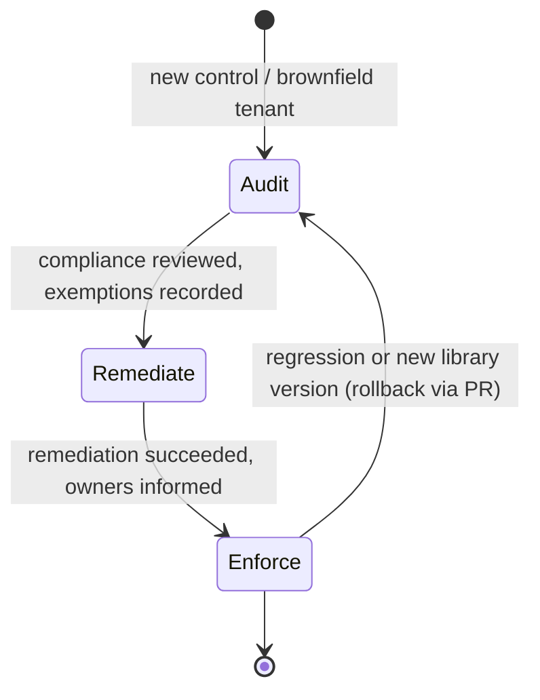

# 06 - Well-Architected Trade-offs & Policy Rollout Strategy (Audit -> Remediate -> Enforce)

> **Note**: This architectural reference framework and repository content were fully generated using **Claude Opus 5.5**.

> **Disclaimer**: This repository serves purely as an advanced theoretical and architectural reference framework incorporating the latest 2026 Microsoft Azure Landing Zone best practices. The code, Terraform manifests, and pipeline configurations provided herein **have not been physically deployed, executed, or tested in a live production environment**. Users should thoroughly validate, plan, and test all code in a sandbox environment prior to enterprise implementation.

---

> 🧭 **Navigation**: [🏠 Masterclass Portal](../README.md) | [⬅️ Previous: 05. CI/CD & Pipeline Security](05-cicd-oidc-security.md) | [📚 Documentation Index](../README.md#documentation-index)

> 🎥 **Multimedia Sessions & Video Guides**:
> - 📽️ [**Azure Management Groups & Governance: Core Engine Architecture**](https://www.youtube.com/watch?v=xh84QXkuYm8) (`8:41`, 🇬🇧 English CC 20+) — *Management group hierarchy, Policy-as-Code lifecycle (Audit -> Remediate -> Enforce), and Well-Architected Framework guardrails.*

---

## 1. Simplicity vs security - the honest trade-offs

Every guardrail has a cost in complexity, money or developer friction. The table records where this reference deliberately leans and how to dial it back.

| Decision | Security / reliability gain | Simplicity / cost price | Default here | Dial-down option |
|---|---|---|---|---|
| Private Endpoints by default | No public exposure, inspectable, compliant | DNS lifecycle, IP usage, ~USD 7/month per endpoint + per-GB | **On** (corp) | Approved service endpoints for non-prod (`allowed_service_endpoints`) |
| Azure Firewall **Premium** per hub | TLS inspection, IDPS, URL filtering | Highest firewall SKU cost | Premium | `firewall_sku = "Standard"` (or `Basic` for SMB hubs) |
| DDoS Network Protection plan | Mitigation + cost protection + rapid response | Significant fixed monthly cost per plan | On | `ddos_protection_plan = false` (the Modify policy is then set to DoNotEnforce automatically) |
| Separate subscription per workload per environment | Blast radius, RBAC and budget isolation | More subscriptions to vend (automated) | On | None recommended |
| Two pipeline identities + environment gate | No PR path to production | One more approval per change | On | Auto-approve only for `day-2` with a wait timer (not recommended) |
| ABAC-conditioned Owner for apply | Pipeline cannot escalate | ABAC condition to maintain | On | `apply_identity_rbac_condition_enabled = false` |
| CMK on state storage | Customer-controlled key, rotation | Key Vault Premium, HSM key, purge protection | On | Microsoft-managed keys |
| Sentinel on the central workspace | SIEM/SOAR | Ingestion cost | Off in code, on in example | Enable per tenant decision |
| Hub-and-spoke vs vWAN | Control vs managed transit | See docs/03 | Hub-and-spoke | `connectivity_type = "virtual_wan"` |

### Mapping to the five WAF pillars

| Pillar | How the landing zone contributes |
|---|---|
| **Reliability** | Zone-redundant firewalls (`zones = 1,2,3`), multi-region hubs with mesh peering, GZRS state, policy-driven backup (`Deploy-VM-Backup`) |
| **Security** | Zero-trust network (private subnets, firewall egress, PE-by-default), Defender for Cloud plans via policy, OIDC-only automation, ABAC, PIM |
| **Cost Optimization** | Budgets per vended subscription (actual 80 % and forecast 100 % alerts), cost-center tags, SKU dial-downs above, unused-resource audit (`Audit-UnusedResources`) |
| **Operational Excellence** | Everything as code, PR reviews with plan comments, drift detection, versioned ALZ Library, deterministic IPAM |
| **Performance Efficiency** | Regional hubs close to workloads, vWAN for global transit at scale, DNS resolution in-region |

---

## 2. Policy-as-Code lifecycle



| Phase | Deny policies | DeployIfNotExists / Modify | Remediation tasks | Exit criteria |
|---|---|---|---|---|
| **Audit** | `DoNotEnforce` (Day 1) / effect `Audit` (Day 2) | `DoNotEnforce` (Day 1) / effect `AuditIfNotExists` (Day 2) | None | Compliance dashboard reviewed; owners of non-compliant resources identified; exemptions created as code |
| **Remediate** | Still `DoNotEnforce` / `Audit` | Enforced / `DeployIfNotExists` | Created for existing non-compliant resources (`ExistingNonCompliant`, 10 % failure threshold, 10 parallel deployments) | Remediation success rate acceptable; no unexplained failures |
| **Enforce** | `Default` / `Deny` | Enforced | Continue as needed | Steady state; new controls restart at Audit |

### 2.1 Where the phase lives in code

| Stack | Variable | Mechanism |
|---|---|---|
| Day 1 (ALZ Library assignments) | `policy_enforcement_phase` | Toggles `enforcement_mode` on a curated list of Deny and DINE assignments through `policy_assignments_to_modify` ([`locals.tf`](../code/day-1-platform-landing-zone/locals.tf)) |
| Day 2 (custom guardrails initiative) | `policy_enforcement_phase` | Switches initiative effect parameters and creates `azurerm_management_group_policy_remediation` resources ([`policies.tf`](../code/day-2-workload-vending-operations/policies.tf)) |

> [!NOTE]
> Two different mechanisms are used on purpose. `enforcementMode = DoNotEnforce` is the only lever for ALZ Library assignments whose effect parameters differ per policy. For the custom initiative, explicit effect parameters make the phase visible in the compliance blade ("Audit" vs "Deny"), which auditors prefer.

### 2.2 Promotion is a pull request

```diff
- policy_enforcement_phase = "audit"
+ policy_enforcement_phase = "remediate"
```

The PR plan shows exactly which assignments change enforcement and which remediation tasks will be created. CODEOWNERS requires security review for policy-affecting paths.

### 2.3 Exemptions

- Prefer **narrow exemptions** (`azurerm_management_group_policy_exemption` / resource-level) with an `expires_on` date over removing assignments.
- Category `Mitigated` when a compensating control exists, `Waiver` otherwise - both reviewed via PR.
- Never exempt at the `alz` intermediate root.

---

## 3. Operational runbook - remediation failures

1. Open **Policy > Remediation** for `Wlz-Guardrails-2026` and inspect failed deployments (the deployment error is the root cause, not the policy).
2. Typical causes and fixes:

| Symptom | Cause | Fix |
|---|---|---|
| `AuthorizationFailed` on diagnostic settings | Assignment identity lacks `Log Analytics Contributor` on the workspace | Role assignment `guardrails_identity_workspace` missing or not yet propagated - re-run apply, then re-create the remediation |
| Defender pricing remediation fails | Subscription not registered for `Microsoft.Security` | Vending registers providers; for adopted subscriptions run `az provider register -n Microsoft.Security` |
| Flapping Defender settings | ALZ `Deploy-MDFC-Config` and the custom storage policy set different malware-scanning caps | Align `defender_storage_malware_cap_gb` with the ALZ parameter, or disable one |
| Deny blocks a legitimate deployment | Missing approved exception | Add an exemption or `allowed_service_endpoints` entry via PR; never toggle the whole phase back |

3. Re-trigger: re-run `terraform apply` for Day 2 (remediation resources are recreated if deleted) or start an ad-hoc remediation in the portal.

---

## 4. Simplicity guardrails for the platform team

- **Prefer the ALZ Library** over custom policy; every custom definition is code you own forever.
- **Change one lever at a time**: library ref, module version, or phase - never together in one PR.
- **Measure**: track compliance %, remediation success %, exemptions count and drift issues per month as platform KPIs.

---

## References

- Azure Well-Architected Framework: <https://learn.microsoft.com/azure/well-architected/>
- Azure Policy remediation: <https://learn.microsoft.com/azure/governance/policy/how-to/remediate-resources>
- Policy enforcement mode: <https://learn.microsoft.com/azure/governance/policy/concepts/assignment-structure#enforcement-mode>
- ALZ - modifying policy assignments (Terraform): <https://azure.github.io/Azure-Landing-Zones/terraform/howtos/modifyingpolicyassignments/>
- ALZ policy assignments reference: <https://azure.github.io/Azure-Landing-Zones/policy/policyassignments/>
