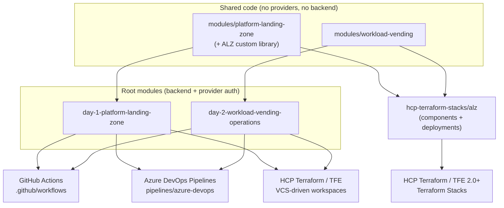
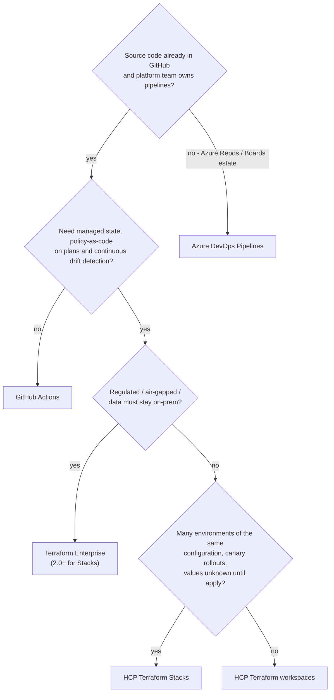

# 07 - Delivery Platforms: GitHub Actions, Azure DevOps, HCP Terraform, Terraform Enterprise & Terraform Stacks

> **Note**: This architectural reference framework and repository content were fully generated using **Claude Opus 5.5**.

> **Disclaimer**: This repository serves purely as an advanced theoretical and architectural reference framework incorporating the latest 2026 Microsoft Azure Landing Zone best practices. The code, Terraform manifests, and pipeline configurations provided herein **have not been physically deployed, executed, or tested in a live production environment**. Users should thoroughly validate, plan, and test all code in a sandbox environment prior to enterprise implementation.

---

## 1. Principle: one codebase, any delivery platform

The Terraform CLI is **not** the operating model. After the one-off Day 0 bootstrap, every change reaches Azure through a governed pipeline or platform run. The repository is structured so that the same code serves all of them:

**How to read this diagram:**

- **Top**: the two shared modules hold all logic and contain no provider or backend configuration.
- **Middle**: the two root modules add backend and authentication; the Stack adds components and deployments. Both reuse the same modules.
- **Bottom**: the root modules run on GitHub Actions, Azure DevOps or HCP Terraform / TFE workspaces; the Stack runs on HCP Terraform or Terraform Enterprise 2.0+.

| Delivery path | Entry point | State | Azure identity | Bootstrap |
|---|---|---|---|---|
| **GitHub Actions** | root modules | Azure Storage (Day 0, CMK, Entra-only) | GitHub OIDC -> plan / apply apps | `day-0-bootstrap-oidc` |
| **Azure DevOps Pipelines** | root modules | Azure Storage | WIF service connections `sc-alz-plan` / `sc-alz-apply` | `day-0-bootstrap-oidc` + `day-0-cicd-azure-devops` |
| **HCP Terraform workspaces** (SaaS) | root modules | HCP Terraform | Dynamic provider credentials (plan phase -> plan app, apply phase -> apply app) | `day-0-bootstrap-oidc` (`hcp_terraform`) + `day-0-cicd-hcp-terraform` |
| **Terraform Enterprise workspaces** (self-managed) | root modules | TFE | Same as HCP; issuer = your TFE hostname | same, with `hostname = "tfe.example.com"` |
| **Terraform Stacks** (HCP Terraform; TFE 2.0+) | `hcp-terraform-stacks/alz` | Per deployment, managed by the platform | `identity_token` per deployment -> apply app | same, with `delivery_model = "stacks"` |
| Local CLI | root modules | Azure Storage | Azure CLI login | Day 0 and break-glass only |

> [!IMPORTANT]
> Pick **one** delivery path per management group hierarchy. Two platforms managing the same resources with different state files will fight each other. Evaluating several side by side is fine only against separate hierarchies (e.g. the `canary-` hierarchy).

---

## 2. How the same root module authenticates everywhere

No credentials live in code. The root modules' provider blocks only set `use_oidc`, `client_id_file_path` and `oidc_token_file_path` when HCP Terraform / TFE injects `var.tfc_azure_dynamic_credentials`; everywhere else those arguments are `null` and the providers read the standard environment variables.

| Platform | What the platform provides | Variables set by the pipeline / platform |
|---|---|---|
| GitHub Actions | OIDC token endpoint (`permissions: id-token: write`) | `ARM_USE_OIDC`, `ARM_CLIENT_ID`, `ARM_TENANT_ID`, `ARM_SUBSCRIPTION_ID`, `ARM_USE_AZUREAD` |
| Azure DevOps | Service-connection OIDC (`AzureCLI@2`, `addSpnToEnvironment`) | `ARM_USE_OIDC`, `ARM_CLIENT_ID`, `ARM_ADO_PIPELINE_SERVICE_CONNECTION_ID` (+ `ARM_OIDC_AZURE_SERVICE_CONNECTION_ID` for AzAPI), `SYSTEM_ACCESSTOKEN`, `SYSTEM_OIDCREQUESTURI` |
| HCP Terraform / TFE workspaces | Token + client-ID files per run phase | `TFC_AZURE_PROVIDER_AUTH=true`, `TFC_AZURE_PLAN_CLIENT_ID`, `TFC_AZURE_APPLY_CLIENT_ID`, `ARM_TENANT_ID`, `ARM_SUBSCRIPTION_ID` (project variable set) |
| Terraform Stacks | `identity_token "azure"` block -> JWT input | Provider `config { use_oidc = true, oidc_token = var.identity_token, client_id = ... }` |

### Federated identity credentials (Entra ID trusts exactly these subjects)

| Platform | Issuer | Plan identity subjects | Apply identity subjects |
|---|---|---|---|
| GitHub Actions | `https://token.actions.githubusercontent.com` | `repo:<org>/<repo>:pull_request`, `repo:<org>/<repo>:ref:refs/heads/main` | `repo:<org>/<repo>:environment:production` |
| Azure DevOps | `https://vstoken.dev.azure.com/<org-id>` (from the service connection) | `sc://<org>/<project>/sc-alz-plan` | `sc://<org>/<project>/sc-alz-apply` |
| HCP Terraform / TFE workspaces | `https://app.terraform.io` or `https://<tfe-host>` | `organization:<org>:project:<project>:workspace:<ws>:run_phase:plan` | `organization:<org>:project:<project>:workspace:<ws>:run_phase:apply` |
| Terraform Stacks | same as above | - | `organization:<org>:project:<project>:stack:alz:deployment:<dep>:operation:plan` **and** `...:operation:apply` |

> [!NOTE]
> A Stack provider configuration has a single `client_id` for both operations, so Stacks cannot split plan and apply across two identities the way workspaces and pipelines do. The compensating control is the HCP Terraform approval on the production deployment (no auto-approve) plus the ABAC condition on the apply identity (docs/05). Stack subjects are limited to 127 characters; Day 0 validates this.

---

## 3. Feature matrix (platform IaC perspective, 2026)

| Capability | GitHub Actions | Azure DevOps Pipelines | HCP Terraform (workspaces) | Terraform Enterprise | Terraform Stacks |
|---|---|---|---|---|---|
| Hosting | SaaS (or GHES) | SaaS (or Server) | SaaS | Self-managed (on-prem / private cloud) | HCP Terraform; TFE 2.0+ |
| State management | You (Azure Storage, Day 0) | You (Azure Storage) | Managed, versioned, locked | Managed (your infrastructure) | Managed per deployment |
| Secret-less Azure auth | OIDC | WIF service connections | Dynamic provider credentials | Dynamic provider credentials | `identity_token` |
| Plan/apply identity split | Yes (subjects) | Yes (two service connections) | Yes (per run phase) | Yes (per run phase) | No (one per deployment) |
| Approvals | Environments (required reviewers) | Environment approvals + checks | Run confirmation (`auto_apply = false`), team permissions | Same | Manual by default; rule-based auto-approve via deployment groups (Premium) |
| Gate that YAML cannot bypass | Environment protection | Checks on environment **and** service connection | Workspace permissions | Same | Deployment group rules |
| PR plans | Workflow + PR comment | PR pipeline / branch policy | Speculative plans (VCS status check) | Same | Speculative plans |
| Drift detection | Scheduled workflow (this repo) | Scheduled pipeline (this repo) | Health assessments (continuous drift + validation) | Health assessments | Check current HCP Terraform docs for Stacks drift capabilities |
| Policy-as-code on plans | Add tools (Checkov, Conftest) | Add tools | Sentinel / OPA policy sets | Sentinel / OPA | Policy support evolving - check current docs |
| Orchestration Day 1 -> Day 2 | `needs:` between jobs | Stage `dependsOn` | Run triggers + remote state sharing | Same | Native component dependencies + **deferred changes** |
| Multi-environment rollout | Jobs / environments | Stages / environments | One workspace per environment | Same | **Deployments** of one configuration (canary -> production) |
| Private networking | Larger runners with Azure VNet injection, self-hosted | Managed DevOps Pools, self-hosted | Self-hosted HCP agents | Native | Self-hosted agents |
| Private module registry | GitHub Packages / git tags | Azure Artifacts / git tags | Yes | Yes | Yes |
| Licensing model | Minutes / seats | Parallel jobs / seats | Resources under management (RUM) tiers | RUM-based licensing | RUM; counted like workspaces |

### When to choose what

**How to read this diagram:**

- Start from **where the code and pipelines already live**: an Azure Repos / Boards estate points to Azure DevOps.
- Need managed state, policy checks on plans and continuous drift detection? Move from GitHub Actions to **HCP Terraform** or **Terraform Enterprise** (self-managed when data must stay on-premises).
- Choose **Stacks** when the same configuration is rolled out to many environments (canary -> production) or values are only known after apply.

---

## 4. Terraform Stacks in this repository

| Element | Implementation |
|---|---|
| Components | `platform` (modules/platform-landing-zone) -> `workloads` (modules/workload-vending), dependency inferred from `component.platform.*` |
| Deployments | `canary` (isolated `canary-` management group hierarchy in the same tenant, cheap SKUs, policy phase `enforce`) and `production` |
| Deployment groups | `canary` with `deployment_auto_approve` rules: no destroys and applyable plan (HCP Terraform Premium). `production` uses the default group = manual approval |
| Identity | `identity_token "azure"` (audience `api://AzureADTokenExchange`) passed to every provider instance |
| Library | `alz` provider reads the custom library through a go-getter `git::` URL (pin `?ref=` to a release tag) |

Status in 2026: Terraform Stacks became **generally available on HCP Terraform** (announced at HashiConf, September 2025; CLI 1.13+), and **Terraform Enterprise 2.0** (April 2026) introduced Stacks for RUM-based licences, with Kubernetes/OpenShift fixes in 2.0.1 and proxy fixes in 2.0.6. Deployment groups and auto-approve checks are HCP Terraform **Premium** features.

> [!WARNING]
> The Stack passes `terraform stacks validate` in CI but has never been deployed. Generate and commit `.terraform.lock.hcl` (`terraform stacks providers-lock`) before connecting it.

---

## 5. Recommended rollout

1. **Day 0 (local, once):** state storage + plan/apply apps + federated credentials for the chosen platform(s).
2. **Platform bootstrap (local, once):** `day-0-cicd-azure-devops` or `day-0-cicd-hcp-terraform` (GitHub Actions needs only the `gh` commands printed by Day 0).
3. **Everything else through the platform:** Day 1 and Day 2 changes are PRs; applies are approved in the platform; drift is detected by the platform.
4. **Migration later is cheap:** the modules do not change. Moving from GitHub Actions to HCP Terraform workspaces = `terraform state push` (or HCP state migration) into the new workspaces; moving to Stacks = import into deployments (plan carefully - Stacks deployments own their state).

---

## References

- Terraform Stacks overview & GA (HashiConf 2025): <https://www.hashicorp.com/blog/scale-infrastructure-with-new-terraform-and-packer-features-at-hashiconf-2025>
- Stacks `identity_token` block and subject format: <https://developer.hashicorp.com/terraform/language/block/stack/tfdeploy/identity_token>
- Stacks `deployment_group` block: <https://developer.hashicorp.com/terraform/language/block/stack/tfdeploy/deployment_group>
- Terraform Enterprise 2.0.x release notes (Stacks): <https://developer.hashicorp.com/terraform/enterprise/releases/2.0.x>
- HCP Terraform dynamic provider credentials for Azure: <https://developer.hashicorp.com/terraform/cloud-docs/dynamic-provider-credentials/azure-configuration>
- AzureRM provider OIDC guide (GitHub Actions and Azure DevOps): <https://registry.terraform.io/providers/hashicorp/azurerm/latest/docs/guides/service_principal_oidc>
- `azuredevops_serviceendpoint_azurerm` (workload identity federation): <https://registry.terraform.io/providers/microsoft/azuredevops/latest/docs/resources/serviceendpoint_azurerm>
