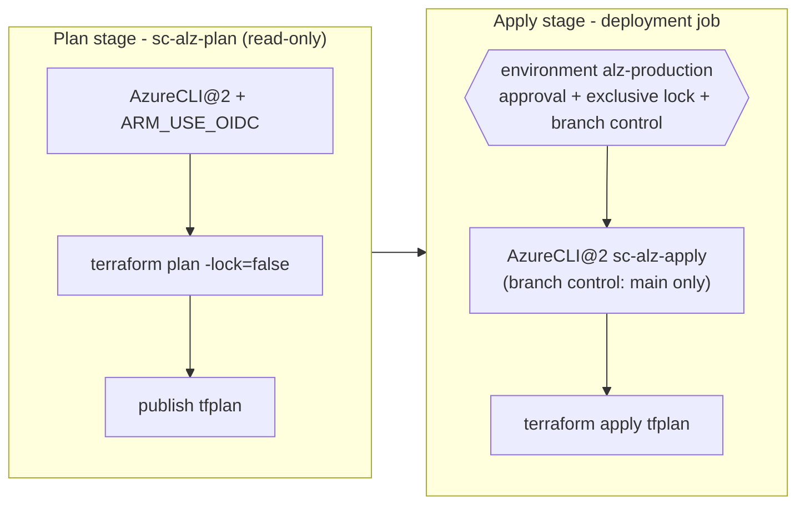

# Azure DevOps Pipelines

> **Note**: This architectural reference framework and repository content were fully generated using **Claude Opus 5.5**. Untested reference - see the [disclaimer](../../README.md).

YAML pipelines that run the same root modules as the GitHub Actions workflows, authenticated with **Workload Identity Federation** service connections (no secrets). Created and wired by [`code/day-0-cicd-azure-devops`](../../code/day-0-cicd-azure-devops).

| File | Trigger | Does |
|---|---|---|
| `alz-pr-validation.yml` | PR to `main` (GitHub) / branch policy (Azure Repos) | fmt, validate, tflint for every stack; read-only plans of Day 1 and Day 2 |
| `alz-apply.yml` | Push to `main` (Day 1/Day 2/modules paths) | Plan -> environment approval -> apply saved plan, Day 1 then Day 2 |
| `alz-drift-detection.yml` | Weekdays 05:17 UTC | Read-only plans; fails with warnings when Azure differs from `main` |
| `templates/terraform-stack.yml` | - | Plan stage (`sc-alz-plan`, `-lock=false`) + optional deployment-job apply stage (`sc-alz-apply`) |
| `templates/install-terraform.yml` | - | Pinned Terraform with SHA256 verification (no Marketplace extension) |

Environment variables used by the providers and the `azurerm` backend:

| Variable | Value |
|---|---|
| `ARM_USE_OIDC` | `true` |
| `ARM_CLIENT_ID` | `$servicePrincipalId` (from `addSpnToEnvironment`) |
| `ARM_TENANT_ID`, `ARM_SUBSCRIPTION_ID` | variable group `alz-iac` |
| `ARM_ADO_PIPELINE_SERVICE_CONNECTION_ID` / `ARM_OIDC_AZURE_SERVICE_CONNECTION_ID` | service connection ID (AzureRM / AzAPI) |
| `SYSTEM_ACCESSTOKEN`, `SYSTEM_OIDCREQUESTURI` | `$(System.AccessToken)`, `$(System.OidcRequestUri)` |
